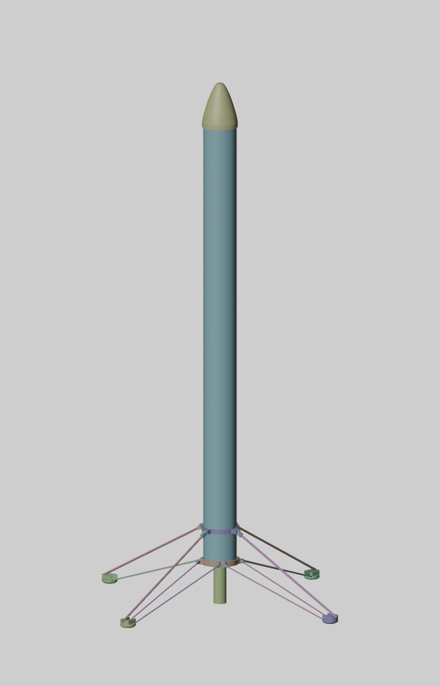

# Kartonaut – Projektdatei

Die zentrale Übersicht über das Raketenprojekt: was es gibt, wo es liegt, wie weit es ist
und was als Nächstes kommt. **Bei jedem Arbeitsschritt hier den Fortschritt und das
Änderungsprotokoll nachtragen.**

Stand: 2026-10-22

## 1. Ziel

Eine Modellrakete mit Schubvektorsteuerung (TVC), aufgebaut nach dem Vorbild von BPS.space
„Scout F“. Sie fliegt mit kardanisch aufgehängtem Motor, Rollregelung über ein Schwungrad
bzw. einen Rollmotor, Fallschirmbergung und Landebeinen. An Bord sitzt ein selbst
programmierter Flugcomputer (Teensy 4.1) mit Funk-Telemetrie zur Bodenstation.

## 2. Eckdaten (Ist-Stand aus Modellen und Code)

| Größe | Wert | Quelle |
|---|---|---|
| Rumpf | Klima-Rohr Ø 75 mm außen, **72,6 mm innen**, 120 g je 0,5 m; 1000 mm lang (2× 0,5 m + Kuppler 72,4/70,2 × 150 mm) | Bestellungen Klima/SRT 2025, `docs/BUILD.md` §1 |
| Spitze | Klima-Kunststoffspitze 75 mm (Artikel 8539), lose aufgesteckt, Fallschirm darin; ersetzt die gedruckte, federgelagerte Spitze (Ø 80 mm, 99 mm) aus `rocket nose.blend` | Klima 23.10.2025, Jan 21.10.2026 |
| Motor | **TSP E12-0** (24 mm, 39 Ns, 28 g Treibstoff, 64 g, Brennschluss 3,55 s, ohne Ausstoßladung), 4 Stück vorhanden, im 29→24-mm-Adapter. Die E12-Schubkurve der Simulation ist diese TSP-Kurve; F35 liegt daneben. | SRT 28.04.2025, thrustcurve.org, `TVC.blend`, MATLAB `6DOF_model` |
| Masse | 981 g im Massenmodell (ein Motor, Landesystem 200 g, zwei Akkus, Kolben-Ausstoß); Budget vom Juni 2025 war 902 g. Gewogen ist noch nichts. | `cad/mass_properties.md`, `Gewicht.csv` |
| TVC | Kardan mit 2× SG90 (Servofenster Yaw 70–115°, Pitch 60–105°). Ersatz bestellt: FrSky Xact W5652H (10 g, 3,7–8,4 V, Hall-Sensor, 15-Zahn-Abtrieb), Kardan muss dafür angepasst werden. | `dual_tvc.blend`, `Control.cpp`, `docs/Plan_2026-10-21.md` §2.2 |
| Hebelarm TVC–Schwerpunkt | 0,37 m im Massenmodell (Start), 0,38 m bei Brennschluss; Firmware und Simulink rechnen noch mit 0,30 m | `cad/mass_properties.md`, `Config.h`, `TVC6DOF.m` |
| Trägheitsmomente | Ixx = Iyy = 0,110 kg·m², Izz = 0,0011 kg·m² (Start). Die Simulation hatte 0,1 auf allen Achsen, das Roll-Moment ist also hundertmal kleiner. | `cad/mass_properties.json` |
| Flugcomputer | Ring-Stack Ø 69 mm, 8 M2-Stangen, **im Kuppler (innen 70,2 mm)**, als Modul herausziehbar. Mainboard rev B als Längs-Schlitten 54 × 120 mm | `flight_computer.blend`, `hardware/mainboard/` |
| Akku | **Zwei Akkus (entschieden 21.10.2026):** 2S LiPo für Servos, Rollmotor und Pyro; 1S LiPo für Teensy, Sensorik, Funk und GPS über einen Buck-Boost. Ein zweipoliger Hauptschalter schaltet beide. | `docs/Plan_2026-10-21.md` §2.5, `flight_computer.blend` („Battery 7.4V“) |
| Funk | HC-12 (433 MHz), 9600 Bd in der Firmware; rev B: LoRa E22-400T22S | `Config.h`, `Radio_test.cpp`, `hardware/mainboard/README.md` |
| Schnittstellen rev B | Alle Flugsensoren an SPI1 (IMU, Barometer, INA239), I²C nur für Erweiterungen; Servos alle am 2S-Akku; Laden in der Rakete (1S über USB-C-Lader auf der Platine, 2S über Ladebuchse) | `hardware/mainboard/Komponenten_2026-10-22.md` |

## 3. Wo liegt was

| Bereich | Ort | Inhalt |
|---|---|---|
| Flug-Firmware | `firmware/` (dieses Repo) | PlatformIO, Teensy 4.1. `src/` ist modular: main, Config, Sensors, KalmanZ, Control, SDLogger, Timing, Indicators. `examples/` enthält Test-Sketches als eigene PlatformIO-Umgebungen (Funk-Beacon, I²C-Scan, Pyro-MOSFET). Die alten Monolithe (`sketches/`) sind seit dem 20.10.2026 nur noch in der Git-Historie (bis Commit `3b152c9`). Doku: `firmware/README.md`. |
| Bodenstation | `kartonaut-ground/` | Eigenes Repo (`git.rwth-aachen.de:jan_philipp.munsch/space`), hier per `.gitignore` ausgeklammert. Arduino Nano mit HC-12-Empfänger, MPU6050-Test, Fan-ESC-Test. |
| Mainboard | `hardware/mainboard/` | Spezifikation rev B (`README.md`), Bestellplan mit Teilestatus, Toren und Kosten (`ORDER.md`), Umriss-DXF, Platzierungsplan, Abbildungen (`figures.py` → `img/`). Design Guide mit Abbildungen für Review und GitHub: `docs/DesignGuide_Mainboard_revB.md` (+ PDF, `docs/build_design_guide.py`). **Datenblatt** im Industrieformat: `hardware/mainboard/datasheet/MS-MB-B.pdf` (LaTeX, `build.py`; Stückliste aus `kicad/circuit.py` über `make_bom.py`). Rev A: `rev_a_2026-10-15.md`, Review: `docs/Plan_2026-10-21.md` §2 |
| Baudokumentation | `docs/BUILD.md` | Inventar (Bestellungen, Elektronik, Drucke), Mechanik, Verdrahtung as-built, Software-Stand, Tests, Bautagebuch, Regeln. Angelegt 21.10.2026, viele `[?]` |
| Planung 21.10.2026 | `docs/Plan_2026-10-21.md` | Platinen-Review mit Kosten, Portierung der Simulation nach Python, Baudokumentation, offene Fragen |
| Elektronik-Notizen | `eLab/` (lokal, per `.gitignore` ausgeklammert) | OneNote-Abschnitt (HC-12-Modul, 14.10.2025) |
| Simulation | `simulation/` (dieses Repo, seit 21.10.2026) | Python-Paket `tvcsim`: 1:1-Port des Simulink-6DOF (Dynamik, Schub, Rauschen, Regler, Servo-PT2), zweiter Regler wie `Control.cpp`, Monte-Carlo, PID-Raster, Servo-Fit, 21 Tests. Doku: `simulation/README.md`. Das MATLAB-Original `6DOF_model` bleibt lokal (Simulink, `tf5.mat`, Sprungantworten). |
| Simulation (Vorlage) | lokal, MATLAB-Projekt `BPS_TVC` (nicht im Repo) | MathWorks-Beispiel „simpleTVCRocketModel“ |
| CAD (eigen) | `cad/` (dieses Repo, seit 21.10.2026) | Parametrisches CadQuery-Modell (`params.py`, Module Rumpf/Kardan/Flugcomputer/Kolben/Beine, `build.py` mit STEP/STL-Export, Kollisionsprüfung und Renderbildern), Massenmodell `mass_model.py` → `mass_properties.md/.json`, Inventur der Blender-Dateien `blender_inventory.md`. Doku: `cad/README.md` |
| CAD (Blender, abgelöst) | lokal, Blender-Dateien (nicht im Repo) | `model_rocket` (Gesamtmodell), `flight_computer` (+ `_obj`), `TVC`, `TVC_V2`, `Inner_gimbal(_V2)`, `dual_tvc`, `inner/outer_gimbal_dual_TVC`, `LegConnectors`, `rocket nose`, `flywheel(V2)`, `untitled`/`test123` (Gimbal-Zwischenstände) |
| CAD/Doku (fremd) | lokal, Ordner „Space Mission“ (nicht im Repo) | BPS.space Scout F STEP/OBJ (TVC, Beine, Reaction Wheel, Throttle), BPS-Blip-Platine (Schaltplan, Layout, Code), Piston-Ejection-Bulkheads, `battery7.stl`, `Gewicht.csv`, `Übersicht.ods` (Strombudget) |

Die Blender-Dateien sind in Millimetern modelliert, obwohl die Szene auf „Meter“ steht.
`docs/render_blend.py` rendert eine Ansicht aus einer .blend-Datei, so ist `docs/img/model_rocket.png` entstanden.

## 4. Fortschritt

Status: ✅ fertig · 🟡 in Arbeit · ⬜ offen

| # | Arbeitspaket | Status | Stand / Nachweis |
|---|---|---|---|
| 1 | Konzept, Massen- und Strombudget | ✅ | `Gewicht.csv` (Juni 2025), `Übersicht.ods` (März 2025) |
| 2 | 6DOF-Simulation und PID-Auslegung | 🟡 | MATLAB (Mai/Juni 2025) nach Python portiert (21.10.2026, `simulation/`). Ergebnis: Firmware-Gewinne stabilisieren, Tuner-Gewinne schwingen (Befund 11). Offen: `tf5` aus MATLAB exportieren, W5652H vermessen (**Experiment E01 vorbereitet, 22.10.2026**: `docs/experiments/E01_servo_ident.md`, Sketch `servo_ident`, Auswertung `ident_servo.py`), Trägheitsmomente aus `cad/`. |
| 3 | TVC-Kardan (CAD) | 🟡 | Mehrere Generationen bis `dual_tvc` (Juni 2025), seit 21.10.2026 parametrisch in `cad/tvc.py` mit W5652H-Taschen, Gegenlager und Ringspiel für ±7°. Druck- und Funktionstest nicht dokumentiert; Servo-Datenblatt (Wellenlage) prüfen. |
| 4 | Rumpf, Spitze, Landebeine (CAD) | 🟡 | `model_rocket.blend` (Juni 2025), seit 21.10.2026 parametrisch in `cad/` mit Klima-Rohr, Kuppler, Klima-Spitze, Kolben und Beinen. Carbonstäbe für die Beine gekauft (2× 5 mm, 4× 3 mm, je 1 m; Conrad Juni 2025). Offen: Einklappmechanismus der Beine. **Erstflug-Konfiguration (CAD, 22.10.2026, `config="erstflug"`):** ohne Beine, 2S 450 mAh, Platine 54 × 120; Rohr **500 + 200 mm** (Klima-Länge 500; Stoß im Fallschirmraum mit 80-mm-Kupplerstück; kürzestes passendes 675 mm: Kardan, Schlüsselschalter-Kragen, Kuppler 150, Kolben, Schirm 125 cm Ø 60 × 230, 50 mm Schnurraum bis zur Öse der Spitze) → **761 g** beim Start (755 g bei 675 mm), **Ziel 750 g um 11 g verfehlt** (Hebel in `cad/mass_properties.md`), Schwerpunkt 318 mm, **Hebelarm Kardan–Schwerpunkt nur 0,242 m** (voll: 0,372), Ixx = Iyy = 0,046, Izz = 0,0006 kg·m². Kollisionsprüfung ±7° frei, Kolbenbohrung frei (Kolbenabstand 5 → 11 mm, die Ladungsschale ragte in die Kolbenplatte). Zweite Prüfung 22.10.: erster Entwurf (131 + 569 mm, 719 g) war nicht herstellbar und rechnete Stangen und Schlüsselschalter zu leicht; korrigiert. Werte: `cad/mass_properties.md`. |
| 5 | Bergung (Piston Ejection) | 🟡 | Entschieden 21.10.2026: Pyro-Ausstoß, Kolben aus einem Kuppler, Fallschirm in der Klima-Spitze. Pyro-Tests mit ca. 1 g Schwarzpulver erfolgreich. Fallschirm (125 cm), Kevlar- und Gummischnur gekauft. Pyro-Logik in der Firmware fehlt. |
| 6 | Flugcomputer-Mechanik (Ring-Stack) | 🟡 | `flight_computer.blend` (13.10.2025), `battery7.stl`. Seit 22.10.2026 im CAD für den Erstflug: Luke A (+y, Fenster 14 mm, Stangenlücke 12 mm, v 16–115) für Teensy-USB, SD und Programmiertaste; Luke B (−y) mit Schalterbrett für Schiebeschalter, USB-C mit LED, XT30 und XH-3; der **Schlüsselschalter** (Ø 12) passt nicht zwischen die Stangen und sitzt in einem Kragen unter dem Kuppler (Bohrung im unteren Rohr). Kuppler ganz im unteren 500-mm-Rohr, je drei M2 bei 45°/135°/225° oben und unten geben die Lage vor. Renders `docs/img/cad/hatches_*.png`. |
| 7 | Sensorik: IMU (DMP), Barometer, INA219 | ✅ | `Sensors.cpp` (Okt. 2025) |
| 8 | Höhenschätzung (Kalman z/vz) | ✅ | `KalmanZ.cpp`, Commit „kalman filter optimization“ |
| 9 | SD-Logger (Binär → CSV) | ✅ | `SDLogger.cpp`, Commit „Logger Implementation“ |
| 10 | Regler Pitch/Yaw und Roll | 🟡 | Commit „Controls under control“ (21.10.2025). Seit 22.10.2026 nachts: Reglergleichungen in `ControlLaw.*` ohne Hardware, Software-in-the-Loop gegen `tvcsim` identisch (Branch `firmware/flight-core`); Regelfehler aus der Gyro-Quaternion statt `rot_deg += ω·dt` (Befund 3 erledigt); Servos als 16-Bit-PWM mit `SERVO_FRAME_HZ`. In `Config.h` sind beide aus. Prüfstand (E02) und Flugtest stehen aus. |
| 11 | Funkstrecke HC-12 | 🟡 | Beacon-Test Teensy → Nano (Okt. 2025). **Telemetrieprotokoll definiert (22.10.2026 nachts, `firmware/src/Telemetry.h`):** Rahmen A5 5A mit CRC-16/CCITT, TLM 16 Byte bei 10 Hz, EVT bei jedem Zustandsübergang, ACK, Kommandos PING/CALIBRATE/PAD_READY/ABORT/SAFE. Die Bodenstation übernimmt die Datei; Funktest offen. |
| 12 | GPS | ⬜ | Nur ein früherer Testsketch (TinyGPSPlus-Beispiel, Git-Historie bis `3b152c9`) |
| 13 | Flugzustandsautomat (Pad → Boost → Coast → Apogäum → Bergung → Landung) | 🟡 | **Geschrieben und ohne Hardware getestet (22.10.2026 nachts, Branch `firmware/flight-core`):** `FlightState.*` mit SAFE → PAD_READY → BOOST → COAST → APOGEE → DESCENT → LANDED und ABORT, Schwellen in `Config.h`, Ereignisse mit Zeitstempel; Pyro-Logik `Pyro.*` (Zustand, Flugzeit, ARM, Durchgang; auf Breakouts gesperrt); Watchdog 250 ms und Zustandsspeicher in DMAMEM für die Wiederaufnahme nach einem Neustart; Sensoren hinter einer Schnittstelle mit Rückenden für Breakouts (ICM-20948 roh) und rev B; 32 native Tests (`pio test -e native`), darunter die Zustandsfolge auf dem simulierten Flug. Nicht am Gerät gelaufen. |
| 14 | **Mainboard rev B (Platine statt Breakouts)** | 🟡 | Rev A spezifiziert 15.10.2026 (Längs-Schlitten 54 × 120 mm, Akku im Träger darunter). Rev B entschieden 21.10.2026: zwei Akkus (1S Elektronik über TPS63070, 2S Aktoren und Pyro), ICM-42688-P an SPI1, BMP390, LoRa E22-400T22D, W5652H direkt am 2S, 20-mΩ-Shunt, beide Pyro-Kanäle → `hardware/mainboard/README.md`. 21.10. abends: Design Guide (`docs/DesignGuide_Mainboard_revB.md`, PDF) mit Blockschaltbild, Versorgungsbaum, Pyro-Kanal, Pinbelegung, Einbau-Längsschnitt; Bestellplan `hardware/mainboard/ORDER.md` (Vorab-Bestellliste, Tore, JLCPCB-Parameter, LCSC-Status: BMP390 zuletzt ohne Bestand → BMP388 pinkompatibel, TPS63070 schwankt, ca. 8–10 Extended-Typen; Platinenlauf ca. 120–180 €). **KiCad-Projekt** (`hardware/mainboard/kicad/`, KiCad 10.0.6 als Benutzerinstallation): Schaltung als Code in `circuit.py` (134 Bauteile, 89 Netze), Schaltplan mit 7 Blättern erzeugt, **ERC 0 Fehler / 0 Warnungen**, PDF in `kicad/out/`; Platinen-Generator mit Umriss, 4 Lagen, Netzklassen und Sperrflächen, Platzierung im Entwurf (12 Überschneidungen, 9 Teile ohne Platz), Routing vorbereitet. Als Nächstes: Platzierung, Routing, DRC, Fertigungsdaten, Review durch Kollegen, Vorab-Bestellung (ORDER §1). Details `kicad/README.md`. **Nachts 21.10.:** Platine komplett platziert und geroutet (1620 Segmente, 231 Vias, DRC 0 Fehler, 3 offene Verbindungen, Renders in `kicad/img/`). **Zweitmeinung-Review** `hardware/mainboard/review_kicad_2026-10-21.md`: Schaltung gegen Datenblätter (TPS63070, TPS563201, DS-000347, Ebyte) und Layout gegen Spezifikation; acht A-Punkte vor der Bestellung (Buck-Boost-Ausgangskapazität 1066 statt max. 470 µF, 1S-Abschaltung bei 3,01 V im Flug, Hauptschalter im Strompfad über JST-PH, Sicherung je Akku, Kelvin-Shunt, 2S-Netze auf In2 an der IMU vorbei, VSYS_IN 0,25 mm, 5V_SERVO 0,15 mm), dazu B/C-Vorschläge (BMP390 an SPI, Summer auf Pin 37, LED-Kette, Polymer-Elkos, vier Pyro-Kanäle für die Landung, Logo). Fertiger entschieden (`Fertiger_2026-10-21.md`): JLCPCB Economic, Aisler als Rückfall; BMP390 bei LCSC nicht lieferbar, BMP388 auf Lager. Bestellliste nach Händlern in `ORDER.md` §7. Als Nächstes: A-Punkte in `circuit.py` und `gen_pcb.py`, neu erzeugen, Gerber/BOM/CPL. |
| 15 | Bodentests (TVC-Prüfstand, Pyro-Test, Funkreichweite) | 🟡 | **Experimente als Paket** (`docs/experiments/README.md`, seit 22.10.2026): je Versuch ein Sketch unter `firmware/examples/`, ein Auswerteskript unter `simulation/scripts/` und eine Anleitung. E01 Servo → Kardan ist fertig vorbereitet und wartet auf den Lauf am alten Kardan (SG90), danach W5652H. **TVC-Prüfstand (Idee Jan, Teile seit Juni 2025 da):** Die Rakete hängt dreh- und schwenkbar in einem Gestell, der Drehpunkt liegt im Schwerpunkt. An Stelle des Raketenmotors sitzt ein Brushless-Motor Racerstar BR2814 (1000 KV, Ø 28 mm, passt in den 29-mm-Adapter) mit 11×7- oder 12×6-Propeller im Kardan, ESC 60 A, 4S-LiPo. Der Propeller liefert bei 4S über 15 N, die 12 N des E12 also bei Teilgas; der Teensy kann das Gas über einen freien PWM-Pin fahren und sogar die E12-Schubkurve nachfahren. Damit lässt sich die Lageregelung mit echtem Schubvektor testen, ohne Treibsatz. Zu beachten: Das Reaktionsmoment des Propellers dreht die Rakete um die Rollachse (Rollregler testen oder Rollachse im Gestell sperren), der Beschleunigungssensor sieht im Gestell nur g (die Firmware rechnet `M = l·m·|a|·sin δ` dann mit |a| = g, also wie bei 1 g Schub), Propellerschutz und Abstand sind Pflicht. **Gestell konstruiert (21.10.2026, `cad/testrig.py`):** Sperrholzplatte, zwei Alu-Stützen mit 608-Lagern, Rahmen 20 × 20 auf Achsstummeln (Nicken), zweiteiliger Klemmkragen am Schwerpunkt mit Zapfen in Lagerböcken (Gieren, Rollen gesperrt), Prop-Adapter mit Ø-29-Zapfen und Motorflansch, Schutzkäfig am Rohr; Kollisionsprüfung bei ±20° Rig und ±7° Kardan frei. Bilder `docs/img/cad/testrig*.png`, STEP `cad/export/testrig.step`. Offen: Gurt-Anschläge, Kabel, Gas-Ausgang in der Firmware, BR2814 nachmessen. Pyro-Test mit ca. 1 g Schwarzpulver erfolgreich. Funkreichweite offen. |
| 16 | Erstflug | ⬜ | Entschieden 21.10.2026: erst geregelter Aufstieg mit einem Motor und Fallschirm; Landung mit zweitem Motor danach. |

## 5. Befunde aus der Durchsicht vom 15.10.2026

Das ist beim Einlesen aufgefallen. Was die Aufräumrunde vom 20.10.2026 davon erledigt hat, steht beim jeweiligen Punkt in eckigen Klammern.

1. **Masse uneinheitlich:** `Config.h` rechnet mit `MASS_KG = 0.70`, die Simulation mit 0,94 kg, `Gewicht.csv` mit 902 g. Die Masse geht direkt in den TVC-Winkel ein (`asin(M / (l·m·|a|))`).
2. **Reglerparameter weichen von der Simulation ab:** Die Firmware nutzt für Pitch/Yaw Kp = 5, Ki = 0, Kd = 1 auf skalierten Grad. `pid_tuner.m` hat zuletzt Kp = 3,1, Ki = 5, Kd = 0,385 gesucht. Die Einheiten beider Seiten sind noch nicht abgeglichen.
3. **Lage rein aus dem Gyro, aber komponentenweise aufsummiert:** Rein inertial ist für den Flug richtig. Die DMP-Quaternion (`Quat9`, mit Magnetometer) ist bewusst verworfen worden, weil sie sprang und den PID verrauschte. Im Flug sind Kompass und Beschleunigungs-Stützung ohnehin unbrauchbar. Schwach ist nur `rot_deg += omega·dt`: Das gilt nur ohne Rollen und bei kleinen Winkeln. Rollt die Rakete, landet ein Neigungsfehler in der falschen Servoachse. Besser wäre eine eigene Quaternion nur aus dem Gyro, auf der Rampe mit dem Beschleunigungssensor initialisiert. Der Regelfehler kommt dann aus dem Oben-Vektor im Körpersystem, `u = R(q)ᵀ·ẑ`, mit Pitch = atan2(u.x, u.z) und Yaw = atan2(u.y, u.z). Das ist stetig, hat keinen ±180°-Sprung und gilt in Servo-Achsen. Nebenbei: `Control_updatePY` integriert einen Schritt mehr als `loop()`. Und `a_nav` für den Kalman wird weiter mit der DMP-Quaternion gedreht, die beim Schub die Neigung falsch stützt. [erledigt 20.10.2026: der doppelte Integrationsschritt ist weg, die Regler bekommen den Winkel aus `main.cpp` und integrieren nur noch ihre I-Anteile. Quaternion aus dem Gyro und `a_nav` sind weiter offen.]
4. **Beschleunigungsbereich ±4 g:** Die E12-Schubkurve hat ihr Maximum bei 28,3 N. Bei 0,9 kg misst der Beschleunigungssensor dann 3,2 g, also knapp unter der Grenze. Mit der F35 (Maximum 55 N, 6,2 g) wäre er gesättigt. Wer den Motor wechselt, muss den DMP-Accel-Bereich vergrößern. Sonst sättigen Kalman und Schubschätzung.
5. **Gyro-Offsets fest im Code:** Die Werte (+12,1 / −7,96 / +2,44 LSB) stehen in `Sensors.cpp`. Besser wäre eine Kalibrierung auf der Startrampe, ähnlich wie `Accel_calibrate_body`. [20.10.2026: nach `Config.h` verschoben (`GYRO_BIAS_LSB_*`), Rampenkalibrierung weiter offen.]
6. **SDFrame-Felder** `load_V`, `power_mW` und `ina_overflow` werden nicht befüllt.
7. **Fallschirm-Servo** läuft über `Servo`, die TVC-Servos über `PWMServo`. Das funktioniert, aber zwei Bibliotheken teilen sich die Timer.
8. **Verkabelung** mit Breakouts und Dupont-Kabeln ist das größte Ausfallrisiko im Flug (Vibration). Das löst Paket 14.
9. **Gyro-Dekodierung am falschen FIFO-Bit** (gefunden 20.10.2026): `Read_IMU` prüfte `DMP_header_bitmap_Gyro_Calibr`, las aber `Raw_Gyro.Data`. Die SparkFun-Bibliothek füllt `Raw_Gyro` nur beim Gyro-Paket (Bit `0x4000`), das Calibr-Paket landet in `Gyro_Calibr`. Es hat bisher nur funktioniert, weil beide Pakete mit ODR 0 im selben Frame kommen. [erledigt 20.10.2026: Prüfung auf `DMP_header_bitmap_Gyro`, das Calibr-Paket wird nicht mehr angefordert. Am Gerät noch nicht gegengeprüft.]
10. **Logger ohne Slack** (gefunden 20.10.2026): `loop()` rief `SDLogger_logFrame(fr)` ohne Slack auf, damit gab es im Flug nie ein Sync und der vorab reservierte Platz wurde nur beim Stop gekürzt. Der unskalierte CSV-Export ließ außerdem den letzten der 40 Kanäle weg (`-Wformat-extra-args`). [erledigt 20.10.2026: `LoopTimer_slack_us()` liefert die Restzeit bis zur Deadline an den Logger, Formatstring korrigiert.]
11. **Reglergewinne, aufgelöst (21.10.2026, Simulation):** Firmware (Kp 5, Ki 0, Kd 1 auf Skala −100) entspricht im Simulink-Regler kp 5, ki 0, kd 0,01 und **stabilisiert** die Rakete in der Brennphase (Kipp < 10°). Die Tuner-Gewinne kp 3,1, ki 5, kd 0,385 haben einen 40-mal größeren D-Anteil: 1 °/s fordert 7° TVC, also sofort die ±5°-Sättigung, und mit Servo-Totzeit und ZOH entsteht ein Grenzzyklus bei 3 bis 4 Hz. Befund 2 ist damit zugunsten der Firmware entschieden; ein kleines Ki (Simulink-ki um 1) würde den statischen Servo-Fehler ausregeln. Warum `pid_tuner.m` 0,385 fand, klärt nur ein Export von `tf5` aus MATLAB.
12. **Schub-Gewichts-Verhältnis (21.10.2026, Simulation):** Mit 0,94 kg Trockenmasse hebt der TSP E12 (12 N mittel, 39 Ns) kaum ab: Gipfel 10 m, Verhältnis 1,2. Mit 0,7 kg sind es 48 m. Das Massenbudget (`Gewicht.csv`: 902 g) muss am Gerät gewogen und gesenkt werden, oder der Motor wird eine Klasse stärker (F). Das Papprohr (240 g für 1 m) ist der größte Posten. [Nachtrag 21.10.2026: mit dem CAD-Massenmodell (1,013 kg Start, Hebelarm 0,37 m, I quer 0,11) kommt `--vehicle cad` auf 9 m Gipfel bei 2 m/s am Brennschluss, Schub-Gewichts-Verhältnis 1,1. Die Brennphase bleibt mit den Firmware-Gewinnen geregelt (Kipp unter 4°), ein Flug ist das aber nicht. Stärkerer Motor (F35) oder weniger Masse.] [Korrektur 21.10.2026 abends: Das Simulink-Modell hat keinen Boden; die Rakete sank in den ersten 0,3 s und nahm ein Geschwindigkeitsdefizit mit. Mit Rampe (`SimParams.ground`) erreicht die 1,0-kg-Rakete **20 m** (Landung 6,3 s), die 0,7-kg-Rakete 62 m. Immer noch knapp: Schub-Gewicht 1,1, Brennschluss bei etwa 10 m/s. Die Entscheidung Masse oder Motor bleibt.]
13. **Servo-Umrechnung (21.10.2026, Simulation):** Mit `SERVO_*_GAIN = 23` und dem Fenster 70 bis 115 Servo-Grad hat die Firmware nur ±0,98° TVC; die Identifikation von 2025 sagt 6 Servo-Grad je TVC-Grad (±3,75°). Am neuen Kardan mit den W5652H messen.
14. **Eigenheiten des Simulink-Modells (21.10.2026):** zwei verschiedene Nominalsätze (`TVC6DOF.m`: I 0,1, l 0,3, m 0,94; PreLoadFcn der `.slx`: I 0,045, l 0,5, m 0,7, kd 0,004), der Beschleunigungssensor misst dort `rdd` statt der spezifischen Kraft, kein Boden, zweite Zündung bei 7,3 s trifft die fallende Rakete. Alles im Python-Port als Schalter nachgebildet und dokumentiert. [erledigt 21.10.2026 abends: Boden eingebaut (Rampe hält, Lauf endet bei der Landung, Plots enden dort); ohne Boden per `--no-ground`. Die Zündung nach Zeit bleibt eine Eigenheit; ein Landebrennen muss aus der Höhe zünden.]
15. **Massenmodell (21.10.2026, CAD):** Stabmodell aus `cad/params.py`: Start 981 g, Schwerpunkt 448 mm über der Düse, Hebelarm Kardan–Schwerpunkt 0,37 m (nicht 0,30), Ixx = Iyy = 0,110 kg·m², **Izz = 0,0011 kg·m²**, also hundertmal kleiner als der Platzhalter 0,1. Für die Rollregelung mit dem Platzhalter wäre die Dynamik um zwei Größenordnungen falsch; `ROLL_K*` in `Config.h` und die Simulation müssen auf den echten Wert. Landesystem (200 g) und Flugcomputer (100 g) sind Vorgaben ohne Konstruktion, alles andere Schätzung; nach dem Zusammenbau wiegen, auswiegen, Bifilarpendel.

## 6. Nächste Schritte

1. Review-Punkte A1 bis A8 aus `hardware/mainboard/review_kicad_2026-10-21.md` **und die Entscheidungen E1 bis E8 aus `hardware/mainboard/Komponenten_2026-10-22.md`** (mechanischer Schalter am FET-Gate, Laden in der Rakete, BMP390 und INA239 an SPI1, alle Servos an VSERVO, vier Pyro-Kanäle, nSLEEP, Pinbelegung §5 dort) in `kicad/circuit.py` und `gen_pcb.py` einarbeiten, Platine mit `make.sh` neu erzeugen, die letzten Verbindungen schließen, Papierausdruck, dann Gerber/BOM/CPL. Danach die Spezifikation `README.md` rev B nachziehen. Bestellt wird erst, wenn das Design steht (Jan, 22.10.2026).
2. Die offenen Fragen aus `hardware/mainboard/README.md` §9 klären: Länge der Avionik-Sektion, IMU-Bus und die Lage der TVC-Servoachsen zum Schlitten. Der Rohr-Innendurchmesser ist seit dem 21.10.2026 bekannt (72,6 mm). Dazu die Fragen in `docs/Plan_2026-10-21.md` §6.
3. Review mit dem Kollegen anhand der Blockbilder des Design Guides, der Lagenbilder und der Netzlistenprüfung (der erzeugte Schaltplan ist ein Label-Netz, Review-Punkt B15), dann Bestellung bei JLCPCB mit Economic-Bestückung (`Fertiger_2026-10-21.md`), Aisler als Rückfall.
4. Firmware parallel: ~~Flugzustandsautomat, Gyro-Quaternion, Watchdog und Zustandsspeicher, Telemetrieprotokoll, Tests ohne Hardware~~ (B1–B8 erledigt 22.10.2026 nachts, Stand in `docs/Plan_2026-10-22.md` §2 B). Jetzt: erster Lauf am Breakout-Aufbau (`?`, `c`, `r` auf USB), Funktest des Protokolls mit der Bodenstation, Rollgewinne gegen Izz (Befund 15). SPI-Treiber (ICM-42688-P, BMP390, INA239), Pinbelegung rev B und das Inbetriebnahme-Programm liegen seit 22.10.2026 abends in `firmware/lib/mainboard_revb/` und `examples/revb_bringup/`; die Pins prüft `firmware/tools/check_board_pins.py` gegen `circuit.py`.
5. Befunde 1–4 aus §5 angehen, bevor das erste Mal mit aktiver Regelung geflogen wird.
6. Firmware für rev B: ~~Treiber ICM-42688-P, Gyro-Quaternion, BMP390, zwei Akkuspannungen, Watchdog und Zustandsspeicher, Pyro-Logik mit Arming~~ (Umgebung `teensy41_revb`, 22.10.2026). Offen: IMU-Achsen nach der Platzierung (`IMU_AXIS_MAP`), LoRa-Parameter setzen (Kanal, Luftrate), Inbetriebnahme auf der Platine.
7. Parametrisches CAD in `cad/` mit Trägheitsmomenten (Session vom 21.10.2026), danach Kardan für die W5652H anpassen und die Servo-Übertragungsfunktion neu messen: **Experiment E01** (`docs/experiments/E01_servo_ident.md`) zuerst am alten Kardan mit SG90 als Prüfung der Messkette, dann W5652H bei 5 V und 2S. Ergebnis in `ServoParams` und `SERVO_*_GAIN` (Befund 13).
8. Massenbudget (Befund 12): Der Motor bleibt der TSP E12 (Jan, 22.10.2026). Ziel unter 750 g für den Erstflug: ohne Landesystem (−200 g), Rohr auf ca. 700 mm kürzen (−72 g), Platine statt Breakouts, kleinerer 2S-Akku. Käufliche Verbundrohre sind schwerer als Pappe; selbst laminieren nur als letzter Hebel (`docs/Rohrmaterial_2026-10-22.md`). Rohrlänge und Fallschirmraum im CAD prüfen.
9. TVC-Prüfstand bauen nach `cad/testrig.py` (konstruiert 21.10.2026): Teile drucken und kaufen (Sperrholz, 2 × Alu 40 × 40, 20 × 20-Profil, 4 × 608, Achsstummel Ø 8, 8-mm-Alurohr für den Käfig), BR2814 nachmessen, Gurt-Anschläge; Gas-Ausgang in der Firmware.

## 7. Änderungsprotokoll

| Datum | Was |
|---|---|
| 2025-03 | Projektstart: PlatformIO-Projekt `spacecode` (heute `firmware/`), erste TVC- und Schwungrad-Modelle, Strombudget |
| 2025-04 bis 06 | MATLAB-6DOF und PID-Tuning, TVC V2 und dual TVC, Landebeine, Gesamtmodell, Massenbudget, Piston Ejection |
| 2025-10-12 bis 31 | Git-Repo angelegt, Firmware modularisiert, Kalman, SD-Logger, HC-12-Test, Regler. `flight_computer.blend` überarbeitet. |
| 2026-10-15 | `groundcode/` (heute `kartonaut-ground/`) als eigenes Repo ausgeklammert. Projektdatei angelegt. Mainboard rev A spezifiziert (`hardware/mainboard/`), erst rund, dann als Längs-Schlitten neu ausgelegt. Befund 3 korrigiert: Lage nur aus dem Gyro ist richtig. |
| 2026-10-20 | Aufräumrunde für die Veröffentlichung. Repo: `README.md` angelegt, `eLab/` und die maschinenabhängige VS-Code-Datei aus dem Index genommen, PlatformIO-Platzhalter und die auskommentierten Monolithe in `sketches/` gelöscht. Firmware: `Main.ino` → `main.cpp` mit wiederhergestellter Flugschleife, alle Gewinne, Servo-Geometrie, Fenster und Gyro-Offsets in `Config.h`, Regler-Schnittstelle ohne doppelte Integration (`RollOutput`), Slack an den Logger, Gyro-Bit-Fix (Befund 9), CSV-Format-Fix (Befund 10), `lib_deps` auf die genutzten Bibliotheken gekürzt. Test-Sketches als Umgebungen unter `examples/` (`radio_beacon`, `i2c_scanner`, `pyro_mosfet_test`). Alle vier Umgebungen bauen warnungsfrei. Nicht am Gerät getestet. Danach: MIT-Lizenz, englisches `README.md` (deutsch als `README.de.md`), lokale Pfade aus dieser Datei entfernt, Repo auf GitHub öffentlich geschaltet. |
| 2026-10-21 | Planungsrunde: `docs/Plan_2026-10-21.md` (Review Mainboard rev A, Bauteilalternativen ICM-42688-P / BMP390 / LoRa E22-400T22D, Kostenschätzung, Portierungsplan der Simulink-Simulation nach Python, Konzept Baudokumentation, Fragen). `docs/BUILD.md` angelegt mit dem Inventar aus den Bestellungen bei Klima (09.06. und 23.10.2025) und Space Rocket Technology (28.04.2025). Dabei geklärt: Rohr innen 72,6 mm, Motor ist der TSP E12-0 (4 Stück), die E12-Schubkurve der Simulation ist die TSP-Kurve. Jan: Funk wird LoRa, Servos FrSky W5652H bestellt. Danach Plan §2.5 (Versorgung: ein 2S-Akku mit Buck-Boost, 20-mΩ-Shunt und Hold-up gegen Neustart im Flug, Platine lässt einen zweiten 1S-Akku zu; Watchdog und Zustandsspeicher in der Firmware) und §2.6 (Layout-Checkliste: Leiterbahnbreiten, verriegelte Stecker, IMU-Platzierung, Funk/GPS-Antennen, Kabel). Portierung der Simulation nach `simulation/` in eigener Session gestartet. Jan entscheidet Variante B: 1S-Akku für die Elektronik, 2S für Servos, Rollmotor und Pyro; Schaltungsstruktur und Strombudget in Plan §2.5. Weitere Entscheidungen: ICM-42688-P, erster Flug mit einem Motor, Pyro-Bergung mit Kolben und Klima-Spitze, Flugcomputer im Kuppler (70,2 mm), CAD-Neuaufbau in eigener Session (`cad/`). Abends: Design Guide `docs/DesignGuide_Mainboard_revB.md` (Markdown und PDF, Abbildungen aus `hardware/mainboard/figures.py`), Bestellplan `hardware/mainboard/ORDER.md` mit LCSC-Prüfung der Hauptbauteile, Elektronik-Zusammenfassung; READMEs auf rev B. Abends: Simulation nach Python portiert (`simulation/`, 21 Tests, Befunde 11–14), Blender-Inventur, Massenmodell und parametrisches CAD in `cad/` (Befund 15), README in beiden Sprachen neu gegliedert (Übersicht, Projektstand, Simulation, Hardware mit Design Guide, CAD, Firmware, Dokumente), Stand auf GitHub und RWTH gepusht. Bestellungen Conrad (Carbonstäbe für die Beine) und Banggood (Prüfstand-Antrieb) ins Inventar aufgenommen, Prüfstand-Idee in Paket 15. Prüfstand als `cad/testrig.py` konstruiert (Gestell, Rahmen, Kragen, Prop-Adapter, Käfig, Kollisionsprüfung, zwei Renderbilder). Simulation: Boden eingebaut, Plots enden bei der Landung; Befund 12 korrigiert (20 m statt 9 m). KiCad-Projekt rev B angelegt (Session „Rev B Platine“): Schaltplan aus `circuit.py`, ERC sauber, Platinen-Generator mit Platzierungsentwurf. Tor-1-Prüfung der Netzliste gegen die Spezifikation (`hardware/mainboard/review_netlist_2026-10-21.md`): Teensy-Belegung und Chips konform; Hinweise: TPS63070-Doppelpins im Footprint zusammengefasst, FB2 offen lassen, ICM-Hersteller bei LCSC prüfen, E22-NRST. Nachts: Platine rev B komplett platziert und geroutet (DRC 0 Fehler, 3 offene Verbindungen, Renders und Lagenbilder), Fertigervergleich. Zweitmeinung-Review des KiCad-Projekts (`hardware/mainboard/review_kicad_2026-10-21.md`, Prüfskript `review_check_layout.py`) mit acht A-Punkten vor der Bestellung; READMEs, Projektdatei, Design Guide, Bestellplan (§7 Bestellliste nach Händlern) und Fertiger-Entscheidung nachgezogen. |
| 2026-10-22 | Fragerunde mit Jan zu den offenen Punkten. Entscheidungen (E1–E8 in `hardware/mainboard/Komponenten_2026-10-22.md`): Hauptschalter bleibt mechanisch, schaltet aber nur FET-Gates; Akkus werden in der Rakete geladen (1S-Lader MCP73831 mit USB-C auf der Platine, 2S über Ladebuchse mit Balancer, beides vor dem Lastschalter); alle Flugsensoren an SPI1 (BMP390 mit eigenem CS, INA239 statt INA219), I²C nur noch `J_QWIIC`; alle Servos direkt am 2S, `5V_SERVO` nur noch für den Rollmotor; Zukunftsfähigkeit (vier Pyro-Kanäle, vierter Servo, nSLEEP, zweites Barometer DNP, E22-NRST); `J_EXP` auf 1×4 verkleinert, weil die Pins ausgehen; Motor bleibt E12, Masse muss runter. Übersicht aller Bauteile nach Schiene und Schnittstelle, neue Pinbelegung. Recherche Rohrmaterial (`docs/Rohrmaterial_2026-10-22.md`): käufliche CFK/GFK-Rohre 75 mm sind 3- bis 4-mal schwerer als Klima-Pappe (2,5 mm Wand, 200 €/m); Pappe bleibt, Masse über Erstflug ohne Landesystem, kürzeres Rohr und Platine. CAD-Ergebnis Erstflug (22.10., `cad/mass_properties.md`, nach zweiter Prüfung): Rohr 500 + 200 mm, 761 g beim Start (Ziel 750 knapp verfehlt), Hebelarm 0,242 m, Luken im Kuppler modelliert, Kollisions- und Kolbenprüfung frei. Schnittstellen Rakete/Pad/Bodenstation/Handy in `docs/Schnittstellen_Bodensystem_2026-10-22.md`; Landepad und Bodenstation in Arbeit. Reihenfolge: erst Platine, Firmware nur design-unabhängig parallel; noch nichts bestellt. Nachmittags: E9 (Rollmotor direkt am 2S, kein Buck), E10 (Stapelstecker `J_STACK`, Stromreserven), Pin-Bilanz mit 74HC138-CS-Decoder und 74HC4051-Analogmux (40 → 31 belegte Pins). CAD-Session: Erstflug-Konfiguration zuerst 719 g (`284c2dc`), nach unabhängiger Prüfung korrigiert auf **761 g** bei 700 mm Rohr (500 + 200 mit Stoßkuppler, Stangen 30 g, Schlüsselschalter 20 g; `1fcb17e`), zwei Luken im Kuppler, Schlüsselschalter-Kragen; 750-g-Ziel um 11 g verfehlt. Datenblatt `hardware/mainboard/datasheet/MS-MB-B.pdf` (17 Seiten: Grenzwerte, Betriebsbedingungen, Kennwerte, Stecker, Pinbelegung, Funktionsbeschreibung, Mechanik, Inbetriebnahme, Fertigung, Stückliste aus `circuit.py`, beschlossene Änderungen). Name und Erscheinungsbild: Das Projekt heißt jetzt **Kartonaut** (Karton + Astronaut, Rumpf aus Klima-Pappe), Flüge werden hochgezählt (*Kartonaut 1* = Erstflug). „Papputnik“ bleibt als Spitzname für eine spätere eigene Nutzlast. Logo ist das Missionsabzeichen aus `hardware/mainboard/kicad/logo.py` (SVGs in `docs/brand/`). Ordner `spacecode/` → `firmware/`, Bodenstation-Repo `groundcode` → `kartonaut-ground` (lokal umbenannt; Umbenennung auf GitHub/RWTH-GitLab und der Remotes steht noch aus, Links zeigen schon auf die neuen Namen). Platine: Lötstopp blau (Stackup im Board), Bestückungsdruck neu mit `gen_pcb.py silk` (1,0 mm Schrift, freie Plätze statt Überlappungen, Abzeichen 20 mm und Steckerbelegung auf der Rückseite, kleines Zeichen vorn); Druckwarnungen von 167 auf 14, alle aus Footprint-Umrissen. Abends: Firmware für rev B vorbereitet (Bausteine stehen fest, nur die Pins hängen am Layout): `firmware/lib/mainboard_revb/` mit Pinbelegung nach dem Stand der Platinen-Session (74HC138-CS-Decoder, 74HC4051-Mux), SPI-Treibern für ICM-42688-P, BMP390 und INA239, Inbetriebnahme-Programm `revb_bringup` und Pin-Abgleich gegen `circuit.py`; baut warnungsfrei, nicht am Gerät getestet. Plan bis zum Erstflug mit Strängen und Meilensteinen in `docs/Plan_2026-10-22.md`. CI auf GitHub Actions (`.github/workflows/ci.yml`): alle PlatformIO-Umgebungen bauen, Simulationstests, Pin-Abgleich (Warnung statt Fehler, solange `circuit.py` auf `main` noch keinen CS-Decoder hat). Nachts: **Experimente als vorgefertigte Versuche** (`docs/experiments/`): E01 Servo → Kardan mit Sketch `servo_ident` (Treppe, Sprünge, Wechselsprünge, zwei Chirps; ICM-20948 auf dem Motorrohr, 500-Hz-CSV über USB), Aufnahme `firmware/tools/capture_serial.py`, Auswertung `simulation/scripts/ident_servo.py` (Modul `tvcsim/ident.py`, 7 Tests, auf einer künstlichen Messung geprüft: Kennlinie, Hysterese, Totzeit, Rate, PT2-Fit, Frequenzgang). Dabei gefunden: der Fit von 2025 hat die Totzeit nie bewegt (ganzzahliger Shift), mit gebrochener Totzeit kommt trotzdem 30 ms heraus. Nicht am Gerät gefahren; Reihenfolge SG90 zuerst, dann W5652H bei 5 V und 2S (Jan, 22.10.). **Später nachts: Plan B1–B8 abgearbeitet** (Jan: „hake diese Punkte ab“; Entscheidungen: IMU roh über Register, Watchdog 250 ms, Pyro auf Breakouts gesperrt, Servos später mit 250 Hz): Gyro-Quaternion `Attitude.*`, Zustandsautomat `FlightState.*`, Pyro `Pyro.*`, Telemetrie `Telemetry.h`/`Crc16.h`, Watchdog `Watchdog.*`, Zustandsspeicher `StateMemory.*`/`StateStore.*`, Reglergleichungen `ControlLaw.*` (SIL gegen `tvcsim`), Sensor-Schnittstelle mit zwei Rückenden, Umgebungen `teensy41_revb` und `native` (32 Tests, eigenes Testgerüst ohne Unity), `Config.h` mit Erstflug-Masse und Hebelarm, neue `main.cpp`. CI-Job für die nativen Tests. Branch `firmware/flight-core`. |
