# Kartonaut

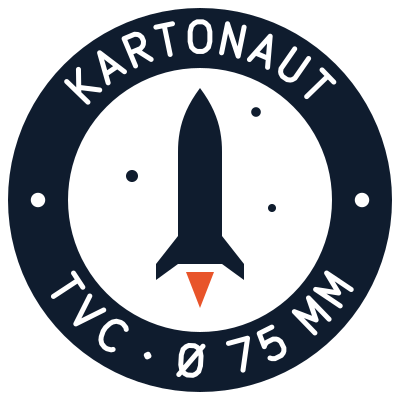

[](LICENSE)
[](firmware/)
[](simulation/)
[](https://github.com/Jan-Philipp-Munsch/kartonaut/actions/workflows/ci.yml)

**Eine Modellrakete aus Pappe, die ihren Motor selbst lenkt.** Der Rumpf ist ein Kartonrohr mit 75 mm
Durchmesser, der Motor sitzt in einer Kardanaufhängung mit zwei Servos, und ein selbst entworfener
Flugcomputer hält die Rakete während des Brennens aufrecht. Von der Platine bis zu den Reglerparametern
ist alles in diesem Repository entworfen, simuliert und dokumentiert.

*English version: [README.md](README.md) · Stand: 10.11.2026*

<table>
<tr>
<td width="50%">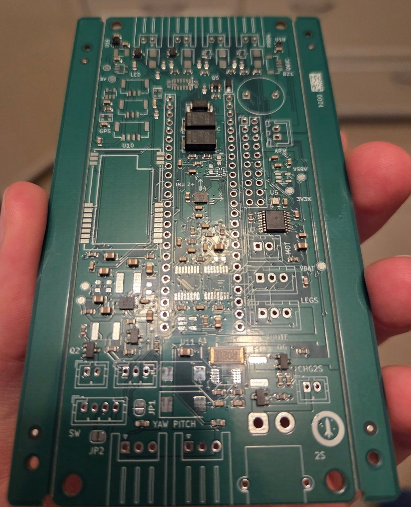</td>
<td width="50%">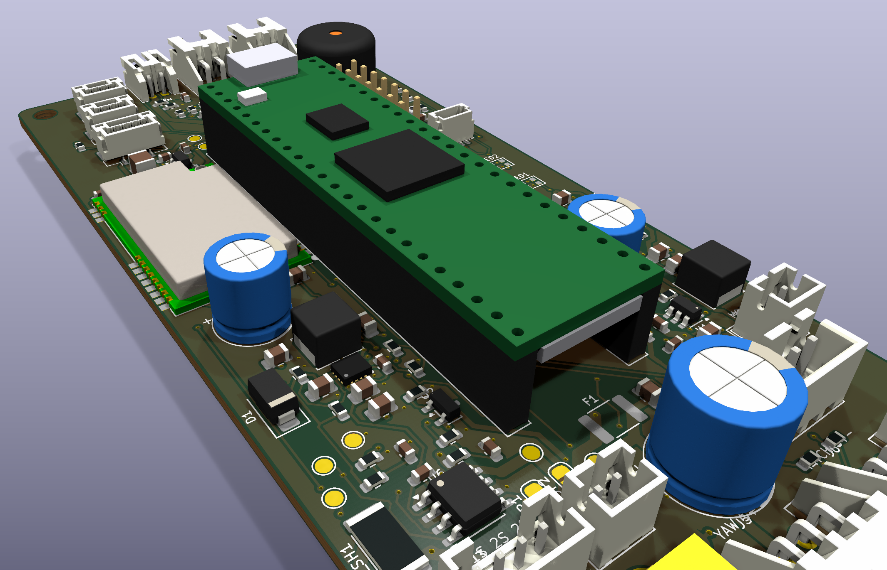<br><br>
<b>Der Flugcomputer rev B1 ist da.</b> Links: die Platine, wie sie am 5.11.2026 ankam, maschinell mit
106 Teilen bestückt. Oben: dieselbe Platine als Rendering aus dem KiCad-Projekt, das vollständig aus
einer Python-Beschreibung der Schaltung erzeugt wird. Als Nächstes: Teensy-Sockel, Stecker und Funkmodul
von Hand löten, dann der Tischtest.</td>
</tr>
</table>

## Auf einen Blick

| | *Kartonaut 1* (Erstflug) |
|---|---|
| Rumpf | Kartonrohr Ø 75 mm in drei verschraubten Modulen, 731 mm lang, Innenteile aus dem 3D-Drucker |
| Masse | **704 g** Startmasse (Massenbudget, [`cad/mass_stand2b.md`](cad/mass_stand2b.md)), Schub-Gewicht 1,7 |
| Motor | TSP E12 (24 mm, 39 Ns, 3,5 s Brenndauer) im Zwei-Achsen-Kardan mit 2 × FrSky W5652H |
| Flugcomputer | Teensy 4.1 auf eigener 4-Lagen-Platine: IMU, Barometer, Magnetometer, Leistungsmessung, LoRa 433 MHz, SD, vier Pyrokanäle |
| Regelung | Lage als Quaternion aus dem Gyro, PID auf Nicken und Gieren, Verstärkungen per Bayes-Optimierung in einer 6DOF-Simulation |
| Bergung | CO₂-Kartusche drückt die Spitze ab, Fallschirm 125 cm |
| Erwarteter Flug | etwa 74 m Gipfelhöhe, Neigung unter 2,5° während des Brennens (Simulation, ohne Luftwiderstand) |

## Projektstand

**Erledigt**

- **Kardan** mit beiden Servos gebaut; Rohr A und B des Rumpfs gebaut.
- **Mainboard rev B1** als Code entworfen (Python → KiCad, vier Lagen, DRC fehlerfrei), begutachtet,
  am 26.10. bei JLCPCB bestellt und **am 5.11.2026 geliefert**.
- **6DOF-Simulation** in Python: Schubkurve, gemessene Servodynamik, Sensorrauschen, Monte Carlo; sie
  hat die Rakete von 981 g auf 704 g gebracht und Verstärkungen gefunden, bei denen der Kardan nicht am
  Anschlag hängt.
- **Flug-Firmware** (Zustandsautomat, Lage, Kalman-Höhe, Pyro, Telemetrie, Watchdog) und eine
  Testkonsole für die Platine, per Software-in-the-Loop gegen die Simulation getestet.
- **Bauanleitung** mit Zeichnungen und 1:1-Bohrschablonen; Startrampe, TVC-Prüfstand und die
  Funkbrücke der Bodenstation in parametrischem CAD.
- CI auf GitHub Actions für Firmware, Simulation und Pin-Abgleich mit der Platine.

**Wartet auf Review und Merge**

- [PR #9](https://github.com/Jan-Philipp-Munsch/kartonaut/pull/9): Löt- und Messanleitung für rev B1,
  Testfirmware für die bestückte IMU, Flug-Firmware mit 250 Hz, PSRAM-Log und Flugschreiber im Flash,
  Bauanleitung der LoRa-Antenne.
- [PR #8](https://github.com/Jan-Philipp-Munsch/kartonaut/pull/8): Motorzündung an Bord über Pyro 1,
  ausgelöst durch einen gesicherten Funkbefehl vom Laptop.

**Als Nächstes**

1. Platine von Hand fertig löten und mit `revb_test` prüfen (Leistungsmessung und ein Widerstand kommen
   mit der zweiten DigiKey-Sendung).
2. Teile drucken und wiegen, Rakete zusammenbauen, Schwerpunkt austarieren.
3. Bodentests: Übersetzung Servo–Kardan, CO₂-Ausstoß, TVC-Prüfstand mit Propellermotor, Funkreichweite.
4. ***Kartonaut 1*: geregelter Aufstieg mit einem Motor, Bergung am Fallschirm.**

Details und Änderungsprotokoll in [PROJECT.md](PROJECT.md), Baulog in [docs/BUILD.md](docs/BUILD.md).

## Bilder

<table>
<tr>
<td align="center" width="33%">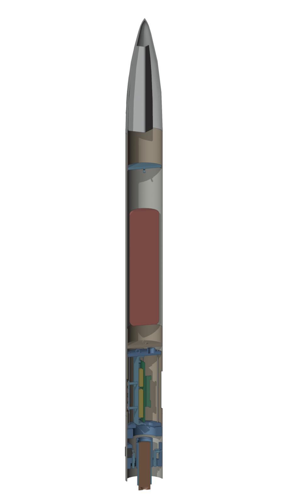<br><sub>Schnitt durch <i>Kartonaut 1</i>: Kardan, Avionik, CO₂ und Fallschirm</sub></td>
<td align="center" width="33%">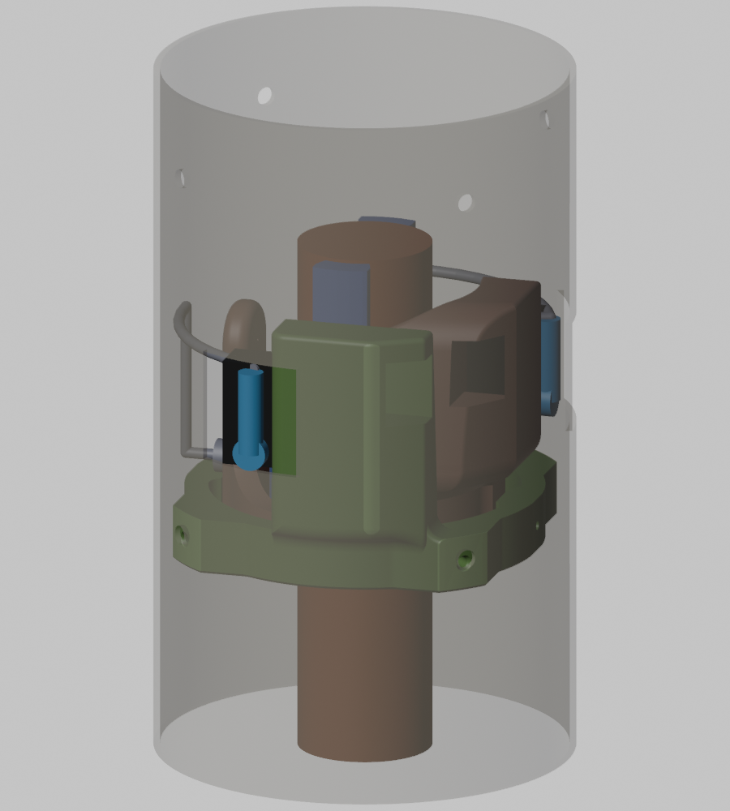<br><sub>Schubstangen-Kardan mit zwei Servos, gebaut</sub></td>
<td align="center" width="33%">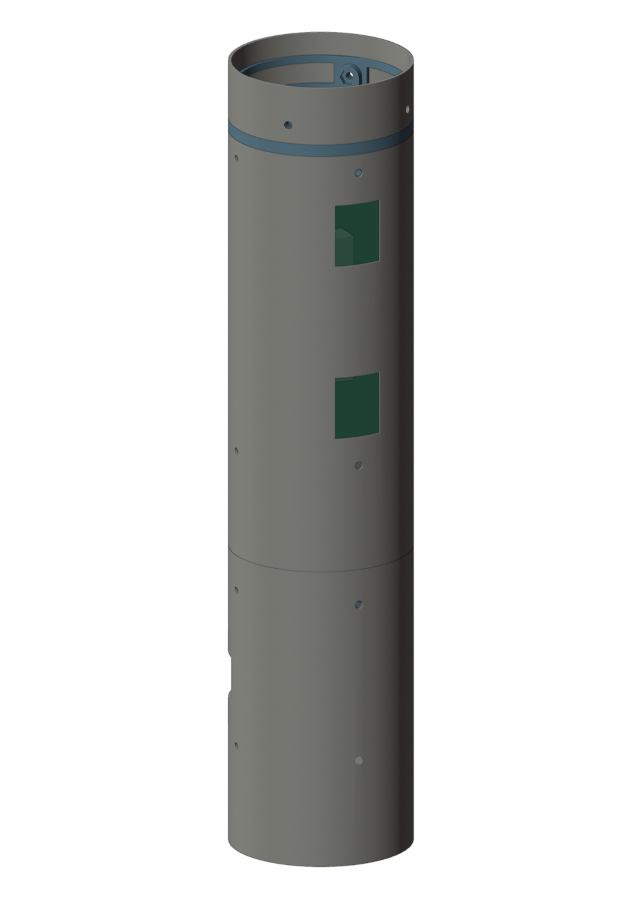<br><sub>Avionikmodul: Platine auf gedrucktem Schlitten</sub></td>
</tr>
<tr>
<td align="center">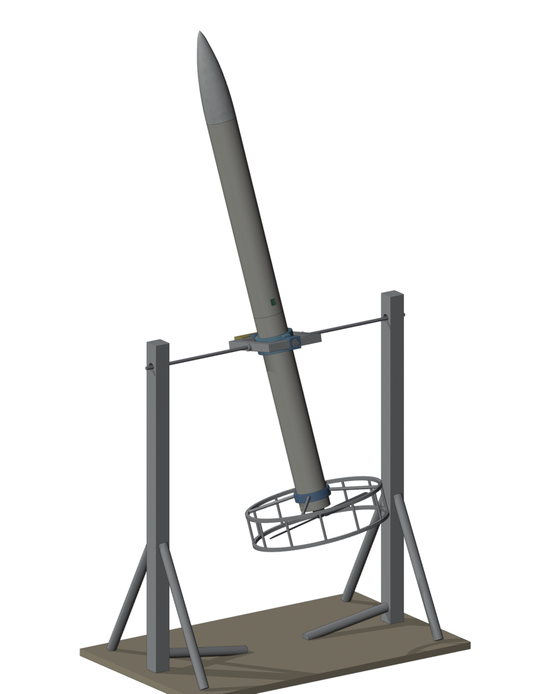<br><sub>TVC-Prüfstand: ein Propeller ersetzt den Motor</sub></td>
<td align="center">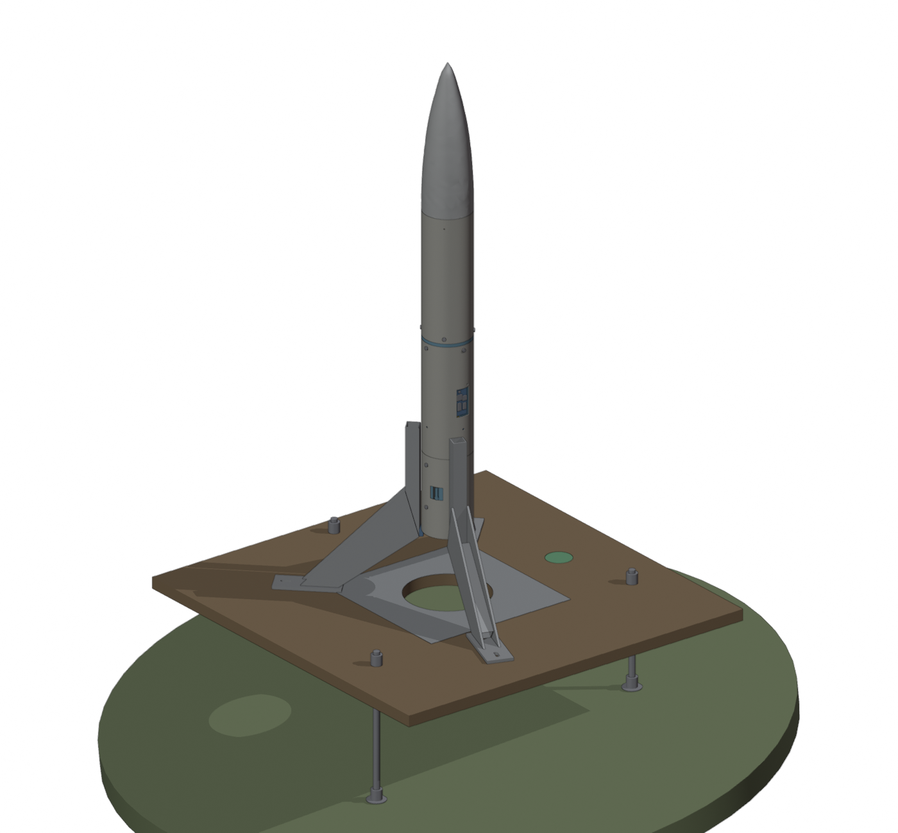<br><sub>Startrampe auf drei verstellbaren Beinen</sub></td>
<td align="center">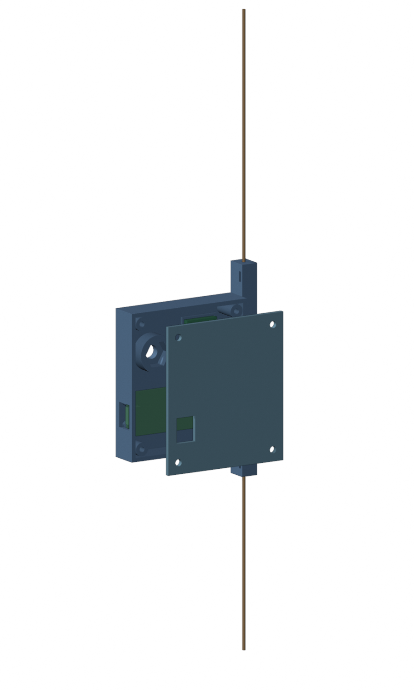<br><sub>Funkbrücke mit Halbwellen-Dipol</sub></td>
</tr>
<tr>
<td align="center" colspan="2">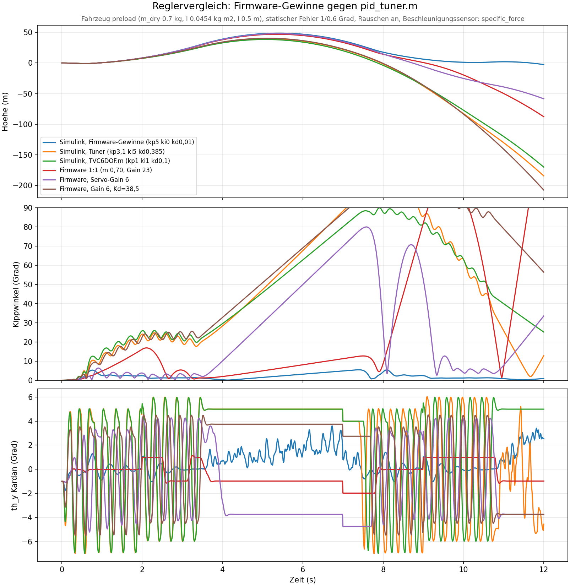<br><sub>Simulation: alte Verstärkungen (Kardan am Anschlag) gegen die abgestimmten</sub></td>
<td align="center">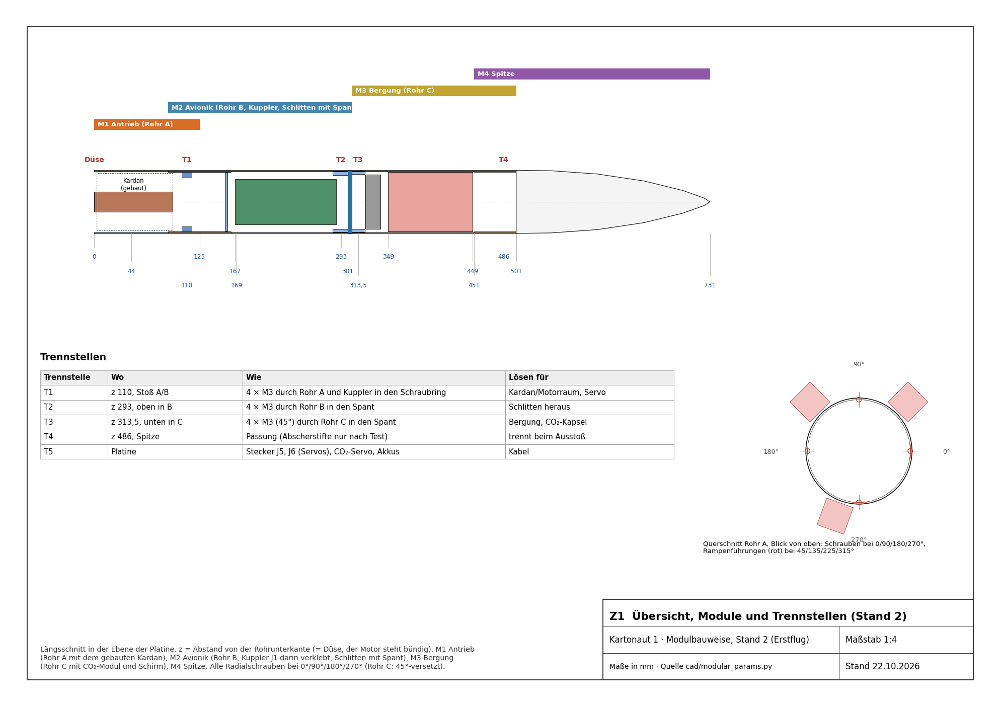<br><sub>Übersichtszeichnung aus der Bauanleitung</sub></td>
</tr>
</table>

## Was drin ist

| Teil | Inhalt | Wo |
|---|---|---|
| Mainboard | KiCad-Projekt aus `circuit.py` erzeugt: Schaltplan, Layout, Gerber/BOM/CPL, Datenblatt | [hardware/mainboard/](hardware/mainboard/README.md) |
| Simulation | Python-6DOF-Modell `tvcsim` mit 1:1 portiertem Firmware-Regler, Reglerabstimmung, Landestudien | [simulation/](simulation/README.md) |
| Firmware | PlatformIO für Teensy 4.1: Flugsoftware, Sensortreiber, Testkonsole, native Tests | [firmware/](firmware/README.md) |
| Mechanik | parametrisches CAD für Druckteile, Startrampe, Prüfstand; Massen- und Trägheitsmodelle | [cad/](cad/README.md) |
| Bauanleitung | Module, Teileliste, Bauschritte, Kabelplan ([PDF](docs/bauanleitung/Bauanleitung_Kartonaut1.pdf)) | [docs/Bauanleitung_Kartonaut1.md](docs/Bauanleitung_Kartonaut1.md) |
| Bodensystem | Startprotokoll, Funkbrücke, ESP32-Station als spätere Option | [groundstation/](groundstation/README.md) |
| Versuche | fertige Abläufe für die Bodentests | [docs/experiments/](docs/experiments/README.md) |

```bash
cd simulation && python -m pytest tests            # Tests der Simulation
cd firmware && pio test -e native                  # Firmware-Tests ohne Hardware
cd firmware && pio run -e teensy41_revb            # Flug-Firmware für rev B1
MS_CONFIG=erstflug python cad/modular.py           # Druckteile, Masse, Renderings
```

## Hintergrund

Vorbild ist die „Scout F“ von [BPS.space](https://bps.space). Spätere Flüge bekommen vielleicht
Landebeine, eine Landezündung mit zweitem Motor und eine Rollregelung; die Platine hat dafür schon Platz.
Die alte Bodenstation liegt in [kartonaut-ground](https://github.com/Jan-Philipp-Munsch/kartonaut-ground).

## Lizenz

[MIT](LICENSE). Die Scout-F-Dateien von BPS.space, die als Vorlage dienten, sind nicht Teil dieses Repositorys.
