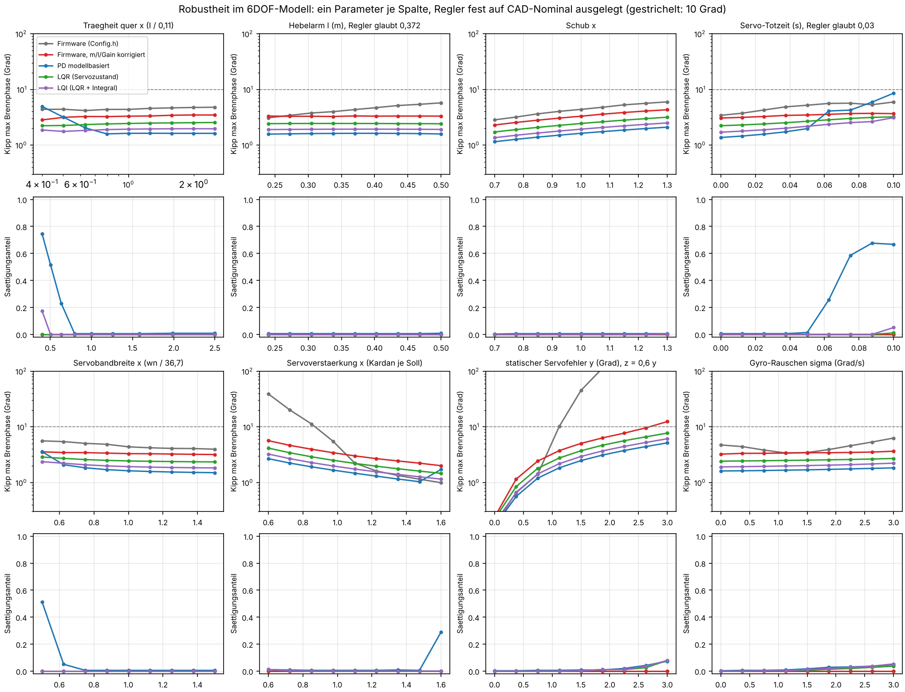

# Kartonaut


[](LICENSE)
[](firmware/)
[](simulation/)

*English version: [README.md](README.md).*

**Kartonaut** aus Karton und Astronaut: Der Rumpf ist ein Klima-Papprohr. Die Flüge zählen hoch, der Erstflug ist *Kartonaut 1*. Abzeichen und Logo in [`docs/brand/`](docs/brand/).

Eine Modellrakete mit Schubvektorsteuerung (TVC) und selbst entwickeltem Flugcomputer, aufgebaut
nach dem Vorbild der „Scout F“ von [BPS.space](https://bps.space). Der Motor hängt in einem Kardan
mit zwei Servos, ein Rollmotor hält die Rollachse, ein pyrotechnisch ausgestoßener Fallschirm
bringt die Rakete zurück. An Bord sitzt ein Teensy 4.1 mit IMU, Barometer, Strommonitor,
SD-Logger und 433-MHz-LoRa-Funk zur Bodenstation. Das Gesamtsystem wird vor dem Flug in einem
6DOF-Modell simuliert.


## Auf einen Blick

| | |
|---|---|
| Rumpf | Klima-Papprohr Ø 75 mm (innen 72,6 mm), 2 × 500 mm, Kuppler 150 mm; Kunststoffspitze, Fallschirm 125 cm |
| Motor | TSP E12-0, 24 mm, 39 Ns, 12 N mittel, 3,5 s Brenndauer, ohne Ausstoßladung; erster Flug mit einem Motor, Landebrennen mit einem zweiten später |
| Startmasse | 981 g im Massenmodell (`cad/`), Schwerpunkt 448 mm über der Düse; laut Simulation trägt ein E12 das nur 20 m hoch, das Massenbudget wird geprüft |
| Flugcomputer | Teensy 4.1 auf dem Mainboard rev B1 (fertig geroutet): IMU LSM6DSV16X, Barometer BMP390, Strommonitor INA239 mit Kelvin-Shunt, LoRa E22-400T22S, microSD, vier Pyro-Kanäle mit Arming (zwei bestückt), Stapelstecker für Zusatzplatinen |
| Versorgung | zwei Akkus: 1S-LiPo für die Elektronik (Buck-Boost), 2S-LiPo für Servos, Rollmotor und Pyro |
| Aktoren | 2 × FrSky Xact W5652H im Kardan (direkt am 2S), Rollmotor an einem DRV8833, Pyro-Kolbenausstoß |
| Regelung | Lage nur aus dem Gyro, PID auf Pitch/Yaw → Moment → Kardanwinkel über `M = l · T · sin δ`, PID auf Roll; 100 Hz |
| Simulation | Python-6DOF (Port des Simulink-Modells): Starrkörper mit Quaternionen, Schubkurve, Servodynamik, Sensorrauschen, Monte-Carlo, Gewinnsuche |
| Status | am Tisch mit Breakouts getestet, noch kein Flug; Mainboard rev B1 am 23.10.2026 fertig geroutet (DRC 0/0), Bestelldateien erzeugt, Review vor der Bestellung läuft (`hardware/mainboard/review_brief_2026-10-23.md`) |

## Projektstand

**Fertig**

- Konzept, Massen- und Strombudget; Rumpfteile, Fallschirm und Motoren gekauft.
- 6DOF-Simulation: MATLAB/Simulink-Modell nach Python portiert, mit 1:1-Kopie des Flugreglers, 21 Tests.
- Firmware-Module: Sensorik, Höhen-Kalman, SD-Logger mit CSV-Export, Pitch/Yaw- und Rollregler, Takt, Signalgeber.
- Mainboard rev B spezifiziert: Versorgungsarchitektur, Pinbelegung, Stückliste, Platzierungsplan, Testplan; Design Guide mit Abbildungen und Bestellplan.
- KiCad-Projekt für rev B1 aus Code erzeugt: Schaltplan mit sieben Blättern, ERC sauber; Platine auf vier Lagen platziert, geroutet und von Hand fertiggestellt, DRC 0 Fehler, 0 offene Verbindungen; alle Review-Punkte vom 21.10. eingearbeitet; Gerber, BOM und CPL für JLCPCB erzeugt.
- Zweitmeinung-Review von Schaltung und Layout gegen Datenblätter und Spezifikation: acht Punkte vor der Bestellung, Fertiger-Entscheidung, Bestellliste.
- Parametrisches CAD-Modell als Code (CadQuery) mit Massenmodell: Masse, Schwerpunkt und Trägheitsmomente für die Simulation; die 16 Blender-Dateien inventarisiert und abgelöst.
- Baudokumentation und Projektdatei mit Befunden und Änderungsprotokoll.

**In Arbeit**

- Platine: Review des fertigen Layouts rev B1 durch den Kollegen, Papierausdruck 1:1 in den Kuppler, LCSC-Zuordnung der Passiven am Bestelltag.
- Kardan-Anpassung für die neuen Servos; Servo-Sprungantwort neu messen.
- Massenbudget: Teile wiegen, Rumpf leichter machen oder stärkeren Motor wählen.

**Als Nächstes**

1. Review-Rückmeldungen zu rev B1 einarbeiten, dann Bestellung bei JLCPCB mit SMD-Bestückung (Aisler als EU-Rückfall); die Tischteile jetzt bestellen.
2. Firmware für rev B: Treiber LSM6DSV16X, Quaternion-Lage, Flugzustandsautomat, Pyro-Logik, Watchdog, LoRa-Telemetrie.
3. Rakete wiegen und das Massenbudget gegen den Schub des E12 prüfen.
4. Bodentests: TVC-Prüfstand mit Propellermotor im Kardan (Teile gekauft, Gestell zu bauen), Pyro-Test, Funkreichweite.
5. Erstflug: geregelter Aufstieg mit einem Motor, Fallschirmbergung.

Die vollständige Liste der Arbeitspakete, die Befunde aus den Durchsichten und das
Änderungsprotokoll stehen in [PROJECT.md](PROJECT.md), das Bautagebuch in
[docs/BUILD.md](docs/BUILD.md), die Planungsrunde vom 21.10.2026 mit Platinen-Review,
Kostenschätzung und Entscheidungen in [docs/Plan_2026-10-21.md](docs/Plan_2026-10-21.md).

## Was die Simulation sagt

Das Simulink-Modell (Starrkörper mit Quaternionen, Schubkurve des TSP E12, aus Sprungantworten
identifizierte Servo-Übertragungsfunktion, Sensorrauschen, statische Fehlausrichtung) liegt jetzt
als Python-Paket `tvcsim` in [`simulation/`](simulation/README.md). Es hat zwei Regler: den aus
Simulink und einen zeilengenauen Port von `Control.cpp` aus der Firmware, damit sich die Gewinne
beider Seiten im selben Modell vergleichen lassen.


Drei Befunde, die das Projekt verändern:

- **Die Firmware-Gewinne sind die richtigen.** Kp 5, Ki 0, Kd 1 (auf der Skala −100 der Firmware)
  halten den Kippwinkel in der Brennphase unter 10°. Die früher per MATLAB-Raster gefundenen
  Gewinne (kp 3,1, ki 5, kd 0,385) haben einen 40-mal größeren D-Anteil, treiben den Kardan sofort
  in die ±5°-Begrenzung und schwingen mit 3 bis 4 Hz. Ein kleiner I-Anteil würde den statischen
  Servo-Fehler ausregeln.
- **Die Rakete ist für einen E12 zu schwer.** Mit den 1,0 kg des Massenmodells liegt das
  Schub-Gewichts-Verhältnis bei 1,1 und der Gipfel bei 20 m; mit 0,7 kg bei 62 m. Entweder sinkt die
  Masse (das Papprohr allein wiegt 240 g) oder der Motor wird eine Klasse stärker.
- **Die Servo-Kardan-Übersetzung entscheidet über die Stellreserve.** Mit den 23 Servo-Grad je
  Kardan-Grad aus `Config.h` erreicht der Kardan nur ±1°, mit den gemessenen 6 sind es ±3,75°.
  Wird am neuen Kardan gemessen.

<p>


</p>

**Reglervergleich (24.10.2026).** Ist PID die richtige Struktur? Die Schubvektor-Inversion macht
die Rakete zum Doppelintegrator, und dafür ist ein PD schon die LQR-Lösung. Was der PID nicht
kennt, ist das Servo (5,8 Hz, 30 ms Totzeit). Ein LQR, der den Servozustand in seinem eigenen
Prädiktor mitführt (`lqr`/`lqi` in `tvcsim`, gleiche Kostenfunktion wie der PD), verträgt etwa
doppelt so viel Verstärkungsfehler und Totzeit und läuft in den Parameter-Sweeps nie in den
Sättigungs-Grenzzyklus. Die größere Schwäche ist aber die heutige Firmware-Parametrierung
(Masse 0,70 kg, Hebelarm 0,30 m, ±1°-Fenster): In Monte-Carlo kippt sie in der Hälfte der Fälle,
mit korrigierten Werten in keinem. Details in
[`docs/Reglervergleich_2026-10-24.md`](docs/Reglervergleich_2026-10-24.md).



```bash
cd simulation
python -m pytest tests                 # 32 Tests
python scripts/run_nominal.py          # Nominalflug -> out/
python scripts/run_montecarlo.py       # 100 Läufe
python scripts/compare_gains.py --vehicle preload
python scripts/compare_controllers.py  # PID gegen modellbasierten PD gegen LQR/LQI
python scripts/robustness.py           # lineare Reserven, Sweeps, Monte-Carlo (ca. 15 min)
```

## Hardware

Heute hängen alle Sensoren als Breakouts mit Dupont-Kabeln am Teensy, im Flug das größte
Ausfallrisiko. [hardware/mainboard/](hardware/mainboard/README.md) spezifiziert deshalb das
**Mainboard rev B**: ein Schlitten 54 × 120 mm, der längs in einem Kuppler liegt, mit Teensy-Sockel,
IMU genau auf der Rollachse und allen Steckern an den Stirnseiten.


Der [Design Guide](docs/DesignGuide_Mainboard_revB.md) (auch als
[PDF](docs/DesignGuide_Mainboard_revB.pdf)) stellt den Entwurf mit Abbildungen vor: Blockschaltbild,
Versorgungsbaum, Pyro-Kanal, Pinbelegung, Einbau; der [Bestellplan](hardware/mainboard/ORDER.md)
listet die Vorab-Bestellung, die Tore vor der Platinenbestellung, die JLCPCB-Parameter und die Kosten.


Das KiCad-Projekt in [hardware/mainboard/kicad/](hardware/mainboard/kicad/README.md) wird aus einer
einzigen Python-Beschreibung der Schaltung erzeugt (`circuit.py`): sieben Schaltplanblätter mit Netzlabel an
jedem Pin, in Funktionsblöcke gegliedert, ERC ohne Fehler und Warnungen
([Schaltplan-PDF](hardware/mainboard/kicad/out/mainboard_schematic.pdf)), dazu ein Platinen-Generator, der
Umriss, vier Lagen, Netzklassen und Sperrflächen zeichnet, die Teile setzt, die Flächen füllt und das
Freerouting-Ergebnis übernimmt: alle 134 Teile platziert und geroutet, DRC ohne Fehler
([Renders und Lagenbilder](hardware/mainboard/kicad/img/)).


Ein [Zweitmeinung-Review](hardware/mainboard/review_kicad_2026-10-21.md) hat die Schaltung gegen die Datenblätter und das
Layout gegen die Spezifikation geprüft. Seine acht A-Punkte kommen vor den Fertigungsdaten hinein: Der
Buck-Boost sieht mehr Ausgangskapazität, als sein Datenblatt erlaubt, die 1S-Unterspannungsabschaltung
würde den Rechner im Flug abschalten, der Hauptschalter sitzt im Hochstrompfad, nur die Servo-Schiene ist
abgesichert, der Shunt hat keinen Kelvin-Anschluss, und der Autorouter hat die 2S-Ströme auf die dünne
Innenlage und an der IMU vorbei gelegt. Der [Fertigervergleich](hardware/mainboard/Fertiger_2026-10-21.md) entscheidet für JLCPCB
mit Economic-Bestückung und Aisler als EU-Rückfall; der [Bestellplan](hardware/mainboard/ORDER.md) sagt,
was jetzt gekauft wird.

Entscheidungen, die man kennen sollte:

- **Zwei Akkus.** Ein blockierender Servo oder ein Pyro-Puls darf den Teensy nie in den Neustart
  ziehen. Die Elektronik läuft deshalb aus einer eigenen 1S-Zelle über einen Buck-Boost, Servos,
  Rollmotor und Pyro aus einem 2S-Akku. Ein zweipoliger Schalter schaltet beide.
- **IMU ohne DMP.** Der ICM-20948 ist „not for new designs“; der ICM-42688-P ersetzt ihn an SPI,
  die Lage wird in der Firmware aus dem Gyro integriert.
- **LoRa statt HC-12.** Ein SX1268-Modul auf dem Board mit Pigtail-Antenne in der Spitze bringt
  Kilometer Reichweite statt einiger hundert Meter.
- **Pyro-Bergung.** Zwei Low-Side-MOSFET-Kanäle hinter einem externen Arming-Schalter, mit
  Durchgangsprüfung; Schwarzpulver-Tests mit etwa 1 g haben funktioniert.
- **Servos am Akku.** Die FrSky W5652H laufen direkt am 2S (bis 8,4 V), doppelt so schnell wie an 5 V.

Die Spezifikation enthält das Strombudget je Akku, die vollständige Pinbelegung, eine Stückliste
mit LCSC-Nummern, Layout-Regeln und den Inbetriebnahme-Plan. Rev A mit der Begründung des
Schlitten-Layouts bleibt in [`rev_a_2026-10-15.md`](hardware/mainboard/rev_a_2026-10-15.md).

## CAD-Modell

Die Blender-Dateien, die die Rakete bisher beschrieben haben, sind in
[`cad/blender_inventory.md`](cad/blender_inventory.md) inventarisiert und durch ein parametrisches
Modell in CadQuery abgelöst ([`cad/`](cad/README.md)): jedes Maß in `cad/params.py` mit Quelle,
STEP- und STL-Export je Baugruppe, Kollisionsprüfung des Kardans bei ±7°, Renderbilder über Blender
headless. Dieselben Parameter speisen ein Massenmodell.

<p>


</p>

| Zustand | Masse | Schwerpunkt ab Düse | Hebelarm Kardan–Schwerpunkt | Ixx = Iyy | Izz (Roll) |
|---|---|---|---|---|---|
| Start, voller Motor | 981 g | 448 mm | 372 mm | 0,110 kg·m² | 0,0011 kg·m² |
| Brennschluss | 953 g | 460 mm | 384 mm | 0,105 kg·m² | 0,0011 kg·m² |
| Ohne Motor | 917 g | 477 mm | 400 mm | 0,098 kg·m² | 0,0011 kg·m² |

Zwei Zahlen, die das Massenmodell verändert hat: Das Roll-Trägheitsmoment ist hundertmal kleiner
als der Platzhalter 0,1 kg·m², mit dem die Simulation gerechnet hat (fast alle Masse liegt innerhalb
von 37 mm um die Achse), und der Hebelarm beträgt 0,37 m statt 0,30 m. Die 981 g bestätigen das
Schub-Gewichts-Problem von oben. Nach dem Zusammenbau: Teile wiegen, Schwerpunkt auswiegen,
Quer-Trägheitsmoment per Bifilarpendel messen und `params.py` korrigieren.

```bash
python -m pip install --user cadquery
python cad/build.py              # STEP/STL nach cad/export/, Bilder nach docs/img/cad/
python cad/mass_model.py         # mass_properties.md und .json
```

## Bodentests

Bevor etwas fliegt, wird die Lageregelung am Boden mit echtem Schub und ohne Treibsatz
getestet: Die Rakete hängt in einem Gestell, das sie um den Schwerpunkt nicken und gieren
lässt, und an Stelle des Raketenmotors sitzt ein Brushless-Motor (Racerstar BR2814, 1000 KV,
11-Zoll-Propeller, 4S-LiPo) im Kardan. Bei Teilgas liefert er die 12 N des E12, und der Teensy
kann den Regler sogar entlang der E12-Schubkurve fahren. Motor, Regler, Propeller, Akku und
Ladegeräte sind gekauft. Das Gestell ist in [`cad/testrig.py`](cad/README.md) konstruiert: ein
zweiachsiger Rahmen auf Kugellagern, ein gedruckter Klemmkragen am Schwerpunkt, ein Prop-Adapter,
der ins Motorrohr steckt, und ein Schutzkäfig um den Propeller; das Build-Skript prüft, dass bei
±20° Rig-Auslenkung und ±7° Kardan nichts kollidiert. Der Fallschirmausstoß ist mit etwa 1 g
Schwarzpulver schon getestet.

<p>


</p>

## Firmware

PlatformIO-Projekt für den Teensy 4.1 in [`firmware/`](firmware/README.md). Die Hauptschleife
läuft mit festen 100 Hz:

1. **Sensoren lesen.** IMU (Drehrate, Beschleunigung), Barometer, Strommonitor.
2. **Lage integrieren.** Nur aus dem Gyro: Im Flug sind Kompass und Beschleunigungsstützung unbrauchbar.
3. **Höhe schätzen.** Ein Kalman-Filter mit zwei Zuständen fusioniert Barometer und Vertikalbeschleunigung.
4. **Regeln.** Ein PID auf Pitch und Yaw liefert ein Moment, das über `M = l · m · |a| · sin δ` in den
   Kardanwinkel und dann in Servo-Grad umgerechnet wird; ein zweiter PID treibt den Rollmotor.
5. **Loggen.** Ein 88-Byte-Frame pro Durchlauf in einen Seitenpuffer; SD-Schreibzugriffe nur in der
   freien Zeit vor der nächsten Deadline. Am Boden wird das Binärlog als CSV exportiert.

```bash
cd firmware
pio run                      # Flug-Firmware bauen
pio run -t upload            # auf den Teensy 4.1 flashen
pio device monitor           # serielle Konsole, 115200 Bd, Teleplot-kompatibel
pio run -e radio_beacon      # einen Test-Sketch aus examples/ bauen
```

Alle Pins, Gewinne, Filterkonstanten und Debug-Schalter liegen in
[`firmware/src/Config.h`](firmware/src/Config.h). Die Regler sind dort abgeschaltet, bis der
erste Flugtest ansteht. Offen: Quaternion-Lage, Gyro-Kalibrierung auf der Rampe,
Flugzustandsautomat mit Pyro-Logik, Telemetrieprotokoll, Treiber für die neue IMU.

## Aufbau des Repos

```
firmware/               Flug-Firmware (PlatformIO, Teensy 4.1)             -> firmware/README.md
  src/                  Module: Sensors, KalmanZ, Control, SDLogger, Timing, Indicators
  examples/             Test-Sketches (Funk-Beacon, I2C-Scan, Pyro-MOSFET)
simulation/             6DOF-Simulation in Python, Paket tvcsim             -> simulation/README.md
  tvcsim/, tests/, scripts/, data/
hardware/mainboard/     Mainboard rev B: Spezifikation, Bestellplan, Umriss (DXF), Platzierungsplan, Abbildungen
cad/                    parametrisches CAD-Modell als Code, Massen          -> cad/README.md
docs/                   Design Guide rev B (Markdown + PDF), Bautagebuch (BUILD.md), Planungsrunde, Bilder
PROJECT.md              Projektdatei: Eckdaten, Arbeitspakete, Befunde, Änderungsprotokoll
```

Die Bodenstation (Arduino Nano mit dem passenden Funkmodul) ist ein eigenes Repo:
[kartonaut-ground](https://github.com/Jan-Philipp-Munsch/kartonaut-ground). Das MATLAB/Simulink-Original
der Simulation und die Blender-Dateien bleiben außerhalb dieses Repos; ihr Inhalt ist hierher
portiert.

## Dokumente

| Dokument | Inhalt |
|---|---|
| [PROJECT.md](PROJECT.md) | Eckdaten, Arbeitspakete mit Status, Befunde aus den Durchsichten, nächste Schritte, Änderungsprotokoll |
| [docs/BUILD.md](docs/BUILD.md) | as-built: Inventar der gekauften und gedruckten Teile, Mechanik, Verdrahtung, Software auf dem Gerät, Tests, Bautagebuch |
| [docs/Plan_2026-10-21.md](docs/Plan_2026-10-21.md) | Platinen-Review mit Bauteilalternativen und Kostenschätzung, Versorgungsarchitektur, Layout-Checkliste, Portierungsplan, Entscheidungen |
| [hardware/mainboard/README.md](hardware/mainboard/README.md) | Spezifikation Mainboard rev B |
| [docs/DesignGuide_Mainboard_revB.md](docs/DesignGuide_Mainboard_revB.md) | der Entwurf rev B mit Abbildungen, zum Review ([PDF](docs/DesignGuide_Mainboard_revB.pdf)) |
| [hardware/mainboard/ORDER.md](hardware/mainboard/ORDER.md) | Bestellplan: Vorab-Bestellung, Tore vor der Platinenbestellung, JLCPCB-Parameter, Kosten, Bestellliste nach Händlern |
| [hardware/mainboard/review_kicad_2026-10-21.md](hardware/mainboard/review_kicad_2026-10-21.md) | Zweitmeinung-Review des KiCad-Projekts: Schaltung gegen Datenblätter, Layout gegen Spezifikation, Zukunft, Kosten |
| [hardware/mainboard/Fertiger_2026-10-21.md](hardware/mainboard/Fertiger_2026-10-21.md) | Fertigervergleich (JLCPCB, PCBWay, Aisler, Eurocircuits) und Entscheidung |
| [simulation/README.md](simulation/README.md) | Modell, Koordinaten, Annahmen, Ergebnis des Gewinnvergleichs |
| [firmware/README.md](firmware/README.md) | Firmware-Module, Log-Format, Test-Sketches |
| [cad/README.md](cad/README.md) | parametrisches Modell, Parameter, Wartungskonzept |
| [cad/mass_properties.md](cad/mass_properties.md) | Massenmodell: Methode, Teileliste, Schwerpunkt und Trägheit je Flugzustand |
| [cad/blender_inventory.md](cad/blender_inventory.md) | was die 16 Blender-Dateien enthalten, was aktuell und was überholt ist |

## Lizenz

[MIT](LICENSE). Die BPS.space-Dateien der Scout F, die als Vorlage dienten, sind nicht Teil dieses
Repos.
