# Kartonaut


[](LICENSE)
[](firmware/)
[](simulation/)
[](https://github.com/Jan-Philipp-Munsch/kartonaut/actions/workflows/ci.yml)

**Eine Modellrakete aus Pappe, die ihren Motor selbst lenkt.** Der Rumpf ist ein Kartonrohr mit 75 mm
Durchmesser, der Motor sitzt in einer Kardanaufhängung mit zwei Servos, und ein selbst entworfener
Flugcomputer hält die Rakete während des Brennens aufrecht. Von der Platine bis zu den Reglerparametern
ist alles in diesem Repository entworfen, simuliert und dokumentiert.

*English version: [README.md](README.md) · Stand: 16.11.2026*

<table>
<tr>
<td width="50%">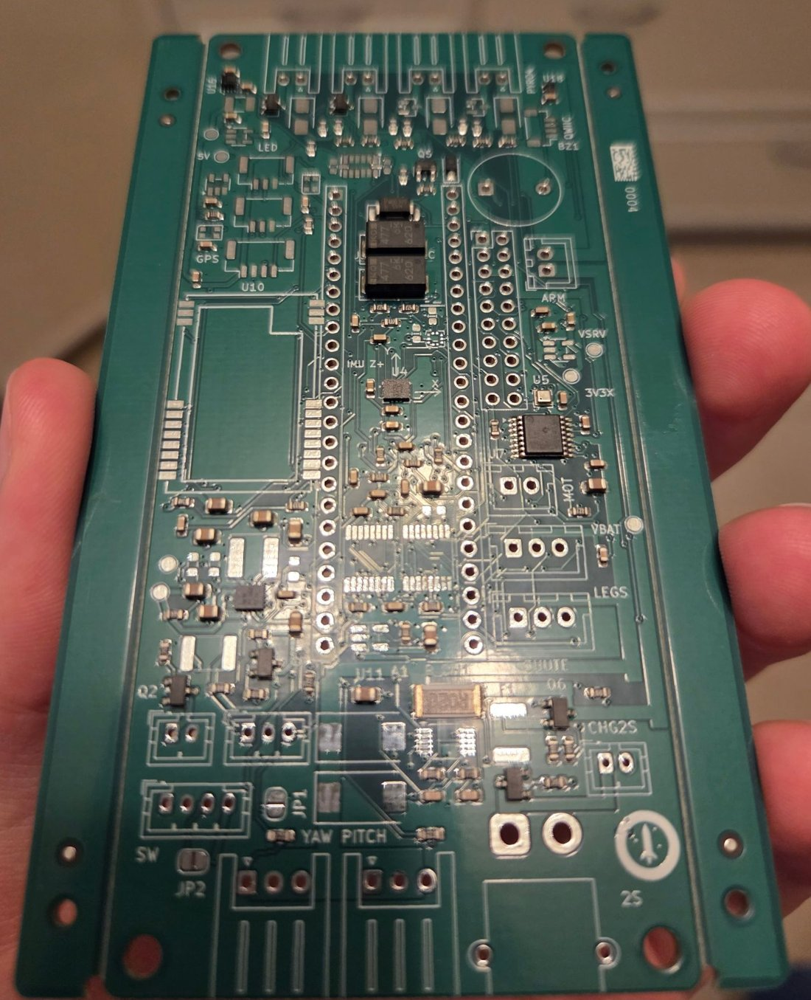</td>
<td width="50%">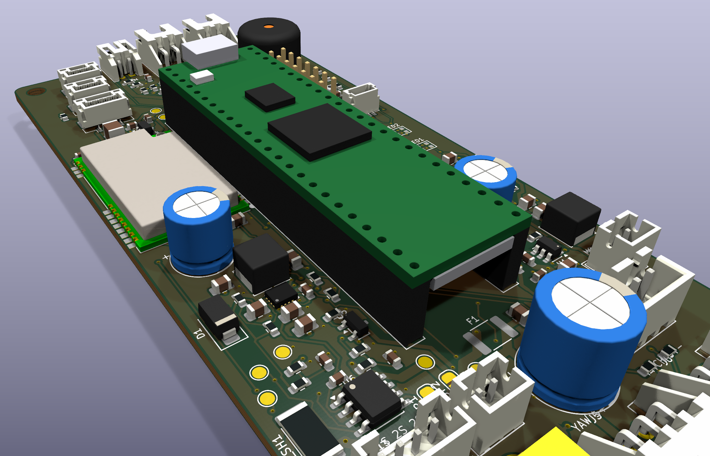<br><br>
<b>Der Flugcomputer rev B1 ist da.</b> Links: die Platine, wie sie am 5.11.2026 ankam, maschinell mit
106 Teilen bestückt. Oben: dieselbe Platine als Rendering aus dem KiCad-Projekt, das vollständig aus
einer Python-Beschreibung der Schaltung erzeugt wird. Als Nächstes: Teensy-Sockel, Stecker und Funkmodul
von Hand löten, dann der Tischtest mit der <a href="#werkbank-die-platine-am-pc">Werkbank</a>.</td>
</tr>
</table>

## Auf einen Blick

| | *Kartonaut 1* (Erstflug) |
|---|---|
| Rumpf | Kartonrohr Ø 75 mm in drei verschraubten Modulen, 731 mm lang, Innenteile aus dem 3D-Drucker |
| Masse | **704 g** Startmasse (Massenbudget, [`cad/mass_stand2b.md`](cad/mass_stand2b.md)), Schub-Gewicht 1,7 |
| Motor | TSP E12 (24 mm, 39 Ns, 3,5 s Brenndauer) im Zwei-Achsen-Kardan mit 2 × FrSky W5652H |
| Flugcomputer | Teensy 4.1 auf eigener 4-Lagen-Platine: IMU, Barometer, Magnetometer, Leistungsmessung, LoRa 433 MHz, SD, vier Pyrokanäle |
| Regelung | Lage als Quaternion aus dem Gyro, PID auf Nicken und Gieren, Verstärkungen per Bayes-Optimierung in einer 6DOF-Simulation |
| Bergung | ein Servo sticht im Gipfelpunkt die CO₂-Kartusche an, das Gas drückt die Spitze ab, Fallschirm 125 cm |
| Erwarteter Flug | etwa 74 m Gipfelhöhe ohne Luftwiderstand, 63 m mit; Neigung während des Brennens wenige Grad, bis 3 m/s Wind unter 8° (Simulation) |

## Projektstand

**Erledigt**

- **Kardan** mit beiden Servos gebaut; Rohr A und B des Rumpfs gebaut.
- **Mainboard rev B1** als Code entworfen (Python → KiCad, vier Lagen, DRC fehlerfrei), begutachtet,
  am 26.10. bei JLCPCB bestellt und **am 5.11.2026 geliefert**.
- **6DOF-Simulation** in Python: Schubkurve, gemessene Servodynamik, Sensorrauschen, Monte Carlo; sie
  hat die Rakete von 981 g auf 704 g gebracht und Verstärkungen gefunden, bei denen der Kardan nicht am
  Anschlag hängt.
- **Flug-Firmware** (Zustandsautomat, Lage, Kalman-Höhe, Pyro, Telemetrie, Watchdog) und eine
  Testkonsole für die Platine, per Software-in-the-Loop gegen die Simulation getestet.
- **Bauanleitung** mit Zeichnungen und 1:1-Bohrschablonen; Startrampe, TVC-Prüfstand und die
  Funkbrücke der Bodenstation in parametrischem CAD.
- CI auf GitHub Actions für Firmware, Simulation und Pin-Abgleich mit der Platine.

**Wartet auf Review und Merge**

- [PR #9](https://github.com/Jan-Philipp-Munsch/kartonaut/pull/9): Löt- und Messanleitung für rev B1,
  Testfirmware für die bestückte IMU, Flug-Firmware mit 250 Hz, PSRAM-Log und Flugschreiber im Flash,
  Bauanleitung der LoRa-Antenne.
- **[Werkbank](#werkbank-die-platine-am-pc)** (PR #9): Oberfläche im Browser für die Platine am USB mit
  Live-Verläufen, Prüfungen und geführter Kalibrierung; gegen eine simulierte Platine getestet, an der
  echten noch nicht.
- **Testkonsole** `revb_test` (PR #9): `stream` liefert die Rohwerte aller Sensoren fortlaufend,
  `cal set` nimmt Kalibrierwerte vom PC an.
- **Flug-Firmware nach der Code-Durchsicht vom 14.11.** (PR #9): der Fallschirm-Servo öffnet im
  Gipfelpunkt (bisher blieb er zu), der Pyro-Puls läuft die volle Länge, das Log behält an der Rampe nur
  10 s Vorlauf und lässt den Rest des Puffers für den Flug, die Pins der rev B1 kommen aus einer einzigen
  Datei, und nach einem Watchdog-Neustart kehrt kein alter Startbereit-Zustand zurück
  ([PROJECT.md](PROJECT.md) §5, Befunde 24–28). 58 native Tests laufen in der CI durch; an der Platine
  ist noch nichts davon geprüft.
- **[Navigation und Punktlandung](#sensorfusion-zustandsschätzung-und-navigation)** (15.11., PR #9):
  Simulation des ganzen Flugs mit Wind, Aerodynamik, GPS, Magnetometer, Kamera und Navigationsfilter;
  Anforderungen an Drossel, Regelung und Sensorik abgeleitet. Nur Simulation, nichts davon in der Firmware.
- [PR #8](https://github.com/Jan-Philipp-Munsch/kartonaut/pull/8): Motorzündung an Bord über Pyro 1,
  ausgelöst durch einen gesicherten Funkbefehl vom Laptop.

**Als Nächstes**

1. Platine von Hand fertig löten und mit `revb_test` und der Werkbank prüfen und kalibrieren, nach der
   [Löt- und Messanleitung](hardware/mainboard/LOETANLEITUNG_revB1.pdf) (Leistungsmessung und ein Widerstand
   kommen mit der zweiten DigiKey-Sendung); zwei IPEX-Pigtails für die
   [LoRa-Antenne](docs/Bauanleitung_LoRa_Antenne.md) besorgen.
2. Teile drucken und wiegen, Rakete zusammenbauen, Schwerpunkt austarieren.
3. Firmware: die Korrekturen aus der Code-Durchsicht vom 14.11. (CO₂-Auslösung, Pyro-Puls, Flug-Log,
   Pins, Zustandsspeicher; [PROJECT.md](PROJECT.md) §5, Befunde 24–28) an der Platine prüfen und die
   kleineren Punkte aus Befund 29 abarbeiten.
4. Bodentests: Übersetzung Servo–Kardan, CO₂-Ausstoß, TVC-Prüfstand mit Propellermotor, Funkreichweite.
5. ***Kartonaut 1*: geregelter Aufstieg mit einem Motor, Bergung am Fallschirm**, nach der Simulation bei
   höchstens 3 m/s Wind.
6. Danach die Landung, voraussichtlich zuerst als Hüpfer mit einem Motor (3 m hoch, ohne Fallschirm): Servos
   und Drossel vermessen (Versuche E01, E05, dazu Zündverzug des Anzünders), die Schlitzscheibe mit einem Servo bauen
   ([`cad/throttle_plate.py`](cad/throttle_plate.py)), Fahrwerk konstruieren,
   Navigationsfilter und Führung in die Firmware.
7. Parallel das Magazin für den Motorwechsel (zwei Motoren hintereinander) als Tischversuch, danach die
   Landung mit zwei Motoren aus 6 m
   ([docs/Motorwechsel_und_Huepfer_2026-11-15.md](docs/Motorwechsel_und_Huepfer_2026-11-15.md)).

Details und Änderungsprotokoll in [PROJECT.md](PROJECT.md), Baulog in [docs/BUILD.md](docs/BUILD.md).

## Bilder

<table>
<tr>
<td align="center" width="33%">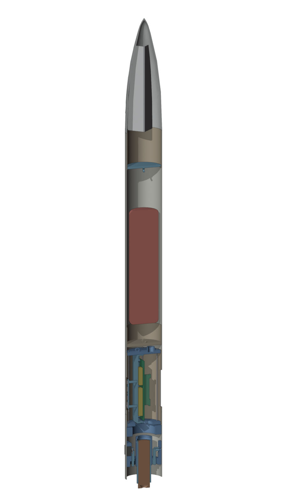<br><sub>Schnitt durch <i>Kartonaut 1</i>: Kardan, Avionik, CO₂ und Fallschirm</sub></td>
<td align="center" width="33%">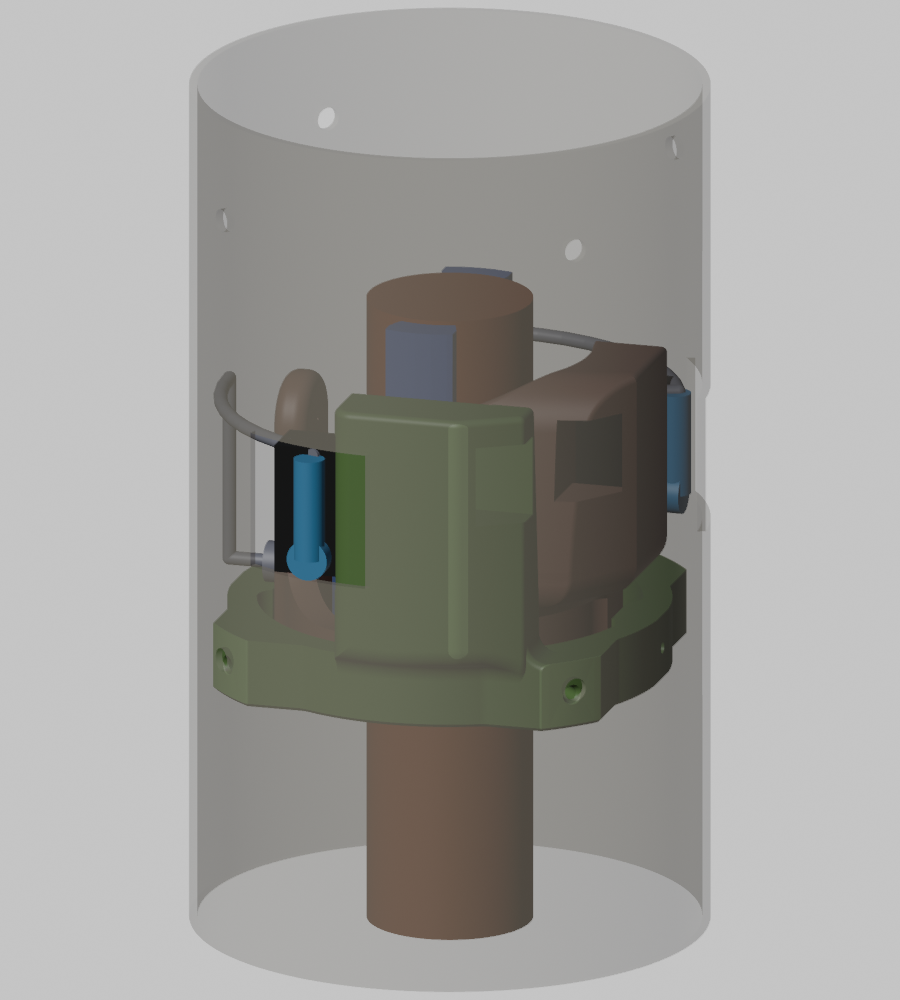<br><sub>Schubstangen-Kardan mit zwei Servos, gebaut</sub></td>
<td align="center" width="33%">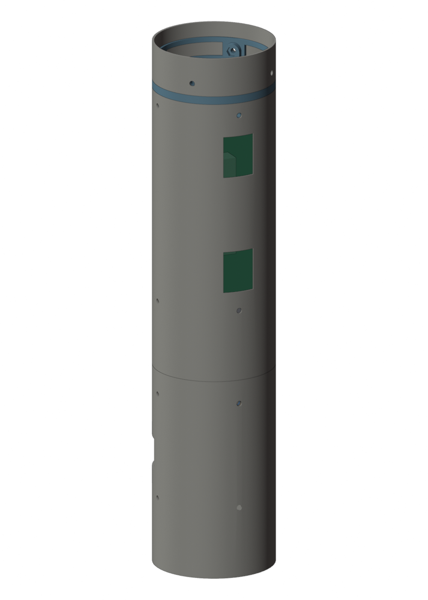<br><sub>Avionikmodul: Platine auf gedrucktem Schlitten</sub></td>
</tr>
<tr>
<td align="center">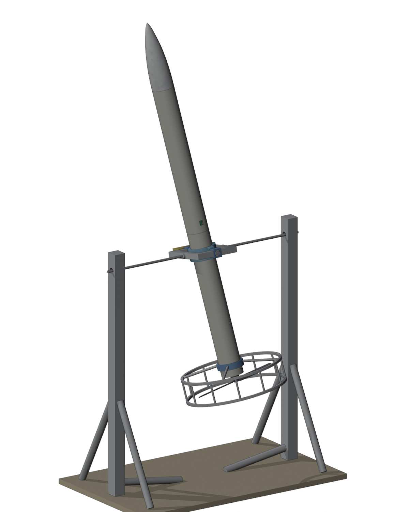<br><sub>TVC-Prüfstand: ein Propeller ersetzt den Motor</sub></td>
<td align="center">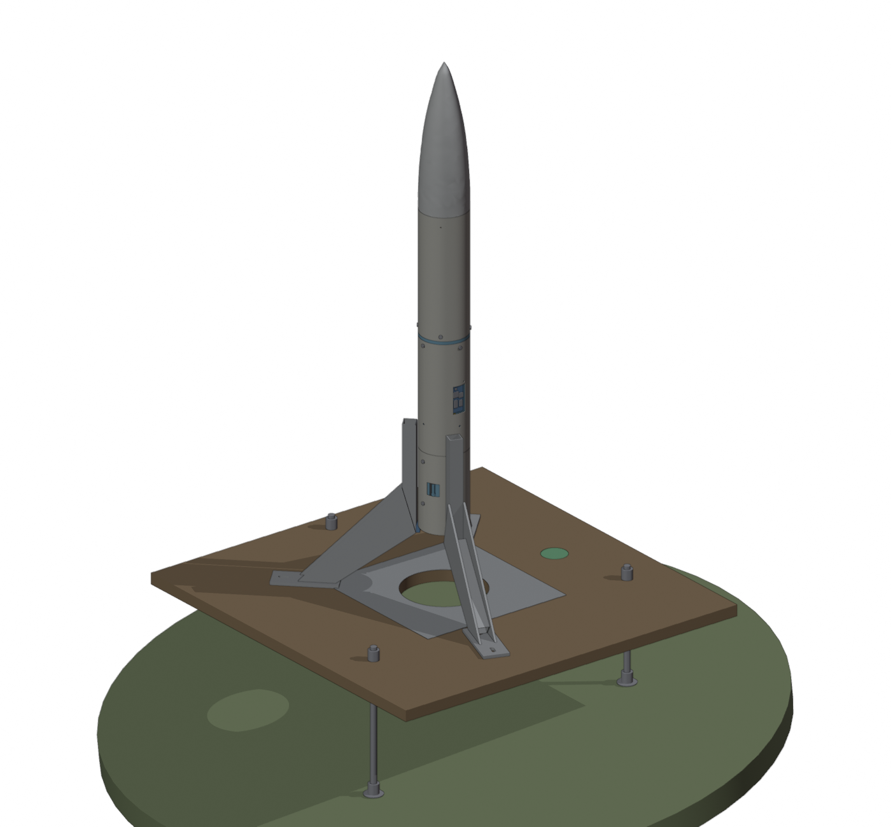<br><sub>Startrampe auf drei verstellbaren Beinen</sub></td>
<td align="center">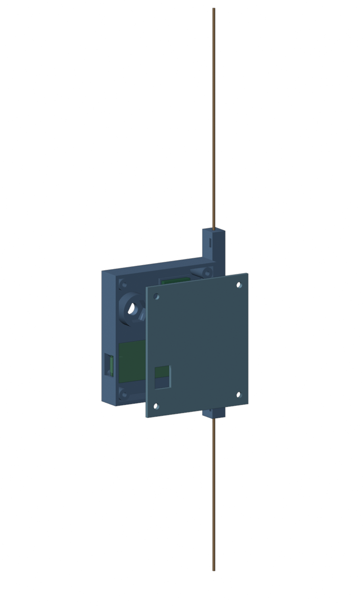<br><sub>Funkbrücke mit Halbwellen-Dipol</sub></td>
</tr>
<tr>
<td align="center" colspan="2">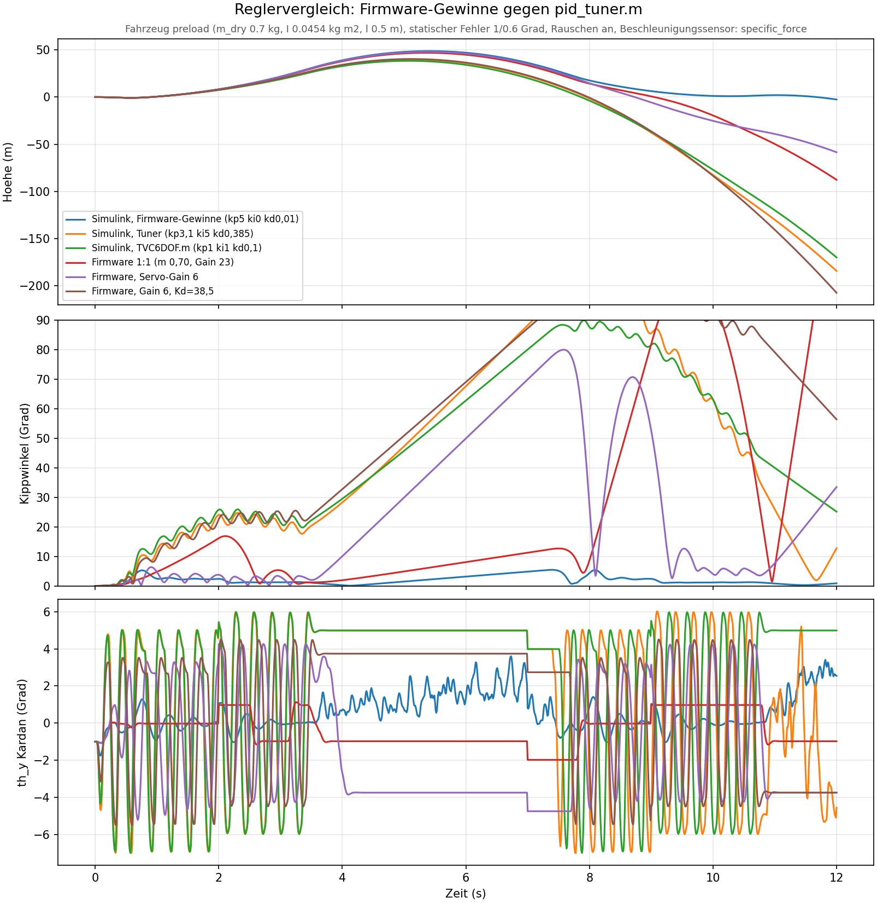<br><sub>Simulation: alte Verstärkungen (Kardan am Anschlag) gegen die abgestimmten</sub></td>
<td align="center">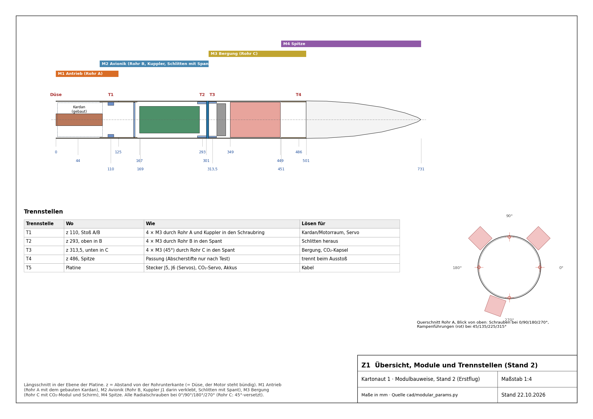<br><sub>Übersichtszeichnung aus der Bauanleitung</sub></td>
</tr>
</table>

## Werkbank: die Platine am PC

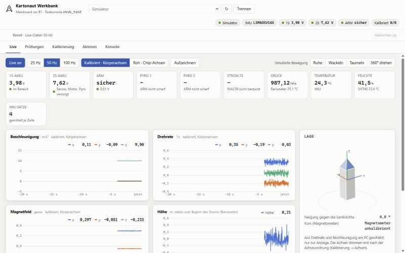

Die Werkbank verbindet den PC über den USB-Anschluss des Teensy mit dem Flugcomputer. Ein
Python-Programm liest die serielle Schnittstelle der Testkonsole `revb_test` und schickt Befehle und
Kalibrierwerte zurück; bedient wird im Browser auf dem eigenen Rechner, ohne Netz.

| Reiter | Was er kann |
|---|---|
| **Live** | Beschleunigung, Drehrate, Magnetfeld und Höhe als Verlauf, Lage in 3D, Akkus, ARM, Pyro-Durchgang; roh oder kalibriert, Aufzeichnung als CSV |
| **Prüfungen** | ein Knopf je Prüfung der Testkonsole, Ergebnistabelle, Bericht als Markdown und JSON |
| **Kalibrierung** | geführt je Sensor: Beschleunigung aus sechs oder beliebig vielen Ruhelagen, Magnetometer per Ellipsoid-Fit mit Bild der Abdeckung, Achszuordnung, Gyro, Spannungs- und Strommessung, Servos |
| **Aktoren** | Servos, Rollmotor, Pyrokanäle; gezündet wird nur mit ARM, Durchgang und von Hand getipptem `JA` |
| **Konsole** | alle Zeilen der Testkonsole und eine Befehlszeile |

```bash
pip install pyserial numpy
```

```bash
python firmware/tools/werkbank.py --sim    # ohne Hardware: simulierte Platine mit bekannten Sensorfehlern
```

```bash
python firmware/tools/werkbank.py          # sucht den Teensy mit der Testkonsole revb_test
```

Erste Version: gegen die simulierte Platine getestet (18 Tests in der CI), an der echten Platine ist sie
noch nicht gelaufen. Verfahren, Aufbau und Grenzen stehen in
[`firmware/tools/bench_gui/`](firmware/tools/bench_gui/README.md).

## Sensorfusion, Zustandsschätzung und Navigation

Der Flugcomputer schätzt heute **Lage** und **Höhe**. Für eine Landung am Zielpunkt kommt die **seitliche
Position** dazu, und aus dem Halten der Lage wird eine Führung. Die Überlegungen dazu und eine
Monte-Carlo-Studie über Flugprofil, Wind, Schubdrossel, Regelung und Sensorik stehen in
[docs/Navigation_und_Landung_2026-11-15.md](docs/Navigation_und_Landung_2026-11-15.md).

| Ebene | Heute im Flug-Code | Für die Punktlandung (simuliert, noch nicht in der Firmware) |
|---|---|---|
| Lage | Gyro-Quaternion mit 250 Hz aus den gemittelten FIFO-Werten der IMU. Auf der Rampe stützen Schwerkraft und Magnetometer die Lage und lernen den Gyro-Nullpunkt, ab dem Start läuft nur der Gyro | unverändert; im Modell nach 7 s auf 0,7° genau |
| Höhe | Kalman-Filter aus Beschleunigung und Barometer (Höhe, Steiggeschwindigkeit) mit Ausreißertor gegen Druckstöße | dazu ein Laser-Höhenmesser für die letzten Meter |
| Position | fehlt | derselbe Filter je Achse mit einem dritten Zustand für den Beschleunigungsfehler, gestützt durch GPS relativ zum eingemessenen Startpunkt und wahlweise eine Kamera mit Zielmarke |
| Kurs | Magnetometer, nur auf der Rampe | verbindet die GPS-Koordinaten mit den Körperachsen, in denen der Kardan stellt; auf 10° nötig |
| Führung | Schubrichtung senkrecht halten | die Drossel führt senkrecht auf Höhe null zum Brennschluss, der Kippwinkel seitlich auf den Zielpunkt |

Die Grundgedanken:

- **Schnell statt glatt.** Regelung und Servos laufen mit 250 Hz. Gegen Vibrationen wird über die IMU-Werte
  eines Takts gemittelt statt träge gefiltert; sonst faltet sich eine Schwingung des Motors zu einer
  scheinbaren Drehung herunter, die kein Servo mehr glättet.
- **Im Flug nur der Gyro.** Unter Schub misst der Beschleunigungssensor den Schub und nicht die Schwerkraft,
  und das Magnetometer sitzt neben den Servoströmen. Beide stützen deshalb nur auf der Rampe.
- **Trägheitsnavigation trägt Sekunden, nicht länger.** 0,3° Lagefehler oder 5 mg Nullpunktfehler sind nach
  7 s gut 1 m. Für einen Hüpfer reicht die IMU, für alles Längere braucht es GPS oder Kamera.
- **GPS relativ statt absolut.** Wird der Zielpunkt vor dem Start mit demselben Empfänger eingemessen, zählt
  nur, wie weit sein Fehler während des Flugs wandert. Die Kamera wird mit sinkender Höhe genauer und braucht
  keinen Kurs.

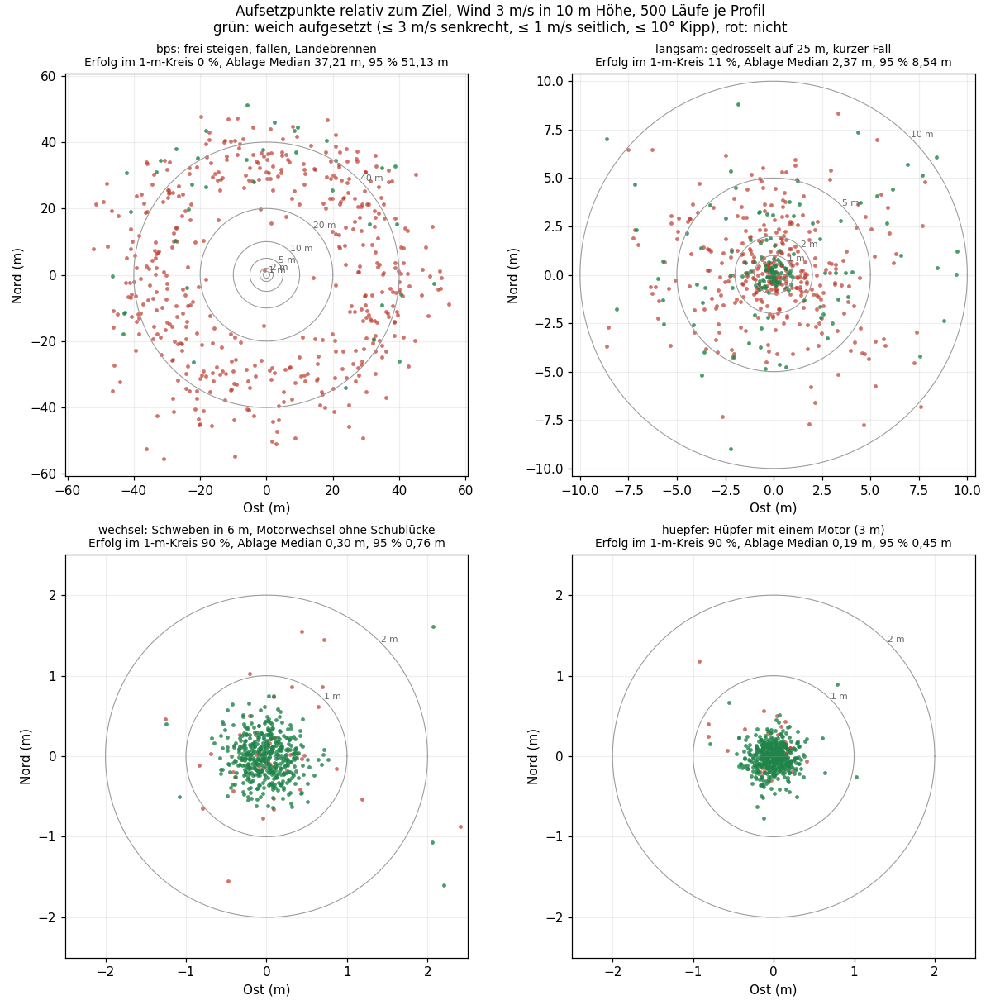

Was die Simulation dazu sagt (500 Flüge je Fall mit gestreuter Brennkurve, Stellgliedern, Masse,
Aerodynamik, Wind, Sensorrauschen und Kalibrierfehlern; Erfolg = weich und aufrecht im 1-m-Kreis um das Ziel):

| Flugprofil | Windstill | 3 m/s Wind | Ablage bei 3 m/s (Median / 95 %) |
|---|---|---|---|
| frei steigen, antriebslos über den Gipfel, Landebrennen (wie Scout F) | 7 % | 0 % | 37 m / 51 m |
| gedrosselt auf 25 m, eine Sekunde Fall, Landebrennen | 88 % | 11 % | 2,4 m / 8,5 m |
| Schweben in 6 m, der zweite Motor übernimmt ohne Schublücke | 98 % | 90 % | 0,30 m / 0,76 m |
| Hüpfer auf 3 m mit einem Motor | 93 % | 90 % | 0,19 m / 0,45 m |

- **Nie ohne Schub.** Die finnenlose Rakete kippt antriebslos weg; bei der Landezündung steht sie im Median
  26 bis 34° schief. Wo der Schub nie aussetzt, hält der Kardan die Lage.
- **Schubdrossel:** Der kleinste Schub darf höchstens das halbe Gewicht sein, das heißt Schubfaktor 0,35 bei
  0,8 bis 1,0 kg. Mit 0,5 landet bei 0,8 kg nur noch gut die Hälfte weich.
- **Stabilisierung:** Servo-Totzeit höchstens 30 ms (bei 50 ms 59 %, bei 80 ms 0 %), Kardan ±5 bis ±8°,
  Nullstellung auf 1°.
- **Zwei Motoren:** Nebeneinander ist verworfen (Platz im Rohr, Stellweg des Kardans). Hintereinander in
  einem Magazin mit Motorwechsel geht im Modell, solange die Rakete höchstens 0,35 s ohne Schub ist; siehe
  den nächsten Abschnitt.
- **Sensorik:** nur IMU und Barometer 50 %, mit dem vorhandenen GPS 90 %, mit Kamera 0,11 m Ablage im Median.
  Ohne Kalibrierung der Sensoren 39 %; ein Kursfehler von 30° kostet mit GPS ein Drittel der Landungen.
- **Fläche und Wind:** ein Kreis mit 1 m Radius fängt 95 % der Landungen bis 3 m/s Wind; bei 5 m/s hält die
  Rakete den Punkt nicht mehr.
- **Für den Erstflug:** mit dem aerodynamischen Moment im Modell verliert *Kartonaut 1* ab 5 m/s Wind in 6 %
  der Läufe die Lage. Empfehlung: nicht über 3 m/s starten.

Das sind Modellwerte. Sie hängen an Annahmen, die erst Versuche prüfen: der Aerodynamik der finnenlosen
Rakete, der Totzeit der Servos und der Kennlinie der Drossel (Abschnitt 6 des Dokuments).

```bash
cd simulation && python scripts/pinpoint_study.py     # 157 Szenarien, 2 bis 5 Minuten
```

## Motorwechsel, Schubdrossel und der Hüpfer

Für die Landung mit zwei Motoren sollen die Motoren hintereinander sitzen. Die Idee ist ein Magazin mit
„Kugelschreiber-Logik“: Der Schub des ersten Motors entriegelt die Mechanik, nach dem Brennschluss wirft eine
Feder die leere Hülse aus und schiebt den zweiten Motor in die Brennstellung, wo er zündet. Rechnung, Bilder
und offene Punkte in
[docs/Motorwechsel_und_Huepfer_2026-11-15.md](docs/Motorwechsel_und_Huepfer_2026-11-15.md).

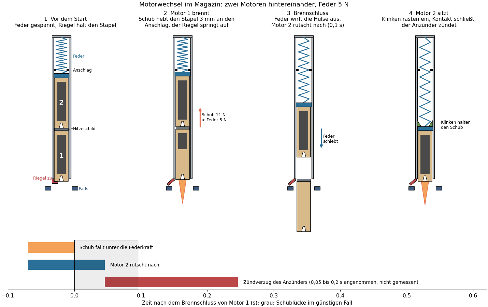

- **Das Nachrutschen dauert etwa 0,1 s** (Feder 5 N). Mit dem Zündverzug des Anzünders ist die Rakete 0,15
  bis 0,35 s ohne Schub.
- **Bis 0,35 s Lücke landet sie aus 6 m so gut wie ohne Lücke** (96 bis 99 % im 1-m-Kreis bei 1,5 m/s Wind,
  79 bis 93 % bei 3 m/s). Über 0,4 s fehlt die Zeit zum Bremsen. Der Zündverzug ist nicht gemessen.
- **Die Drossel braucht jede Variante,** und die Masse hilft: Bei 0,75 kg muss der Schubfaktor 0,35 sein, bei
  1,05 kg reicht 0,5.
- **Der Fallschirm entfällt bei diesen Flügen** (aus 3 bis 9 m öffnet er nicht). Das macht 94 g frei; Drossel und
  Beine brauchen etwa 119 g.
- **Empfehlung:** zuerst der Hüpfer mit einem Motor (94 % bei 1,5 m/s Wind, keine Wechselmechanik), das
  Magazin parallel als Tischversuch.

**Schubdrossel: Schlitzscheibe mit einem Servo** ([`cad/throttle_plate.py`](cad/throttle_plate.py), Konzept vom
16.11.): Ein einzelnes Edelstahlblech dreht sich 15 mm unter der Düse um eine Welle neben dem Motor. Im Blech ist
ein Schlitz, der von einem Loch Ø 27 keilförmig auf 2 mm zuläuft; Drehen schiebt eine andere Breite unter die Düse.

- **Fehlerverzeihend:** Beide Kanten sind im selben Teil. Spiel im Gestänge ändert nur die Stärke der Drosselung,
  nicht die Symmetrie. Mit 15 mm Abstand wirkt die Scheibe auf den freien Strahl und staut nicht in die Düse zurück.
- **Passt zum Motorwechsel:** Durch das Loch Ø 27 fällt die leere Hülse (Ø 24). Fährt die Scheibe 0,3 s vor dem
  Brennschluss auf, kostet das keine Landung (98 % bei 1,5 m/s Wind).
- **Ein Servo, 29 g** (statt 60 g mit zwei Servos). Die Strahlkraft trägt die Welle, das Servo hat in der
  Schubspitze 2,3-fache Reserve. Gestänge und Servo liegen über der Düse im Rohr, weg vom Abgas.
- **Kardan:** frei bis ±5° in beiden Achsen (1,6 mm Luft zur Rohrwand); bei ±7° in beiden Achsen stößt eine
  Servoecke an.
- **Eigenheit des Keilschlitzes:** Der durchgelassene Strahl sitzt bei tiefer Drosselung bis 3,5 mm außermittig.
  Das wirkt wie 1° Ablenkung, ist bei jedem Flug gleich und kostet in der Simulation höchstens 3 Prozentpunkte,
  mit Vorsteuerung im Regler nichts.
- **Offen:** die Kennlinie Stellung → Schub und die Querkraft (Versuch E05), die Wärme an Scheibe und Welle, und
  dass die Scheibe 12 mm über das Rohr hinaus schwenkt (Fahrwerk).

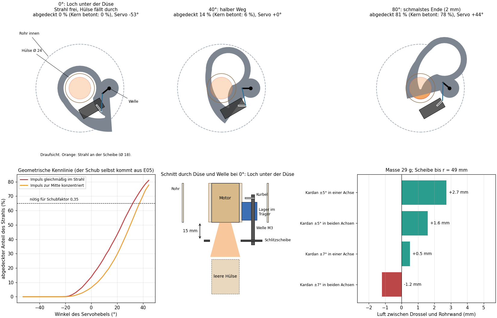

<table>
<tr>
<td align="center" width="33%">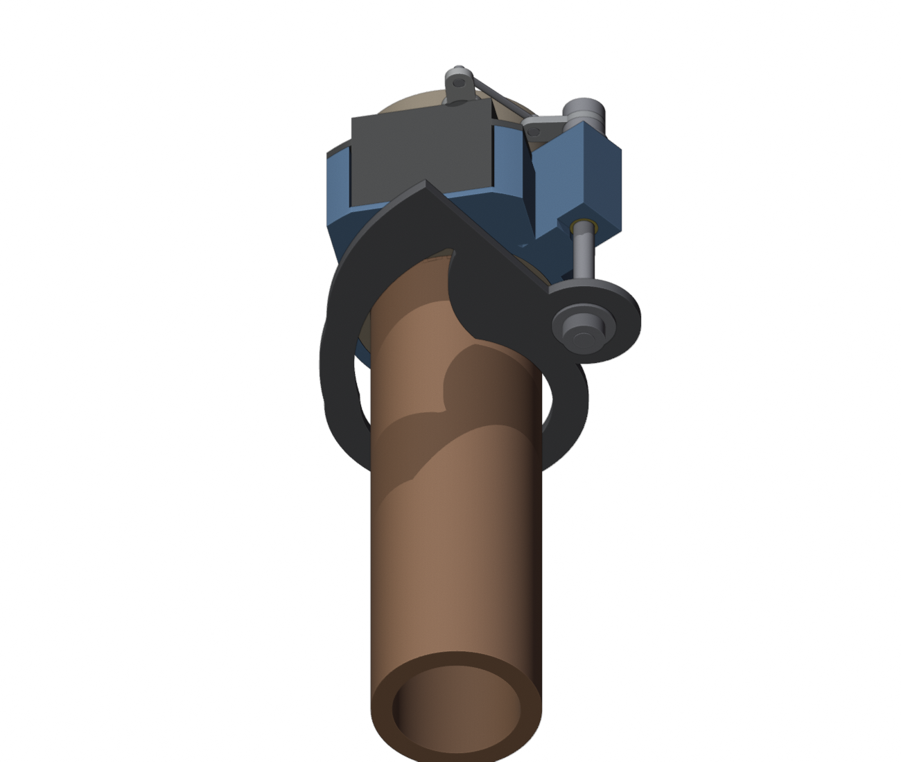<br><sub>Loch unter der Düse: die leere Hülse fällt durch</sub></td>
<td align="center" width="33%">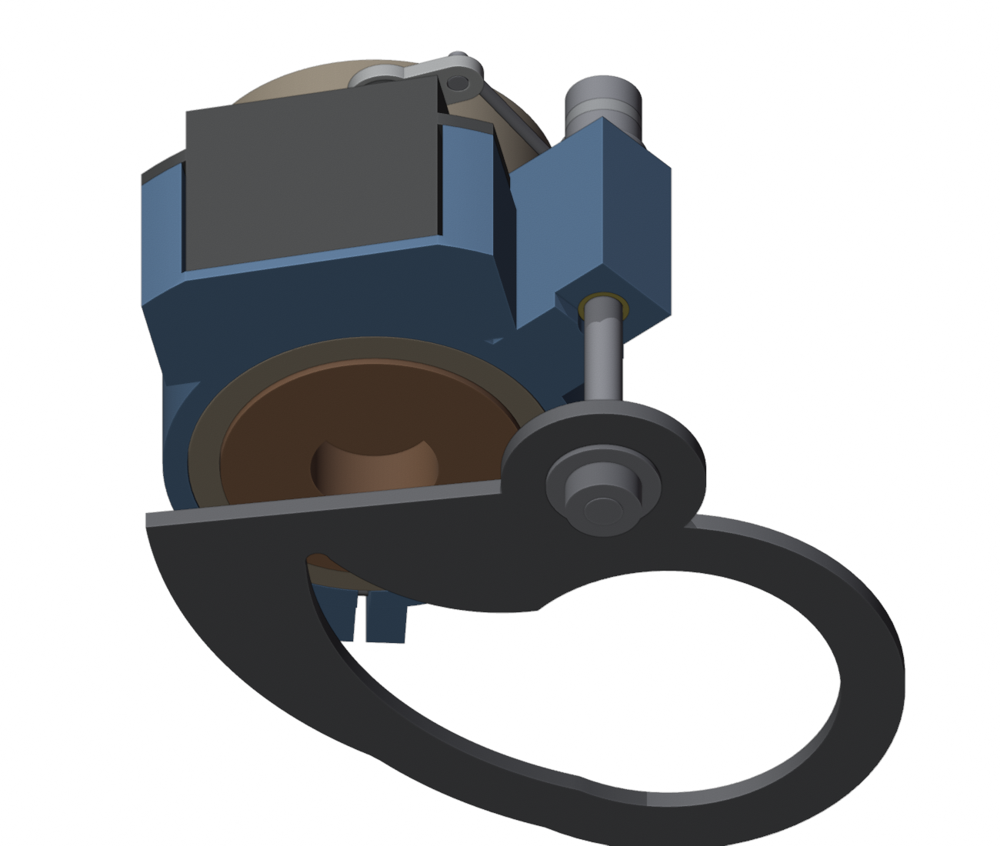<br><sub>gedrosselt (60°), von unten</sub></td>
<td align="center" width="33%">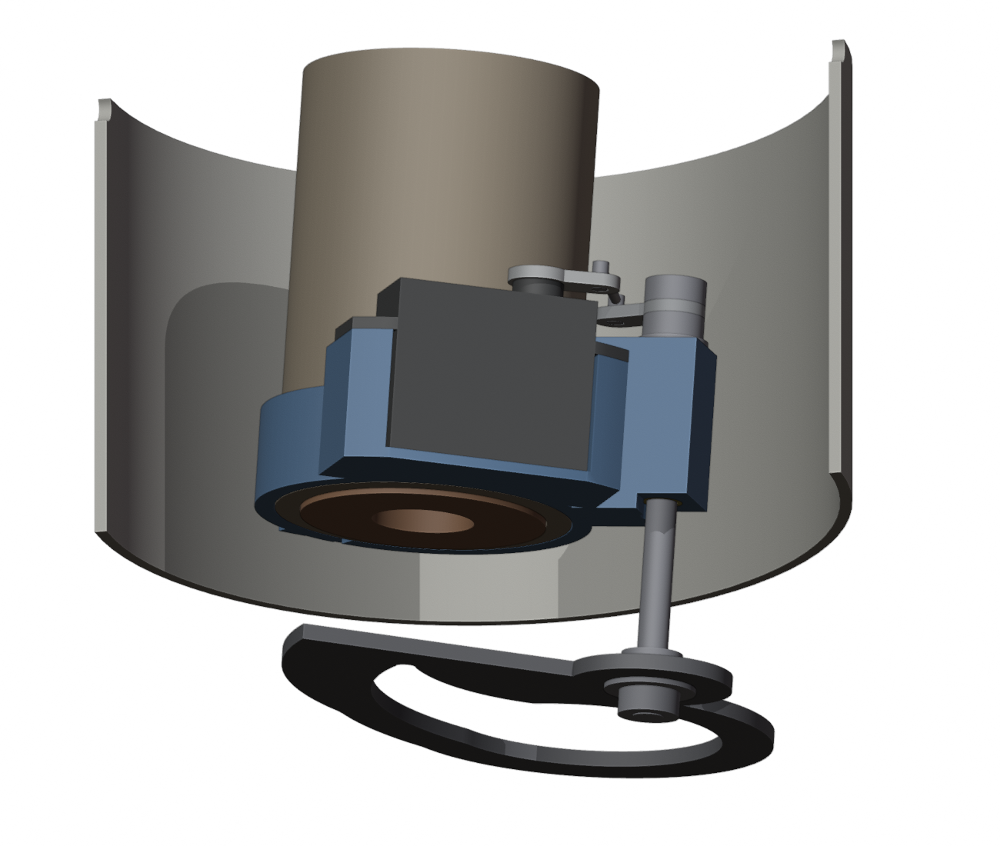<br><sub>im Rohr, Kardan 5°/5°</sub></td>
</tr>
</table>

**Warum nicht die Pads mit Gestänge vom 15.11.** ([`cad/throttle.py`](cad/throttle.py)): Die Landung verträgt nur
etwa 1° zufällige Querablenkung durch ungleiches Abblocken (bei 3° gelingen noch 60 bis 74 %). Pads 1,5 mm unter
der Düse können das nach einer Abschätzung schon bei 0,5 mm Kantenfehler überschreiten. Eine Irisblende scheidet
aus, weil ihre dünnen Lamellen im Strahl durchglühen.

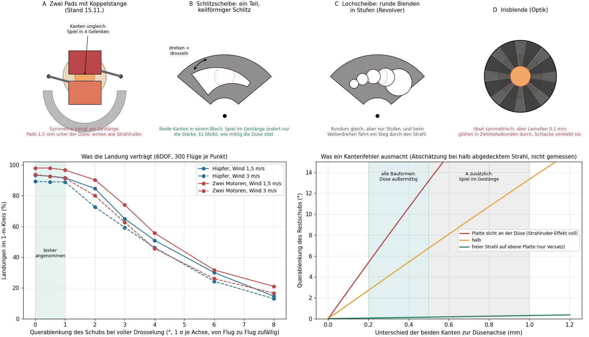

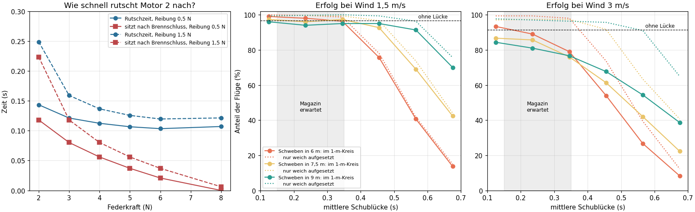

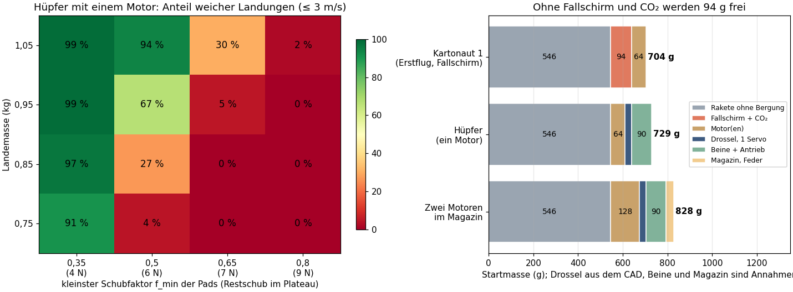

Das Magazin ist ein Konzept und nicht konstruiert, die Drossel ist konstruiert und nicht gebaut; alle Zahlen
sind Modellwerte.

## Was drin ist

| Teil | Inhalt | Wo |
|---|---|---|
| Mainboard | KiCad-Projekt aus `circuit.py` erzeugt: Schaltplan, Layout, Gerber/BOM/CPL, Datenblatt | [hardware/mainboard/](hardware/mainboard/README.md) |
| Simulation | Python-6DOF-Modell `tvcsim` mit 1:1 portiertem Firmware-Regler, Reglerabstimmung, Landestudien, Punktlandung mit Sensoren und Navigation | [simulation/](simulation/README.md) |
| Firmware | PlatformIO für Teensy 4.1: Flugsoftware, Sensortreiber, Testkonsole mit Oberfläche am PC, native Tests | [firmware/](firmware/README.md) |
| Mechanik | parametrisches CAD für Druckteile, Startrampe, Prüfstand; Massen- und Trägheitsmodelle | [cad/](cad/README.md) |
| Bauanleitung | Module, Teileliste, Bauschritte, Kabelplan ([PDF](docs/bauanleitung/Bauanleitung_Kartonaut1.pdf)) | [docs/Bauanleitung_Kartonaut1.md](docs/Bauanleitung_Kartonaut1.md) |
| Bodensystem | Startprotokoll, Funkbrücke, ESP32-Station als spätere Option | [groundstation/](groundstation/README.md) |
| Versuche | fertige Abläufe für die Bodentests | [docs/experiments/](docs/experiments/README.md) |

```bash
cd simulation && python -m pytest tests            # Tests der Simulation
cd firmware && pio test -e native                  # Firmware-Tests ohne Hardware
cd firmware && pio run -e teensy41_revb            # Flug-Firmware für rev B1
MS_CONFIG=erstflug python cad/modular.py           # Druckteile, Masse, Renderings
```

## Hintergrund

Vorbild ist die „Scout F“ von [BPS.space](https://bps.space). Spätere Flüge bekommen vielleicht
Landebeine, eine Landezündung mit zweitem Motor und eine Rollregelung; die Platine hat dafür schon Platz.
Die alte Bodenstation liegt in [kartonaut-ground](https://github.com/Jan-Philipp-Munsch/kartonaut-ground).

## Lizenz

[MIT](LICENSE). Die Scout-F-Dateien von BPS.space, die als Vorlage dienten, sind nicht Teil dieses Repositorys.
