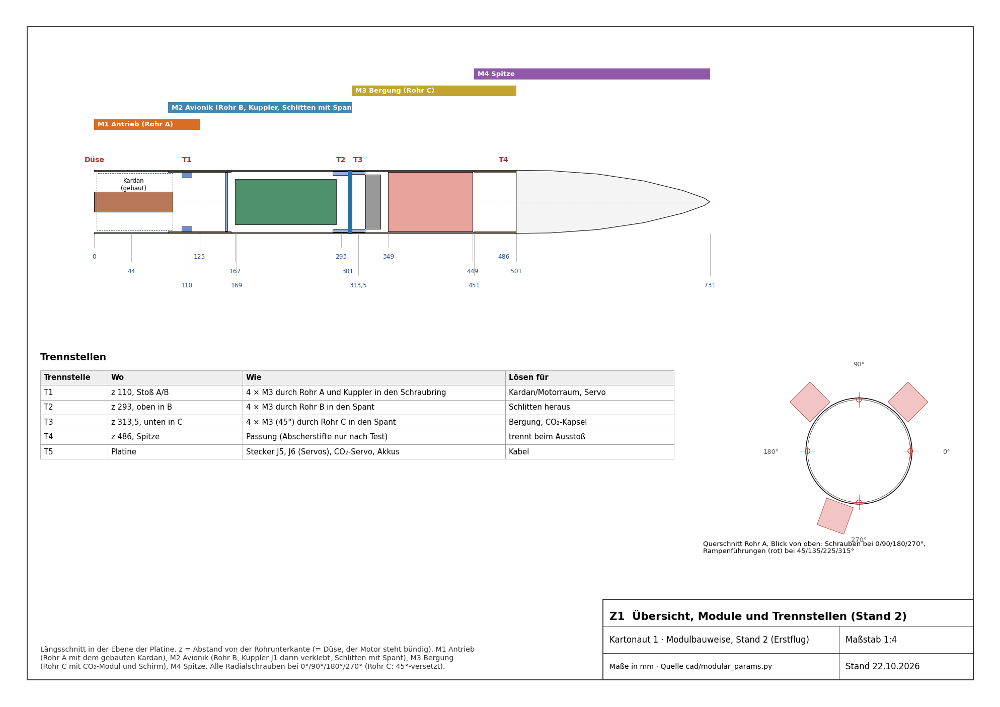
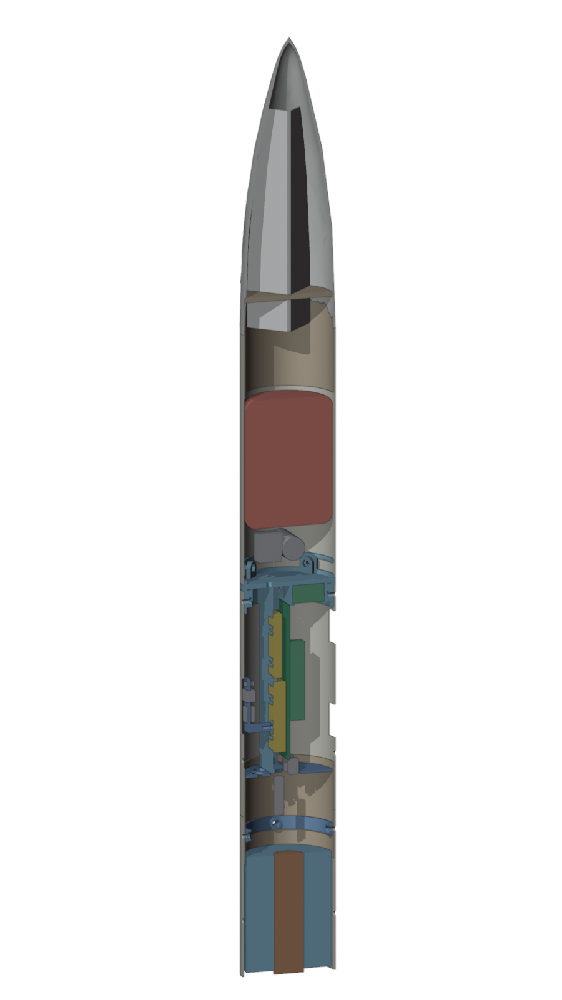
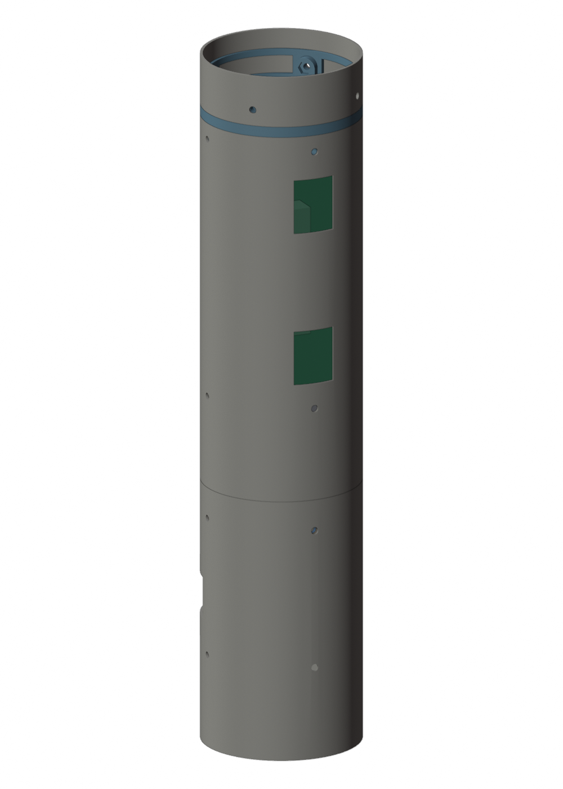
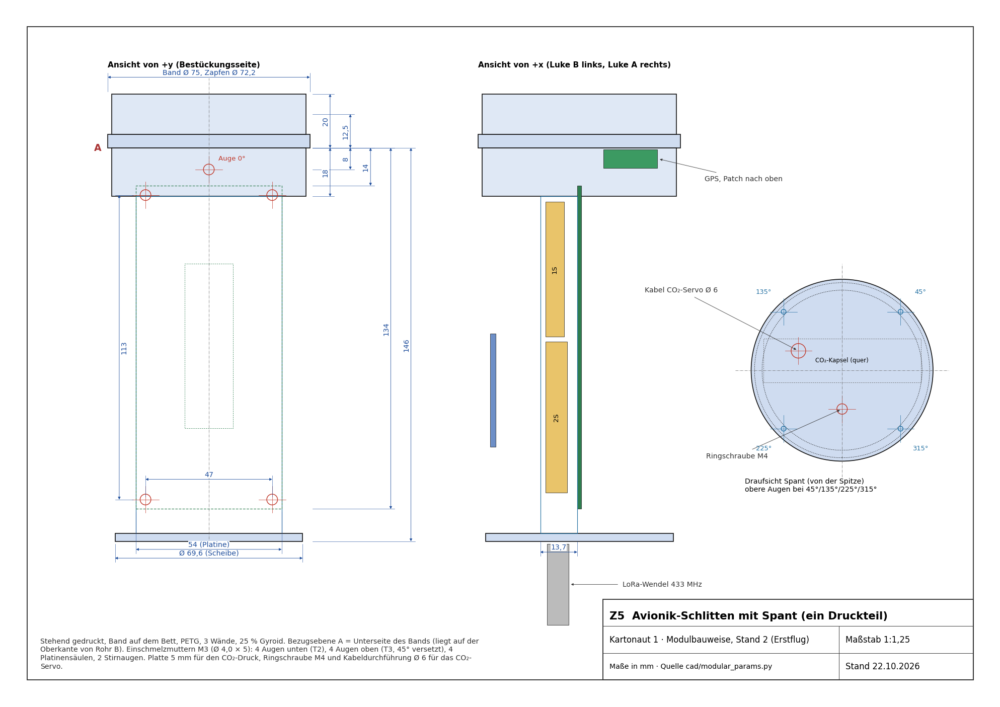
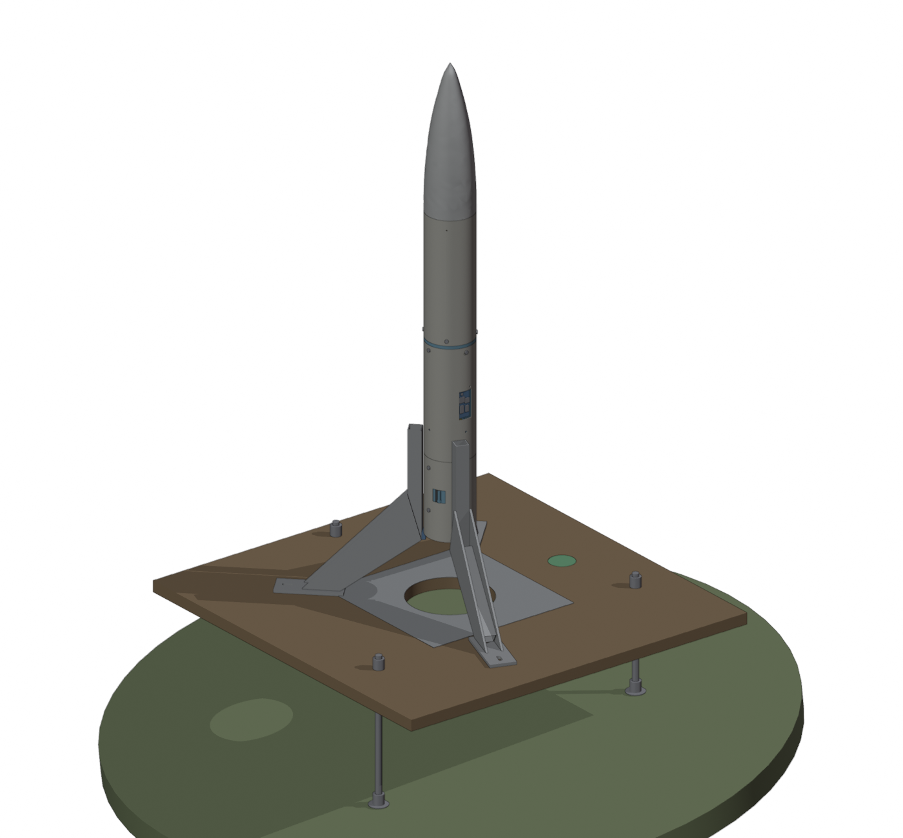

# Kartonaut


[](LICENSE)
[](firmware/)
[](simulation/)
[](https://github.com/Jan-Philipp-Munsch/kartonaut/actions/workflows/ci.yml)

*English version: [README.md](README.md).*

**Kartonaut** aus Karton und Astronaut: Der Rumpf ist ein Klima-Papprohr. Die Flüge zählen hoch, der Erstflug ist *Kartonaut 1*. Abzeichen und Logo in [`docs/brand/`](docs/brand/).

Eine Modellrakete mit Schubvektorsteuerung (TVC) und selbst entwickeltem Flugcomputer, aufgebaut
nach dem Vorbild der „Scout F“ von [BPS.space](https://bps.space). Der Motor hängt in einem Kardan
mit zwei Servos; ein Teensy 4.1 mit IMU, Barometer, Strommonitor, SD-Logger und 433-MHz-LoRa-Funk
hält die Lage und spricht mit einer Bodenstation, die vom Handy aus bedient wird. Das Gesamtsystem wird
vor dem Flug in einem 6DOF-Modell simuliert. *Kartonaut 1* fliegt auf einer TSP E12, hält während des
Brennens die Lage und kommt am Fallschirm zurück, den eine CO₂-Kartusche ausstößt. Landebeine,
Landebrennen mit zweitem Motor, Rollmotor und Pyro-Kanäle bleiben späteren Flügen vorbehalten und sind
auf der Platine schon vorgesehen.

*Stand: 26.10.2026.*



## Auf einen Blick: *Kartonaut 1*

| | |
|---|---|
| Rumpf | Klima-Papprohr Ø 75 mm (innen 72,6 mm) in drei Modulen: Rohr A 125 mm (Kardan), Rohr B 176 mm (Avionik), Rohr C 195 mm (Bergung); zwei halbe Kuppler, Klima-Kunststoffspitze; 731 mm lang. Alle radialen Schrauben M3 |
| Motor | TSP E12-0, 24 mm, 39 Ns, 12 N mittlerer Schub, 28 N Spitze, 3,5 s Brenndauer, ohne Ausstoßladung; vier vorhanden |
| Startmasse | **705 g** im Massenbudget ([`cad/mass_stand2b.md`](cad/mass_stand2b.md), Druckteile Stand 2c), Schwerpunkt 259 mm über der Düse, Hebelarm Kardan–Schwerpunkt 190 mm, Schub-Gewicht 1,7; Ziel unter 750 g erreicht. Noch nichts gewogen |
| Flugcomputer | Teensy 4.1 auf Mainboard **rev B1** (KiCad aus Code, fertig geroutet, DRC 0 Fehler, Bestelldateien fertig, im Review): IMU LSM6DSV16X, Barometer BMP390, Strommonitor INA239, alle an SPI1 hinter einem CS-Decoder; Magnetometer LIS3MDL und SHT40 an I²C; LoRa E22-400T22S, microSD, vier Pyro-Kanäle (zwei bestückt), Stapelstecker |
| Versorgung | zwei Akkus: 1S-LiPo für die Elektronik (Buck-Boost), 2S LemonRC 450 mAh für die Servos; FET-Lastschalter hinter einem mechanischen Schalter, beide in der Rakete ladbar |
| Aktorik | Schubstangen-Kardan mit 2 × FrSky Xact W5652H direkt an 2S (gebaut und in Rohr A eingepasst); ein Servo löst die CO₂-Kartusche aus. Kein Rollmotor beim Erstflug |
| Bergung | 8-g-CO₂-Kartusche drückt die Spitze ab; Fallschirm 125 cm in Rohr C |
| Regelung | Lage als Quaternion aus dem Gyro, PID auf Nick/Gier → Moment → Kardanwinkel über `M = l · T · sin δ`; 100 Hz; Rollen ungeregelt. Flugzustandsautomat `SAFE → PAD_READY → BOOST → COAST → APOGEE → DESCENT → LANDED` mit Watchdog und Zustandsspeicher |
| Simulation | Python-6DOF: mit 705 g trägt eine E12 die Rakete auf etwa 74 m (ohne Luftwiderstand); Kp 2 / Ki 1 / Kd 0,45 aus einer Bayes-Optimierung halten die Neigung unter 2,5°, ohne dass der Kardan anschlägt |
| Bodensystem | ESP32-S3-Bodenstation mit Weboberfläche fürs Handy, Zündung über 15 m Leitung mit Schlüssel, ARM-Schalter und Relais; Startrampe 600 × 600 mm auf drei verstellbaren Beinen |
| Stand | Kardan, Rohr A und Rohr B gebaut; Platine nach dem Review bestellfertig; Flug- und Tischtest-Firmware geschrieben und ohne Hardware getestet; **noch kein Flug** |

## Projektstand

**Erledigt**

- Konzept, Massen- und Strombudget; Rumpfteile, Fallschirm, Motoren, CO₂-Kartuschen und Antrieb des Prüfstands gekauft; Schubstangen-Kardan mit den W5652H gebaut.
- **Bauanleitung *Kartonaut 1*** in Modulbauweise mit Zeichnungen, Bohrschablonen 1:1, Stückliste, Bauschritten, Wartung und Kabelplan; Massenbudget Stand 2c (705 g).
- **6DOF-Simulation**: MATLAB/Simulink-Modell nach Python portiert, mit 1:1-Kopie des Flugreglers; Physik-Durchsicht (Luftwiderstand, Bodenkontakt, Treibstoffmodell), Reglergewinne per Bayes-Optimierung, Studien zu Landebrennen und Schubdrossel; 45 Tests.
- **Flug-Firmware**: Gyro-Quaternion, Zustandsautomat, Pyro-Logik, Telemetrieprotokoll mit CRC, Watchdog mit Zustandsspeicher, Sensor-Backends für Breakouts und rev B, Landebrennen und Drosselregler (für den Erstflug abgeschaltet); 42 native Tests inkl. Software-in-the-Loop gegen die Simulation.
- **Tischtest-Firmware rev B1**: Treiber für LIS3MDL, SHT40, ADXL375, IMU-Selbsttest, Testkonsole `revb_test`, geführte Kalibrierung mit CRC, `bench_test.py` am PC, Versuche E01, E02, E05 und zwölf Tischversuche.
- **Mainboard rev B1**: Review-Punkte und Entscheidungen E1–E12 eingearbeitet, fertig geroutet (DRC 0 Fehler, 0 offen), Gerber/BOM/CPL für JLCPCB, Prüfanleitung und Einkaufsliste.
- **Bodenstation** (Konzept, Sicherheitskonzept, Schaltung, Stückliste, ESP32-S3-Firmware mit Weboberfläche) und **Startrampe** (CAD gegen die Rakete geprüft); Schnittstellen Rakete/Rampe/Station/Handy festgelegt; Budgetplan bis zum Erstflug.
- CI auf GitHub Actions: alle PlatformIO-Umgebungen, Simulationstests, native und Host-Tests, Pin-Abgleich gegen die Platine.

**Als Nächstes**

1. Review von rev B1 nach [`REVIEW_ANLEITUNG_revB1.md`](hardware/mainboard/REVIEW_ANLEITUNG_revB1.md), Papierprobe in Rohr B, JLCPCB-Angebot mit den Dateien aus `hardware/mainboard/kicad/fab/` wiederholen und nach Freigabe bestellen (ein Testangebot mit den älteren rev-B-Dateien lag bei etwa 165 $ für zwei bestückte Platinen); den Rest nach [`EINKAUFSLISTE_revB1.md`](hardware/mainboard/EINKAUFSLISTE_revB1.md) kaufen.
2. Firmware: Treiber LSM6DSV16X hinter `Imu.h`, CO₂-Auslösung aus dem Zustandsautomaten, Kalibrierwerte in den rev-B-Sensorpfad, gemeinsamer Telemetrie-Header mit der Bodenstation.
3. Rakete nach der Anleitung bauen: Teile drucken und wiegen, Rakete wiegen, Schwerpunkt auspendeln, Masse, Hebelarm und die neuen Gewinne in `Config.h`.
4. Tischtest rev B1 mit `revb_test`, dann Bodentests: Servo-Kardan-Verhältnis (E01/E02), CO₂-Ausstoß dreimal (auch kalt), TVC-Prüfstand mit Propellermotor, Funkreichweite, Startfreigabe vom Handy.
5. Bodenstation und Startrampe bauen (etwa 80 € und 86 €).
6. *Kartonaut 1*: geregelter Aufstieg auf einem Motor, Bergung am Fallschirm.

Arbeitspakete, Befunde und Änderungsverlauf stehen in [PROJECT.md](PROJECT.md), das Baulog in
[docs/BUILD.md](docs/BUILD.md), der Plan bis zum Erstflug in [docs/Plan_2026-10-22.md](docs/Plan_2026-10-22.md),
das Budget in [docs/Budget_2026-10-22.md](docs/Budget_2026-10-22.md).

## Bauanleitung: *Kartonaut 1* in Modulbauweise

[docs/Bauanleitung_Kartonaut1.md](docs/Bauanleitung_Kartonaut1.md) (auch als
[PDF](docs/bauanleitung/Bauanleitung_Kartonaut1.pdf)) beschreibt, wie der erste Flieger aus dem schon
gebauten Kardan entsteht. Vier Module, drei Stöße mit je vier M3-Schrauben in eingelegte Muttern:

| Modul | Inhalt |
|---|---|
| M1 Antrieb | Rohr A 125 mm mit Schubstangen-Kardan, zwei W5652H, Motor unten bündig |
| M2 Avionik | Rohr B 176 mm, Kuppler mit Schraubring, gedruckter Schlitten mit Spant, Platine, 2S und 1S, GPS unter dem Spant, LoRa-Wendel unten, Schalterbrett hinter Luke B |
| M3 Bergung | Rohr C 195 mm, CO₂-Modul auf dem Spant, Fallschirm, Fangleine |
| M4 Spitze | Klima-Spitze mit Holzplatte und Haken, über den zweiten halben Kuppler gesteckt |

<p>



</p>

Mit Stand 2b festgelegt: kein Ringstapel und keine Gewindestangen (die Platine sitzt auf einem
gedruckten Schlitten), **kein Rollmotor** (Masse, Vibration, ohne Finnen kaum Rollmoment), **CO₂ statt
Schwarzpulver** (kein Sprengstoff, am Tisch beliebig oft testbar), Schraubschalter statt
Schlüsselschalter, GPS und LoRa-Antenne im Avionikraum. Zeichnungen und Schablonen kommen aus
[`docs/bauanleitung/zeichnungen.py`](docs/bauanleitung/zeichnungen.py), die Druckteile aus
[`cad/modular.py`](cad/modular.py).

```bash
MS_CONFIG=erstflug python cad/modular.py       # Druckteile, Kollisionsprüfung, Masse, Renders
python docs/bauanleitung/zeichnungen.py        # Zeichnungen und Schablonen 1:1
python cad/mass_stand2b.py                     # Massenbudget, Schwerpunkt, Trägheit
```

## Massenbudget

Vier Modelle in drei Tagen, jedes leichter als das vorige. Modellwerte aus
[`cad/mass_properties.md`](cad/mass_properties.md) und [`cad/mass_stand2b.md`](cad/mass_stand2b.md);
gewogen wird nach dem Drucken.

| Konfiguration | Start | Schwerpunkt über Düse | Hebelarm Kardan–Schwerpunkt | Ixx = Iyy | Izz (Roll) | E12 in der Simulation |
|---|---|---|---|---|---|---|
| `voll` (21.10.): 1000 mm, Beine, Ringstapel, Kolben | 981 g | 449 mm | 372 mm | 0,110 kg·m² | 0,00105 kg·m² | 20 m, Schub-Gewicht 1,1 |
| `erstflug` (22.10.): 700 mm, ohne Beine, Kolben | 761 g | 318 mm | 242 mm | 0,046 kg·m² | 0,00057 kg·m² | – |
| Stand 2b (22.10.): 496 mm Rohr in drei Modulen, CO₂, ohne Rollmotor | 723 g | 256 mm | 186 mm | 0,021 kg·m² | 0,00047 kg·m² | 63 m |
| **Stand 2c (23.10.): Druckteile im Leichtbau** | **705 g** | 259 mm | 190 mm | 0,021 kg·m² | 0,00047 kg·m² | **74 m**, Schub-Gewicht 1,7 |

Der Hebelarm ist halb so lang wie bei `voll`, die Querträgheit ein Fünftel. Mit den echten Werten stehen
die alten Gewinne Kp 5 / Kd 1 zwei Drittel des Brennens am Kardananschlag; Kp 2 / Ki 1 / Kd 0,45 aus
einer Bayes-Optimierung (`simulation/scripts/tune_bayes.py`, robust gegen 30 und 50 ms Servo-Totzeit)
regeln sauber. Weitere Hebel bis 593 g stehen in
[docs/Gewicht_und_Landung_2026-10-23.md](docs/Gewicht_und_Landung_2026-10-23.md). Die Schubspitze der E12
ergibt bei 705 g etwa 4 g am Beschleunigungssensor, weit innerhalb der ±16 g der IMU.

## Was die Simulation sagt

Das Simulink-Modell (Starrkörper mit Quaternionen, Schubkurve TSP E12, aus Sprungantworten
identifizierte Servo-Übertragungsfunktion, Sensorrauschen, statischer Versatz, Bodenkontakt, wahlweise
Luftwiderstand) liegt in [`simulation/`](simulation/README.md) als Python-Paket `tvcsim`. Es hat zwei
Regler, den aus Simulink und eine zeilengenaue Portierung des Firmware-Reglers, und Fahrzeugsätze aus
den Massenmodellen. Die [Physik-Durchsicht](docs/Physik_Review_2026-10-23.md) vom 23.10. hat das Modell
geprüft und einen Landemodus ergänzt.


Befunde, die das Projekt verändert haben:

- **Die 1-kg-Rakete war zu schwer für eine E12** (Schub-Gewicht 1,1, Gipfel 20 m). Statt eines
  stärkeren Motors wurde die Rakete leichter: *Kartonaut 1* mit 705 g erreicht etwa 74 m (ohne
  Luftwiderstand, mit ihm etwa 10 % weniger).
- **Die leichte Rakete braucht kleinere Gewinne** (siehe Massenbudget). Auch die Gewinne der früheren
  MATLAB-Gittersuche waren falsch: D-Anteil 40-mal zu groß, Kardan im Anschlag, Schwingung mit 3–4 Hz.
- **Das Verhältnis Servo zu Kardan entscheidet über die Stellreserve.** Am gebauten Kardan zu messen
  ([E01](docs/experiments/E01_servo_ident.md), [E02](docs/experiments/E02_TVC_Charakterisierung_revB1.md)).
- **Ohne Rollregelung muss die Lage ein Quaternion sein.** Komponentenweise integrierte Winkel legen einen
  Neigungsfehler in die falsche Servoachse, sobald die Rakete rollt; die Flug-Firmware integriert jetzt
  ein Quaternion.
- **Die Landung mit zweitem Motor kommt später.** Ohne Drossel landet mit einer E12 nur eine
  0,75–0,80-kg-Rakete weich; mit einer Schubdrossel nach Scout F landen 0,5–0,65 kg nominal mit
  1,2–2 m/s, im Monte-Carlo mit 2–3 m/s. *Kartonaut 1* nimmt den Fallschirm.

<p>


</p>

```bash
cd simulation
python -m pytest tests                 # 45 Tests
python scripts/run_nominal.py --controller firmware --vehicle stand2b --single-motor --fuel impulse
python scripts/check_stand2b_levers.py # Gewichtspakete gegen Reglergewinne
python scripts/tune_bayes.py           # Gewinnsuche per Bayes-Optimierung
python scripts/landing_study.py        # Landebrennen über der Masse, Monte-Carlo
```

## Hardware: Mainboard rev B1

Heute hängen alle Sensoren als Breakout-Boards mit Steckbrücken am Teensy, das größte Ausfallrisiko im
Flug. [hardware/mainboard/](hardware/mainboard/README.md) spezifiziert das Mainboard: einen Schlitten
54 × 120 mm mit Teensy-Sockel, der IMU genau auf der Rollachse und allen Steckern an den Stirnseiten. In
der Modulbauweise sitzt es auf dem gedruckten Schlitten in Rohr B.


Das KiCad-Projekt in [hardware/mainboard/kicad/](hardware/mainboard/kicad/README.md) entsteht aus einer
einzigen Python-Beschreibung der Schaltung (`circuit.py`): sieben Schaltplanblätter, ERC ohne Fehler, ein
Platinengenerator mit Umriss, vier Lagen, Netzklassen, Sperrflächen und Freerouting, fertig geroutet mit
eigenem Gitter-Router und von Hand ([Schaltplan-PDF](hardware/mainboard/kicad/out/mainboard_schematic.pdf)).
`./make.sh fab` schreibt Gerber, BOM und CPL für JLCPCB nach `kicad/fab/`. Der
[Review-Brief](hardware/mainboard/review_brief_2026-10-23.md) nennt die Platine in Zahlen und die
Prüfpunkte; [Design Guide](docs/DesignGuide_Mainboard_revB.md) ([PDF](docs/DesignGuide_Mainboard_revB.pdf))
und [Datenblatt](hardware/mainboard/datasheet/) (Version 0.2 vom 26.10., Bestellfassung rev B1) stellen den Entwurf vor.

Ein [Zweitmeinungs-Review](hardware/mainboard/review_kicad_2026-10-21.md) von rev B fand acht Punkte;
zusammen mit den Entscheidungen in [Komponenten_2026-10-22.md](hardware/mainboard/Komponenten_2026-10-22.md)
sind sie in rev B1 eingeflossen:

- **Mechanischer Hauptschalter, Strom über FETs**; Polyfuse je Akku; Kelvin-Shunt mit INA239.
- **Laden in der Rakete**: 1S über USB-C auf der Platine, 2S über eine Balancer-Buchse.
- **Alle Flugsensoren an SPI1** hinter einem CS-Decoder 74HC138, Analogkanäle über einen Mux 74HC4051;
  I²C für Magnetometer, SHT40 und die Qwiic-Erweiterung.
- **LSM6DSV16X statt ICM-42688-P** auf demselben Land-Pattern (3,4 statt 21,5 USD bei JLCPCB, auf Lager).
- **Alle Servos direkt an 2S**, kein 5-V-Wandler.
- **Platz für spätere Flüge**: vier Pyro-Kanäle, vierter Servostecker, ADXL375 (±200 g) als Footprint,
  Stapelstecker `J_STACK`.

Die Firmware passt dazu: [`firmware/lib/mainboard_revb/`](firmware/README.md) enthält Pins, Decoder, Mux
und Treiber; `check_board_pins.py` vergleicht die Pins mit `circuit.py`, auch in der CI. Rev A und die
Begründung für das Schlittenlayout stehen in [`rev_a_2026-10-15.md`](hardware/mainboard/rev_a_2026-10-15.md).

## Bodenstation und Startrampe



Die **Bodenstation** ([groundstation/](groundstation/README.md)) zündet den Motor über eine 15-m-Leitung,
empfängt die LoRa-Telemetrie und zeigt beides über ein eigenes WLAN im Browser des Handys. Die Station
entscheidet, das Handy zeigt an: Scharfschalten geht nur mit Schlüssel und ARM-Schalter am Kasten, der
Zündpfad läuft über Relais und MOSFET, die Startsperre prüft Anzünder-Durchgang, frische Telemetrie und
den Flugzustand `PAD_READY`; ein Herzschlag vom Handy bricht den Countdown bei Verbindungsverlust ab.
Sparvariante aus Modulen etwa 80 € ([Schaltung](groundstation/Schaltung.md)).

Die **Startrampe** ([`cad/landingpad.py`](cad/README.md)) ist eine Siebdruckplatte 600 × 600 mm mit
Loch für den Strahl, drei einzeln verstellbaren M10-Beinen (bis 23° Bodenneigung) und drei abnehmbaren
Führungen; das Skript prüft sie gegen die Rakete. 6,5 kg, etwa 86 € aus dem Baumarkt. Die Schnittstellen
zwischen Rakete, Rampe, Station und Handy stehen in
[docs/Schnittstellen_Bodensystem_2026-10-22.md](docs/Schnittstellen_Bodensystem_2026-10-22.md).

## Bodentests

Bevor etwas fliegt, wird die Lageregelung am Boden mit echtem Schub und ohne Raketenmotor getestet: Die
Rakete hängt in einem Gestell, das Nicken und Gieren um den Schwerpunkt erlaubt, und ein Brushless-Motor
(Racerstar BR2814, 1000 KV, 11-Zoll-Propeller, 4S-LiPo) sitzt anstelle des Raketenmotors im Kardan. Der
Antrieb ist gekauft, das Gestell in [`cad/testrig.py`](cad/README.md) konstruiert. Dazu kommen der Test
des CO₂-Ausstoßes, die Funkreichweite mit zwei E22-Modulen und der Freigabetest vom Handy bis zu einem
Lämpchen an der Zündleitung. Versuche liegen als fertige Anleitungen in
[`docs/experiments/`](docs/experiments/README.md), die Tischversuche für die Platine in
[`firmware/Versuche_revB1.md`](firmware/Versuche_revB1.md).

<p>


</p>

## Firmware

PlatformIO-Projekt für den Teensy 4.1 in [`firmware/`](firmware/README.md). Die Hauptschleife läuft mit
festen 100 Hz: Sensoren lesen, Lage-Quaternion aus dem Gyro integrieren, Höhe mit einem Kalman-Filter
mit zwei Zuständen schätzen, Zustandsautomat weiterschalten, Nick und Gier über den Kardan regeln,
Telemetrie senden, je Durchlauf einen Rahmen auf die SD-Karte schreiben. Ein Watchdog mit
Zustandsspeicher setzt den Flug nach einem Neustart fort.

```bash
cd firmware
pio run                            # Flug-Firmware, Breakout-Aufbau
pio run -e teensy41_revb           # Flug-Firmware für Mainboard rev B1
pio test -e native                 # 42 Tests ohne Hardware
pio run -e revb_test -t upload     # Tischtest-Konsole für rev B1
python tools/bench_test.py         # Konsole vom PC aus steuern, Bericht als Markdown + JSON
python tools/check_board_pins.py   # Firmware-Pins gegen circuit.py
```

Der Tischtest Schritt für Schritt steht in [`firmware/Tischtest_revB1.md`](firmware/Tischtest_revB1.md).
Pins, Gewinne, Schwellen und Schalter liegen in [`firmware/src/Config.h`](firmware/src/Config.h); die
Regler bleiben dort aus, bis der Prüfstand sie freigibt, und das Landebrennen ist abgeschaltet
(`RECOVERY_MODE = CHUTE`).

## Aufbau des Repositorys

```
firmware/               Flug-Firmware (PlatformIO, Teensy 4.1)                -> firmware/README.md
  src/                  Attitude, FlightState, Pyro, Telemetry, ControlLaw, KalmanZ, SDLogger, LandingBurn, ...
  lib/mainboard_revb/   Pins, CS-Decoder, Mux, Treiber für die Sensoren von rev B1
  lib/calstore/         Kalibrierdaten mit CRC, Ellipsoid-Fit, Achszuordnung
  examples/             revb_test, revb_bringup, servo_ident und kleine Testprogramme
  test/                 native Tests (pio test -e native) und Host-Tests
groundstation/          Bodenstation: Konzept, Schaltung, ESP32-S3-Firmware   -> groundstation/README.md
simulation/             6DOF-Simulation in Python, Paket tvcsim               -> simulation/README.md
hardware/mainboard/     Mainboard: Spezifikation, Entscheidungen, KiCad aus Code, Fertigungsdaten, Datenblatt, Reviews, Bestellung
cad/                    parametrisches CAD, Modulbauweise, Startrampe, Prüfstand, Massenmodelle -> cad/README.md
docs/                   Bauanleitung, Versuche, Design Guide, Baulog, Pläne, Budget, Reviews, Bilder
.github/workflows/      CI: PlatformIO-Umgebungen, Simulation, native und Host-Tests, Pin-Abgleich
PROJECT.md              Projektdatei: Eckdaten, Arbeitspakete, Befunde, Änderungsverlauf
```

Die alte Bodenstation (Arduino Nano mit HC-12) ist ein eigenes Repository,
[kartonaut-ground](https://github.com/Jan-Philipp-Munsch/kartonaut-ground); ihr Nachfolger ist
`groundstation/`. Das MATLAB/Simulink-Original der Simulation und die Blender-Dateien bleiben außerhalb
dieses Repositorys; ihr Inhalt ist hierher portiert.

## Dokumentation

| Dokument | Inhalt |
|---|---|
| [PROJECT.md](PROJECT.md) | Eckdaten, Arbeitspakete mit Stand, Befunde, nächste Schritte, Änderungsverlauf |
| [docs/Baustellen_2026-10-26.md](docs/Baustellen_2026-10-26.md) | offene Arbeiten nach Strängen (Platine, Repo, Firmware, Mechanik, Simulation, Bodensysteme) mit Reihenfolge bis zum Erstflug |
| [docs/Bauanleitung_Kartonaut1.md](docs/Bauanleitung_Kartonaut1.md) | Bauanleitung: Module, Stückliste, Bauschritte, Wartung, Kabelplan ([PDF](docs/bauanleitung/Bauanleitung_Kartonaut1.pdf), [Zeichnungen](docs/bauanleitung/Zeichnungen_Kartonaut1.pdf), [Schablonen 1:1](docs/bauanleitung/Bohrschablonen_1zu1.pdf)) |
| [cad/mass_stand2b.md](cad/mass_stand2b.md) | Massenbudget *Kartonaut 1*: Masse, Schwerpunkt, Hebelarm, Trägheit, Teileliste |
| [docs/Gewicht_und_Landung_2026-10-23.md](docs/Gewicht_und_Landung_2026-10-23.md) | Gewichtshebel bis 593 g, Gewinne, Landestudie mit unseren Massen |
| [docs/Physik_Review_2026-10-23.md](docs/Physik_Review_2026-10-23.md) | Physik-Durchsicht der Simulation, Landebrennen, Drossel |
| [docs/experiments/README.md](docs/experiments/README.md) | fertige Versuche E01, E02, E05 |
| [docs/Plan_2026-10-22.md](docs/Plan_2026-10-22.md) | Plan bis zum Erstflug mit Meilensteinen |
| [docs/Budget_2026-10-22.md](docs/Budget_2026-10-22.md) | Budget bis zum Erstflug |
| [docs/BUILD.md](docs/BUILD.md) | Ist-Stand: Teile, Mechanik, Verkabelung, Tests, Baulog |
| [docs/Schnittstellen_Bodensystem_2026-10-22.md](docs/Schnittstellen_Bodensystem_2026-10-22.md) | Schnittstellen Rakete/Rampe, Zündleitung, Funk, Handy |
| [hardware/mainboard/README.md](hardware/mainboard/README.md) | Spezifikation des Mainboards |
| [hardware/mainboard/review_brief_2026-10-23.md](hardware/mainboard/review_brief_2026-10-23.md) | rev B1 für den Prüfer, mit [Prüfanleitung](hardware/mainboard/REVIEW_ANLEITUNG_revB1.md) und [Einkaufsliste](hardware/mainboard/EINKAUFSLISTE_revB1.md); [Review-Paket vom 26.10.](hardware/mainboard/REVIEW_PAKET_2026-10-26.md) mit gelaufenen Prüfungen, Lesereihenfolge und Entscheidungen vor der Bestellung; [JLCPCB-Testangebot](hardware/mainboard/Angebot_JLCPCB_2026-10-23.md); [Abschlussprüfung vom 26.10.](hardware/mainboard/Abschlusspruefung_2026-10-26.md) der Fertigungsdaten gegen Spezifikation und JLCPCB-Grenzen; [Review-Bewertung](hardware/mainboard/Review_Bewertung_2026-10-26.md): die zehn Reviewfragen mit gemessenen Kupferbreiten, Verschaltung Pin für Pin; B1–B3 am 26.10. ins Layout eingearbeitet, Bestelldateien neu |
| [hardware/mainboard/Komponenten_2026-10-22.md](hardware/mainboard/Komponenten_2026-10-22.md) | Entscheidungen, Bauteile nach Schiene und Schnittstelle, Pinbudget |
| [hardware/mainboard/ORDER.md](hardware/mainboard/ORDER.md) | Bestellplan: Schranken, JLCPCB-Parameter, Gegenstecker, Kosten |
| [docs/DesignGuide_Mainboard_revB.md](docs/DesignGuide_Mainboard_revB.md) | Entwurf mit Abbildungen ([PDF](docs/DesignGuide_Mainboard_revB.pdf)) |
| [groundstation/README.md](groundstation/README.md) | Bodenstation: Konzept, Sicherheit, Ablauf am Startplatz, Firmware, Stückliste |
| [firmware/README.md](firmware/README.md) | Firmware-Module, Ablauf im Flug, Telemetrie, Tests, rev-B-Bibliothek |
| [firmware/Tischtest_revB1.md](firmware/Tischtest_revB1.md) | Tischtest rev B1 |
| [simulation/README.md](simulation/README.md) | Modell, Koordinaten, Annahmen, Fahrzeugsätze, Ergebnisse |
| [cad/README.md](cad/README.md) | parametrisches Modell, Modulbauweise, Prüfstand, Startrampe |
| [cad/blender_inventory.md](cad/blender_inventory.md) | was die 16 Blender-Dateien enthalten |

## Lizenz

[MIT](LICENSE). Die BPS.space-Scout-F-Dateien, die als Vorlage dienten, sind nicht Teil dieses Repositorys.
