# Kartonaut

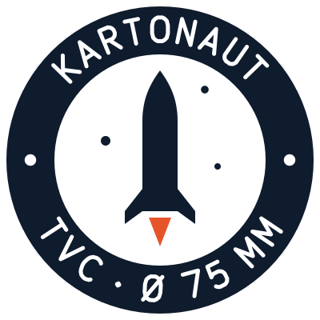

[](LICENSE)
[](firmware/)
[](simulation/)

*Deutsche Fassung: [README.de.md](README.de.md). The detailed documents are in German.*

**Kartonaut** is German *Karton* (cardboard) plus astronaut: the airframe is a cardboard tube. Flights are numbered, the first one is *Kartonaut 1*. Patch and logo in [`docs/brand/`](docs/brand/).

A thrust-vector-controlled (TVC) model rocket with a home-built flight computer, modelled on the
"Scout F" by [BPS.space](https://bps.space). The motor sits in a two-servo gimbal, a roll motor
holds the roll axis, and a pyro-ejected parachute brings the rocket back. On board is a
Teensy 4.1 with IMU, barometer, power monitor, SD logger and a 433 MHz LoRa link to the ground
station. The whole system is simulated in a six-degree-of-freedom model before it flies.

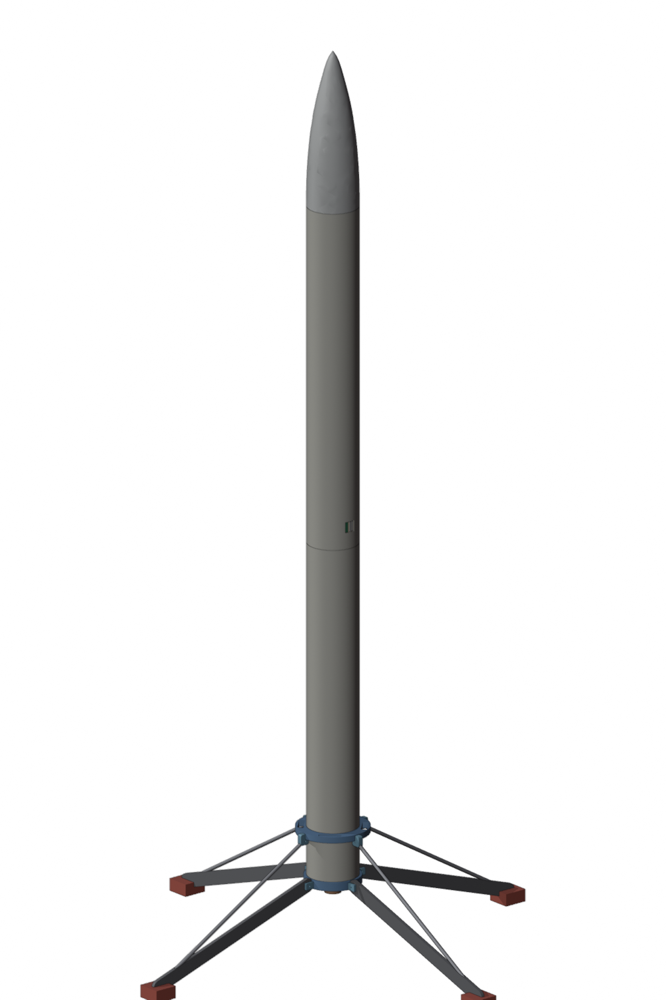

## At a glance

| | |
|---|---|
| Airframe | Klima cardboard tube Ø 75 mm (ID 72.6 mm), 2 × 500 mm, couplers 150 mm; plastic nose cone, 125 cm parachute |
| Motor | TSP E12-0, 24 mm, 39 Ns, 12 N average, 3.5 s burn, no ejection charge; first flight on one motor, landing burn on a second one later |
| Lift-off mass | 981 g in the mass model (`cad/`), centre of gravity 448 mm above the nozzle; the simulation says one E12 lifts this to only 20 m, so the mass budget is under review |
| Flight computer | Teensy 4.1 on a mainboard (rev B specified): ICM-42688-P IMU, BMP390 barometer, INA219 power monitor, LoRa SX1268, microSD, two pyro channels with arming |
| Power | two batteries: 1S LiPo for the electronics (buck-boost), 2S LiPo for servos, roll motor and pyro |
| Actuators | 2 × FrSky Xact W5652H in the gimbal (direct on 2S), roll motor on a DRV8833, pyro piston ejection |
| Control | attitude from the gyro only, PID on pitch/yaw → torque → gimbal angle via `M = l · T · sin δ`, PID on roll; 100 Hz |
| Simulation | Python 6DOF (port of the Simulink model): rigid body with quaternions, thrust curve, servo dynamics, sensor noise, Monte Carlo, gain search |
| Status | bench-tested on breakout boards, no flight yet; mainboard rev B routed and reviewed on 21 Oct 2026, the review's changes go in before the PCB order |

## Project status

**Done**

- Concept, mass and power budget; airframe parts, parachute and motors bought.
- 6DOF simulation: MATLAB/Simulink model ported to Python with a 1:1 copy of the flight controller, 21 tests.
- Firmware modules: sensors, altitude Kalman filter, SD logger with CSV export, pitch/yaw and roll controllers, timing, indicators.
- Mainboard rev B specified: power architecture, pin map, bill of materials, placement plan, test plan; design guide with figures and order plan.
- KiCad project for rev B generated from code: schematic with seven sheets, ERC clean; board placed and routed on four layers, DRC without errors.
- Second-opinion review of schematic and layout against the datasheets and the specification: eight points to change before ordering, manufacturer decision, order list.
- Parametric CAD model in code (CadQuery) with a mass model: mass, centre of gravity and moments of inertia for the simulation; the 16 Blender files inventoried and superseded.
- Build documentation and project file with findings and changelog.

**In progress**

- Board: working the review into the circuit (buck-boost output capacitance, 1S undervoltage threshold, main switch via FETs, fuse per battery, Kelvin shunt) and into the generator (power paths as copper pours on the outer layers), then re-route, DRC, fabrication files.
- Gimbal redesign for the new servos; servo step response to be measured again.
- Mass budget: weigh the parts, lighten the airframe or choose a stronger motor.

**Next**

1. Work the review into rev B, regenerate the board, close the last connections, export Gerber, BOM and CPL, order at JLCPCB with SMD assembly (Aisler as the EU fallback); order the bench parts now.
2. Firmware for rev B: ICM-42688-P driver, quaternion attitude, flight state machine, pyro logic, watchdog, LoRa telemetry.
3. Weigh the rocket and settle the mass budget against the thrust of the E12.
4. Ground tests: TVC test rig with a propeller motor in the gimbal (parts bought, rig to be built), pyro test, radio range.
5. First flight: controlled ascent on one motor, parachute recovery.

The full list of work packages, the findings from the reviews and the changelog are in
[PROJECT.md](PROJECT.md); the build log in [docs/BUILD.md](docs/BUILD.md); the planning round of
21 Oct 2026 with the board review, cost estimate and decisions in
[docs/Plan_2026-10-21.md](docs/Plan_2026-10-21.md).

## What the simulation says

The Simulink model (rigid body with quaternions, TSP E12 thrust curve, servo transfer function
identified from step responses, sensor noise, static misalignment) now lives in
[`simulation/`](simulation/README.md) as the Python package `tvcsim`. It has two controllers: the
Simulink one and a line-by-line port of the firmware's `Control.cpp`, so the gains of both can
be compared in the same model.

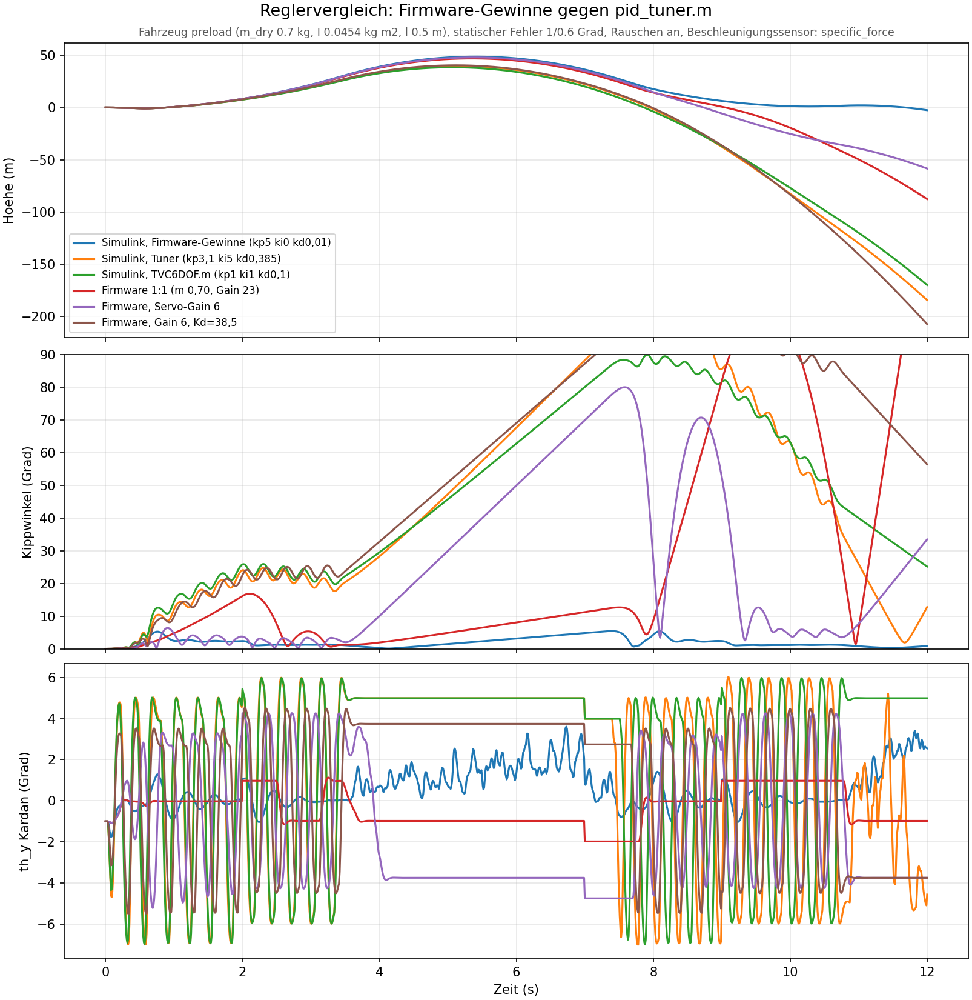

Three findings that change the project:

- **The firmware gains are the right ones.** Kp 5, Ki 0, Kd 1 (on the firmware's −100 scale)
  keep the tilt below 10° during the burn. The gains found earlier by the MATLAB grid search
  (kp 3.1, ki 5, kd 0.385) have a 40 times larger D term, drive the gimbal straight into its ±5°
  limit and oscillate at 3 to 4 Hz. A small I term would remove the static servo offset.
- **The rocket is too heavy for an E12.** With the 1.0 kg of the mass model the thrust-to-weight
  ratio is 1.1 and the apogee 20 m; with 0.7 kg it is 62 m. Either the mass comes down (the
  cardboard tube alone is 240 g) or the motor goes up one class.
- **The servo-to-gimbal ratio decides the control authority.** With the 23 servo degrees per gimbal
  degree in `Config.h` the gimbal only reaches ±1°, with the measured 6 it reaches ±3.75°. To be
  measured on the new gimbal.

<p>
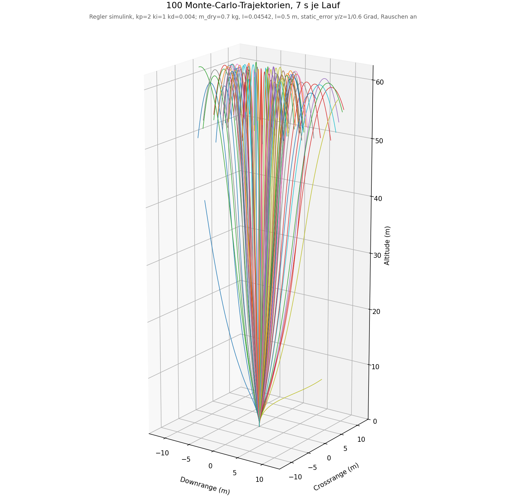
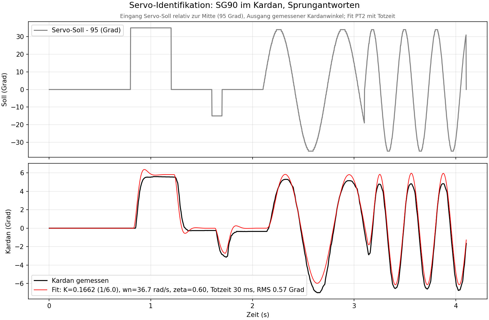
</p>

```bash
cd simulation
python -m pytest tests                 # 21 tests
python scripts/run_nominal.py          # nominal flight -> out/
python scripts/run_montecarlo.py       # 100 runs
python scripts/compare_gains.py --vehicle preload
```

## Hardware

Today all sensors hang off the Teensy as breakout boards with jumper wires, which is the biggest
failure risk in flight. [hardware/mainboard/](hardware/mainboard/README.md) specifies **mainboard
rev B**: a 54 × 120 mm sled that lies lengthwise inside a coupler, with the Teensy socket, the IMU
exactly on the roll axis, and all connectors on the end faces.

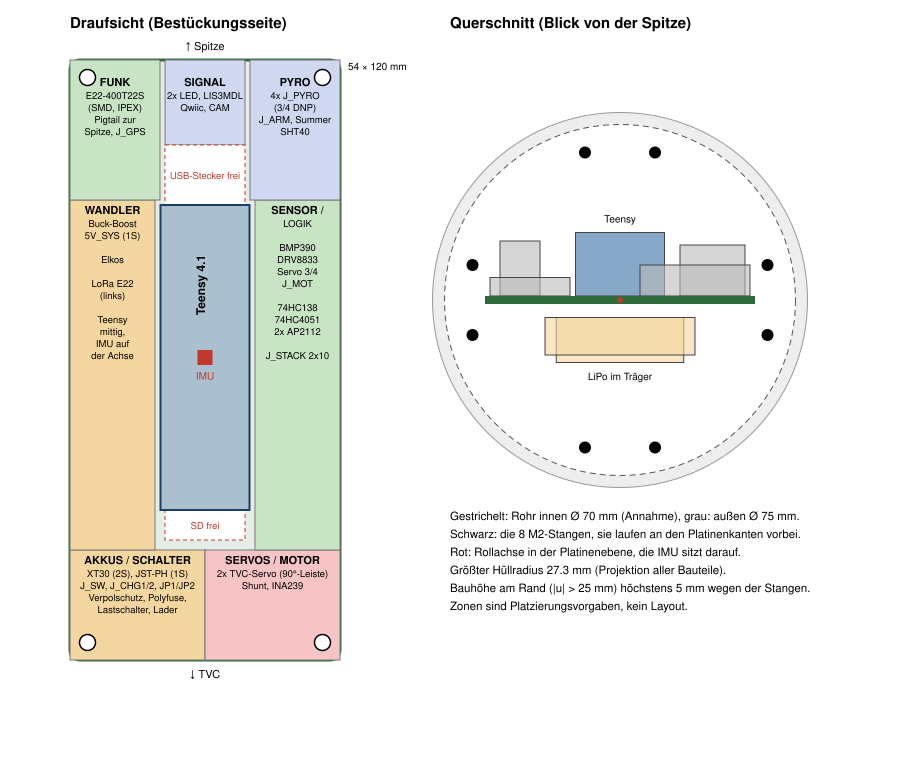

The [design guide](docs/DesignGuide_Mainboard_revB.md) (German, also as a
[PDF](docs/DesignGuide_Mainboard_revB.pdf)) presents the design with figures, block diagram,
power tree, pyro channel and pin map; the [order plan](hardware/mainboard/ORDER.md) lists the
parts to buy now, the gates before the PCB order, the JLCPCB parameters and the costs.

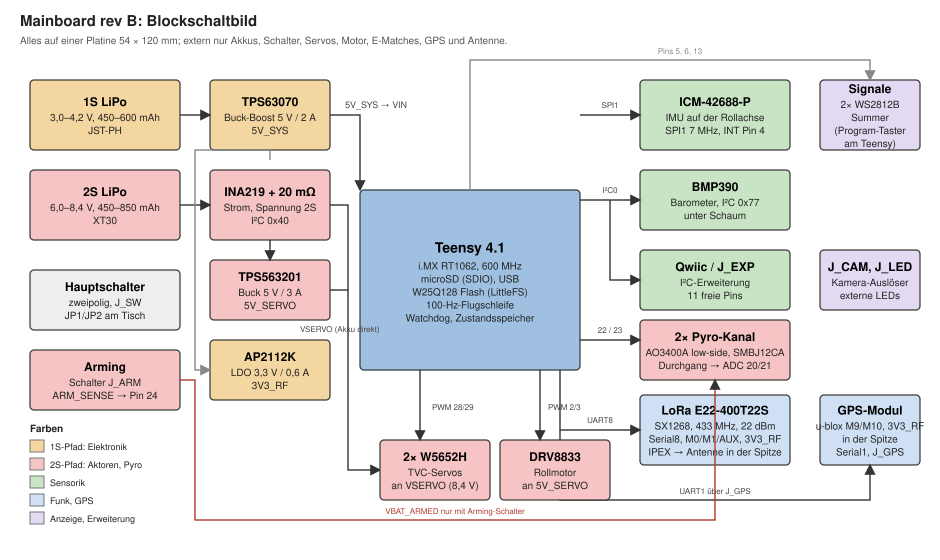

The KiCad project in [hardware/mainboard/kicad/](hardware/mainboard/kicad/README.md) is generated
from a single Python description of the circuit (`circuit.py`): seven schematic sheets with a net label on
every pin, grouped into function blocks, ERC with zero errors and warnings
([schematic PDF](hardware/mainboard/kicad/out/mainboard_schematic.pdf)), plus a board generator that
draws the outline, four layers, net classes and keep-outs, places the parts, pours the planes and imports the
Freerouting result: all 134 parts placed and routed, DRC without errors
([renders and layer images](hardware/mainboard/kicad/img/)).

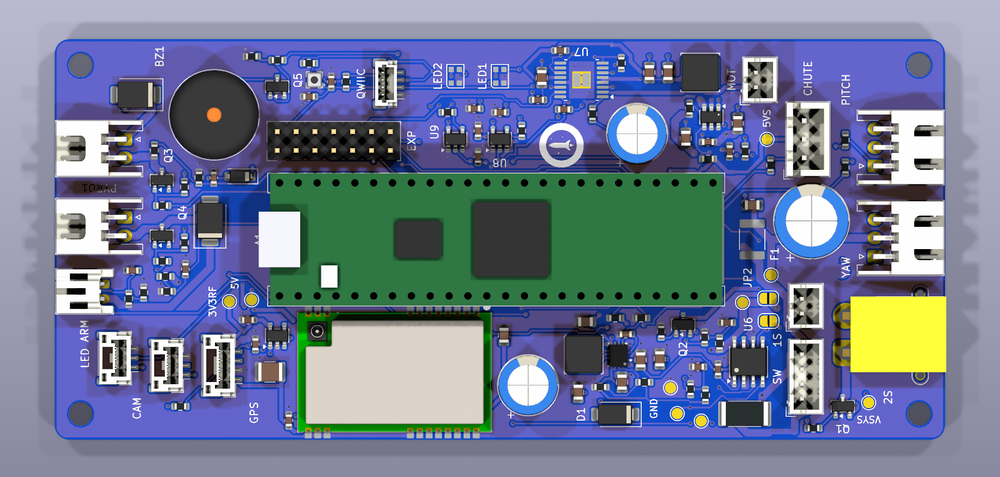

A [second-opinion review](hardware/mainboard/review_kicad_2026-10-21.md) checked the circuit against the datasheets
and the layout against the specification. Its eight A points go in before the fabrication files: the
buck-boost sees more output capacitance than its datasheet allows, the 1S undervoltage cut-off would
switch the computer off in flight, the main switch sits in the high-current path, only the servo rail is
fused, the shunt has no Kelvin connection, and the autorouter put the 2S currents on the thin inner layer
and past the IMU. The [manufacturer comparison](hardware/mainboard/Fertiger_2026-10-21.md) settles on JLCPCB with economic
assembly and Aisler as the EU fallback; the [order plan](hardware/mainboard/ORDER.md) lists what to buy now.

Design decisions worth knowing:

- **Two batteries.** A servo stall or a pyro pulse must never brown out the Teensy, so the
  electronics run from their own 1S cell through a buck-boost converter, while servos, roll motor
  and pyro channels draw from a 2S pack. One two-pole switch turns both on.
- **IMU without DMP.** The ICM-20948 is marked "not for new designs"; the ICM-42688-P replaces it
  on SPI, and the attitude is integrated from the gyro in the firmware.
- **LoRa instead of HC-12.** An SX1268 module on the board with a pigtail antenna in the nose cone
  gives kilometres of range instead of a few hundred metres.
- **Pyro recovery.** Two low-side MOSFET channels behind an external arming switch, with
  continuity check; black-powder tests with about 1 g have worked.
- **Servos on the battery.** The FrSky W5652H run directly on 2S (up to 8.4 V), twice as fast as
  on 5 V.

The specification contains the current budget per battery, the full pin map, a bill of materials
with LCSC numbers, layout rules and the bring-up test plan. Rev A and the reasoning behind the
sled layout are kept in [`rev_a_2026-10-15.md`](hardware/mainboard/rev_a_2026-10-15.md).

## CAD model

The Blender files that defined the rocket so far are inventoried in
[`cad/blender_inventory.md`](cad/blender_inventory.md) and replaced by a parametric model written in
CadQuery ([`cad/`](cad/README.md)): every dimension in `cad/params.py` with its source, STEP and STL
export per assembly, a collision check of the gimbal at ±7°, renders through Blender headless. The
same parameters feed a mass model.

<p>
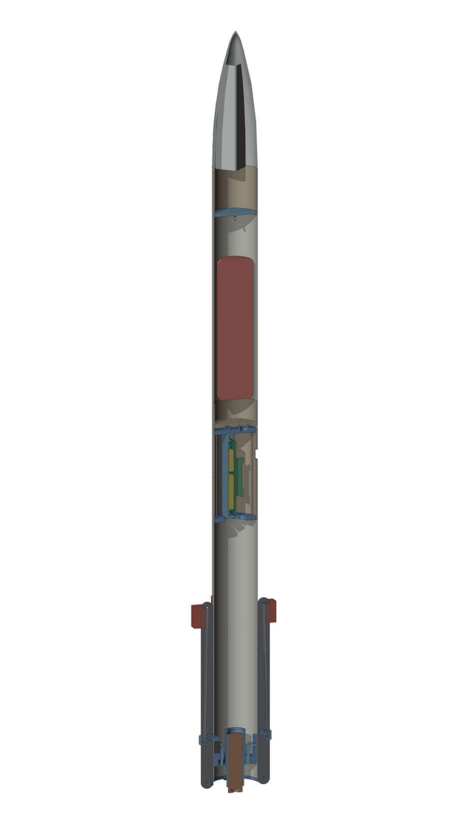
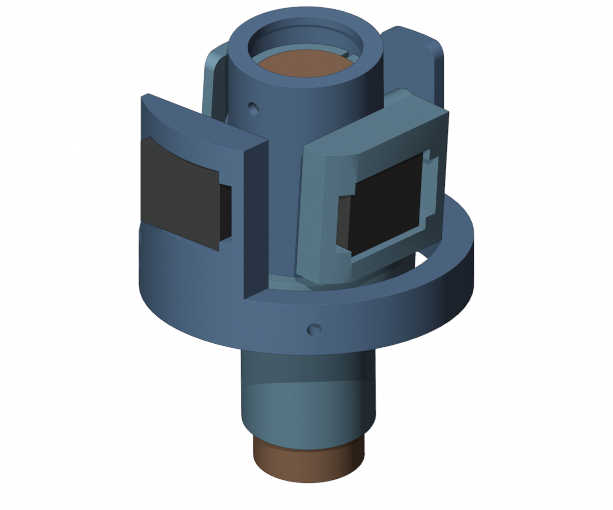
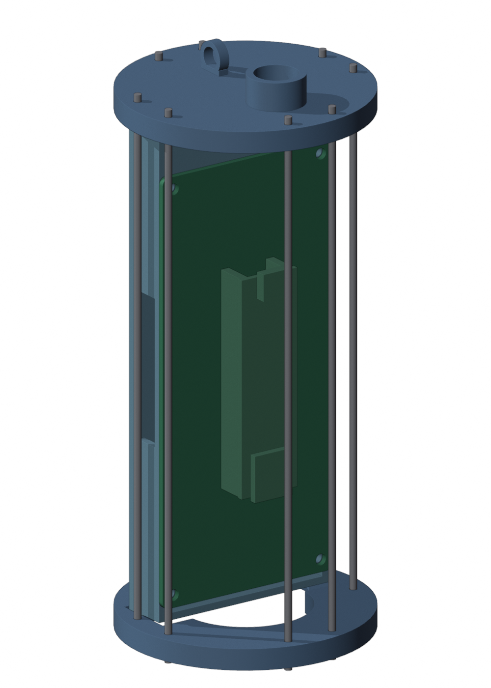
</p>

| State | Mass | CG above nozzle | Lever arm gimbal–CG | Ixx = Iyy | Izz (roll) |
|---|---|---|---|---|---|
| Lift-off, full motor | 981 g | 448 mm | 372 mm | 0.110 kg·m² | 0.0011 kg·m² |
| Burnout | 953 g | 460 mm | 384 mm | 0.105 kg·m² | 0.0011 kg·m² |
| Without motor | 917 g | 477 mm | 400 mm | 0.098 kg·m² | 0.0011 kg·m² |

Two numbers the mass model changed: the roll inertia is a hundred times smaller than the 0.1 kg·m²
placeholder the simulation had used (almost all mass sits within 37 mm of the axis), and the lever
arm is 0.37 m instead of 0.30 m. The 981 g confirm the thrust-to-weight problem above. Once the
rocket is assembled: weigh the parts, find the centre of gravity by balancing, measure the
transverse inertia with a bifilar pendulum, and correct `params.py`.

```bash
python -m pip install --user cadquery
python cad/build.py              # STEP/STL to cad/export/, renders to docs/img/cad/
python cad/mass_model.py         # mass_properties.md and .json
```

## Ground testing

Before anything flies, the attitude control gets tested on the ground with real thrust and
without a rocket motor: the rocket hangs in a rig that lets it pitch and yaw about its centre
of gravity, and a brushless motor (Racerstar BR2814, 1000 KV, 11-inch propeller, 4S LiPo) sits
in the gimbal in place of the rocket motor. At part throttle it delivers the 12 N of the E12,
and the Teensy can even drive the ESC along the E12 thrust curve. Motor, ESC, propellers,
battery and chargers are bought. The rig is designed in [`cad/testrig.py`](cad/README.md): a
two-axis gimbal frame on bearings, a printed clamp collar at the centre of gravity, a propeller
adapter that plugs into the motor tube, and a guard cage around the propeller; the build script
checks that nothing collides at ±20° of rig tilt and ±7° of gimbal deflection. The parachute
ejection has already been tested with about 1 g of black powder.

<p>
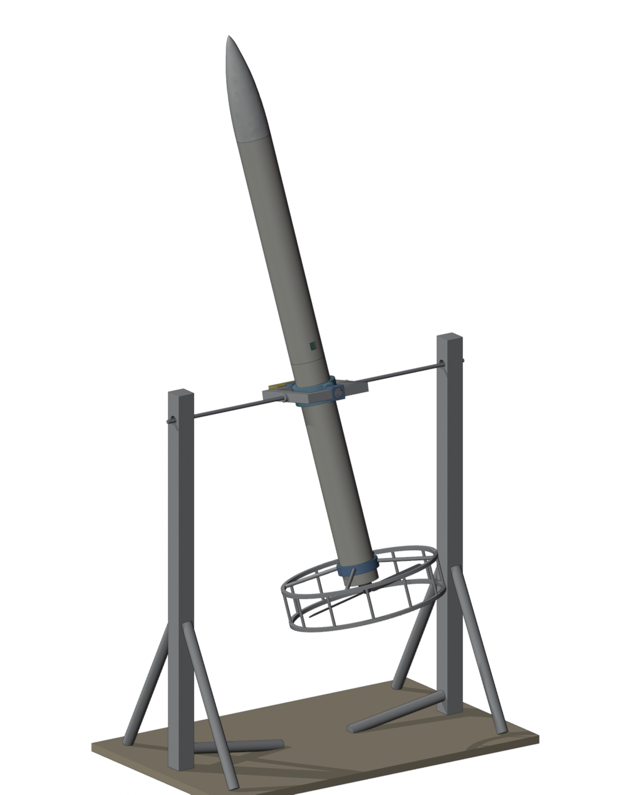
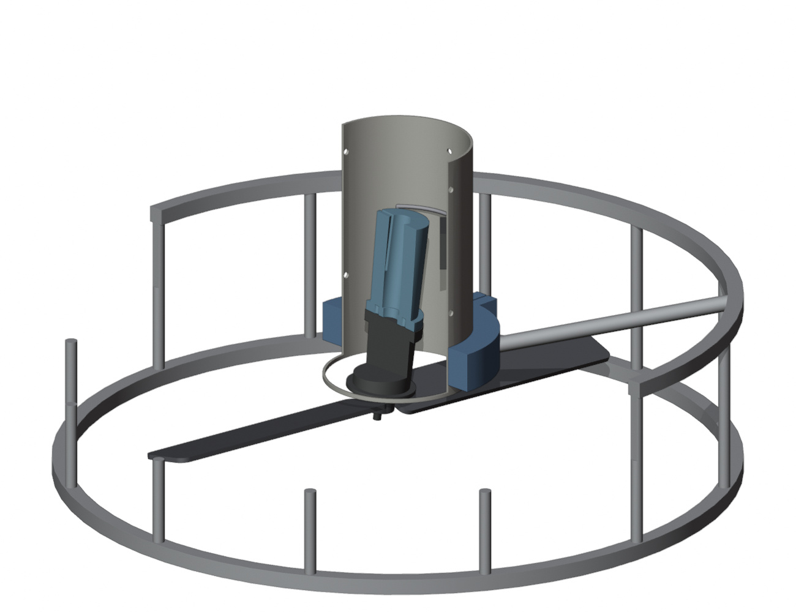
</p>

## Firmware

PlatformIO project for the Teensy 4.1 in [`firmware/`](firmware/README.md). The main loop runs
at a fixed 100 Hz:

1. **Read the sensors.** IMU (angular rate, acceleration), barometer, power monitor.
2. **Integrate attitude.** Gyro only: in flight, magnetometer and accelerometer aiding are useless.
3. **Estimate altitude.** A two-state Kalman filter fuses barometer and vertical acceleration.
4. **Control.** PID on pitch and yaw outputs a torque that is converted via `M = l · m · |a| · sin δ`
   into a gimbal angle and then into servo degrees; a second PID drives the roll motor.
5. **Log.** One 88-byte frame per pass into a page buffer; SD writes only in the spare time before
   the next deadline. On the ground the binary log is exported as CSV.

```bash
cd firmware
pio run                      # build the flight firmware
pio run -t upload            # flash the Teensy 4.1
pio device monitor           # serial console, 115200 baud, Teleplot-compatible
pio run -e radio_beacon      # one of the test sketches in examples/
```

All pins, gains, filter constants and debug switches live in
[`firmware/src/Config.h`](firmware/src/Config.h). The controllers are switched off there until
the first flight test. Open points: quaternion attitude, gyro calibration on the pad, flight state
machine with pyro logic, telemetry protocol, driver for the new IMU.

## Repository layout

```
firmware/               flight firmware (PlatformIO, Teensy 4.1)          -> firmware/README.md
  src/                  modules: Sensors, KalmanZ, Control, SDLogger, Timing, Indicators
  examples/             test sketches (radio beacon, I2C scan, pyro MOSFET)
simulation/             6DOF simulation in Python, package tvcsim          -> simulation/README.md
  tvcsim/, tests/, scripts/, data/
hardware/mainboard/     mainboard rev B: specification, order plan, outline (DXF), placement plan, figures
cad/                    parametric CAD model as code, mass properties      -> cad/README.md
docs/                   design guide rev B (Markdown + PDF), build log (BUILD.md), planning round, images
PROJECT.md              project file: key data, work packages, findings, changelog
```

The ground station (Arduino Nano with the matching radio module) lives in its own repository,
[kartonaut-ground](https://github.com/Jan-Philipp-Munsch/kartonaut-ground). The MATLAB/Simulink original of
the simulation and the Blender files stay outside this repository; their content is ported here.

## Documentation

| Document | What it holds |
|---|---|
| [PROJECT.md](PROJECT.md) | key data, work packages with status, findings from the reviews, next steps, changelog |
| [docs/BUILD.md](docs/BUILD.md) | as-built: inventory of bought and printed parts, mechanics, wiring, software on the device, tests, build log |
| [docs/experiments/README.md](docs/experiments/README.md) | ready-to-run experiments (sketch, evaluation script, instructions, German); E01 servo → gimbal transfer function |
| [docs/Plan_2026-10-21.md](docs/Plan_2026-10-21.md) | board review with component alternatives and cost estimate, power architecture, layout checklist, simulation port plan, decisions |
| [hardware/mainboard/README.md](hardware/mainboard/README.md) | mainboard rev B specification |
| [docs/DesignGuide_Mainboard_revB.md](docs/DesignGuide_Mainboard_revB.md) | the rev B design presented with figures, for review ([PDF](docs/DesignGuide_Mainboard_revB.pdf)) |
| [hardware/mainboard/ORDER.md](hardware/mainboard/ORDER.md) | order plan: parts to buy now, gates before the PCB order, JLCPCB parameters, costs, order list by shop |
| [hardware/mainboard/review_kicad_2026-10-21.md](hardware/mainboard/review_kicad_2026-10-21.md) | second-opinion review of the KiCad project: circuit against datasheets, layout against the specification, future-proofing, costs |
| [hardware/mainboard/Fertiger_2026-10-21.md](hardware/mainboard/Fertiger_2026-10-21.md) | manufacturer comparison (JLCPCB, PCBWay, Aisler, Eurocircuits) and decision |
| [simulation/README.md](simulation/README.md) | model, coordinates, assumptions, results of the gain comparison |
| [firmware/README.md](firmware/README.md) | firmware modules, log format, test sketches |
| [cad/README.md](cad/README.md) | parametric model, parameters, maintenance concept |
| [cad/mass_properties.md](cad/mass_properties.md) | mass model: method, parts list, centre of gravity and inertia per flight state |
| [cad/blender_inventory.md](cad/blender_inventory.md) | what the 16 Blender files contain, which is current, which is superseded |

## License

[MIT](LICENSE). The BPS.space Scout F files that served as reference are not part of this
repository.
