# Kartonaut

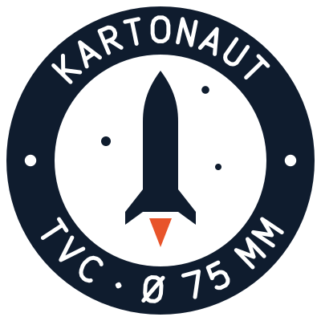

[](LICENSE)
[](firmware/)
[](simulation/)
[](https://github.com/Jan-Philipp-Munsch/kartonaut/actions/workflows/ci.yml)

**A cardboard model rocket that steers its own motor.** *Karton* is German for cardboard: the airframe
is a 75 mm cardboard tube, the motor sits in a servo-driven gimbal, and a home-designed flight computer
holds the rocket upright during the burn. Everything from the circuit board to the control gains is
designed, simulated and documented in this repository.

*Deutsche Fassung: [README.de.md](README.de.md) · detailed documents are in German · last updated: 10 Nov 2026*

<table>
<tr>
<td width="50%">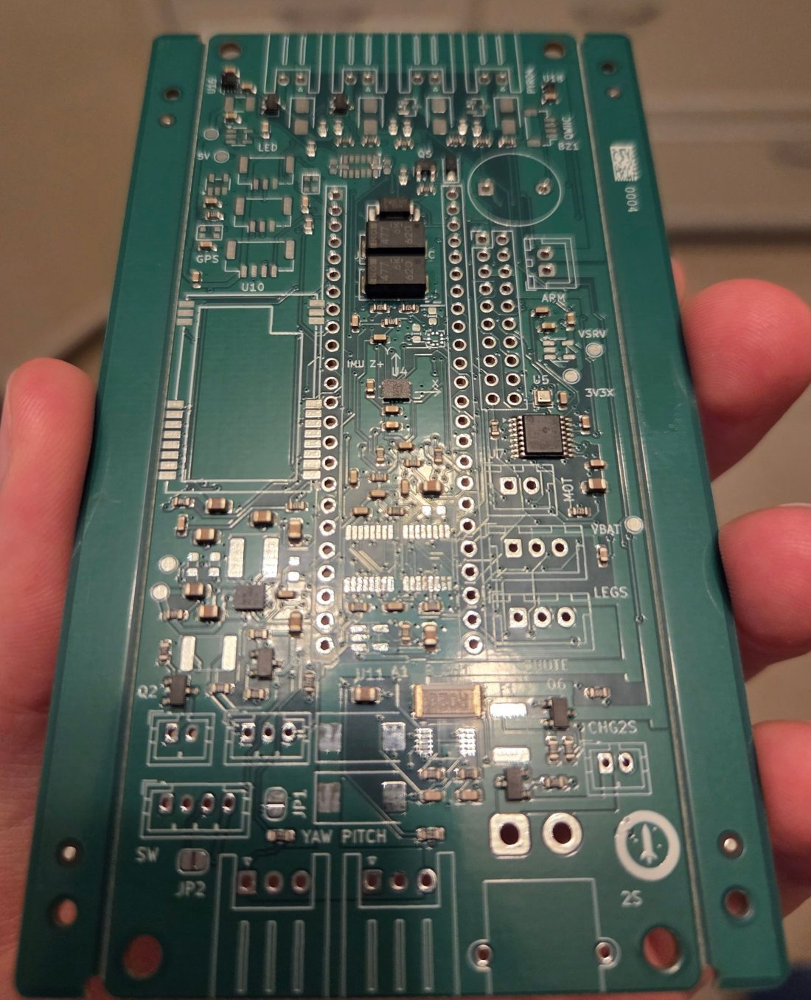</td>
<td width="50%">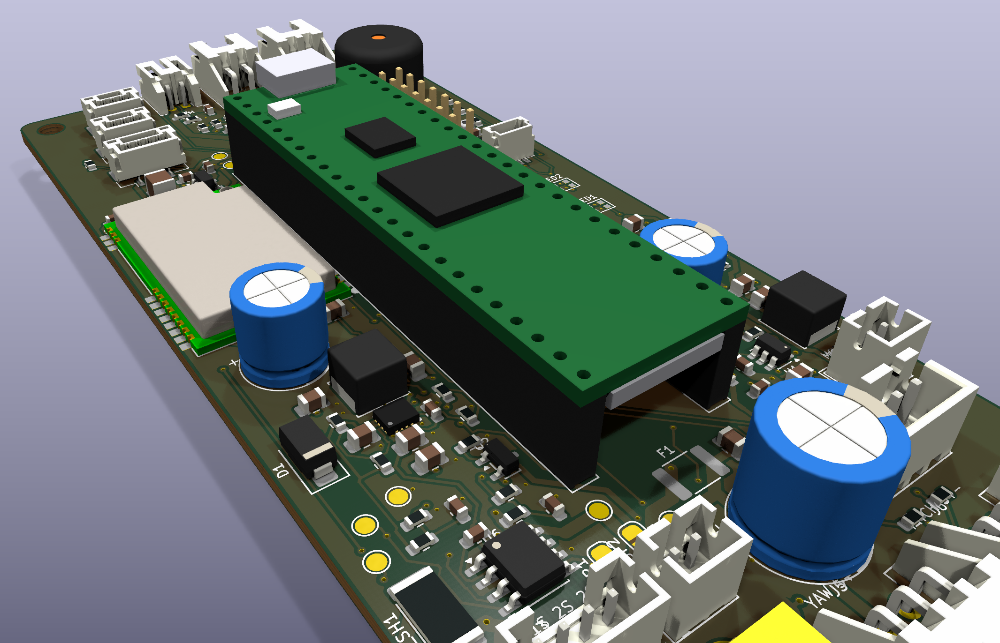<br><br>
<b>Flight computer rev B1 has arrived.</b> Left: the board as delivered on 5 Nov 2026, machine-assembled
with 106 parts. Above: the same board as rendered from the KiCad project, which is generated entirely
from a Python description of the circuit. Next step: hand-soldering the Teensy sockets, connectors and
radio, then the bench test.</td>
</tr>
</table>

## From breakout stack to circuit board

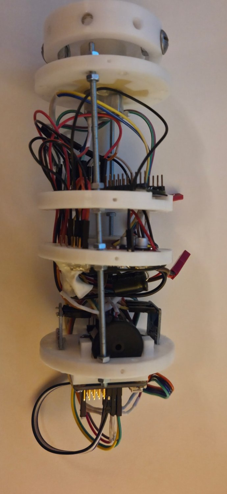

**Before:** the first flight computer was a Teensy 4.1 with breakout boards on a printed ring stack,
held together by threaded rods and jumper wires. On it the core functions were proven on the bench:
IMU and gyro offsets, barometer with Kalman altitude, power measurement, SD logging with CSV export,
radio telemetry to the ground, servo control and a pyro channel that fired a test ejection.

**Now:** the mainboard rev B1 carries the same functions on one 54 × 120 mm board, with newer chips:

- **No loose wires.** Plug-in jumper wires were the biggest failure risk in flight; now everything is
  soldered or on locking JST connectors.
- **IMU exactly on the roll axis**, all flight sensors on a fast SPI bus instead of a shared I²C bus.
- **Safe power:** mechanical main switch with FET load switches, a polyfuse per battery, power monitor
  with a Kelvin shunt, charging inside the rocket.
- **LoRa instead of HC-12** for range, plus magnetometer, GPS socket and microSD on board.
- **Room for later flights:** four pyro channels, a fourth servo, a high-g accelerometer footprint and
  a stacking connector.
- **Lighter and smaller:** a printed sled replaces the ring stack, which helped bring the rocket to 704 g.

<br clear="left">

## At a glance

| | *Kartonaut 1* (first flight) |
|---|---|
| Airframe | cardboard tube Ø 75 mm in three screwed modules, 731 mm long, 3D-printed internals |
| Mass | **704 g** lift-off (mass budget, [`cad/mass_stand2b.md`](cad/mass_stand2b.md)), thrust-to-weight 1.7 |
| Motor | TSP E12 (24 mm, 39 Ns, 3.5 s burn) in a two-axis gimbal with 2 × FrSky W5652H servos |
| Flight computer | Teensy 4.1 on a custom 4-layer board: IMU, barometer, magnetometer, power monitor, LoRa 433 MHz, SD, four pyro channels |
| Control | gyro quaternion, PID on pitch and yaw, gains from Bayesian optimisation in a 6DOF simulation |
| Recovery | CO₂ cartridge pushes off the nose cone, 125 cm parachute |
| Predicted flight | about 74 m apogee, tilt below 2.5° during the burn (simulation, no drag) |

## Status

**Done**

- **Gimbal** with both servos built; tubes A and B of the airframe built.
- **Mainboard rev B1** designed as code (Python → KiCad, four layers, DRC clean), reviewed, ordered
  from JLCPCB on 26 Oct and **delivered on 5 Nov 2026**.
- **6DOF simulation** in Python: thrust curve, identified servo dynamics, sensor noise, Monte Carlo;
  it cut the rocket from 981 g to 704 g and found gains that keep the gimbal off its stop.
- **Flight firmware** (state machine, attitude, Kalman altitude, pyro, telemetry, watchdog) and a
  bench-test console for the board, tested in software-in-the-loop against the simulation.
- **Build manual** with drawings and 1:1 drilling templates; launch stand, TVC test rig and the radio
  bridge of the ground station designed in parametric CAD.
- CI on GitHub Actions for firmware, simulation and pin check against the board.

**In review**

- [PR #9](https://github.com/Jan-Philipp-Munsch/kartonaut/pull/9): soldering and measurement guide for
  rev B1, test firmware for the fitted IMU, flight firmware at 250 Hz with PSRAM log and flash flight
  recorder, LoRa antenna build guide.
- [PR #8](https://github.com/Jan-Philipp-Munsch/kartonaut/pull/8): on-board motor ignition through
  pyro 1, triggered by an authenticated radio command from a laptop.

**Next**

1. Hand-solder the board and bench-test it with `revb_test` (power monitor and one resistor follow
   with the second DigiKey shipment).
2. Print and weigh the parts, assemble the rocket, balance the centre of gravity.
3. Ground tests: servo-to-gimbal ratio, CO₂ ejection, TVC test rig with a propeller motor, radio range.
4. ***Kartonaut 1*: controlled ascent on one motor, parachute recovery.**

Details and changelog in [PROJECT.md](PROJECT.md), build log in [docs/BUILD.md](docs/BUILD.md).

## Gallery

<table>
<tr>
<td align="center" width="33%">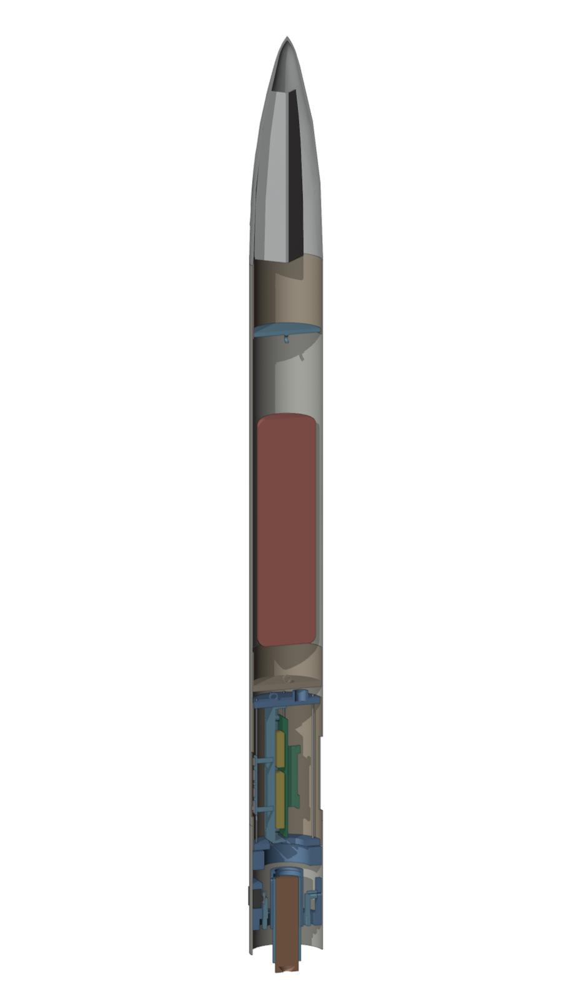<br><sub>Section through <i>Kartonaut 1</i>: gimbal, avionics, CO₂ and parachute</sub></td>
<td align="center" width="33%">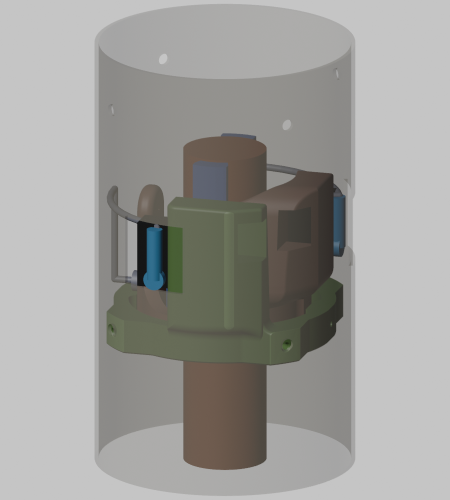<br><sub>Push-rod gimbal with two servos, built</sub></td>
<td align="center" width="33%">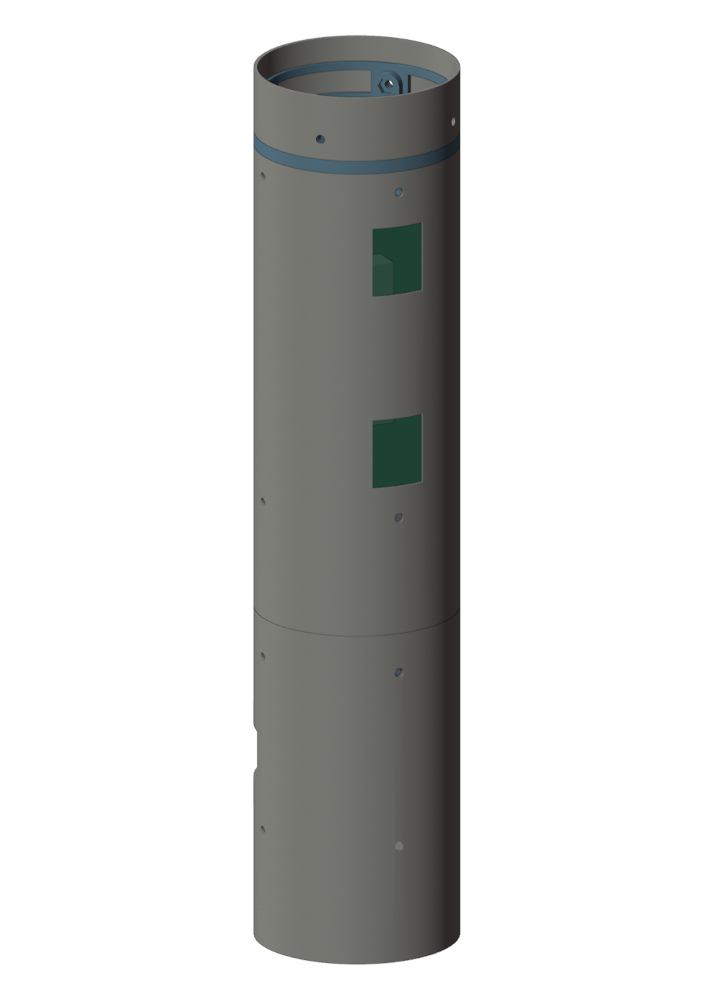<br><sub>Avionics module: board on a printed sled</sub></td>
</tr>
<tr>
<td align="center">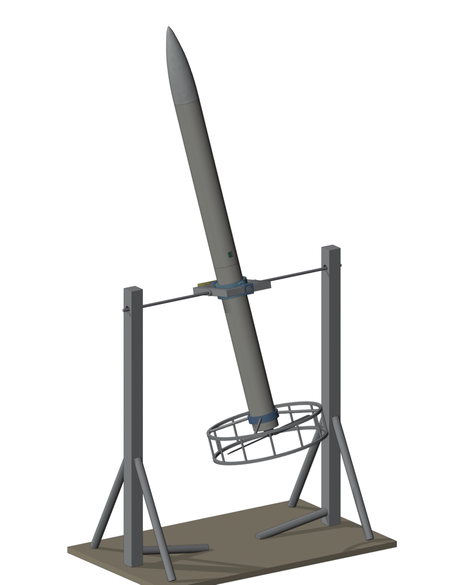<br><sub>TVC test rig: a propeller replaces the motor</sub></td>
<td align="center">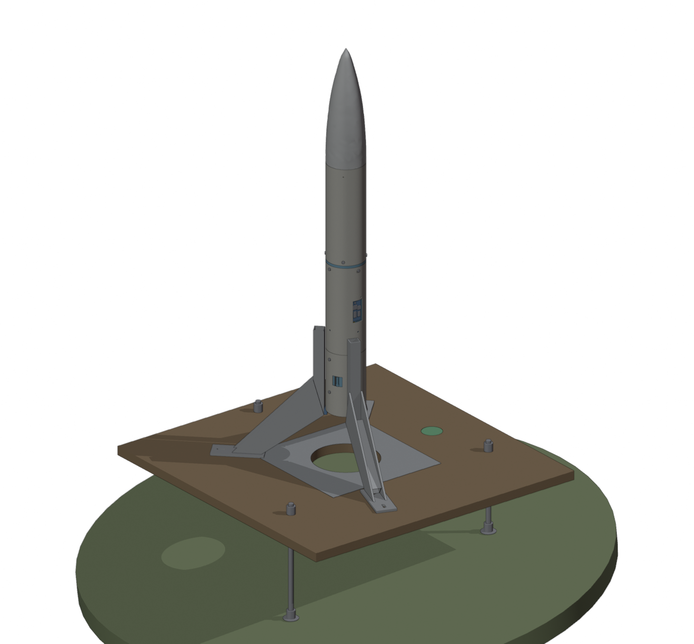<br><sub>Launch stand on three adjustable legs</sub></td>
<td align="center">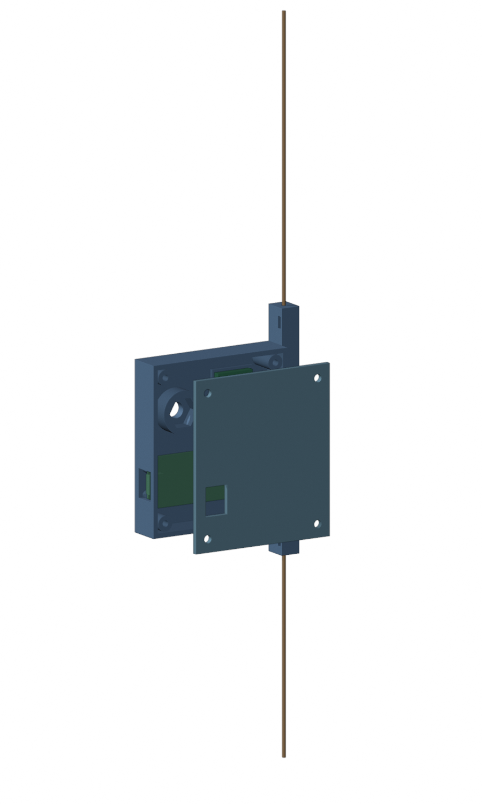<br><sub>Radio bridge with half-wave dipole</sub></td>
</tr>
<tr>
<td align="center" colspan="2">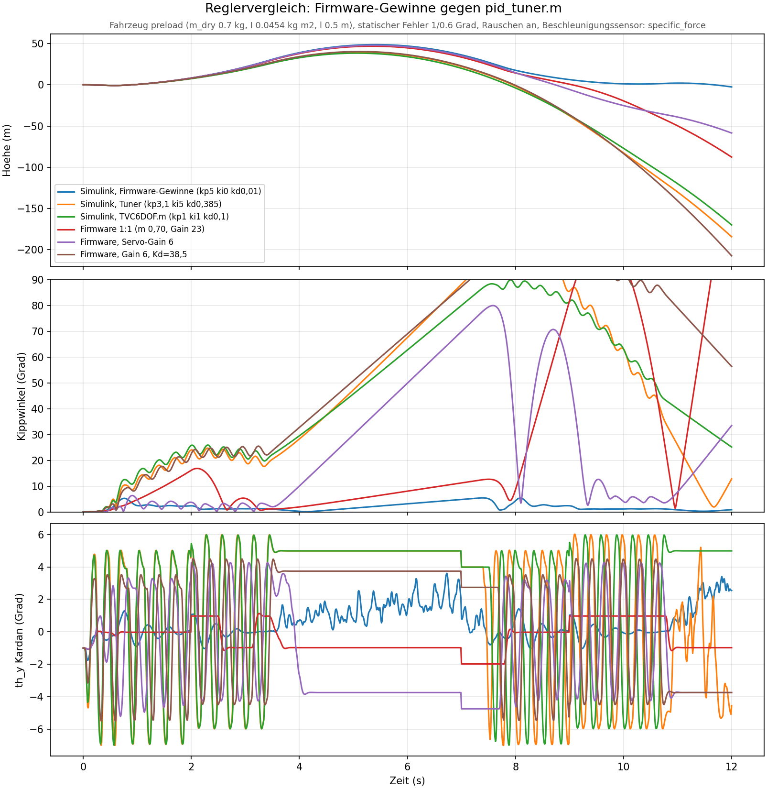<br><sub>Simulation: old gains (gimbal saturated) against tuned gains</sub></td>
<td align="center">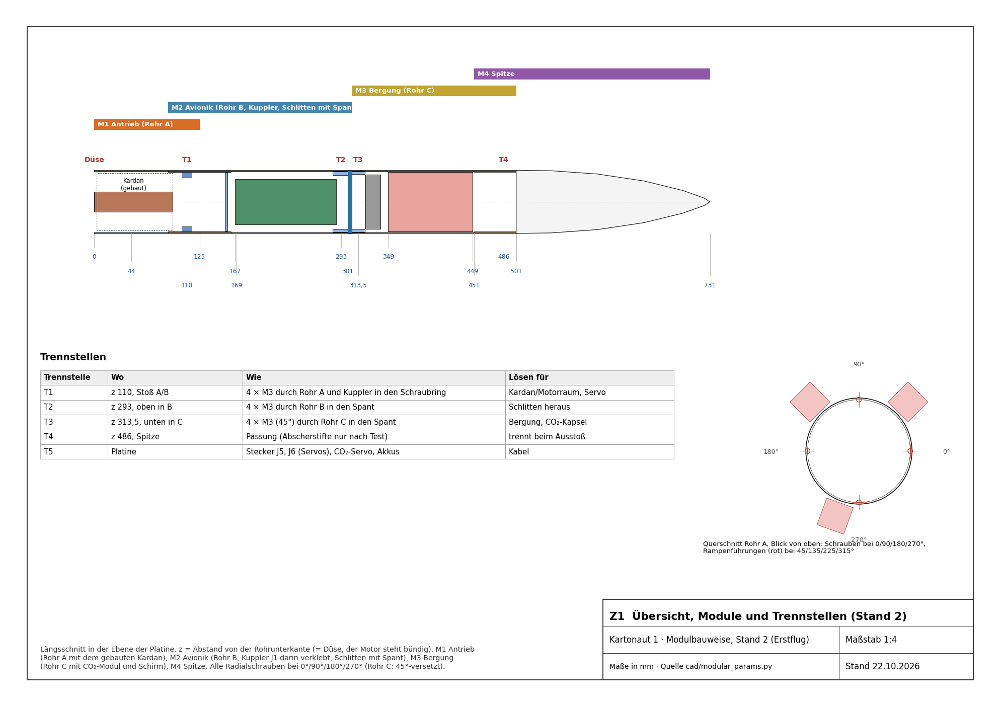<br><sub>Overview drawing from the build manual</sub></td>
</tr>
</table>

## What is inside

| Part | What it does | Where |
|---|---|---|
| Mainboard | KiCad project generated from `circuit.py`: schematic, layout, Gerber/BOM/CPL, datasheet | [hardware/mainboard/](hardware/mainboard/README.md) |
| Simulation | Python 6DOF model `tvcsim` with the firmware controller ported 1:1, gain tuning, landing studies | [simulation/](simulation/README.md) |
| Firmware | PlatformIO for Teensy 4.1: flight software, sensor drivers, bench-test console, native tests | [firmware/](firmware/README.md) |
| Mechanics | parametric CAD for printed parts, launch stand, test rig; mass and inertia models | [cad/](cad/README.md) |
| Build manual | modules, parts list, build steps, cable plan ([PDF](docs/bauanleitung/Bauanleitung_Kartonaut1.pdf)) | [docs/Bauanleitung_Kartonaut1.md](docs/Bauanleitung_Kartonaut1.md) |
| Ground system | launch protocol, radio bridge, ESP32 station as later option | [groundstation/](groundstation/README.md) |
| Experiments | ready-to-run ground tests | [docs/experiments/](docs/experiments/README.md) |

```bash
cd simulation && python -m pytest tests            # simulation tests
cd firmware && pio test -e native                  # firmware tests without hardware
cd firmware && pio run -e teensy41_revb            # flight firmware for rev B1
MS_CONFIG=erstflug python cad/modular.py           # printed parts, mass, renders
```

## Background

Inspired by the "Scout F" of [BPS.space](https://bps.space). Later flights may get landing legs, a
landing burn on a second motor and roll control; the board already has room for them. The old ground
station lives in [kartonaut-ground](https://github.com/Jan-Philipp-Munsch/kartonaut-ground).

## License

[MIT](LICENSE). The BPS.space Scout F files that served as reference are not part of this repository.
