# Kartonaut


[](LICENSE)
[](firmware/)
[](simulation/)
[](https://github.com/Jan-Philipp-Munsch/kartonaut/actions/workflows/ci.yml)

**A cardboard model rocket that steers its own motor.** *Karton* is German for cardboard: the airframe
is a 75 mm cardboard tube, the motor sits in a servo-driven gimbal, and a home-designed flight computer
holds the rocket upright during the burn. Everything from the circuit board to the control gains is
designed, simulated and documented in this repository.

*Deutsche Fassung: [README.de.md](README.de.md) · detailed documents are in German · last updated: 16 Nov 2026*

<table>
<tr>
<td width="50%">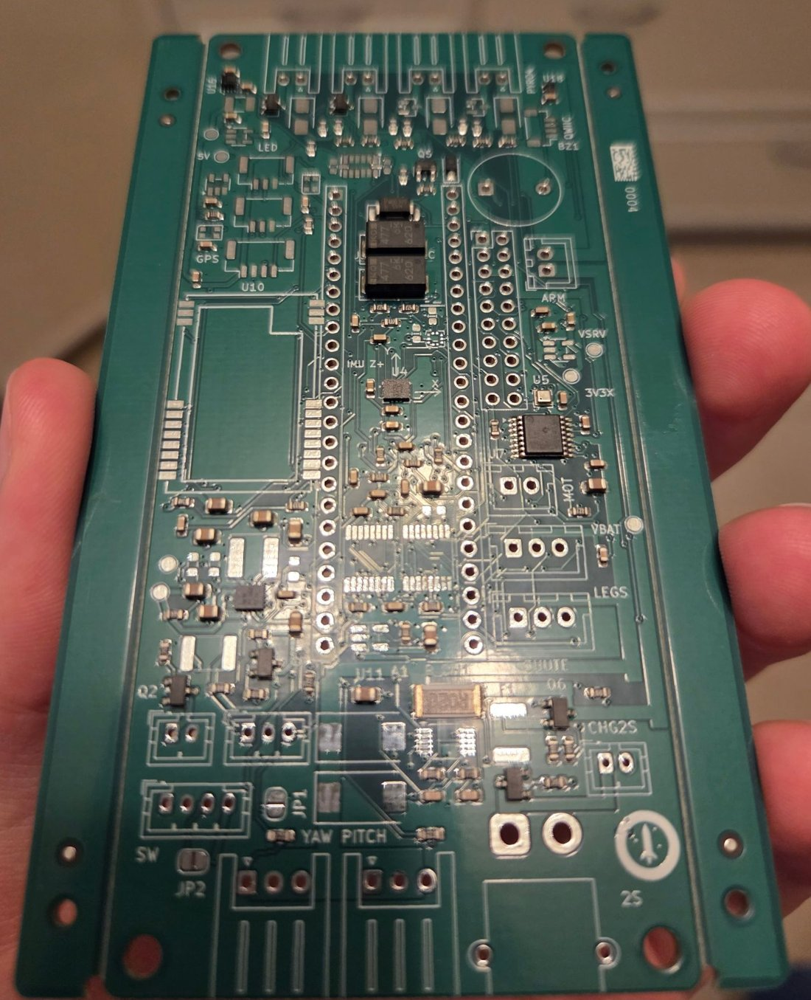</td>
<td width="50%">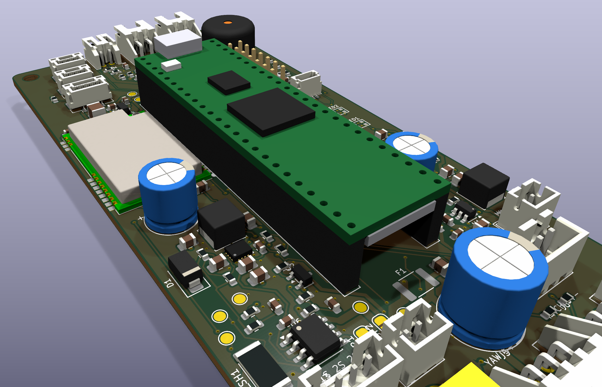<br><br>
<b>Flight computer rev B1 has arrived.</b> Left: the board as delivered on 5 Nov 2026, machine-assembled
with 106 parts. Above: the same board as rendered from the KiCad project, which is generated entirely
from a Python description of the circuit. Next step: hand-soldering the Teensy sockets, connectors and
radio, then the bench test with the <a href="#werkbank-the-board-on-your-pc">Werkbank</a>.</td>
</tr>
</table>

## At a glance

| | *Kartonaut 1* (first flight) |
|---|---|
| Airframe | cardboard tube Ø 75 mm in three screwed modules, 731 mm long, 3D-printed internals |
| Mass | **704 g** lift-off (mass budget, [`cad/mass_stand2b.md`](cad/mass_stand2b.md)), thrust-to-weight 1.7 |
| Motor | TSP E12 (24 mm, 39 Ns, 3.5 s burn) in a two-axis gimbal with 2 × FrSky W5652H servos |
| Flight computer | Teensy 4.1 on a custom 4-layer board: IMU, barometer, magnetometer, power monitor, LoRa 433 MHz, SD, four pyro channels |
| Control | gyro quaternion, PID on pitch and yaw, gains from Bayesian optimisation in a 6DOF simulation |
| Recovery | a servo pierces the CO₂ cartridge at apogee, the gas pushes off the nose cone, 125 cm parachute |
| Predicted flight | about 74 m apogee without drag, 63 m with; tilt of a few degrees during the burn, below 8° in up to 3 m/s wind (simulation) |

## Status

**Done**

- **Gimbal** with both servos built; tubes A and B of the airframe built.
- **Mainboard rev B1** designed as code (Python → KiCad, four layers, DRC clean), reviewed, ordered
  from JLCPCB on 26 Oct and **delivered on 5 Nov 2026**.
- **6DOF simulation** in Python: thrust curve, identified servo dynamics, sensor noise, Monte Carlo;
  it cut the rocket from 981 g to 704 g and found gains that keep the gimbal off its stop.
- **Flight firmware** (state machine, attitude, Kalman altitude, pyro, telemetry, watchdog) and a
  bench-test console for the board, tested in software-in-the-loop against the simulation.
- **Build manual** with drawings and 1:1 drilling templates; launch stand, TVC test rig and the radio
  bridge of the ground station designed in parametric CAD.
- CI on GitHub Actions for firmware, simulation and pin check against the board.

**In review**

- [PR #9](https://github.com/Jan-Philipp-Munsch/kartonaut/pull/9): soldering and measurement guide for
  rev B1, test firmware for the fitted IMU, flight firmware at 250 Hz with PSRAM log and flash flight
  recorder, LoRa antenna build guide.
- **[Werkbank](#werkbank-the-board-on-your-pc)** (PR #9): browser front end for the board on USB with
  live plots, checks and guided calibration; tested against a simulated board, not yet on the real one.
- **Bench console** `revb_test` (PR #9): `stream` sends the raw values of all sensors continuously,
  `cal set` accepts calibration values from the PC.
- **Flight firmware after the 14 Nov code review** (PR #9): the parachute servo opens at apogee (it
  used to stay closed), the pyro pulse runs its full length, the log keeps only 10 s of pre-roll on the
  pad and leaves the rest of the buffer for the flight, the rev B1 pins come from a single file, and no
  stale launch-ready state returns after a watchdog reset ([PROJECT.md](PROJECT.md) §5, findings 24–28).
  58 native tests pass in CI; none of this has been checked on the board yet.
- **[Navigation and pinpoint landing](#sensor-fusion-state-estimation-and-navigation)** (15 Nov, PR #9):
  simulation of the whole flight with wind, aerodynamics, GPS, magnetometer, camera and navigation filter;
  requirements for throttle, control and sensors derived from it. Simulation only, none of it in the firmware.
- [PR #8](https://github.com/Jan-Philipp-Munsch/kartonaut/pull/8): on-board motor ignition through
  pyro 1, triggered by an authenticated radio command from a laptop.

**Next**

1. Hand-solder the board, then bench-test and calibrate it with `revb_test` and the Werkbank, following the
   [soldering and measurement guide](hardware/mainboard/LOETANLEITUNG_revB1.pdf) (power monitor and one
   resistor follow with the second DigiKey shipment); get two IPEX pigtails for the
   [LoRa antenna](docs/Bauanleitung_LoRa_Antenne.md).
2. Print and weigh the parts, assemble the rocket, balance the centre of gravity.
3. Firmware: verify the fixes from the 14 Nov code review on the board (CO₂ release, pyro pulse, flight
   log, pins, state store; [PROJECT.md](PROJECT.md) §5, findings 24–28) and work through the smaller
   items in finding 29.
4. Ground tests: servo-to-gimbal ratio, CO₂ ejection, TVC test rig with a propeller motor, radio range.
5. ***Kartonaut 1*: controlled ascent on one motor, parachute recovery**, in at most 3 m/s wind according
   to the simulation.
6. After that the landing, probably first as a hop on one motor (3 m high, no parachute): characterise
   servos and throttle (experiments E01, E05, plus the igniter delay), build the slotted-plate throttle
   ([`cad/throttle_plate.py`](cad/throttle_plate.py)), design the landing gear,
   navigation filter and guidance in the firmware.
7. In parallel the magazine for the motor swap (two motors in line) as a bench test, then the two-motor
   landing from 6 m
   ([docs/Motorwechsel_und_Huepfer_2026-11-15.md](docs/Motorwechsel_und_Huepfer_2026-11-15.md), German).

Details and changelog in [PROJECT.md](PROJECT.md), build log in [docs/BUILD.md](docs/BUILD.md).

## Gallery

<table>
<tr>
<td align="center" width="33%">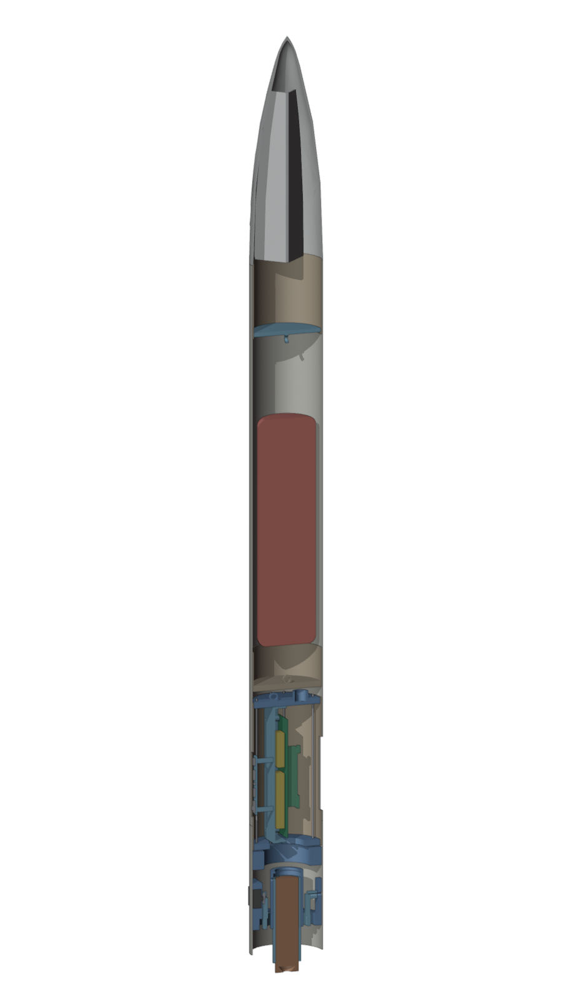<br><sub>Section through <i>Kartonaut 1</i>: gimbal, avionics, CO₂ and parachute</sub></td>
<td align="center" width="33%">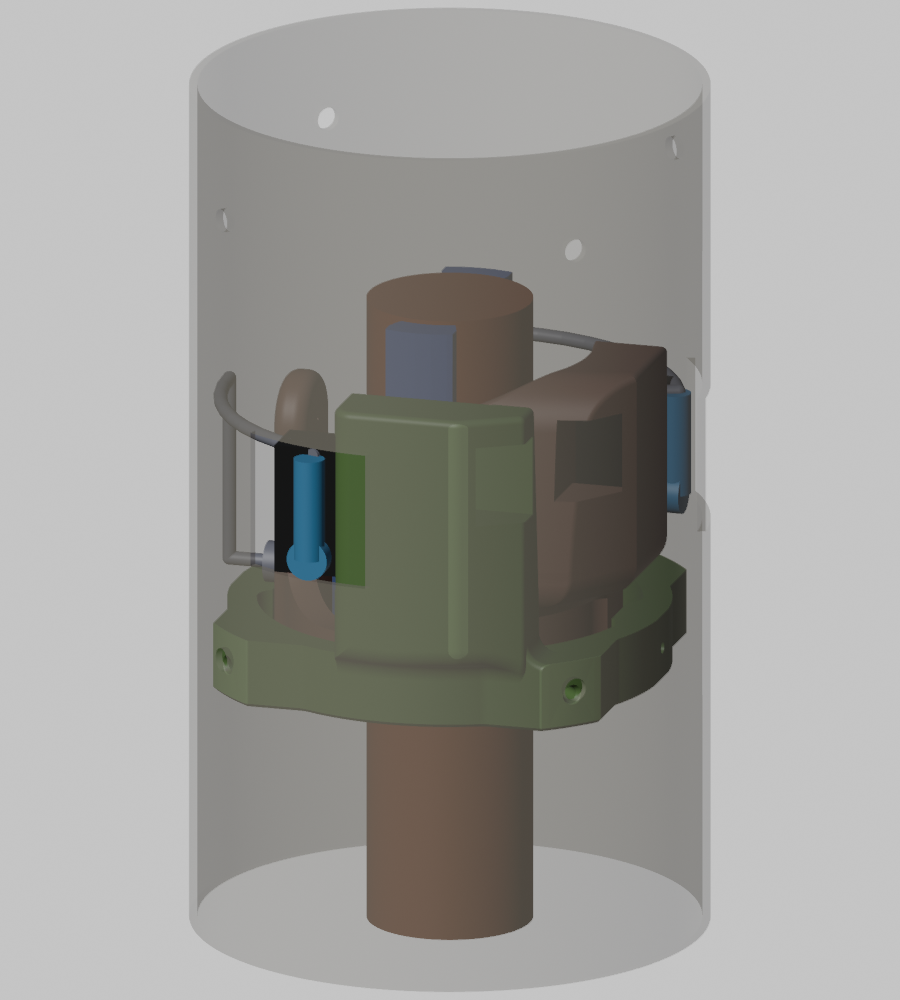<br><sub>Push-rod gimbal with two servos, built</sub></td>
<td align="center" width="33%">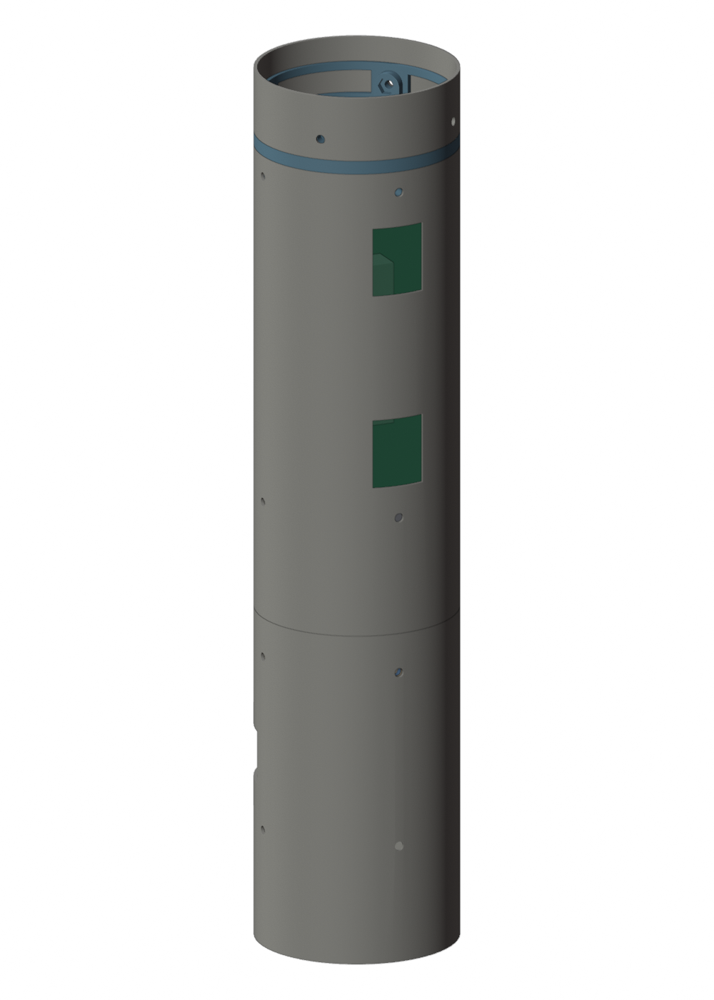<br><sub>Avionics module: board on a printed sled</sub></td>
</tr>
<tr>
<td align="center">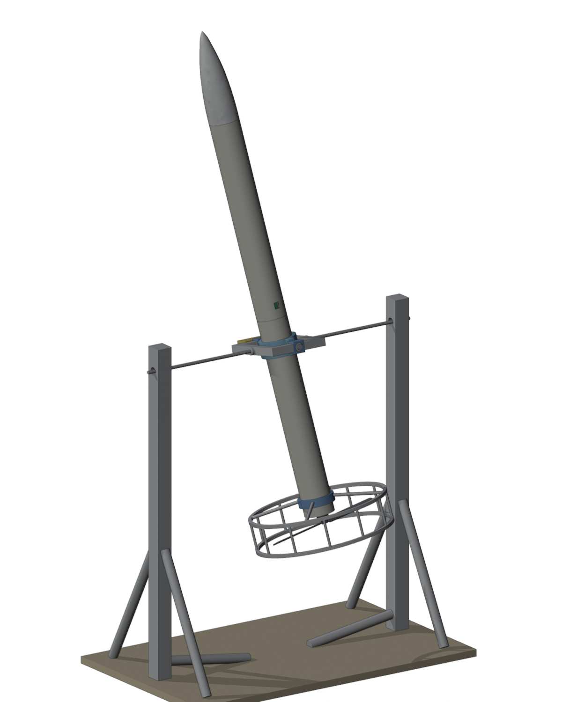<br><sub>TVC test rig: a propeller replaces the motor</sub></td>
<td align="center">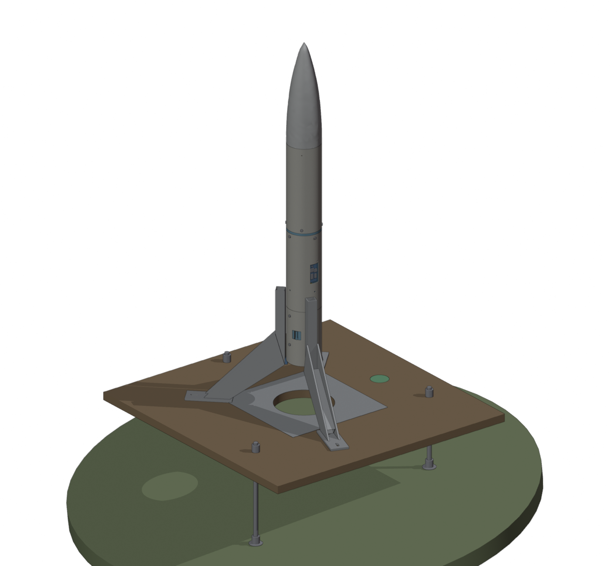<br><sub>Launch stand on three adjustable legs</sub></td>
<td align="center">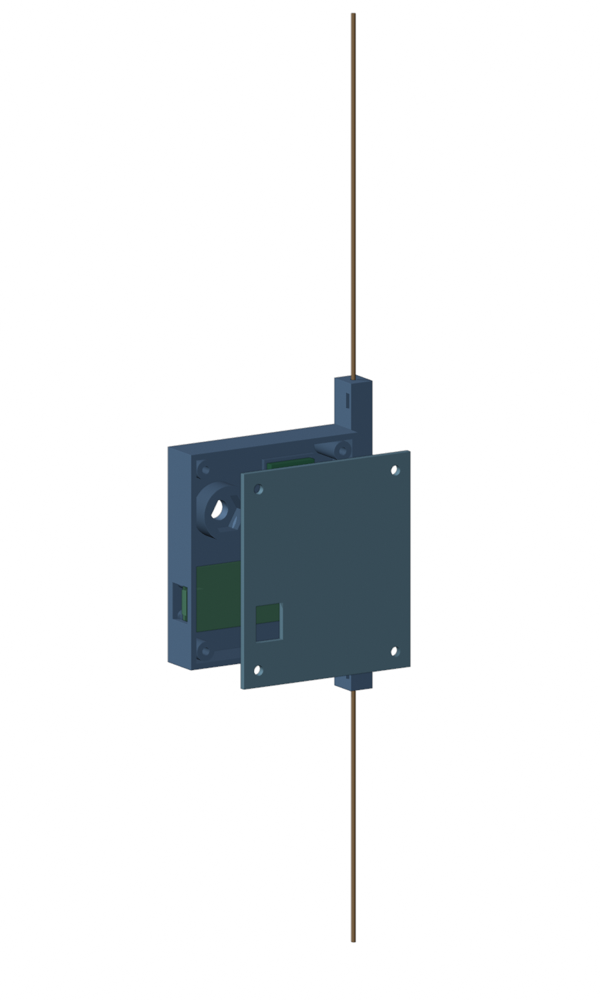<br><sub>Radio bridge with half-wave dipole</sub></td>
</tr>
<tr>
<td align="center" colspan="2">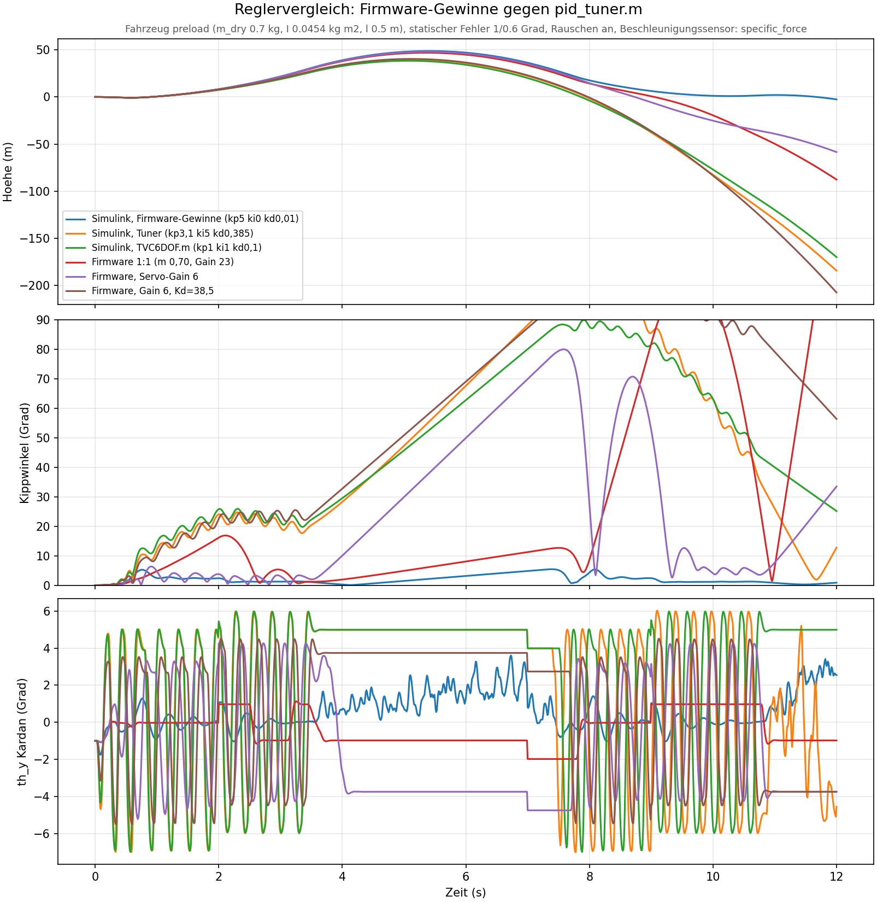<br><sub>Simulation: old gains (gimbal saturated) against tuned gains</sub></td>
<td align="center">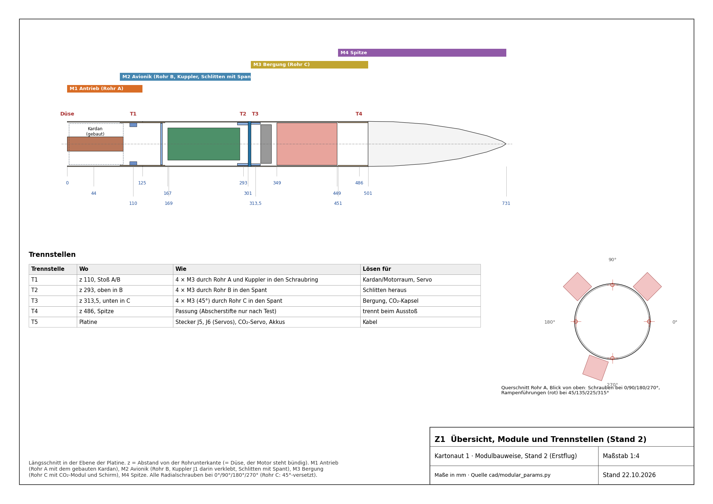<br><sub>Overview drawing from the build manual</sub></td>
</tr>
</table>

## Werkbank: the board on your PC

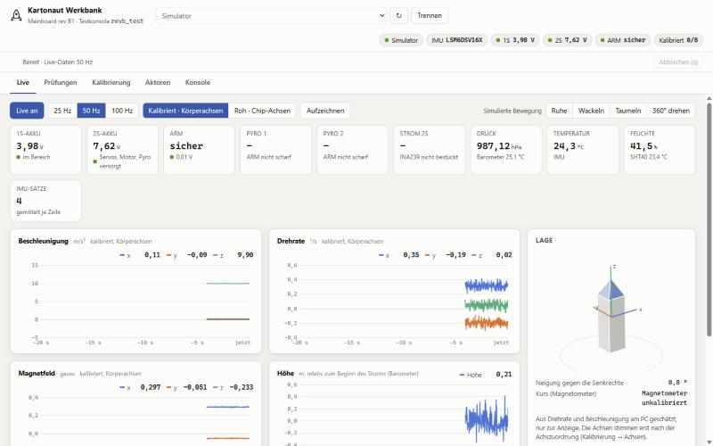

The Werkbank (German for workbench) connects a PC to the flight computer through the Teensy's USB port.
A Python program reads the serial port of the `revb_test` bench console and sends commands and
calibration values back; the user interface runs in a browser on the same machine, no network needed.
Its labels are in German.

| Tab | What it does |
|---|---|
| **Live** | acceleration, angular rate, magnetic field and altitude as plots, attitude in 3D, batteries, ARM, pyro continuity; raw or calibrated, recording to CSV |
| **Prüfungen** (checks) | one button per check of the bench console, result table, report as Markdown and JSON |
| **Kalibrierung** (calibration) | guided per sensor: accelerometer from six or any number of rest positions, magnetometer by ellipsoid fit with a coverage plot, axis mapping, gyro, voltage and current measurement, servos |
| **Aktoren** (actuators) | servos, roll motor, pyro channels; firing needs ARM, continuity and the word `JA` typed by hand |
| **Konsole** (console) | every line of the bench console and a command line |

```bash
pip install pyserial numpy
```

```bash
python firmware/tools/werkbank.py --sim    # no hardware: simulated board with known sensor errors
```

```bash
python firmware/tools/werkbank.py          # looks for the Teensy running the revb_test console
```

First version: tested against the simulated board (18 tests in CI), it has not run on the real board
yet. Methods, structure and limits are in
[`firmware/tools/bench_gui/`](firmware/tools/bench_gui/README.md) (German).

## Sensor fusion, state estimation and navigation

Today the flight computer estimates **attitude** and **altitude**. Landing on a target adds **horizontal
position**, and holding attitude turns into guidance. The reasoning and a Monte Carlo study over flight
profile, wind, thrust throttling, control and sensors are in
[docs/Navigation_und_Landung_2026-11-15.md](docs/Navigation_und_Landung_2026-11-15.md) (German).

| Layer | In the flight code today | For a pinpoint landing (simulated, not yet in the firmware) |
|---|---|---|
| Attitude | gyro quaternion at 250 Hz from the averaged FIFO samples of the IMU. On the pad, gravity and the magnetometer aid the attitude and learn the gyro bias; from lift-off on, the gyro runs alone | unchanged; accurate to 0.7° after 7 s in the model |
| Altitude | Kalman filter from acceleration and barometer (altitude, vertical speed) with an outlier gate against pressure spikes | plus a laser rangefinder for the last metres |
| Position | missing | the same filter per axis with a third state for the acceleration error, aided by GPS relative to the surveyed launch point and optionally a camera tracking a target marker |
| Heading | magnetometer, on the pad only | ties the GPS coordinates to the body axes in which the gimbal acts; needed to within 10° |
| Guidance | keep the thrust vertical | the throttle guides vertically to zero altitude at burnout, the tilt angle guides sideways to the target |

The main ideas:

- **Fast rather than smooth.** Control and servos run at 250 Hz. Against vibration, the IMU samples of one
  cycle are averaged instead of low-pass filtered; otherwise a motor vibration aliases down to an apparent
  rotation that no servo smooths out.
- **Gyro only in flight.** Under thrust the accelerometer measures thrust, not gravity, and the magnetometer
  sits next to the servo currents. Both aid the attitude on the pad only.
- **Inertial navigation lasts seconds, not longer.** 0.3° of attitude error or 5 mg of accelerometer bias is
  a good 1 m after 7 s. The IMU is enough for a hop; anything longer needs GPS or a camera.
- **GPS relative, not absolute.** If the target is surveyed with the same receiver before launch, only the
  drift of its error during the flight counts. The camera gets more accurate as the rocket descends and
  needs no heading.

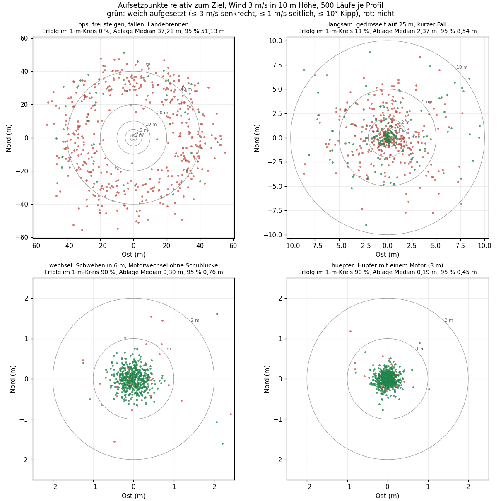

What the simulation says (500 flights per case with scatter in thrust curve, actuators, mass, aerodynamics,
wind, sensor noise and calibration errors; success = soft and upright within 1 m of the target; plot labels
are in German):

| Flight profile | Calm | 3 m/s wind | Miss distance at 3 m/s (median / 95 %) |
|---|---|---|---|
| free ascent, unpowered over apogee, landing burn (as Scout F) | 7 % | 0 % | 37 m / 51 m |
| throttled ascent to 25 m, one second of free fall, landing burn | 88 % | 11 % | 2.4 m / 8.5 m |
| hover at 6 m, the second motor takes over without a thrust gap | 98 % | 90 % | 0.30 m / 0.76 m |
| hop to 3 m on a single motor | 93 % | 90 % | 0.19 m / 0.45 m |

- **Never without thrust.** The finless rocket tips over when unpowered; at landing ignition it is tilted
  26 to 34° in the median. Where thrust never stops, the gimbal holds the attitude.
- **Throttle:** the lowest thrust must be at most half the weight, i.e. a thrust factor of 0.35 at 0.8 to
  1.0 kg. With 0.5, only a good half of the landings at 0.8 kg are soft.
- **Stabilisation:** servo dead time at most 30 ms (59 % at 50 ms, 0 % at 80 ms), gimbal range ±5 to ±8°,
  gimbal zero within 1°.
- **Two motors:** side by side is ruled out (space in the tube, gimbal travel). In line in a magazine with a
  motor swap works in the model as long as the rocket is without thrust for at most 0.35 s; see the next
  section.
- **Sensors:** IMU and barometer alone 50 %, with the GPS already on hand 90 %, with a camera 0.11 m median
  miss. Without sensor calibration 39 %; a heading error of 30° costs a third of the landings when GPS guides.
- **Area and wind:** a circle of 1 m radius catches 95 % of the landings up to 3 m/s wind; at 5 m/s the
  rocket no longer holds its position.
- **For the first flight:** with the aerodynamic moment in the model, *Kartonaut 1* loses attitude in 6 % of
  the runs from 5 m/s wind. Recommendation: do not launch above 3 m/s.

These are model values. They rest on assumptions that only experiments can check: the aerodynamics of the
finless rocket, the servo dead time and the throttle characteristic (section 6 of the document).

```bash
cd simulation && python scripts/pinpoint_study.py     # 157 scenarios, 2 to 5 minutes
```

## Motor swap, throttle and the hop

For the two-motor landing the motors are to sit in line. The idea is a magazine with "ballpoint-pen logic":
the thrust of the first motor unlatches the mechanism, after burnout a spring ejects the spent case and pushes
the second motor into the firing position, where it ignites. Calculation, figures and open points in
[docs/Motorwechsel_und_Huepfer_2026-11-15.md](docs/Motorwechsel_und_Huepfer_2026-11-15.md) (German).

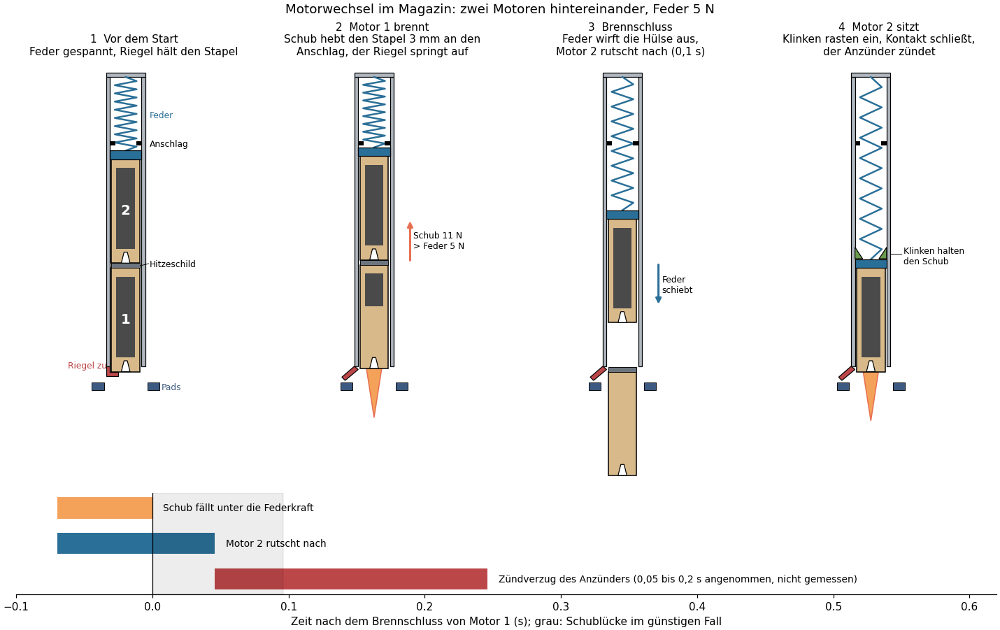

*Panels: 1 before launch, spring loaded, latch holds the stack; 2 motor 1 burns, thrust lifts the stack 3 mm
against the stop and the latch springs open; 3 burnout, the spring ejects the case and motor 2 slides down;
4 motor 2 seated, pawls lock, the contact closes and the igniter fires.*

- **Sliding down takes about 0.1 s** (5 N spring). With the igniter delay the rocket is without thrust for
  0.15 to 0.35 s.
- **Up to a 0.35 s gap it lands from 6 m as well as without a gap** (96 to 99 % inside the 1 m circle in
  1.5 m/s wind, 79 to 93 % in 3 m/s). Above 0.4 s there is not enough time to brake. The igniter delay has
  not been measured.
- **Every variant needs the throttle,** and mass helps: at 0.75 kg the thrust factor must be 0.35, at
  1.05 kg 0.5 is enough.
- **No parachute on these flights** (it does not open from 3 to 9 m). That frees 94 g; throttle and legs
  need about 119 g.
- **Recommendation:** the one-motor hop first (94 % in 1.5 m/s wind, no swap mechanism), the magazine as a
  bench test in parallel.

**Throttle: slotted plate with one servo** ([`cad/throttle_plate.py`](cad/throttle_plate.py), concept of
16 Nov): a single stainless sheet turns 15 mm below the nozzle about a shaft next to the motor. The sheet has a
slot that tapers from a Ø 27 hole down to 2 mm; turning it puts a different width under the nozzle.

- **Forgiving:** both edges are in the same part. Play in the linkage only changes how much is throttled, not the
  symmetry. At 15 mm the plate acts on the free jet and does not back up into the nozzle.
- **Works with the motor swap:** the spent case (Ø 24) drops through the Ø 27 hole. Opening the plate 0.3 s
  before burnout costs no landings (98 % in 1.5 m/s wind).
- **One servo, 29 g** (instead of 60 g with two servos). The shaft carries the jet force; the servo keeps a
  2.3-fold reserve at the thrust peak. Linkage and servo sit above the nozzle inside the tube, away from the exhaust.
- **Gimbal:** free up to ±5° in both axes (1.6 mm to the tube wall); at ±7° in both axes a servo corner touches.
- **A property of the tapered slot:** at deep throttling the jet that passes sits up to 3.5 mm off centre. That
  acts like 1° of deflection, is the same on every flight and costs at most 3 percentage points in the simulation,
  nothing with feed-forward in the controller.
- **Open:** the characteristic position → thrust and the side force (experiment E05), heat at plate and shaft,
  and the plate swinging 12 mm beyond the tube (landing gear).

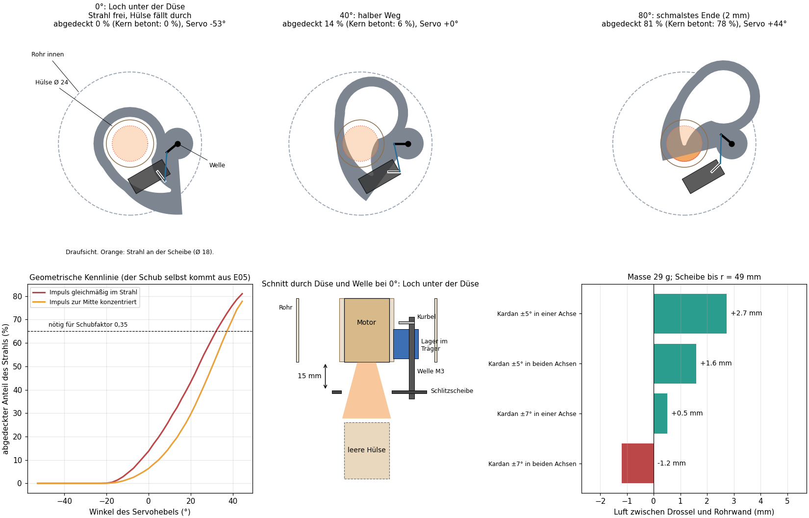

*Top: plan view at 0° (hole under the nozzle, jet free, case drops through), 40° and 80° (narrowest end). Bottom:
blocked share of the jet against servo angle, section through nozzle and shaft, clearance to the tube wall.*

<table>
<tr>
<td align="center" width="33%">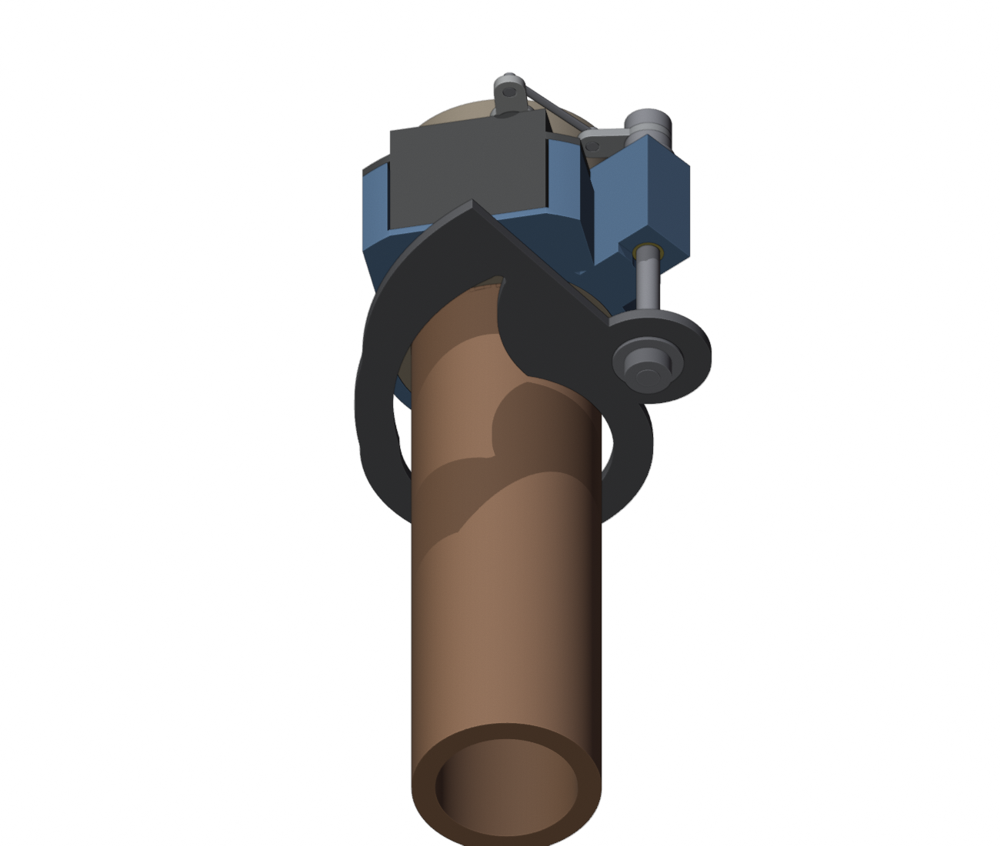<br><sub>hole under the nozzle: the spent case drops through</sub></td>
<td align="center" width="33%">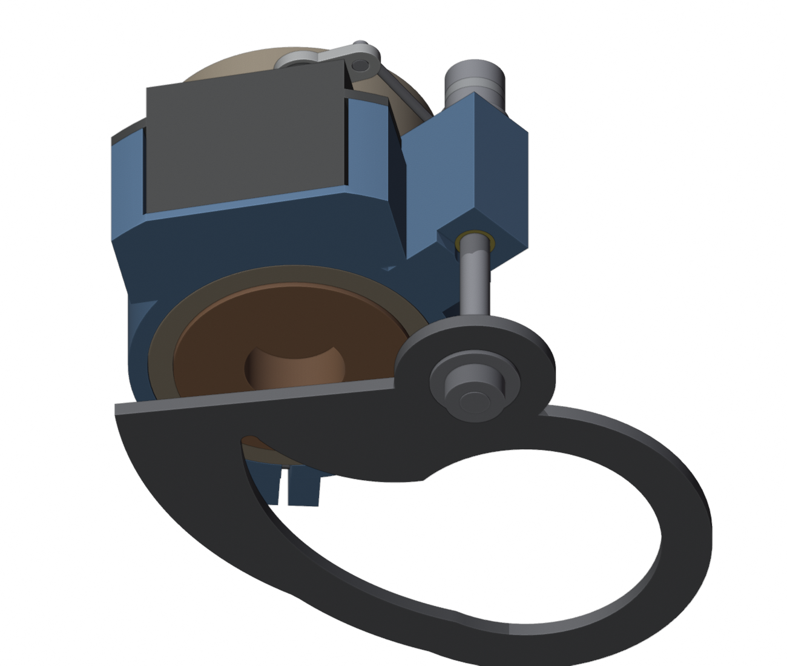<br><sub>throttling (60°), from below</sub></td>
<td align="center" width="33%">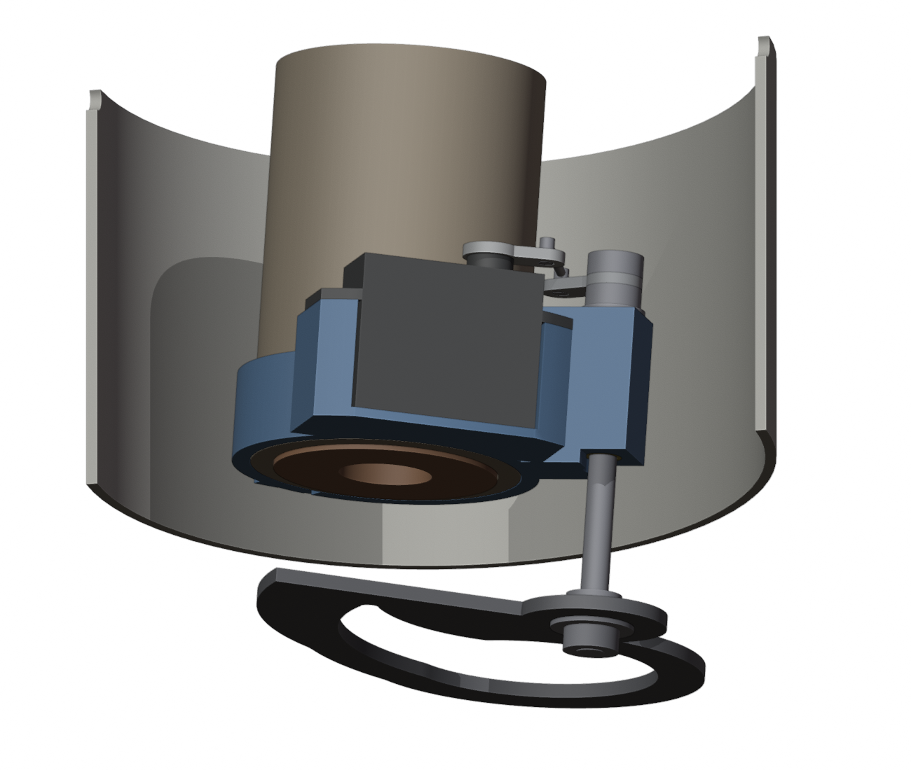<br><sub>inside the tube, gimbal at 5°/5°</sub></td>
</tr>
</table>

**Why not the pads with linkage of 15 Nov** ([`cad/throttle.py`](cad/throttle.py)): the landing tolerates only
about 1° of random side deflection from uneven blocking (at 3° only 60 to 74 % still succeed). Pads 1.5 mm below
the nozzle may exceed that with an edge error of 0.5 mm according to an estimate. An optical iris is ruled out
because its thin leaves would burn through in the jet.

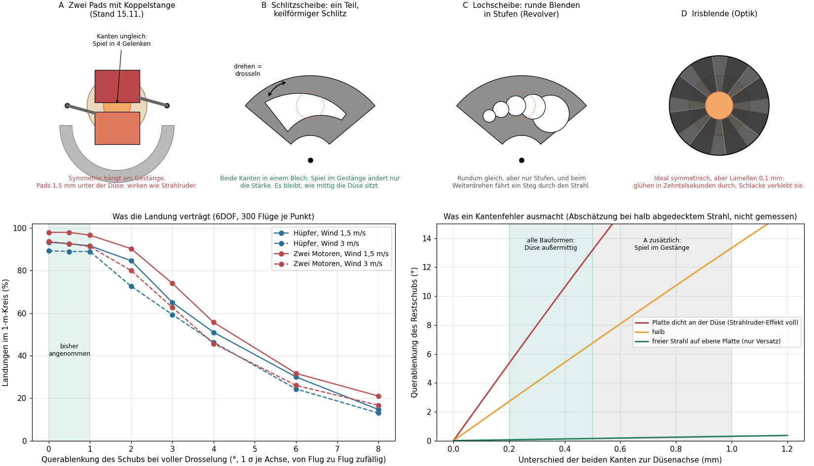

*Top: A two pads with coupling bar, B slotted plate, C plate with round holes, D iris. Bottom left: landings
inside the 1 m circle against side deflection at full throttling. Bottom right: side deflection against the
difference of the two edges, estimated.*

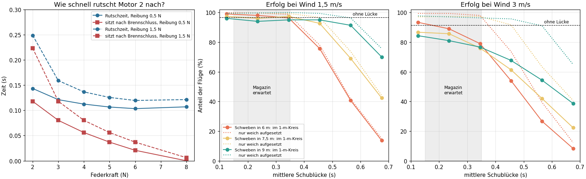

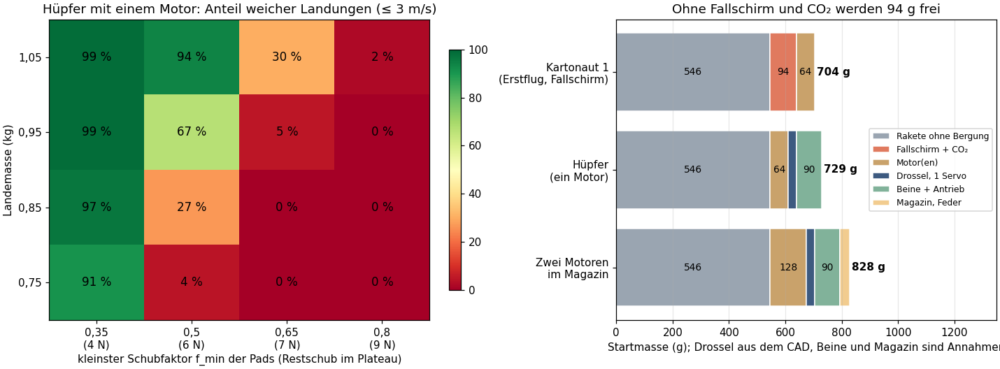

The magazine is a concept and has not been designed, the throttle is designed but not built; all numbers are
model values.

## What is inside

| Part | What it does | Where |
|---|---|---|
| Mainboard | KiCad project generated from `circuit.py`: schematic, layout, Gerber/BOM/CPL, datasheet | [hardware/mainboard/](hardware/mainboard/README.md) |
| Simulation | Python 6DOF model `tvcsim` with the firmware controller ported 1:1, gain tuning, landing studies, pinpoint landing with sensors and navigation | [simulation/](simulation/README.md) |
| Firmware | PlatformIO for Teensy 4.1: flight software, sensor drivers, bench-test console with a PC front end, native tests | [firmware/](firmware/README.md) |
| Mechanics | parametric CAD for printed parts, launch stand, test rig; mass and inertia models | [cad/](cad/README.md) |
| Build manual | modules, parts list, build steps, cable plan ([PDF](docs/bauanleitung/Bauanleitung_Kartonaut1.pdf)) | [docs/Bauanleitung_Kartonaut1.md](docs/Bauanleitung_Kartonaut1.md) |
| Ground system | launch protocol, radio bridge, ESP32 station as later option | [groundstation/](groundstation/README.md) |
| Experiments | ready-to-run ground tests | [docs/experiments/](docs/experiments/README.md) |

```bash
cd simulation && python -m pytest tests            # simulation tests
cd firmware && pio test -e native                  # firmware tests without hardware
cd firmware && pio run -e teensy41_revb            # flight firmware for rev B1
MS_CONFIG=erstflug python cad/modular.py           # printed parts, mass, renders
```

## Background

Inspired by the "Scout F" of [BPS.space](https://bps.space). Later flights may get landing legs, a
landing burn on a second motor and roll control; the board already has room for them. The old ground
station lives in [kartonaut-ground](https://github.com/Jan-Philipp-Munsch/kartonaut-ground).

## License

[MIT](LICENSE). The BPS.space Scout F files that served as reference are not part of this repository.
