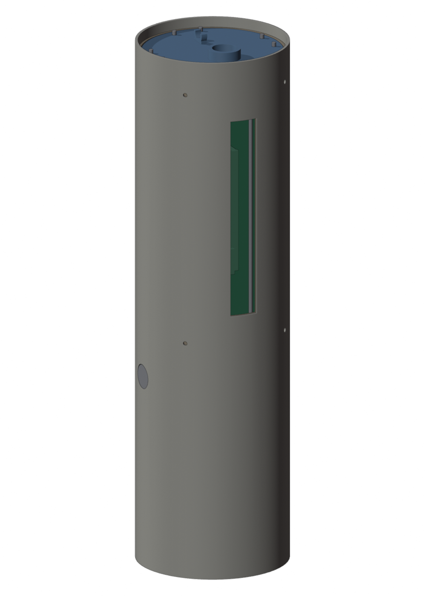
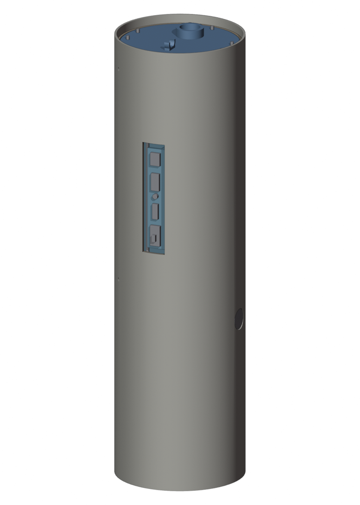
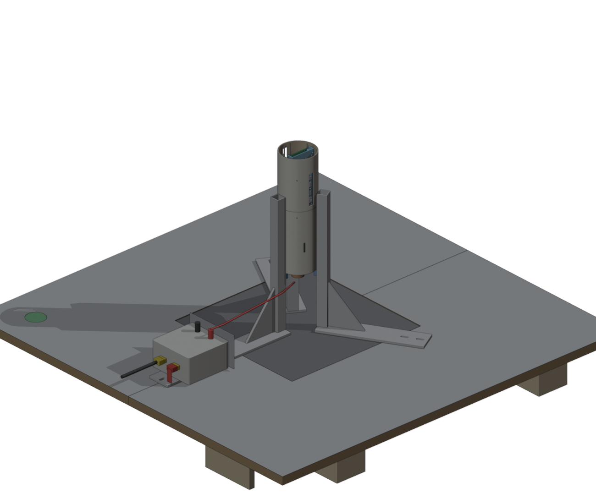
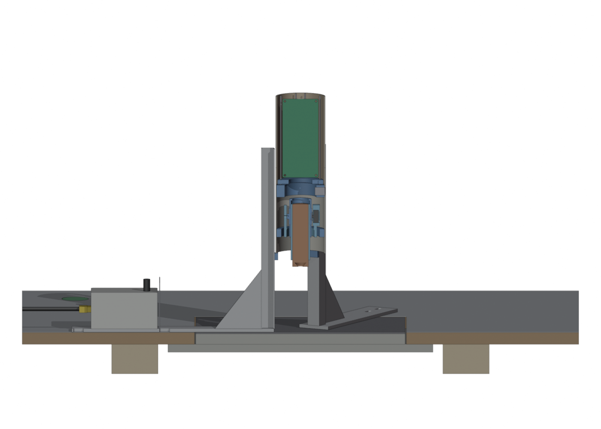
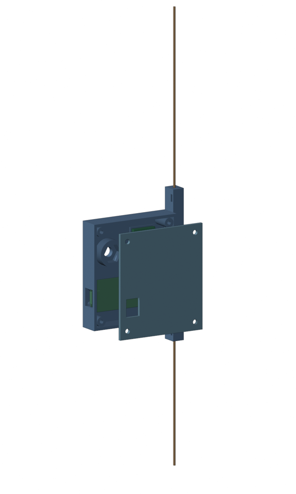
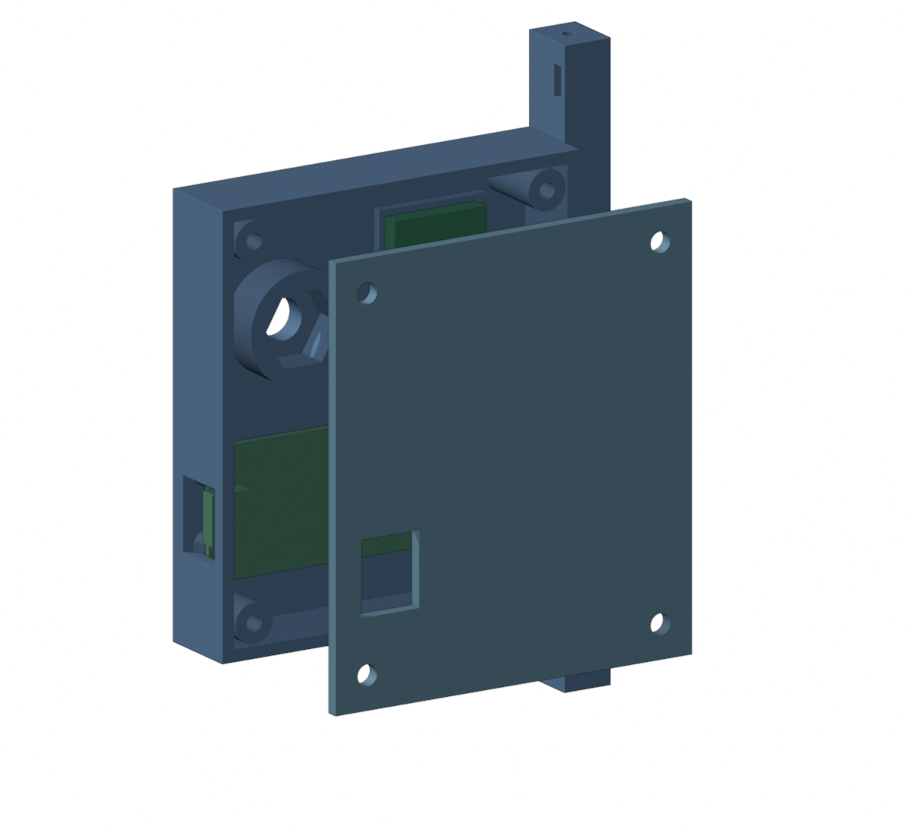

# CAD-Modell der Rakete (parametrisch, CadQuery)

Angelegt am 21.10.2026. Das Modell ersetzt die Blender-Dateien als Konstruktionsquelle; was aus ihnen
übernommen wurde, steht in [`blender_inventory.md`](blender_inventory.md). Alle Maße stehen in
[`params.py`](params.py), jede Zahl mit Quelle (`[Klima]`, `[BUILD]`, `[Blender]`, `[HW]`, `[Annahme]`,
`[Vorgabe]`). Das Massenmodell in [`mass_properties.md`](mass_properties.md) /
[`mass_properties.json`](mass_properties.json) rechnet mit denselben Parametern.

| Gesamtansicht | Schnitt (Beine eingeklappt) | Kardan mit W5652H, 5°/4° ausgelenkt | Flugcomputer-Modul |
|---|---|---|---|
|  |  |  |  |

## Bauen

```bash
python -m pip install --user cadquery      # einmalig (CadQuery 2.8, Python 3.13 funktioniert)
python cad/build.py                         # STEP/STL nach cad/export/, Bilder nach docs/img/cad/
python cad/build.py --no-render             # ohne Blender
python cad/mass_model.py                    # mass_properties.md und .json neu schreiben (alle Varianten)
python cad/build.py --config erstflug       # Erstflug-Konfiguration (22.10.2026), Rohr 700 mm
python cad/build.py --config erstflug --tube-l 665   # kürzestes Rohr (Minimum steht in params.TUBE_MIN)
```

`build.py` baut die Geometrie (54 Teile, 2 s), exportiert je Baugruppe `export/<gruppe>.step` und `.stl`
sowie `export/rocket.step` (Gesamtmodell mit Farben, das einzige Export-Artefakt im Repo), prüft dann
Durchdringungen des Kardans bei ±`GIMBAL_MAX_DEG` und ruft Blender headless auf
(`tools/render_parts.py`, Pfad in `build.py` oder Umgebungsvariable `BLENDER`). Ohne Blender entfallen
nur die Bilder.

## Struktur

| Datei | Inhalt |
|---|---|
| `params.py` | alle Maße und Massen, Koordinatenkonvention |
| `common.py` | Helfer (Rohr, Zylinder zwischen Punkten, Quader, Rotation, Radialbohrungen), Teileliste |
| `airframe.py` | zwei Klima-Rohre 75 × 500, Luke, Klima-Spitze 8539 mit Schulterkuppler und Spant |
| `tvc.py` | Außenrahmen, Innenrahmen, Motorrohr, Adapter 29→24, Motor E12, zwei W5652H mit Hebelscheiben |
| `avionics.py` | Flugcomputer-Kuppler: Endringe, 8 × M2-Stangen, Träger, Platine 54 × 120 mit Teensy, Akkus 2S/1S, obere Endplatte = Spant mit Ladungsschale |
| `ejection.py` | Kolben (Kuppler-Stück mit Platte und Öse), Fallschirm als Platzhalter; Gasraum 11 mm (war 5, die Ladungsschale ragte in die Kolbenplatte) |
| `legs.py` | Hülse am Rohrende, Ring 70 mm darüber, vier Beine mit Haupt- und oberer Strebe, Fuß, Gelenke |
| `testrig.py` | TVC-Prüfstand um die gebaute Rakete: Gestell, Rahmen, Klemmkragen mit Lukenfenstern, Prop-Adapter mit BR2814 und Propeller, Schutzkäfig; Prüfung, Druckteile einzeln als STL (siehe unten) |
| `build.py` | Zusammenbau, Export, Kollisionsprüfung, Render-Aufrufe |
| `groundbridge.py` | Gehäuse der Bodenstations-Funkbrücke (Raspberry Pi Pico + E22-400T22S) mit senkrechtem Halbwellen-Dipol in einer Leiste, Stativmutter 1/4"; Druckteile als STL (siehe unten) |
| `landingpad.py` | Startrampe: Platte mit Loch, drei verstellbare Beine, Startstützen bei 45°/135°/250°; Prüfung gegen die gebaute Rakete, eigener Export und Bilder (siehe unten) |
| `mass_model.py` | Stabmodell für Schwerpunkt und Trägheitstensor (Konfigurationen `voll` und `erstflug`) |
| `modular.py`, `modular_params.py` | Modulbauweise *Kartonaut 1* Stand 2b: Rohre A/B/C mit Bohrungen und Luken, Druckteile, gebauter Kardan als Netz, Servos und Gestänge schematisch, Kollisionsprüfung, Gesamtmodell STEP/GLB, Bilder (siehe unten) |
| `mass_stand2b.py` | Massenbudget der Modulbauweise: Masse, Schwerpunkt, Hebelarm, Trägheit je Flugzustand → `mass_stand2b.md/.json` (liest die Simulation als `--vehicle stand2b`) |
| `tools/` | Blender-Skripte: Inventur (`blender_inspect.py`, `run_inventory.sh`), Ortho-Ansichten und Radialmaße (`blender_views.py`), Renderer für den Build (`render_parts.py`) |

Koordinaten wie in der Firmware: z ist die Längsachse, z = 0 die Düsenebene, +z zur Spitze. x zeigt zum
Servo des Innenrahmens (Motorrohr kippt um x), y zum Lagerohr des Außenrahmens (Innenrahmen kippt um y).
Welche davon Pitch und welche Yaw ist, muss mit `Config.h` abgeglichen werden.

## Aufbau von unten nach oben (z in mm ab Düse)

| z | Was |
|---|---|
| 0 … 95 | Motor TSP E12-0 im Adapter 29→24 (Adapter 10 … 95), Motorrohr 45 … 103 |
| 20 | Unterkante des unteren Rohrs; Beinhülse 14,5 … 27 |
| 45 … 93 | Außenrahmen (Flansch 45 … 57 mit 4 × M3 durch das Rohr), Innenrahmen, Kardanpunkt bei **76,5** |
| 90 … 99 | oberer Beinring mit vier Gelenkböcken |
| 445 … 595 | Flugcomputer-Kuppler, symmetrisch um den Rohrstoß bei 520; Platine 455 … 575, Teensy 485 … 546 |
| 544 … 560 | Luke 16 mm breit auf +y über dem USB-Stecker (im oberen Rohr, 24 mm über dem Stoß) |
| 595 | obere Endplatte = fester Spant mit Ladungsschale, E-Match-Bohrungen und Öse |
| 606 … 646 | Kolben (Gasraum 11 mm über der Endplatte, seit 22.10.) |
| 651 … 881 | Fallschirm |
| 945 … 1020 | Schulter der Spitze (lose), 1020 … 1250 Spitze |

## Wartung und Montage, wie das Modell es vorsieht

- **Flugcomputer als Modul:** vier M2-Schrauben oben lösen, oberes Rohr abziehen, Modul am oberen
  Ring aus dem unteren Rohr ziehen. Kuppler, Endringe, Stangen, Träger, Platine und beide Akkus bleiben
  eine Einheit. Die Akkus liegen in der Trägerwanne unter der Platine und sind nach dem Herausziehen
  von der Seite zugänglich (Aussparung in den Längswänden).
- **Luke:** nur über dem USB-Stecker (`HATCH_V`). Eine Luke für die SD-Karte läge 35 bis 41 mm unter
  dem Rohrstoß im unteren Rohr; `HATCH_SD = True` schneidet sie zusätzlich. Eine gemeinsame Luke für
  beide würde den Rohrstoß kreuzen, deshalb nicht vorgesehen. Alternative: Platine um 180° einbauen
  (USB zum TVC), dann liegt die USB-Luke im unteren Rohr; das legt `hardware/mainboard/` fest.
- **Kardan:** Servos von außen in die Taschen setzen, bevor der Außenrahmen ins Rohr kommt. Der
  Außenrahmen sitzt mit vier M3 radial im Rohr (Flansch 25 mm über der Rohrunterkante). Motor von unten
  in den Adapter, Adapter im Motorrohr geklemmt.
- **Bergung:** Ladung in der Schale auf der Endplatte, Kolben darüber, Schockschnur von der Öse der
  Endplatte über die Kolben-Öse zur Spitze. Die Spitze sitzt lose (Schulter 72,4 statt 72,6).

## Was gegenüber Blender geändert ist (alles Parameter in `params.py`)

| Parameter | Blender | Modell | Grund |
|---|---|---|---|
| `OUTER_RING_OD` | 73,0 | 72,2 | Rohr innen 72,6 |
| `OUTER_RING_ID` | 51,3 | 58,3 | aus `GIMBAL_MAX_DEG` = 7°: bei 31,5 mm Hebel zur Ring-Unterkante braucht jeder Ring 4,4 mm radiales Spiel; Blender hatte 0,9 mm (1,6°) |
| `INNER_RING_ID` | 37,2 | 42,3 | dito, Blender 1,85 mm (3,4°) |
| `MOTOR_TUBE_ID` | 28,6 | 29,2 | 29-mm-Adapter |
| `SERVO_*` | „5600“ 22,4 × 8 × 29,5 | W5652H 23 × 19 × 8 | neues Servo; Welle liegt auf der Rahmenachse, Gehäuse um `SERVO_SHAFT_OFFSET` versetzt |
| `SERVO_OUTER_R`, `SERVO_INNER_R` | 29 / 25 | 30,9 / 23,5 | aus Ringmaßen und Wandstärken abgeleitet |
| Lagerohr am Außenrahmen | fehlt | ergänzt | Gegenlager zur Servowelle, spiegelbildlich zum Innenrahmen |
| `INNER_HOUSING_Z0`, `INNER_ENVELOPE_R` | – | 17 mm, 33,5 mm | Servogehäuse des Innenrahmens darf beim Kippen weder Außenflansch noch Rohr berühren |
| `ADAPTER_*` | Ø 35 × 100 | Ø 29 × 85 | wie ein 29-mm-Motor |
| `LEG_SLEEVE_ID`, `LEG_UPPER_RING_ID` | 77 / 75 | 75,2 | Spiel zum Rohr |
| Spitze | gedruckt, Ø 80, federgelagert | Klima 8539, Ogive als Spline geschätzt | Kaufteil |
| Servos SG90 unter dem Kardan, Throttle-Teile, zweites Motorrohr | vorhanden | nicht übernommen | Entscheidungen 21.10.2026 |
| Flugcomputer | Ring-Stack, Ø-73-Akkuplatte | Schlitten im Kuppler, Ringe Ø 69 | `hardware/mainboard/` |

Die Landebeine sind geometrisch wie in Blender (ausgefahren: Fuß auf r ≈ 320 mm). Eingeklappt wird nur
die Hauptstrebe senkrecht gestellt; die obere Strebe passt mit fester Länge nicht (eingeklappt bräuchte
sie 218 statt 320 mm). Der Einklappmechanismus ist offen, siehe Inventur §3.7.

## Konfigurationen (22.10.2026): `voll` und `erstflug`

`params.py` kennt zwei Konfigurationen, gewählt über die Umgebungsvariable `MS_CONFIG` (von `build.py --config`
gesetzt, Vorgabe `voll`) und optional `MS_TUBE_L`. Die abgeleiteten Längen (Rohrstoß, Kuppler, Platine, Kolben,
Schirm, Spitze, Gesamtlänge) liefert `params.layout(config, tube_total)`; `mass_model.py` nutzt diese Funktion
und rechnet alle Varianten in einem Lauf, ohne die Umgebungsvariable.

| | `voll` (Stand 21.10.) | `erstflug` (Entscheidung Jan 22.10.) |
|---|---|---|
| Rohr | 2 × 500 mm, Stoß bei z = 520 | 500 + 200 mm (Minimum 675: 500 + 175), Stoß bei z = 520 im Fallschirmraum |
| Kuppler | zentriert um den Stoß (75 / 75) | Flugcomputer-Kuppler ganz im unteren Rohr (z 127 … 277); am Stoß ein 80-mm-Kupplerstück (18 g), im oberen Rohr verklebt, 3 × M2 ins untere |
| Landebeine | ja (200 g) | nein |
| 2S-Akku / Platine | 45 g / 40 g | 30 g (450 mAh) / 45 g (Mainboard mit Teensy) |
| Luken | eine USB-Luke (+y) | Luke A (+y) und Luke B (−y), Schlüsselschalter-Kragen |
| Start | 981 g | **761 g** (700 mm), 755 g (675 mm): Ziel 750 g um 11 g verfehlt, siehe `mass_properties.md` |

Die Bilder der Gesamtübersicht gehören zu `voll` (der Prüfstand steht seit 27.10. in `testrig.py`); `build.py --config erstflug` schreibt
`export/erstflug/*` und `export/rocket_erstflug.step` und rendert `rocket_erstflug_*.png` und `hatches_*.png`.
Dazu prüft es (`check_erstflug`), ob Schalterbrett und Schlüsselschalter frei von Stangen, Platine, Akkus und Rohren sind, ob die
Steckerräume (Micro-USB, microSD, die fünf Teile des Schalterbretts, Schlüssel) weder Einbauten noch die Wand von Kuppler und Rohr
treffen (also die Luken sie abdecken), ob der Kolben frei über der Endplatte steht und ob die Bohrung bis zur Öse der Spitze frei
von Einbauten ist. Fehlende Teilenamen sind ein Fehler, kein "frei". Gegenprobe vom 22.10.: Luke A auf v = 30 … 100 verkürzt,
die Prüfung meldet USB- und SD-Raum gegen Rohr und Kuppler.

**Warum 500 + 200 und nicht 131 + 569:** Klima-Rohre sind 500 mm lang. Der erste Entwurf vom 22.10. (Kuppler 25 mm im unteren
Rohr, Stoß bei z = 151, damit die Luken im oberen Rohr liegen) hätte ein 569-mm-Stück gebraucht, das es nicht gibt. Jetzt liegt
der Flugcomputer-Kuppler mit beiden Luken ganz im unteren 500-mm-Rohr, der Stoß liegt bei z = 520 im Fallschirmraum und wird
von einem 80-mm-Kupplerstück überbrückt (Bohrung dort 70,2 statt 72,6; der Kolben läuft nur bis z = 328, der Schirm Ø 60 passt).
Zuschnitt: ein Rohr bleibt 500, das zweite wird auf 200 (bzw. 175) gekürzt.

### Luken im Flugcomputer-Kuppler (Erstflug)

| Luke A, +y, Bestückungsseite | Luke B, −y, Schalterbrett |
|---|---|
|  |  |

Die M2-Stangen stehen bei (±7, ±29,5) und (±29,5, ±7). Die Fenster in Kuppler- und Rohrwand sind 14 mm breit, bei ±y (u = 0);
die Stangen liegen 4,6 mm radial innerhalb der Kupplerwand und berühren das Fenster nicht. Was durch die Luke muss, passt aber
nur zwischen die Stangen: lichte Weite 12 mm, abzüglich 0,3 mm Bohrspiel (`ROD_GAP` = 11,7). Micro-USB-Stecker und microSD
sind mit 11 mm angenommen (0,35 mm je Seite; am Stecker nachmessen), die Teile des Schalterbretts sind höchstens 6 mm breit.
Beide Luken liegen im unteren 500-mm-Rohr, kein Stoß kreuzt sie. Schrauben: je drei M2 bei 45°, 135°, 225° am unteren und
oberen Ende des Kupplers, damit er nur in einer Drehung passt und die Luken zu den Fenstern stehen.

Wartung im Erstflug-Aufbau: die drei M2 am Stoß (z = 500) lösen, oberes Rohr mit Stoßkuppler und Spitze abziehen, Schirm und
Kolben herausnehmen, dann die sechs M2 des Flugcomputer-Kupplers lösen, Kabel zum Schlüsselschalter-Kragen am Stecker trennen und
das Modul nach oben aus dem unteren Rohr ziehen (250 mm). Der Kragen bleibt im Rohr.

- **Luke A (Teensy):** v = 16 … 115 mm (z = Platinenanfang + 16 … 115), Micro-USB, Programmiertaste und SD-Slot des
  Teensy. Die Micro-USB-Buchse zeigt in Längsrichtung (+v) und endet bei v = 92,5; ein gerader Stecker mit Knickschutz reicht
  bis v ≈ 113, deshalb geht die Luke bis 115 (bis zur Prüfung am 22.10. nachmittags endete sie bei 100, dann ging nur ein
  Winkelstecker). 21 mm Luft von der Teensy-Oberseite bis zur Kupplerwand. Der SD-Slot des Teensy 4.1 sitzt **auf der Unterseite**
  am USB-fernen Ende (im Modell vereinfacht oben); die Karte wird bei v ≈ 30 nach −v herausgezogen, zwischen Teensy und Platine,
  und ragt dabei bis v ≈ 18, deshalb beginnt die Luke bei 16 (bis zur Prüfung bei 25, da wäre die Karte nicht greifbar gewesen).
  Steckerräume (USB-Stecker und microSD je 11 mm breit) sind frei und von der Luke abgedeckt.
- **Luke B (Schalterbrett):** v = 24 … 90 mm. Ein 11 mm breites Brett (gedruckt oder Leiterplatte) sitzt zwischen den Stangen
  bei y = −33,1 … −31,1 auf zwei Stützen am Trägerboden; die Bauteile in einer Reihe von unten (TVC) nach oben: Schiebeschalter
  2-polig (v 28–40), USB-C-Buchse (44–53) mit LED (56–59), XT30-Buchse (61–71), XH-3-Buchse für den Balancer (76–83,5). Sie sind
  über Kabel mit der Platine verbunden (`J_SW`, USB-C-Lader, `J_BAT2`-Parallelanschluss). Sie liegen frei von Stangen, Akkus
  (die 2S/1S-Akkus liegen bei y > −10,8, Trägerboden bei −14,5), Träger und Platine, jeder Stecker hat 1,5 mm Luft ringsum.
- **Schlüsselschalter passt nicht in Luke B** (Körper Ø 12 gegen 12 mm Stangenlücke, dazu 15 mm Einbautiefe). Er sitzt in einem
  gedruckten **Kragen** im unteren Rohr direkt unter dem Kuppler (z = 107 … 125; das Motorrohr steigt bei 7°/7° bis 105,5),
  radial nach +x, durch eine Bohrung Ø 12,4 im unteren Rohr. Das kostet 21 mm Rohrlänge (der Kuppler beginnt bei z = 127);
  Kabel zur Platine über Steckverbinder. Schalter mit Schlüssel 20 g, Kragen 8 g [Annahme].

Prüfung vom 22.10.2026 (zweite Meinung, Befunde in `mass_properties.md` §Erstflug eingearbeitet): Rohrteilung 131 + 569 war
nicht herstellbar; Lukenbreite 12 hatte 0 mm Rand zu den Stangen (jetzt Fenster 14, Stangenlücke als eigene Prüfung);
`check_erstflug` prüfte die Wand nicht (jetzt ja); Öse am Spitzenspant hing 8,5 mm in den Schnurraum (jetzt in
`NOSE_BULKHEAD_BELOW_BASE`); Stangen 20 → 30 g, Schlüsselschalter 6 → 20 g. Ergebnis: 761 g statt 719 g.

## Modulbauweise für den Erstflug (`modular.py`, Stand 2 vom 22.10.2026)

Nach Jans gebautem Kardan (Schubstangen, W5652H, Rohr A 125 mm) und den Entscheidungen vom 22.10. abends: kein
Ring-Stack, kein Rollmotor, CO₂-Ausstoß, Schirm im Rohr C, Spitze über den zweiten halben Kuppler. Maße in
`modular_params.py` (Stand 2b): Rohr A 125 + B 176 + C 195, Gesamtlänge 731 mm; Kuppler J1 75 mm in B verklebt mit
Schraubring, Schlitten mit Spant (Band Ø 75 zwischen B und C), alle Radialschrauben bei 0°/90°/180°/270° (Rohr C 45°
versetzt), Rampenführungen bei 45°/135°/250° zwischen Schrauben und Servofenstern (207°/336° laut Druckdatei).
Grundlage der Bauanleitung `docs/Bauanleitung_Kartonaut1.md`. Das Massenbudget dazu rechnet `mass_stand2b.py`:
**705 g** beim Start (Druckteile Stand 2d: Leichtbau vom 23.10., GPS-Halter NEO-6M und Zapfenfenster vom 27.10.), Schwerpunkt 260 mm, Hebelarm Kardan–Schwerpunkt 190 mm,
Ixx = 0,021, Izz = 0,00047 kg·m², dazu eine Hebeltabelle bis 593 g
(`mass_stand2b.md`; die Überschlagsrechnung in `modular.py` kommt ohne LoRa-Wendel, CO₂-Servo und Schalterbrett-Teile
auf 689 g).

```bash
MS_CONFIG=erstflug python cad/modular.py        # Druckteile nach export/modular/*.stl, Prüfung, masses.json, Bilder
python cad/modular_params.py                    # nur die Plausibilitätsprüfung der Zahlen
```

Der gebaute Kardan liegt als Netz aus den Druckdateien vom 12.06.2025 (`export/asbuilt/*.stl`) an seiner Lage im
Gesamtmodell (Grundfläche 38 mm, Bohrungen auf 44 mm, Drehung −45°), Servos, Hebel und Drahtbügel schematisch dazu;
`tvc.py` beschreibt noch den Direktantrieb und ist auf den Schubstangen-Kardan umzustellen (Bauanleitung §8 O4). Die Prüfung meldet Durchdringungen von Schlitten, Platine,
Steckern, Akkus, GPS, LoRa-Wendel, Schalterbrett, Schraubring, CO₂-Modul und Schirm mit Rohren, Kuppler und einander.

## Prüfstand (`testrig.py`, 21.10.2026; auf die gebaute Rakete umgestellt 27.10.2026)

| Rakete im Gestell, 12° genickt, 8° gegiert, Kardan 4°/3° | Antriebsende aufgeschnitten: Prop-Adapter, BR2814, Propeller, Schutzkäfig |
|---|---|
|  |  |

`python cad/testrig.py` baut den Prüfstand um die gebaute Rakete (`modular.build_all()`, Stand 2d), prüft ihn, schreibt
`export/testrig.step` (mit Rakete, im Repo), `export/testrig.stl` (Gestell und Rahmen) und die Druckteile einzeln nach
`export/testrig/` und rendert zwei Bilder (`--no-render` ohne Blender). Laufzeit unter 1 min. Die alte Fassung hing an
`tvc.py` (Rohr 20 mm über der Düse, Drehpunkt 448 mm) und ist aus `build.py`, `tvc.py` und `params.py` entfernt.

Die Rakete hängt in einem zweiachsigen Gestell mit Drehpunkt im Schwerpunkt und bekommt ihren Schub von einem
Propellermotor im gebauten Kardan:

- **Schwerpunkt:** aus `mass_stand2b.json` (ohne Motor 641 g) minus 29→24-Adapter, plus BR2814, Propeller, Prop-Adapter,
  Käfig und Käfig-Klemmring: **908 g, z = 200 mm**. `RIG_PIVOT_Z = 200`; nach dem Auswiegen am Gerät setzen.
- **Gestell:** Sperrholzplatte 820 × 500, zwei Alu-Stützen 40 × 40 bei x = ±350 mit je drei Streben, Kugellager 608 in
  Höhe des Drehpunkts (**600 mm über dem Boden**, der Propeller läuft dann 386 mm über dem Boden), zwei Achsstummel Ø 8.
- **Rahmen:** Rechteck aus Alu-Profil 20 × 20 (innen 120 × 135 mm), auf den Stummeln geklemmt, nickt um x. Auf den
  y-Stäben zwei gedruckte Lagerböcke mit 608-Lagern.
- **Klemmkragen:** gedruckt, zweiteilig (Teilung x = 0), Ø 95, z = 185 … 250 um Rohr B, Ohren an ±y mit je zwei M4; der
  Zapfen Ø 8 liegt in der Teilung und wird mitgeklemmt. Die Rakete steckt um 90° gedreht im Kragen: ihre Längslinie 0°
  (Kardanschraube) zeigt zum Zapfen +y, Luke B nach +x. **Fenster** lassen Luke B (Hauptschalter, USB-C, Laden 2S), den
  Schraubschalter (282°, z 237) und Luke A1 frei; über dem Fenster für Luke B bleibt ein 9-mm-Rand, damit jede Hälfte
  ein Stück ist. Luke A2 (ab z 254) und die Schraubenebenen z 169 und 293 liegen außerhalb. Rollen ist gesperrt.
- **Antrieb:** Statt 29→24-Adapter und E12 sitzt ein gedruckter Adapter mit Zapfen Ø 28,4 (Bohrung des Motorrohrs laut
  Druckdatei 28,6, **nachmessen**) im gebauten Motorrohr (Unterkante z = 34) und ein Flansch Ø 34 × 5 mit M3-Kreuz 16/19
  darunter; Ø 34 wie das Motorrohr, so kippt er bei ±7°/±7° (9,9°) mit 0,5 mm Luft unter den Kardanrahmen (ab z = 38)
  durch. Daran der BR2814 mit Welle nach unten, Propeller 12 × 6 rund 14 mm unter der Rohrunterkante. Der Schubvektor läuft
  durch den Kardanpunkt (z = 69,5), der Kardan lenkt ihn wie im Flug.
- **Schutzkäfig:** zwei Ringe Ø 337 aus 8-mm-Alu-Rohr, zwölf Stäbe, vier Speichen in Buchsen eines zweiteiligen gedruckten
  Klemmrings an Rohr A (z = 6 … 26, unter den Kardanschrauben bei z = 44), je Teilung eine M4. Propellerspitze 12 mm radial
  vom Käfig.
- **Auslenkung:** ±20° je Rig-Achse (`RIG_TILT_MAX_DEG`), begrenzt per Gurt zwischen Rohr und Rahmen (nicht modelliert).

**Prüfungen** (alle frei, 27.10.): Adapterflansch bei voller Kardankippung unter den Rahmen (z 37,5 < 38); Flansch und
Glocke bleiben im Rohr (r ≤ 30,4 < 36,3); Propeller, Glocke, Adapter und Käfig-Klemmring gegen Rohr A und Käfig bei Kardan
0° und allen Ecken ±7°; Kragen lässt Luke B, Schraubschalter und Luke A1 frei, jede Hälfte ist ein Stück; Rakete (alle Teile),
Antrieb, Käfig und Kragen gegen Gestell, Rahmen, Lagerböcke und ESC bei Rig ±20° je Achse und in vier Ecken mit Kardan ±7°.

**Druckteile** (`export/testrig/`, liegend fürs Bett, PETG wie die Modulbauweise; Massen 75 % des CAD-Volumens,
`druckteile.json`):

| Datei | Stück | Masse | Hinweis |
|---|---|---|---|
| `Klemmkragen_Haelfte_LukeB.stl` | 1 | ≈ 76 g | +x-Hälfte mit dem Fenster für Luke B und den Schraubschalter |
| `Klemmkragen_Haelfte_LukeA.stl` | 1 | ≈ 87 g | −x-Hälfte mit dem Fenster für Luke A1 |
| `Lagerbock_608.stl` | 2 | ≈ 7 g | sitzt auf dem y-Stab des Rahmens |
| `Prop_Adapter.stl` | 1 | ≈ 27 g | Zapfen erst nach dem Nachmessen der Motorrohr-Bohrung drucken |
| `Kaefig_Klemmring_Haelfte.stl` | 2 | ≈ 37 g | Speichenbuchsen Ø 8,2 |

Nicht modelliert: Kabel (ESC und 4S-Akku sitzen als Klotz auf dem Rahmen), Gurt-Anschläge, Schrauben. Maße des BR2814
(Glocke Ø 35 × 36, Lochkreuz 16/19, 75 g) sind Annahmen für einen 2814-Außenläufer; am Teil nachmessen und `PM_*` oben in
`testrig.py` anpassen.

## Startrampe (`landingpad.py`, 22.10.2026; auf die gebaute Rakete umgestellt 27.10.2026)

| Start, Boden 6° geneigt | Stützen, Loch, Stahlblech |
|---|---|
|  |  |
| **Schnitt y = 0** | |
|  | |

Anforderungen: [`docs/Schnittstellen_Bodensystem_2026-10-22.md`](../docs/Schnittstellen_Bodensystem_2026-10-22.md), S1;
Zündung an Bord nach [`docs/Plan_Bordzuendung_2026-10-27.md`](../docs/Plan_Bordzuendung_2026-10-27.md) (S2 entfällt).
`python cad/landingpad.py` baut die Rampe in den Koordinaten der Modulbauweise (z = 0 Düse = Rohrunterkante, der Motor steht
bündig), prüft sie gegen die gebaute Rakete aus `modular.build_all()` mit den M3-Linsenköpfen der Radialschrauben (Kardan
±7°/±7° um den Kardanpunkt z = 69,5, Abheben bis 200 mm), schreibt `export/landingpad.step` (Rampe mit Rakete) und rendert drei
Bilder (`--no-render` ohne Blender). Laufzeit unter 1 min.

Zweiter Stand vom 22.10.: der erste Entwurf (Achteck 1250 mit Stahldeck und Strahlplatte als Landefläche, 34 kg, 230 €) war
für den Erstflug zu schwer und zu teuer (Jan, 22.10.). Jetzt: kleine Startrampe aus B1/OBI-Teilen, Strahl durch ein Loch in die
Erde, Beine einzeln verstellbar für unebenen Boden. **Die Landefläche für die Konfiguration `voll` (S1: Ø ≥ 1200, nicht brennbar)
ist damit ein eigenes Teil für später**; diese Rampe trägt die Beine nicht (Füße auf r ≈ 320, Platte 600).

**Aufbau** (Maße oben in `landingpad.py`, jede Zahl mit Quelle):

- **Platte:** Siebdruckplatte 600 × 600 × 18 (Zuschnitt im Baumarkt; OSB 18 ginge auch, quillt aber bei Nässe), in der Mitte
  ein **Loch Ø 130**: der Strahl geht durch die Platte in die Erde. Der Strahlkegel (±15° plus 7° Kardan) hat an der
  Plattenunterkante r = 53. Um das Loch ein Stahlblech 250 × 250 × 1 gegen Funken und Hitze, Oberkante **100 mm unter der Düse**
  (S1: ≥ 80). Dosenlibelle Ø 40 bündig eingelassen bei 0°.
- **Beine:** drei Gewindestangen M10 × 330 (eine 1-m-Stange) auf r = 265 bei 90°/210°/330°, je in einer Einschlagmutter mit
  Kontermutter oben; unten eine Karosseriescheibe Ø 30 zwischen zwei Muttern. Drei Beine stehen auf jedem Boden ohne Kippeln.
  Jedes Bein einzeln drehen, bis die Libelle einspielt: Platte 80 … 274 mm über dem Boden, das gleicht **bis 23° Neigung** aus
  (im Bild 6°). Auf weichem Boden die Scheiben weglassen und die Stangen 3 cm einstecken.
- **Startstützen (drei, abschraubbar):** bei **45°, 135°, 250°** (Befund 17): zwischen den Radialschrauben bei 0/90/180/270° und
  den Servofenstern bei 207°/336°; die Luken bei 90°/270° liegen über der Führung. Je ein Alu-Vierkantrohr 20 × 20 × 1,5 als
  **Führung, 160 mm über der Rohrunterkante, 2 mm Luft** zum Rohr (S1: 1 … 2 mm), oben innen angefast. 2 statt 1,5 mm, weil die
  Linsenköpfe der M3-Schrauben (ISO 7380, 1,65 mm hoch) bei z 44 und 110 in der Führungshöhe liegen: so gehen sie bei jeder
  Rolllage durch. Ein **Auflage-Klotz** Alu 20 × 5 × 10 innen an der Führung, Oberkante z = 0 unter der Ringfläche (r 34 … 39
  deckt 36,3 … 37,5). Die Führung endet unten bei z = −10; eine Schrägstrebe aus demselben Rohr und zwei Knotenbleche Alu 3 mm
  führen zur Fußplatte Alu 40 × 5 auf r = 150 … 250 mit zwei M6 in Langlöchern (radial einstellbar). Im Strahl steht nichts.
  Verbunden mit M5 durch Rohr und Knotenbleche. Einstellen mit einem gedruckten Ring Ø 79 (Lehre = Rohr + 2 × 2) statt der
  Rakete: Stützen anlegen, M6 festziehen, Lehre nach oben abziehen.
- **Zündung:** kein Zündkasten, keine Zündleitung und kein Shunt mehr an der Rampe. Die Rakete zündet über Pyro 1; die
  Anzünderleitung kommt von innen aus der Düse und hängt nach dem Start lose.

**Prüfungen** (alle frei, 27.10.): gebaute Rakete bei Kardan 0° und allen vier Ecken ±7°/±7° gegen jedes Teil; Düse mindestens
99 mm über dem Stahlblech; Strahlkegel ±22° bis 400 mm unter der Düse frei; Kardan-Freiraum r < 30 unter der Rohrunterkante
leer; Auflagen auf z = 0 unter der Ringfläche, Führungen 160 mm hoch, Luft 2,00 mm; Linsenköpfe bis r = 39,15, Führung innen
bei 39,50; Abheben in Schritten bis 200 mm gegen die Stützen; Beinlängen bei 6° Bodenneigung im Verstellbereich; Kippsicherheit
im Wind (5 N auf die Rakete, 0,84 m über dem Boden) Faktor 2,1 mit 6,1 kg Rampe und 705 g Rakete.

**Stückliste** (Massen aus dem Modell mit Dichten [Annahme], Preise grob B1/OBI Oktober 2026 [Annahme]):

| Teil | Masse | Preis |
|---|---|---|
| Siebdruckplatte 18 mm, Zuschnitt 600 × 600, Loch Ø 130 (Lochsäge oder Stichsäge) | 4,2 kg | 13 € |
| Stahlblech 1 mm, 250 × 250 (Tafel 250 × 500 halbiert), um das Loch | 0,5 kg | 9 € |
| Gewindestange M10, 1 m; Einschlagmuttern M10 (3) und M6 (6), Muttern M10 (9), Karosseriescheiben (3) | 0,6 kg | 10 € |
| Alu-Vierkantrohr 20 × 20 × 1,5, 2 × 1 m; Alu-Flach 40 × 5, 1 m; Alu 3 mm Rest; M6 × 20, M5 × 30 | 0,9 kg | 31 € |
| Dosenlibelle Ø 40 | – | 4 € |
| Druckteil PETG: Lehre Ø 79 | – | 1 € |
| **gesamt** | **6,1 kg** | **ca. 68 €** |

**Transport:** Platte 600 × 600 (passt in jeden Kofferraum), Beine herausgedreht, Stützen abgeschraubt oder dran gelassen
(Höhe dann 300 mm). Aufbau: Beine eindrehen, Rampe hinstellen, mit der Libelle ausrichten, Rakete von oben zwischen die
Führungen setzen, Schraubenköpfe zwischen die Stützen drehen.

**Sicherheit:** Ablauf am Pad nach dem Plan Bordzündung, Startcheckliste (Hauptschalter, Anzünder, Arming-Schalter, weggehen, dann PAD_READY,
ARM, LAUNCH vom Laptop; bei MISFIRE 60 s warten, SAFE, erst dann hingehen).
- Unter dem Loch nackte Erde, kein trockenes Gras, kein Laub; im Umkreis von 2 m nichts Brennbares. Auf Asphalt oder Stein
  ein Stück Gehwegplatte oder Blech unter das Loch legen (Strahl prallt dann zurück, Abstand ≥ 150 mm). Wasser oder Löscher bereit.
- Bei Wind über etwa 10 m/s nicht starten; auf weichem Boden die Stangen einstecken, sonst Heringe über die Platte (Kippfaktor 2,1).

**Abweichungen von S1** (an den Besitzer der Schnittstellendatei): keine Strahlplatte mit seitlichem Abzug, sondern Loch und
Erde; keine Landefläche Ø 1200 (eigenes Teil für die Konfiguration `voll`, später).

**Offen:** Schrauben, Muttern und Einschlagmuttern der Stützen sind nur als Langlöcher modelliert. Steifigkeit der Stütze mit
2 × M6 in 18 mm Sperrholz am Muster prüfen. Temperatur der Alu-Auflagen (direkt neben der Düse, seitlich vom Strahl) beim ersten
Abbrand prüfen. Ob die Servoarme bei Vollausschlag aus den Servofenstern ragen (Bauanleitung O1), am Kardan nachsehen; das Modell
hat sie im Rohr. Landefläche für `voll` konstruieren.

## Funkbrücke der Bodenstation (`groundbridge.py`, 27.10.2026)

| Mit Dipol, Deckel abgehoben | Innenraum |
|---|---|
|  |  |

`python cad/groundbridge.py` baut das Gehäuse für den Pico und das dritte E22 (Plan Bordzündung §5), prüft, dass Pico und
E22 frei liegen, und schreibt die Druckteile nach `export/groundbridge/` (Unterteil ≈ 23 g, Deckel ≈ 8 g, PETG, ohne
Stützen). Kasten 62 × 16 × 70 mm, links eine Leiste mit Drahtkanal Ø 2,2 für den Dipol: zwei Arme aus 1,5-mm²-Kupferdraht,
je 164 mm ab der Lötstelle (λ/4 bei 433,125 MHz × 0,95), oberer Arm an ANT, unterer an GND des E22. Beide biegen im Fenster
der Leiste rechtwinklig durch die linke Wand zu den Pads. Der Pico sitzt auf vier Domen (M2 × 5), die USB-Buchse in der
rechten Wand; das E22 klebt mit Schaumband in einem Rahmen. Rückseite: Sechskanttasche für eine 1/4"-20-Mutter
(Kamerastativ), zwei Kabelbinderschlitze in der Leiste für die Montage an einem Stab. Deckel mit vier M3 × 10 und einem
Fenster über der Pico-LED.

**Offen:** Lage der LED und der Pads am echten Pico/E22 prüfen (Fenster und Drahtdurchführungen sind großzügig). Die Arme
nach dem ersten Reichweitentest gegebenenfalls kürzen; ohne Messgerät ist 164 mm der Startwert.

## Annahmen, am Gerät nachzumessen

- Rohrunterkante 20 mm über der Düse (`TUBE_BOTTOM_Z`), Außenrahmen 25 mm darüber: beides frei gewählt,
  ergibt den Kardanpunkt bei 76,5 mm und den Hebelarm 0,37 m. Verschiebt sich der Rahmen, ändert sich
  der Hebelarm direkt.
- Kardanpunkt 31,5 mm über der Rahmen-Grundfläche (Servomitte in Blender). Lage der Abtriebswelle am
  W5652H (`SERVO_SHAFT_OFFSET`, 5 mm aus der Mitte) und welche Seite 19 bzw. 23 mm ist: Datenblatt.
- Kuppler außen 72,4 (BUILD.md) oder 72,6 (Klima-Shop); Schulterlänge und Masse der Spitze.
- Treibsatzlage im E12 (z = 10 … 60 mm), Masse der gedruckten Teile, Landesystem 200 g ohne Konstruktion.
- Flugcomputer 100 g gesamt, hier als 40 g Platine, 25 g Endringe/Platte, 20 g Stangen, 15 g Träger.
- Fallschirm gepackt Ø 60 × 230 mm; Kolbenlänge 40 mm; Ladungsschale Ø 12 × 8.
- Rohr-Innendurchmesser 72,6 (Klima): davon hängen Außenrahmen, Beinringe und Kolben ab.

## Offen

1. Pitch/Yaw-Zuordnung der beiden Servos zu `Config.h` und zur Platinenlage (`chipToBody`).
2. Einklappmechanismus der Beine und ihre Verriegelung im Flug.
3. Servo-Datenblatt W5652H: Wellenlage, Laschenabstand, Schraubenmaß; dann `tvc.py` Taschen prüfen.
4. Ob die Ringe mit 4,4 mm Spiel noch genug Führung haben, oder ob der Innenrahmen tiefer hängen soll
   (kleinerer Hebel zur Ring-Unterkante, weniger Spiel nötig).
5. Druckausgleichsbohrungen für das Barometer (3 bis 4 × Ø 2 auf Höhe v ≈ 80, `hardware/mainboard/README.md`) fehlen im Modell.
6. Prüfstand: Gurt-Anschläge, Kabelführung vom ESC zum Motor über den Kragen, Gas-Ausgang in der Firmware; BR2814 und die Bohrung des Motorrohrs nachmessen, Drehpunkt nach dem Auswiegen setzen.
