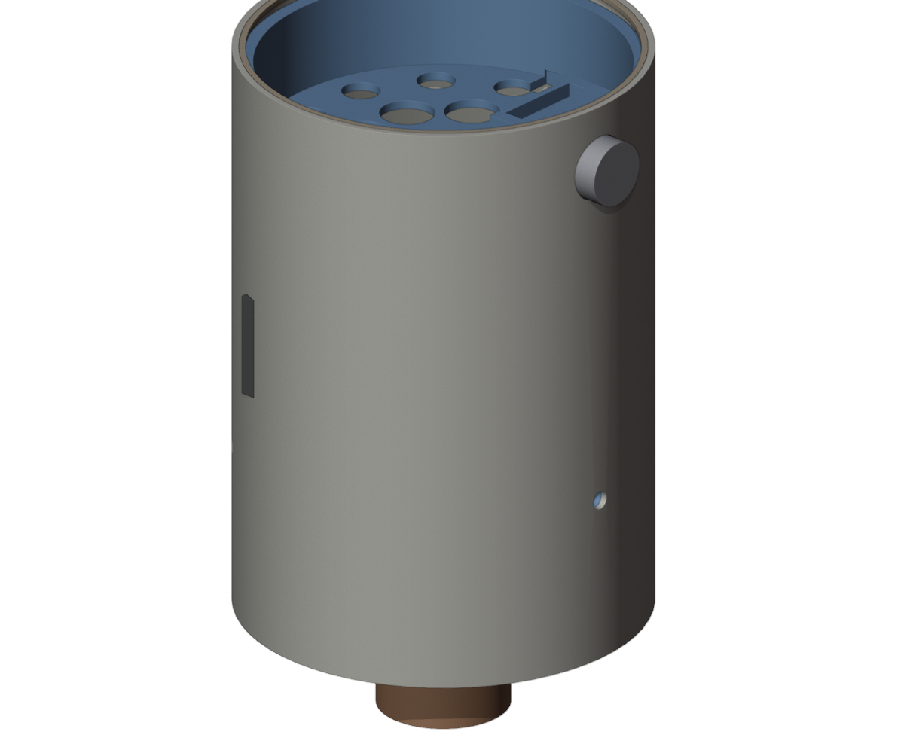
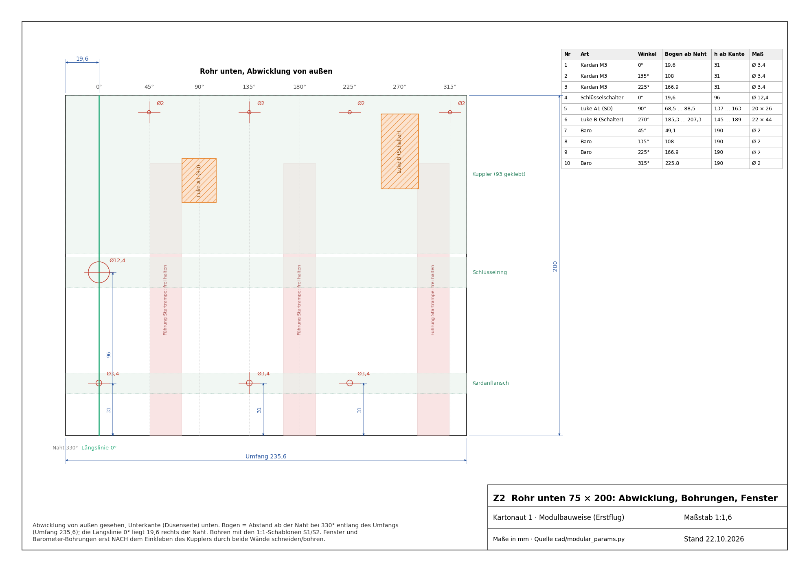
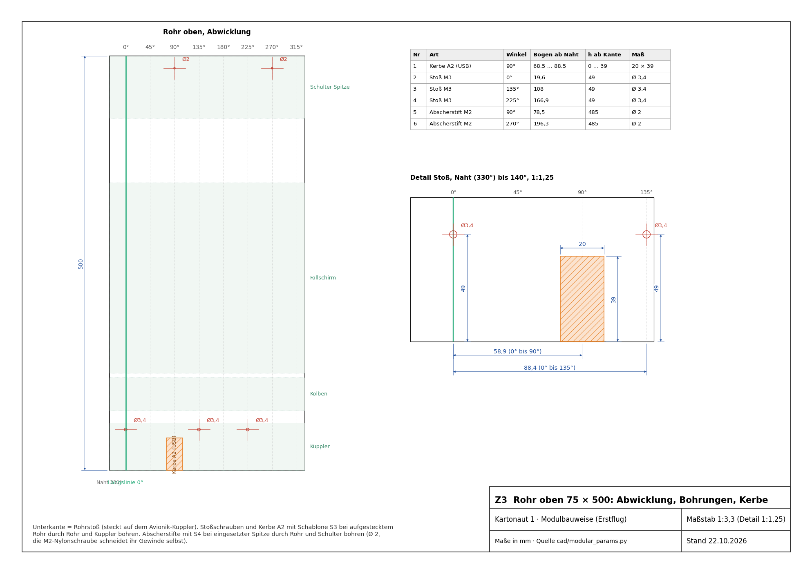
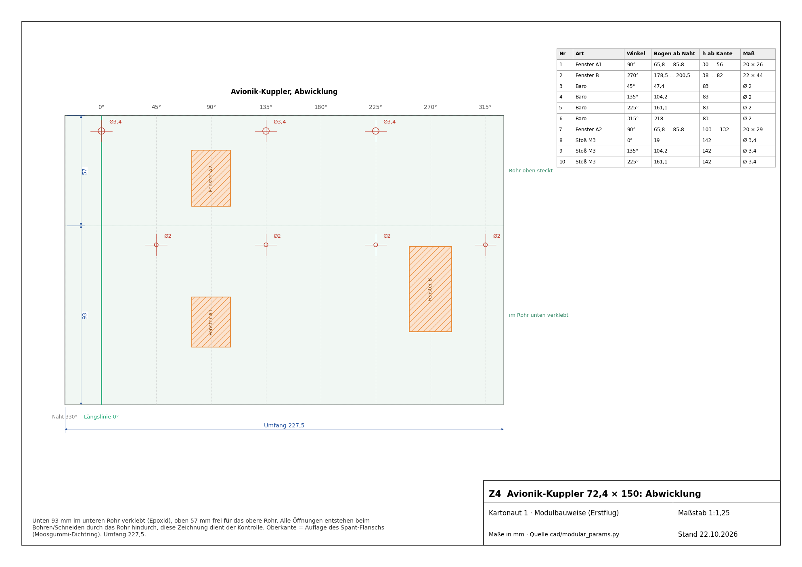
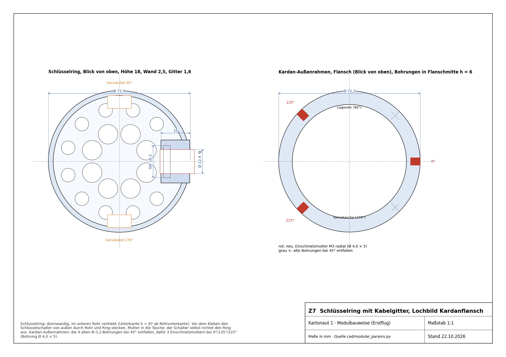
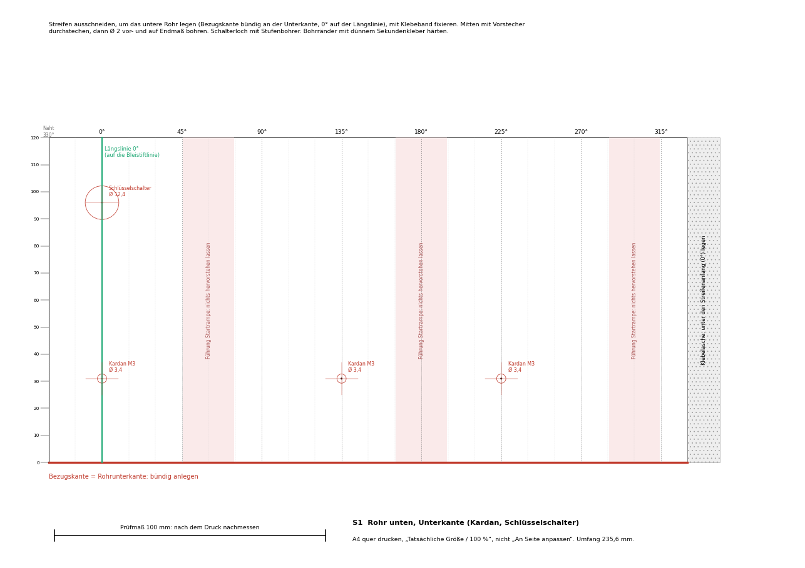

# Kartonaut 1: Bauanleitung in Modulbauweise

<p class="subtitle">Erstflug-Konfiguration (ein TSP E12, Fallschirm, keine Beine) · Stand 22.10.2026 · Maße aus
<code>cad/modular_params.py</code>, Zeichnungen aus <code>docs/bauanleitung/zeichnungen.py</code></p>

Diese Anleitung ersetzt für den Erstflug den Ring-Stack mit acht M2-Gewindestangen. Der Flugcomputer ist jetzt
eine einzige Platine (Mainboard rev B1, 54 × 120 mm, vier M3-Löcher). Sie sitzt auf einem gedruckten Schlitten, der
an seinem oberen Ende, dem Ausstoßspant, im Avionik-Kuppler hängt. Die Rakete zerfällt in fünf Module, die nur an
fünf Trennstellen verschraubt oder gesteckt sind. Alle Radialschrauben sind M3 mit demselben Lochbild, alle Löcher im
Rohr entstehen mit 1:1-Schablonen.

| Datei | Inhalt |
|---|---|
| `docs/bauanleitung/Zeichnungen_Kartonaut1.pdf` | Blatt Z1 bis Z7: Übersicht, Abwicklungen der Rohre und des Kupplers, Schlitten, Kleinteile, Schlüsselring und Kardanflansch |
| `docs/bauanleitung/Bohrschablonen_1zu1.pdf` | Blatt S1 bis S4 zum Ausdrucken in Originalgröße und Umwickeln der Rohre |
| `cad/export/modular/*.stl` | alle Druckteile einzeln (im Slicer nur noch drehen) |
| `cad/modular.py` | erzeugt die Druckteile, prüft Kollisionen, rechnet die Masse, rendert die Bilder |

```bash
MS_CONFIG=erstflug python cad/modular.py          # Druckteile, Prüfung, Masse, Bilder
python docs/bauanleitung/zeichnungen.py           # Zeichnungen und Schablonen
python docs/bauanleitung/build_pdf.py             # diese Anleitung als PDF
```

[TOC]

<hr class="pb">

## 1. Kritische Prüfung des bisherigen Erstflug-Entwurfs

Geprüft wurde der CAD-Stand vom 22.10.2026 (`cad/build.py --config erstflug`, 761 g) gegen die Platine rev B1, die
Startrampe (`cad/landingpad.py`, Branch `landepad`) und die Bergung. **K** = verhindert den Flug oder den Bau,
**W** = muss vor dem Bau gelöst sein, **H** = beim Bau beachten.

| Nr. | | Befund | Folge | Lösung in dieser Anleitung |
|---|---|---|---|---|
| 1 | K | Die acht M2-Gewindestangen stammen aus dem Ring-Stack für Breakout-Platinen. Mit der einen Platine tragen sie nichts mehr; sie begrenzen nur noch die Luken auf 12 mm Lücke, für 11 mm breite Stecker (0,35 mm Luft je Seite). | 30 g Stahl, zwei Endringe, sechs M2-Schrauben am Kuppler; USB-Stecker und SD-Karte nur mit Glück erreichbar | Stangen entfallen. Ein gedruckter Schlitten trägt Platine, Akkus und Schalterbrett und hängt am Ausstoßspant (§2.3). Luken 20 und 22 mm breit. |
| 2 | K | Der 80-mm-Stoßkuppler bei z = 480 … 560 hat innen 70,2 mm, der Kolben außen 72,4 mm. | Der Kolben bleibt nach 190 mm am Stoßkuppler hängen; der Fallschirm steckt dann noch zur Hälfte im Rohr und muss von der Spitze herausgezogen werden. | Rohre getauscht: unten 200, oben 500 mm. Der Stoß liegt jetzt im Avionik-Kuppler, das obere Rohr ist innen glatt bis zur Spitze. |
| 3 | K | LoRa-Antenne (λ/4 in der Spitze) und GPS-Modul (in der Spitze) laut Spezifikation rev B. Die Spitze wird beim Ausstoß abgesprengt. | Das Antennenkabel reißt beim Ausstoß oder hält die Spitze fest; ab dem Gipfel keine Telemetrie und kein GPS, genau dann, wenn man es zum Suchen braucht. | Antenne und GPS in den Avionikraum (§8, offener Punkt O1). Papprohr und Kuppler sind für 433 MHz und GPS durchlässig. |
| 4 | K | Die Stecker an der TVC-Stirnseite der Platine (J5, J6 Servos, J1 XT30) ragen 12 mm über die Platinenkante. Im alten Modell sitzt dort der untere Endring, der nur einen schmalen Schlitz für Träger und Platine hat. | Stecker passen nicht; Platine müsste höher, dann kollidieren die Pyro-Stecker oben mit der Endplatte. | Untere Scheibe mit Steckerfenster 34 × 12 mm, Platine 6 mm höher; beides mit der Kollisionsprüfung in `cad/modular.py` belegt. |
| 5 | W | Das Massenmodell setzt die Druckteile mit 67 g an. Mit derselben Rechenregel wie hier (Volumen aus dem CAD × 1,27 g/cm³ × 0,75) wären es 134 g; allein der Schlüsselschalter-Kragen hat 40 cm³ statt der angesetzten 8 g. | Der alte Entwurf wiegt eher 828 g als 761 g. | Dünnwandiger Schlüsselring, Schlitten statt Ringe und Stangen, kein Stoßkuppler: **≈ 757 g** nach derselben Regel (§2.6). Das 750-g-Ziel ist knapp verfehlt, Hebel in §2.6. |
| 6 | W | Alle Lochbilder sind symmetrisch (4 × 90°). | Der Kardan passt auch um 90° verdreht hinein; dann sind Nicken und Gieren gegenüber der Platine vertauscht, der Regler kippt die Rakete. | Ein einziges Lochbild **0°/135°/225°** für Kardan und Rohrstoß: passt nur in einer Drehlage. |
| 7 | W | Die vier Kardanschrauben bei 45° liegen im Bereich der Startrampen-Führung bei 60° (Führung 20 mm breit, belegt 45,6° … 74,4°, 1,5 mm Luft). Ein M3-Linsenkopf steht 1,65 mm über. | Die Rakete hakt beim Abheben an der Führung. | Lochbild 0°/135°/225° liegt zwischen den Führungen; Schlüsselschalter bei 0° ebenfalls. Die Schablonen zeigen die Führungsbereiche als „frei halten“. |
| 8 | W | Radialschrauben gehen in Ø-3,2-Bohrungen in PLA/PETG, ohne Gewinde. | Gewinde im Druck ist nach wenigen Montagen ausgerissen, gerade an den Stellen, die bei jeder Flugvorbereitung gelöst werden. | Einschmelzmuttern M3 in alle Druckteile, die geschraubt werden (14 Stück). |
| 9 | W | Die Klemmschraube des Motoradapters sitzt am oberen Ende des Motorrohrs (z = 95), im Rohr hinter dem Kardan. | Nach dem Einbau nicht erreichbar; Motor wechseln heißt Kardan ausbauen. | Klemmschraube an das untere Ende des Motorrohrs (z ≈ 51), von unten mit dem Inbus erreichbar; dazu Klebeband um den Motor als zweite Sicherung. |
| 10 | W | Gedruckte Öse für die Schockschnur (3 mm PETG) am Spant und an der Spitze. | Reißt beim Öffnungsstoß. | Ringschraube M4 mit Mutter und Scheiben durch Spant und Spitzen-Spant. |
| 11 | W | Zünderdrähte durch zwei Bohrungen im Spant, nach jedem Flug neu abzudichten. | Undichter Spant: Ausstoßgas im Avionikraum, Barometer springt, Ruß auf der Platine. | Zwei M2-Messingschrauben als Durchführungsklemmen, einmal eingeklebt; der Zünder wird oben angeklemmt. |
| 12 | W | Der Avionikraum ist nach unten zum Kardan offen (Endring mit Ø-36-Loch). | Das Barometer sieht den Unterdruck am Heck statt des statischen Drucks; Gipfelerkennung falsch. | Untere Scheibe, Kabel- und Steckerfenster mit Schaumstoff gestopft, Flansch auf Moosgummi; Druckausgleich über 4 × Ø 2 im Rohr. |
| 13 | W | Servokabel liegen lose über dem Kardan. | Kabelschlaufe gerät in den Kardan und blockiert ihn. | Kabelgitter als Boden des Schlüsselrings, zwei Durchlässe an der Wand. |
| 14 | H | Der Motoradapter ist als PLA angesetzt. | PLA wird bei 55 °C weich, das Motorgehäuse nach dem Brand heißer. | Adapter, Motorrohr, Kolbenplatte, Ladungsbecher aus ASA oder PETG. |
| 15 | H | Fenster durch Rohr und Kuppler müssen fluchten. | Getrennt geschnittene Fenster verdecken sich halb. | Kuppler zuerst einkleben, dann durch beide Wände zusammen schneiden und bohren. |
| 16 | H | Die Spitze sitzt lose. Beim Brennschluss bremst die Rakete stärker als die Spitze. | Die Spitze kann sich vor dem Gipfel lösen. | Passung mit Klebeband einstellen; zwei M2-Nylon-Abscherstifte vorgesehen (Bohrschablone S4), Einsatz nach Bodentest. |
| 17 | H | Datenblatt des W5652H fehlt noch (Wellenlage, Laschen). | Servotaschen im Kardan sind nicht geprüft. | Vor dem Druck des Kardans Servo nachmessen (`cad/params.py`, `SERVO_*`). |
| 18 | H | Schlüsselschalter mit Ø 12 mm sind meist nur bis 0,5 bis 2 A belastbar; durch J_ARM fließt der Zündpuls (3 bis 5 A, 50 bis 100 ms). | Kontakt verschweißt oder Zündung bleibt aus. | Schalter mit ≥ 3 A und abziehbarem Schlüssel in beiden Stellungen wählen, sonst Arming-Stecker (§8, O3). |

<hr class="pb">

## 2. Das Modulkonzept

### 2.1 Fünf Module, fünf Trennstellen


{ width=28% }

| Modul | Teile | hält durch |
|---|---|---|
| **M1 Antrieb** | Kardan (Außen-, Innenrahmen, Motorrohr, 2 × W5652H), Adapter 29 → 24, Motor E12 | T1: 3 × M3 radial in den Kardanflansch |
| **M2 Unterteil** | Rohr unten 200 mm, Schlüsselring mit Schalter, Avionik-Kuppler 150 mm (93 mm eingeklebt) | geklebt, bleibt immer eine Einheit |
| **M3 Avionik-Schlitten** | Schlitten mit Ausstoßspant, untere Scheibe, Platine rev B1, Akkus 1S und 2S, Schalterbrett | hängt mit dem Flansch auf der Kupplerkante, T2 |
| **M4 Oberteil** | Rohr oben 500 mm, Kolben, Schockschnur, Fallschirm | T2: 3 × M3 radial durch Rohr und Kuppler in den Spant |
| **M5 Spitze** | Klima 8539 mit Spant und Ringschraube | T3: Passung (und 2 × M2-Nylon nach Bodentest) |

T4 sind die Stecker an der Platine (Servos, Akku, Arming, Zünder), T5 die Zünder-Klemmen und die Ringschraube oben auf
dem Spant. Eine Schraubengröße (M3, Inbus 2,0 für ISO 7380), ein Lochbild, ein Werkzeug.

**Lastpfade.** Schub: Motor → Adapter → Motorrohr → Kardan → 3 × M3 → Rohr unten. Ausstoßdruck: drückt den Spant auf
die Kupplerkante, die im Rohr unten verklebt ist. Öffnungsstoß: Schnur → Ringschraube → Spant → 3 × M3 → Kuppler und
Rohr oben gleichzeitig. Weil die Stoßschrauben durch beide Wände gehen, hält auch der Rohrstoß den Schirmzug.

### 2.2 Bezugslinie und Winkel

Am Rohr zählen alle Winkel ab der **Längslinie 0°**, einer Bleistiftlinie längs über beide Rohre. Von außen gesehen,
Spitze oben, wächst der Winkel nach rechts.

| Winkel | Was dort liegt |
|---|---|
| 0° | Schlüsselschalter, je eine Schraube von T1 und T2 |
| 90° | Luke A1 (SD-Karte) und Kerbe A2 (USB), Bestückungsseite der Platine, Lagerohr des Kardans |
| 135°, 225° | übrige Schrauben von T1 und T2 |
| 270° | Luke B (Schalterbrett), Servo des Außenrahmens, Kabeldurchlass |
| 60°, 180°, 300° | Führungen der Startrampe bis 160 mm über der Rohrunterkante: nichts darf hervorstehen |
| 330° | Naht der Schablonen (kein Loch) |

Die Platine liegt in der Ebene durch die Längsachse, ihre Bestückungsseite zeigt nach 90°. Der Innenrahmen-Servo sitzt
bei 0° (Motorrohr kippt um die 0°-Achse), der Außenrahmen-Servo bei 270°. Welche Achse in `Config.h` Nicken und welche
Gieren ist, bleibt offen (O5); mit dem eindeutigen Lochbild ist sie nach dem ersten Abgleich aber für immer gleich.

### 2.3 Avionik-Schlitten

| Bestückungsseite (Luke A) | Schalterbrett (Luke B) | Schlitten allein |
|---|---|---|
|  |  |  |

Ein Druckteil, stehend gedruckt: oben der **Flansch** Ø 72,2 × 4 (liegt auf der Kupplerkante, Moosgummi-Ring
dazwischen), darunter der **Zapfenring** Ø 69,8 / 62 × 18 im Kuppler mit drei Schraubenaugen für die
Einschmelzmuttern, daran der **Träger**: Boden und zwei Seitenwände unter der Platine, Fächer für den 2S-Akku
(v = 8 … 64) und den 1S-Akku (v = 68 … 118), Klettband-Schlitze, vier Säulen mit Einschmelzmuttern für die Platine.
Unten verschraubt: die **untere Scheibe** (zentriert im Kuppler, Steckerfenster für J5/J6/J1, Kabelloch).
Unter dem Träger: das **Schalterbrett** an zwei Säulen, hinter Luke B, mit Hauptschalter, USB-C (1S laden),
Lade-LED, XT30 (2S laden) und Balancer-Buchse.

Der Spant ist die Bühne für die Bergung: **Ladungsbecher** Ø 12 × 8 im Sockel (verrußt: neu drucken),
**zwei Zünder-Klemmen** M2 Messing, **Ringschraube M4** für die Schockschnur. Maße: Blatt Z5 und Z6.

Die Pyro-Stecker an der Spitzen-Stirnseite der Platine (J9, J10, z bis 275) ragen in den Zapfenring hinein, die
Platinenecken (r = 27) bleiben innerhalb seiner Bohrung (r = 31). Die Prüfung in `cad/modular.py` belegt: Schlitten,
Platine, Teensy, Stecker, Akkus und Schalterbrett berühren weder Kuppler noch Rohre, der Schlüsselring nicht den Kardan
bei Neutralstellung. (Die Kardanprüfung bei ±7° macht weiterhin `cad/build.py`.)

### 2.4 Schlüsselring

Ein dünnwandiger Ring (Wand 2,5 mm, 18 mm hoch) im unteren Rohr direkt unter dem Kuppler, mit einem Auge für den
Schlüsselschalter bei 0° und einem Kabelgitter als Boden. Er hält den Schalter, hält die Kabelschlaufe vom Kardan fern
und ist der untere Abschluss des Kabelraums. Maße: Blatt Z7.

{ width=45% }

### 2.5 Stapel längs (z ab Düsenebene)

| z von … bis | Was | Modul |
|---|---|---|
| 0 … 95 | Motor TSP E12-0, ragt 20 mm unten heraus | M1 |
| 20 | Rohrunterkante (Auflage auf der Startrampe) | M2 |
| 45 … 93 | Kardan, T1 bei z = 51 (h = 31) | M1 |
| 107 … 125 | Schlüsselring, Schalter bei z = 116 (h = 96) | M2 |
| 127 … 277 | Avionik-Kuppler, 93 mm im Rohr unten, 57 mm im Rohr oben | M2 |
| 131 … 134 | untere Scheibe | M3 |
| 143 … 263 | Platine rev B1 (v = 0 … 120) | M3 |
| 220 | Rohrstoß | M2/M4 |
| 259 … 281 | Zapfenring und Flansch des Spants, T2 bei z = 269 | M3 |
| 292 … 332 | Kolben (11 mm Gasraum über dem Flansch) | M4 |
| 337 … 567 | Fallschirm 125 cm, gepackt Ø 60 × 230 | M4 |
| 567 … 638 | Raum für die Schockschnur (72 mm) | M4 |
| 645 … 720 | Schulter der Spitze, Abscherstifte bei z = 705 | M5 |
| 720 … 950 | Spitze | M5 |

Kürzestes Rohr mit dieser Stapelfolge: 678 mm (gebaut wird 700 = 200 + 500, also 22 mm Reserve für Schirm und Schnur).

### 2.6 Masse

Gleiche Rechenregel für alt und neu: Druckteile aus dem CAD-Volumen × 1,27 g/cm³ (PETG) × 0,75 (dünne Wände fast
voll), alle anderen Teile wie in `cad/mass_properties.md`. Ergebnis aus `cad/export/modular/masses.json`:

| | alter Entwurf (Ring-Stack) | Modulbauweise |
|---|---|---|
| Druckteile ohne Kardan | 134 g (angesetzt waren 67 g) | 99 g |
| Gewindestangen, M2, Stoßkuppler | 49 g | – |
| Ringschraube, Einschmelzmuttern, Klemmen, Dichtung | – | 12,5 g |
| **Start (ein E12)** | **≈ 828 g** | **≈ 757 g** |

Die 750 g sind um 7 g verfehlt. Hebel, ohne die Funktion anzufassen: Spitzen-Spant aus 3-mm-Pappelsperrholz statt
Druck (−5 g), Kolbenplatte 2 mm (−3 g), Fenster in der Trägerwand größer und Boden 1,2 mm (−5 g), Rohr 680 statt
700 mm (−5 g). Die Waage entscheidet: alle Druckteile nach dem Druck wiegen und in `cad/mass_properties.md` eintragen.

<hr class="pb">

## 3. Teile-Checkliste

Status: **da** = laut `docs/BUILD.md` vorhanden, **best.** = bestellt, **kaufen** = fehlt noch,
**druck** = selbst drucken, **JLC** = mit der Platine. Zum Abhaken ausdrucken.

### 3.1 M2 Unterteil

| ✓ | Teil | Stück | Status | Hinweis |
|---|---|---|---|---|
| ☐ | Körperrohr 75/500 Klima 207550000, auf **200 mm** gekürzt | 1 | da (3) | Rest 300 mm als Reserve |
| ☐ | Kuppler 75/150 Klima 207315000 (Avionik-Kuppler) | 1 | da (3) | Außen-Ø nachmessen (72,4 oder 72,6) |
| ☐ | Schlüsselring mit Kabelgitter, `Schluesselring_mit_Kabelgitter.stl` | 1 | druck | PETG, 15 g |
| ☐ | Schlüsselschalter Ø 12, ≥ 3 A, Schlüssel in beiden Stellungen abziehbar | 1 | kaufen | ORDER.md 0.10; Mutter SW ≤ 16,5 (Tasche im Ring) |
| ☐ | Kabel Schlüsselschalter → J_ARM, JST-XH 2, AWG 22, 25 cm | 1 | crimpen | |
| ☐ | Epoxid 30 min (Kuppler, Ring) | – | kaufen | |
| ☐ | Dünnflüssiger Sekundenkleber (Bohrränder härten) | – | kaufen | |

### 3.2 M1 Antrieb

| ✓ | Teil | Stück | Status | Hinweis |
|---|---|---|---|---|
| ☐ | Außenrahmen mit neuem Lochbild, `Aussenrahmen.stl` | 1 | druck | PETG/ASA, 24 g; 3 Einschmelzmuttern radial |
| ☐ | Innenrahmen, `Innenrahmen.stl` | 1 | druck | PETG/ASA, 17 g |
| ☐ | Motorrohr, `Motorrohr.stl` | 1 | druck | ASA, 13 g; Klemmschraube unten (Befund 9), Bohrung von Hand Ø 4,0 für Einschmelzmutter |
| ☐ | Adapter 29 → 24, `Adapter_29-24.stl` | 1 | druck | ASA, 16 g |
| ☐ | Servo FrSky Xact W5652H | 2 (+1 Reserve) | best. | Stecker auf JST-XH 3 umcrimpen (Platine J5/J6 sind XH) |
| ☐ | Lagerbolzen M3 × 12 mit Sicherungsmutter (Gegenlager beider Rahmen) | 2 | kaufen | Länge am Druckteil prüfen |
| ☐ | M3 × 6 ISO 7380 + Einschmelzmutter M3 (T1) | 3 + 3 | kaufen | |
| ☐ | M3 × 8 + Einschmelzmutter (Motorklemme) | 1 + 1 | kaufen | |
| ☐ | Servoverlängerung 15 cm oder Litze AWG 26, 3-adrig | 2 | kaufen | Servo bis J5/J6 mit Schlaufe: ca. 25 cm |
| ☐ | Motor TSP E12-0 | 1 je Flug | da (4) | Klebeband als zweite Sicherung |

### 3.3 M3 Avionik-Schlitten

| ✓ | Teil | Stück | Status | Hinweis |
|---|---|---|---|---|
| ☐ | Schlitten mit Ausstoßspant, `Schlitten_mit_Ausstossspant.stl` | 1 | druck | PETG, 50 g, stehend, Flansch auf dem Bett |
| ☐ | Untere Scheibe, `Untere_Scheibe.stl` | 1 | druck | PETG, 8 g |
| ☐ | Schalterbrett, `Schalterbrett.stl` | 1 | druck | PETG, 2 g |
| ☐ | Ladungsbecher, `Ladungsbecher.stl` | 3 | druck | ASA; Ersatz, weil er verrußt |
| ☐ | Mainboard rev B1, bestückt | 1 (+1) | JLC | noch nicht bestellt (`hardware/mainboard/ORDER.md` Tor 3) |
| ☐ | Teensy 4.1 mit Buchsenleisten 1 × 24 | 1 | da | ORDER.md 0.14 |
| ☐ | 1S-LiPo 450–600 mAh, JST-PH 2.0, **ohne** Schutzschaltung | 1 (+1) | kaufen | ORDER.md 0.6; Fach 50 × 30 × 7 |
| ☐ | 2S-LiPo 450 mAh 50 C, XT30 | 1 | `[?]` | Fach 56 × 25,5 × 8 |
| ☐ | Einschmelzmutter M3 kurz (Länge ≈ 4, Außen ≈ 4,5) | 9 | kaufen | Bohrung im CAD Ø 4,0 × 5: vor dem Druck am Muster prüfen (`INSERT_HOLE`) |
| ☐ | M3 × 6 ISO 7380 (Platine 4, Schalterbrett 2) | 6 | kaufen | |
| ☐ | M3 × 8 (untere Scheibe) | 2 | kaufen | |
| ☐ | M3 × 6 ISO 7380 (T2, Rohrstoß) | 3 (+3 Reserve) | kaufen | werden bei jeder Flugvorbereitung gelöst |
| ☐ | M2 × 10 Messing, 4 Muttern, 2 Lötösen (Zünder-Klemmen) | 2 | kaufen | mit Epoxid eingeklebt |
| ☐ | Ringschraube M4 (DIN 580 oder Edelstahl-Öse), Mutter, 2 Scheiben | 1 | kaufen | |
| ☐ | Moosgummi/EVA 1 mm, Ring 72,4 / 70 (Dichtung unter dem Flansch) | 1 | kaufen | |
| ☐ | Schaumstoff (offenporig) für Baro, Kabel- und Steckerfenster | – | kaufen | |
| ☐ | Klettband 16 mm, 2 × 20 cm | 2 | kaufen | |
| ☐ | Kapton- oder PE-Isolierplatte 1 mm, 54 × 120 | 1 | kaufen | ORDER.md 0.23 |
| ☐ | Schiebeschalter 2-polig (J_SW) | 1 | kaufen | ORDER.md 0.9, Ausbruch 6 × 12 |
| ☐ | USB-C-Buchse auf kleiner Platine (nur VBUS/GND) + Lade-LED 3 mm, Kabel PH zu J_CHG1 | 1 | kaufen | Ausbruch 9 × 9 |
| ☐ | XT30-Buchse mit Kabel → J_CHG2 (JST-PH 2) | 1 | kaufen/crimpen | ORDER.md 0.13 |
| ☐ | Balancer-Verlängerung JST-XH 3, 15 cm (Buchse ins Brett) | 1 | kaufen | |
| ☐ | Kabel J_SW (JST-XH 4) zum Schiebeschalter | 1 | crimpen | ORDER.md 0.11 |
| ☐ | 433-MHz-Antenne mit IPEX-Pigtail, Lage siehe O1 | 1 | kaufen | ORDER.md 0.4, 0.5 |
| ☐ | GPS-Modul (optional), Lage siehe O1 | 1 | optional | ORDER.md 0.20 |
| ☐ | microSD-Karte | 1 | da | |

### 3.4 M4 Oberteil und Bergung

| ✓ | Teil | Stück | Status | Hinweis |
|---|---|---|---|---|
| ☐ | Körperrohr 75/500 Klima (ungekürzt) | 1 | da | |
| ☐ | Kuppler 75/150, davon 40 mm als Kolben | 1 | da | Rest 110 mm Reserve |
| ☐ | Kolbenplatte, `Kolbenplatte.stl` | 1 | druck | ASA, 13 g, in das Kuppler-Stück geklebt |
| ☐ | Kevlarschnur 2 mm (vom Spant über den Kolben hinaus) | 1 m | da | |
| ☐ | Gummischnur 1,5 mm (Kevlar → Spitze) | 1,8 m | da | |
| ☐ | Fallschirm 125 cm Klima 8594 | 1 | da | |
| ☐ | Wirbel oder Schnellverbinder 3 mm (Spant, Schirm, Spitze) | 3 | kaufen | |
| ☐ | Schirmschutz: Nomex-Tuch 30 × 30 oder Ausstoßwatte | 1 | kaufen | |
| ☐ | Elektrozünder (E-Match) | 1 je Flug + Tests | kaufen | ORDER.md 0.22 |
| ☐ | Schwarzpulver, Menge per Bodentest (ca. 0,5 … 1 g) | – | vorhanden? | Bodentest §5.8 |
| ☐ | Klebeband (Ladungsbecher verschließen) | – | – | |

### 3.5 M5 Spitze

| ✓ | Teil | Stück | Status | Hinweis |
|---|---|---|---|---|
| ☐ | Spitze komplett 75 mm Klima 8539 | 1 | da | |
| ☐ | Spitzen-Spant, `Spitze_Spant.stl` (oder 3 mm Pappelsperrholz Ø 70) | 1 | druck | in die Schulter geklebt |
| ☐ | Ringschraube M4, Mutter, 2 Scheiben | 1 | kaufen | |
| ☐ | M2 × 6 Nylon (Abscherstifte) | 2 (+4) | kaufen | erst nach Bodentest einsetzen |

### 3.6 Werkzeug und Verbrauch

| ✓ | Was | Wofür |
|---|---|---|
| ☐ | 3D-Drucker, PETG und ASA | Druckteile |
| ☐ | Lötkolben mit Einschmelzspitze M3 | Einschmelzmuttern |
| ☐ | Cutter mit neuen Klingen, Stahllineal, Schneidmatte | Rohr ablängen, Fenster |
| ☐ | Alu-Winkelprofil ≥ 800 mm (oder Türrahmen) | Längslinie ziehen |
| ☐ | Bohrer Ø 2, 3,4, 4,0; Stufenbohrer bis 13 mm; Vorstecher | Löcher |
| ☐ | Schleifpapier 240, Feile | Kanten |
| ☐ | Crimpzange JST-XH/PH | Kabel (ORDER.md 0.12) |
| ☐ | Messschieber, Waage 0,1 g | Maße, Massen |
| ☐ | Inbus 2,0 und 1,5, kleiner Kreuzschlitz (Servo) | Montage |
| ☐ | Drucker für A4 in Originalgröße | Schablonen |

<hr class="pb">

## 4. Druckeinstellungen

| Teil | Material | Lage auf dem Bett | Wände / Füllung | Stützen |
|---|---|---|---|---|
| Schlitten mit Ausstoßspant | PETG | Flansch unten (im Slicer um 180° drehen) | 3 Wände, 25 % Gyroid | nein; die Säulen haben 45°-Übergänge |
| Untere Scheibe, Spitzen-Spant | PETG | flach | 3 Wände, 30 % | nein |
| Schlüsselring | PETG | Gitter unten | 3 Wände, 30 % | nein (Bohrung des Schalters als Tropfenform nachschneiden) |
| Schalterbrett | PETG | flach | 100 % | nein |
| Kardanrahmen, Motorrohr | ASA oder PETG | Flansch unten | 4 Wände, 40 % | an den Servotaschen |
| Adapter 29 → 24, Kolbenplatte, Ladungsbecher | ASA | stehend | 4 Wände, 40 % | nein |

Nach dem Druck jedes Teil wiegen (Tabelle in `cad/mass_properties.md`). Einschmelzmuttern mit 220 °C senkrecht
eindrücken, bis sie 0,2 mm unter der Oberfläche stehen; vorher an einem Probestück prüfen, ob Ø 4,0 × 5 passt.

## 5. Bauschritte

### 5.1 Vorbereiten

1. **Schablonen drucken:** `Bohrschablonen_1zu1.pdf` auf A4 quer, „Tatsächliche Größe“. Den 100-mm-Prüfbalken
   nachmessen; weicht er mehr als 0,5 mm ab, Druckereinstellung korrigieren. Streifen an der Außenlinie ausschneiden,
   Klebelasche stehen lassen.
2. **Rohr unten ablängen:** 200 mm anzeichnen, mit einem Papierstreifen eine rechtwinklige Linie um das Rohr ziehen,
   mit dem Cutter in mehreren Umläufen schneiden, Kante auf Schleifpapier plan schleifen. Das obere Rohr bleibt 500 mm.
3. **Längslinie ziehen:** beide Rohre stumpf aneinanderlegen (oder das obere später aufstecken) und im Winkelprofil mit
   Bleistift eine durchgehende Linie ziehen. Das ist 0°.
4. **Kuppler für den Kolben:** vom zweiten Kuppler 40 mm abschneiden (wie Schritt 2).

### 5.2 M2 Unterteil

1. **S1 anlegen:** Streifen um das untere Rohr, rote Bezugskante bündig an die **Unterkante**, grüne Linie auf die
   Längslinie, Lasche unter den Streifenanfang, mit Klebeband fixieren.
2. Drei Kardanlöcher (h = 31, 0°/135°/225°) mit dem Vorstecher markieren, Ø 2 vor-, Ø 3,4 aufbohren.
   Schalterloch (h = 96, 0°) markieren, mit dem Stufenbohrer auf Ø 12,4. Bohrränder innen und außen mit einem Tropfen
   dünnem Sekundenkleber härten, nach dem Aushärten leicht entgraten.
3. **Schlüsselring einkleben:** Schalter von außen durch Rohr und Ring stecken, Mutter innen in die Tasche, leicht
   anziehen: der Schalter richtet den Ring aus. Ring so weit schieben, dass seine Unterkante bei h = 87 liegt (das Loch
   tut das von selbst), Epoxid ringsum dünn von innen auftragen, aushärten lassen. Schalterkabel (XH-2, 25 cm) jetzt
   anlöten und nach oben durch den Ring führen.
4. **Kuppler einkleben:** am Kuppler 93 mm von unten anzeichnen. Epoxid dünn auf die unteren 93 mm des Kupplers und
   ringsum in das Rohr, Kuppler mit leichter Drehung bis zur Marke einschieben, die Unterkante sitzt dann 2 mm über dem
   Schlüsselring. Überschuss innen abwischen. Aushärten.
5. **S2 anlegen:** Bezugskante an die **Oberkante** des unteren Rohrs (die Stufe zum Kuppler), Längslinie fluchten.
   Fenster A1 (90°, 20 × 26) und B (270°, 22 × 44) mit dem Cutter an Stahllineal durch Rohr **und** Kuppler schneiden,
   mehrere leichte Züge. Die ausgeschnittenen Stücke aufheben: sie sind die Lukendeckel. Barometerlöcher Ø 2
   (h = 190, 45°/135°/225°/315°) durch beide Wände. Schnittkanten mit Sekundenkleber härten.
6. **Kontrolle:** Längslinie, Schalter bei 0°, Fenster bei 90° und 270°, nichts steht in den Führungsbereichen der
   Rampe (60°, 180°, 300°) über.

### 5.3 M4 Oberteil

1. Oberes Rohr auf den Kuppler stecken, bis es am unteren Rohr anliegt, Längslinien fluchten lassen, mit Klebeband
   gegen Verdrehen sichern.
2. **S3 anlegen:** Bezugskante an die **Unterkante des oberen Rohrs** (den Stoß). Drei Löcher T2 (h = 49,
   0°/135°/225°) Ø 2 vor-, Ø 3,4 aufbohren, **durch Rohr und Kuppler**. Kerbe A2 (90°, 20 × 39 ab der Unterkante) im
   Rohr ausschneiden; das Fenster dahinter im Kuppler (z = 230 … 259, also 103 … 132 über der Kupplerunterkante)
   gleich mitschneiden. Ränder härten.
3. Oberes Rohr abziehen, Löcher im Kuppler kontrollieren. Ab hier bleibt das Paar Rohr/Kuppler einander zugeordnet:
   beide mit „A“ beschriften.

### 5.4 M1 Antrieb (Kardan)

1. Einschmelzmuttern: 3 radial in den Außenrahmen-Flansch (0°/135°/225°), 1 unten in das Motorrohr (Klemmschraube).
2. Servos vorher am Servotester oder mit `examples/revb_bringup` auf **Mitte** fahren, erst dann Hebelscheiben
   aufstecken (Kardan in Neutralstellung). Servostecker auf JST-XH 3 umcrimpen, Belegung wie J5/J6.
3. Innenrahmen-Servo (0°-Seite) einsetzen, Motorrohr einhängen, Gegenlager mit M3-Bolzen; dann Außenrahmen-Servo
   (270°), Innenrahmen einhängen, Gegenlager. Von Hand ±7° auf beiden Achsen frei durchbewegen.
4. Kabel beider Servos nach oben, entlang der Rohrwand.
5. **Einbauen:** Kardan von unten ins untere Rohr schieben, dabei die Servokabel durch die beiden Durchlässe im
   Kabelgitter (90° und 270°) nach oben fädeln. Die drei Einschmelzmuttern fluchten nur in einer Lage mit den
   Rohrlöchern. 3 × M3 × 6 ISO 7380 eindrehen, handfest.
6. Adapter mit Motor von unten ins Motorrohr, Klemmschraube unten anziehen, Klebeband um Motor und Adapter.

### 5.5 M3 Avionik-Schlitten

1. Einschmelzmuttern: 3 radial in die Augen des Zapfenrings, 4 in die Platinensäulen, 2 stirnseitig unten (Scheibe),
   2 in die Säulen des Schalterbretts.
2. **Spant ausrüsten:** zwei M2-Messingschrauben von unten durch die Klemmen-Bohrungen, oben mit Mutter, unten mit
   Lötöse und Mutter; von unten mit Epoxid abdichten. Ringschraube M4 mit Scheiben beidseitig, Mutter mit Schraubensicherung.
   Ladungsbecher in den Sockel stecken. Moosgummi-Ring unter den Flansch kleben.
3. **Schalterbrett:** Schiebeschalter, USB-C-Platine mit LED, XT30-Buchse und Balancer-Buchse einkleben (Epoxid, von
   innen), Kabel crimpen: J_SW (XH-4), J_CHG1 (PH-2), J_CHG2 (PH-2). Brett mit 2 × M3 × 6 von innen durch den
   Trägerboden an die Säulen schrauben.
4. **Akkus:** Isolierplatte auf die Akkus, 2S in das untere Fach (v 8 … 64), 1S in das obere (v 68 … 118), je mit
   Klettband durch die Schlitze. 2S-Kabel zur Stirnseite (XT30 J1), 1S-Kabel zur Seite (PH J_BAT1).
5. **Platine:** auf die vier Säulen, 4 × M3 × 6. Zünderkabel (XH-2, 4 cm) von J9 und J10 zu den Lötösen der Klemmen.
6. **Untere Scheibe** mit 2 × M3 × 8 von unten an den Träger.
7. **Einbau** (Oberteil ist ab): Schlitten über den Kuppler halten, von unten heraufkommende Kabel einstecken: Servo
   Gieren J5, Servo Nicken J6, Schlüssel J_ARM. Schlitten langsam absenken, die Kabelschlaufe ins Kabelgitter legen.
   Die Stecker J5/J6/J1 stecken im Fenster der Scheibe. Der Flansch liegt auf der Kupplerkante auf; Schlitten drehen,
   bis die drei Augen hinter den Kupplerlöchern stehen (nur eine Lage passt). Kabel- und Steckerfenster der Scheibe
   von oben durch Luke B mit Schaumstoff stopfen.

### 5.6 M4 Bergung

1. Kolbenplatte in das 40-mm-Kuppler-Stück kleben (Epoxid). Die Kevlarschnur läuft mittig durch die Platte, ohne
   Knoten: der Kolben gleitet auf ihr und bleibt nach dem Ausstoß an der Schnur, statt allein zu Boden zu fallen.
2. Schnurfolge: Ringschraube Spant → Kevlar 1 m (durch die Kolbenplatte) → Wirbel → Gummischnur 1,8 m → Ringschraube
   Spitze. Der Schirm hängt am Wirbel zwischen Kevlar und Gummischnur (ca. ⅓ der Gesamtlänge von der Spitze).
3. Schirm falten (Ø 60 × 230), in Nomex-Tuch wickeln, Schnur im Zickzack mit Malerkrepp-Streifen bündeln (reißen beim
   Ausstoß), Kolben einsetzen, Schirm, Schnurpaket, Spitze.

### 5.7 M5 Spitze

1. Spitzen-Spant mit Ringschraube M4 in die Schulter kleben (Kragen nach oben, Epoxid).
2. Passung prüfen: Die Spitze soll mit leichtem Druck stecken und an der aufrecht gehaltenen Rakete nicht von selbst
   herausrutschen; zu lose: eine Lage Klebeband auf die Schulter.
3. Abscherstifte (optional, erst nach Bodentest): Spitze einsetzen, **S4** mit Bezugskante an der **Oberkante** des
   oberen Rohrs, Ø 2 bei 90° und 270° durch Rohr und Schulter.

### 5.8 Endkontrolle vor dem ersten Flug

1. **Wiegen:** komplett mit Motor; ≤ 760 g, sonst Hebel aus §2.6.
2. **Schwerpunkt:** auf einer Kante auswiegen, Lage ab Düse messen; Hebelarm Kardanpunkt (z = 76,5) bis Schwerpunkt in
   `firmware/src/Config.h` (`MOMENT_ARM_M`, steht noch auf 0,30) und die Masse in `MASS_KG` (0,70) eintragen, dazu
   in `cad/mass_properties.md`.
3. **Kardan:** mit eingebautem Schlitten über die Firmware ±7° fahren; nichts streift, Kabel bleiben im Gitter.
4. **Bodentest Ausstoß** (draußen, mit Abstand, Gehörschutz): Rakete waagrecht, Ladung im Becher, Zündung über die
   Bodenstation. Ergebnis: Spitze fliegt mindestens 3 m, Kolben und Schirm vollständig draußen, Spant und Platine
   unversehrt, kein Ruß unter dem Flansch. Menge in `docs/BUILD.md` notieren. Erst danach Abscherstifte.
5. **Funkreichweite** (O1) mit eingebauter Antenne, Rakete zu.
6. **Barometer:** Rakete zu, Lukendeckel aufgeklebt, kurz mit dem Mund an einer der Ø-2-Bohrungen saugen: die
   Druckänderung muss im Log erscheinen und nach einer Sekunde abklingen. Dann sind die Bohrungen offen und der Raum
   sonst dicht.

## 6. Wartung

### 6.1 Zerlegen (Reihenfolge)

| Ziel | Handgriffe | Werkzeug |
|---|---|---|
| Akkus laden | nichts zerlegen: USB-C (1S) und XT30 (2S) an Luke B | – |
| Firmware, SD-Karte | Lukendeckel A1/A2 ab (Klebeband), USB von A2, SD von A1 | – |
| Zünder wechseln, Schirm packen | Spitze ab, Schirm und Kolben heraus; Zünder oben an den Klemmen | Schraubendreher |
| Schlitten heraus | 3 × M3 bei T2 lösen → Oberteil nach oben abziehen → Schlitten am Flansch heben, Stecker J5/J6/J_ARM abziehen | Inbus 2,0 |
| Kardan oder Servo tauschen | Schlitten heraus (oben) → 3 × M3 bei T1 → Kardan nach unten, Servokabel durch das Gitter ziehen | Inbus 2,0 |
| Motor wechseln | Klemmschraube unten, Klebeband | Inbus 2,0 |

Zusammenbau in umgekehrter Reihenfolge. Die Lochbilder lassen nur die richtige Drehlage zu. Stoßschrauben T2 handfest
(Papier!), nach fünf Montagen die Löcher mit Sekundenkleber nachhärten.

### 6.2 Flugvorbereitung am Startplatz

| ✓ | Schritt |
|---|---|
| ☐ | Beide Akkus voll (1S ≥ 4,1 V, 2S ≥ 8,2 V), Hauptschalter AUS, Schlüssel abgezogen |
| ☐ | Zünder an die Klemmen, Kopf in den Becher, Ladung abgewogen einfüllen, mit Klebeband verschließen |
| ☐ | Schirm, Schnur, Kolben, Spitze; Abscherstifte (falls verwendet) |
| ☐ | Motor einsetzen, Klemmschraube und Klebeband; Anzünder **noch nicht** |
| ☐ | Rakete auf die Rampe, Lochbild und Schlüssel zwischen den Führungen |
| ☐ | Hauptschalter EIN: Bootton, Telemetrie an der Bodenstation, Kardan-Selbsttest |
| ☐ | Lukendeckel mit Klebeband schließen |
| ☐ | Schlüssel stecken, ARM, Schlüssel abziehen; Arming-Meldung an der Bodenstation |
| ☐ | Motoranzünder einsetzen, Startbox, alle Personen auf Abstand |

### 6.3 Nach dem Flug

Schlüssel auf AUS (Pyro entschärft), Hauptschalter AUS, Log von der SD-Karte, Ruß am Spant und am Becher prüfen,
Becher tauschen, Kevlar auf Brandstellen prüfen, Bohrränder T2 prüfen, alles in `docs/BUILD.md` (Bautagebuch).

## 7. Kabelplan (Trennstelle T4)

| Stecker auf der Platine | Typ | Gegenstelle | Länge | Lösen beim |
|---|---|---|---|---|
| J5 Servo Gieren | XH-3 | Außenrahmen-Servo (270°) | ca. 25 cm | Schlitten heraus |
| J6 Servo Nicken | XH-3 | Innenrahmen-Servo (0°) | ca. 25 cm | Schlitten heraus |
| J1 2S-Akku | XT30 | 2S-Akku im Träger | Akkukabel | Akkutausch |
| J_BAT1 1S-Akku | PH-2 | 1S-Akku im Träger | Akkukabel | Akkutausch |
| J4 / J_ARM | XH-2 | Schlüsselschalter im Ring | 25 cm | Schlitten heraus |
| J_SW | XH-4 | Schiebeschalter am Brett | 10 cm | bleibt am Schlitten |
| J_CHG1 | PH-2 | USB-C-Platine am Brett | 10 cm | bleibt am Schlitten |
| J_CHG2 | PH-2 | XT30-Ladebuchse am Brett | 10 cm | bleibt am Schlitten |
| (Balancer) | XH-3 | 2S-Akku direkt → Buchse am Brett | 15 cm | bleibt am Schlitten |
| J9, J10 Pyro 1/2 | XH-2 | Lötösen der Zünder-Klemmen am Spant | 4 cm | bleibt am Schlitten |
| IPEX (E22) | u.FL | Antenne, siehe O1 | 10 cm | bleibt am Schlitten |
| J_GPS | GH-4 | GPS, siehe O1 | 10 cm | bleibt am Schlitten |

Nur drei Kabel kreuzen eine Modulgrenze (J5, J6, J_ARM); alle anderen bleiben am Schlitten.

## 8. Offen, vor dem Bau zu klären

| Nr. | Punkt | Vorschlag |
|---|---|---|
| O1 | Lage von LoRa-Antenne und GPS (nicht in der Spitze, Befund 3) | 433-MHz-Helix oder kurze Stabantenne an der IPEX-Seite der Platine im Zapfenring, GPS-Modul flach unter dem Spant mit der Patch-Antenne nach oben; Reichweite am Boden mit geschlossener Rakete messen (Paket 15). Die Platinen-Spezifikation rev B §2 ist danach anzupassen. |
| O2 | Einschmelzmuttern: genaues Muster | Muster kaufen, Bohrung in `cad/modular_params.py` (`INSERT_HOLE`) anpassen, `cad/modular.py` neu laufen lassen |
| O3 | Schlüsselschalter mit ≥ 3 A | Datenblatt prüfen; Alternative: Arming-Stecker (XT30-Brücke) durch eine Ø-12-Bohrung |
| O4 | W5652H nachmessen | Wellenlage, Laschen und Schrauben in `cad/params.py` (`SERVO_*`), dann Kardan neu erzeugen und mit `cad/build.py` ±7° prüfen |
| O5 | Nicken/Gieren-Zuordnung | Innenrahmen-Servo (0°) und Außenrahmen-Servo (270°) gegen `Config.h` und `chipToBody` abgleichen, einmal festschreiben |
| O6 | Ausstoßladung | Bodentest §5.8; Kolbenspalt 11 mm und Flansch 4 mm sind für 0,7 bar ausgelegt |
| O7 | Übernahme ins Hauptmodell | Der Schlitten steht bisher nur in `cad/modular.py`. Wenn das Konzept bleibt, `cad/avionics.py` und `airframe.py` (Konfiguration `erstflug`) darauf umstellen und `cad/mass_model.py` mit den gewogenen Massen neu rechnen. |
| O8 | Kabelrouting 2S zum XT30 | Der 2S-Akku liegt unter der Platine, J1 sitzt an der unteren Stirnseite: Kabel 6 cm mit Schlaufe im Steckerfenster, am Muster prüfen |

## 9. Was gegenüber dem bisherigen CAD geändert ist

| Größe | bisher (`cad/params.py`, erstflug) | jetzt (`cad/modular_params.py`) |
|---|---|---|
| Rohrteilung | 500 unten + 200 oben, Stoß bei z = 520 im Schirmraum | 200 unten + 500 oben, Stoß bei z = 220 im Avionik-Kuppler |
| Stoßkuppler | 80 mm im Schirmraum | entfällt |
| Flugcomputer | Ring-Stack, 8 × M2-Gewindestangen, zwei Endringe | Schlitten mit Ausstoßspant, untere Scheibe |
| Befestigung Kuppler/Modul | 6 × M2 am Kuppler, 3 × M2 am Stoß | 3 × M3 bei T2 (hält Oberteil, Kuppler und Schlitten) |
| Kardanschrauben | 4 × Ø 3,2 bei 45°, ohne Gewinde | 3 × M3 in Einschmelzmuttern bei 0°/135°/225° |
| Luken | 14 mm zwischen Stangen, A bei v 16 … 115, B v 24 … 90 | A1 20 × 26 (SD), A2 20 × 29 als Kerbe (USB), B 22 × 44 |
| Platine | v = 0 bei z = 137 | v = 0 bei z = 143 (Steckerraum unten) |
| Spant | Endplatte Ø 69, 6 mm, gedruckte Öse | Flansch Ø 72,2 × 4 auf der Kupplerkante, Zapfenring, Ringschraube M4, Zünder-Klemmen |
| Kolben | z 288 … 328 | z 292 … 332 |
| Schlüsselschalter | massiver Kragen (40 cm³) | dünnwandiger Ring mit Kabelgitter (16 cm³) |
| Start | 761 g (Druckteile zu leicht angesetzt) | ≈ 757 g, gleiche Regel für alt: ≈ 828 g |

<hr class="pb">

## 10. Zeichnungen

Verkleinert zum Nachschlagen. Maßstäblich und zum Ausdrucken: `docs/bauanleitung/Zeichnungen_Kartonaut1.pdf`
(A4 quer). Die Bohrschablonen nur aus `docs/bauanleitung/Bohrschablonen_1zu1.pdf` drucken, nie aus diesem Dokument.












