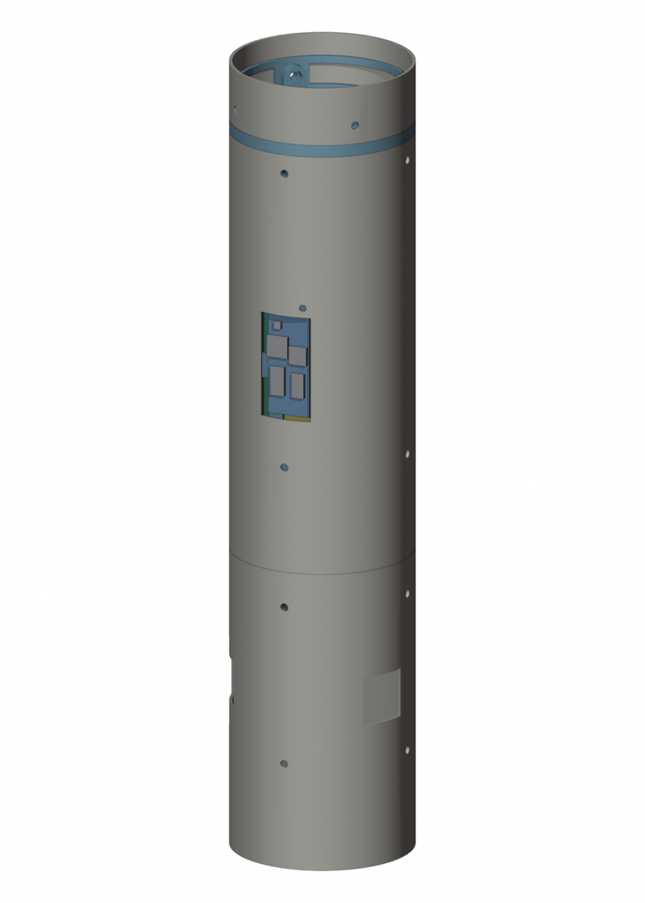
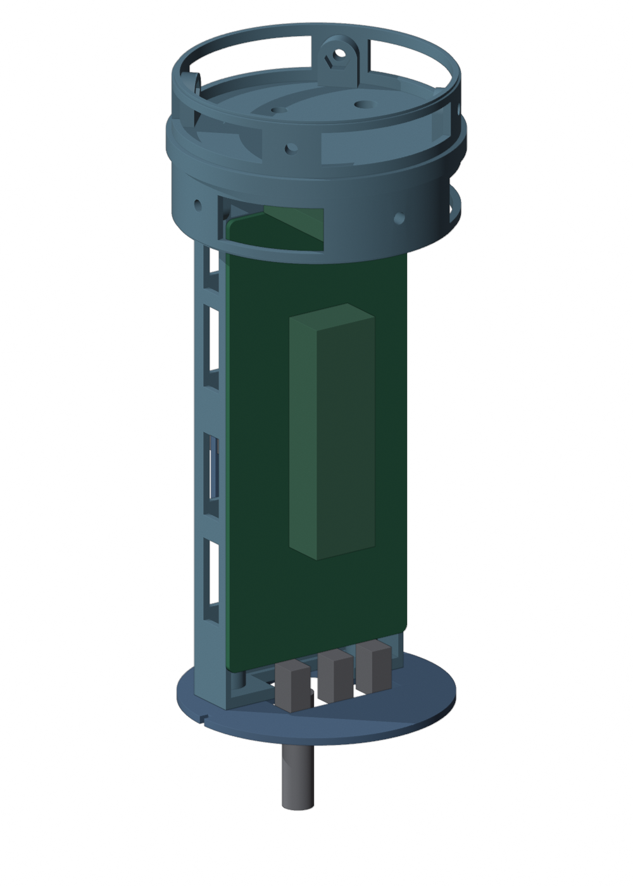
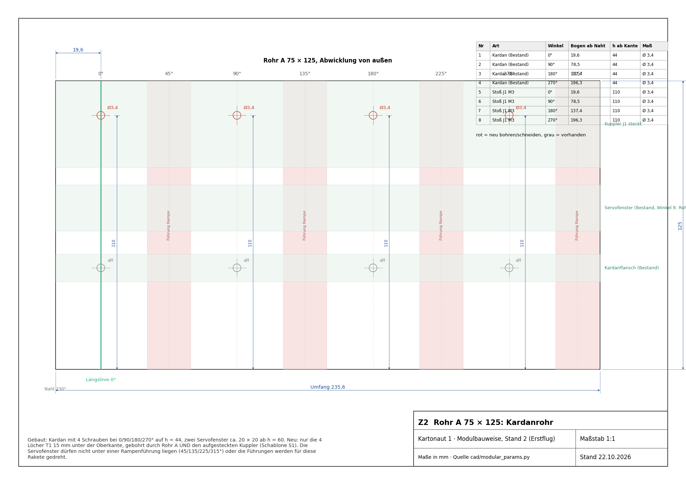
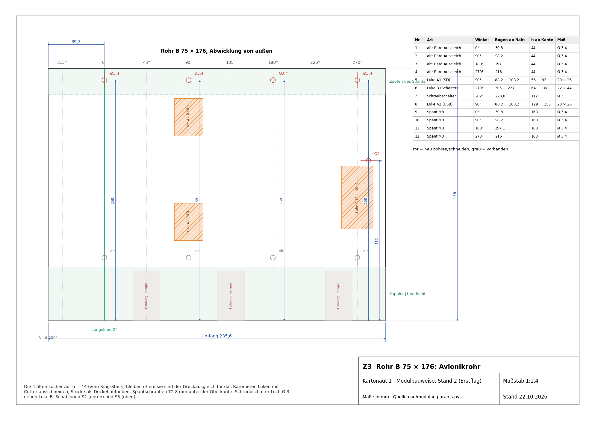
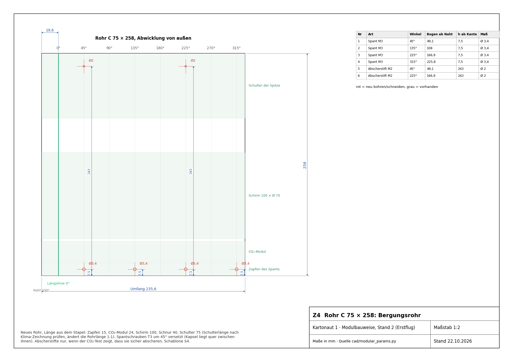
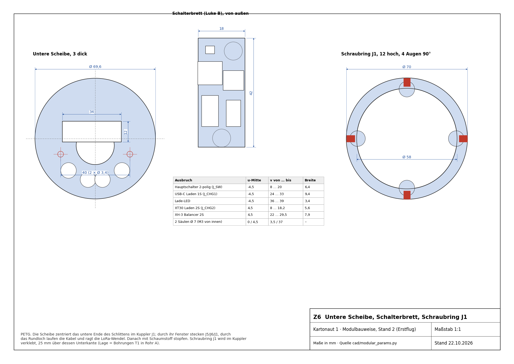

# Kartonaut 1: Bauanleitung in Modulbauweise

<p class="subtitle">Erstflug (ein TSP E12, Fallschirm, keine Beine, kein Rollmotor) · Stand 2 vom 22.10.2026, nach dem gebauten
Kardan · Maße aus <code>cad/modular_params.py</code>, Zeichnungen aus <code>docs/bauanleitung/zeichnungen.py</code></p>

Stand 2 richtet sich nach dem, was schon gebaut ist: dem Schubstangen-Kardan mit zwei FrSky W5652H im 125-mm-Rohr A,
dem 176-mm-Rohr B und dem halben Kuppler (75 mm). Der Flugcomputer ist die Platine rev B1 auf einem gedruckten Schlitten
im Rohr B. Oben schließt ein gedruckter Spant mit sichtbarem Band ab; auf ihm sitzt die CO₂-Ausstoßung, darüber liegt
im neuen Rohr C der Schirm unter der Klima-Spitze. Alle Radialschrauben sind M3 auf 0°/90°/180°/270° wie am Kardan.

| Datei | Inhalt |
|---|---|
| `docs/bauanleitung/Zeichnungen_Kartonaut1.pdf` | Z1 Übersicht, Z2–Z4 Abwicklungen der Rohre A, B, C, Z5 Schlitten mit Spant, Z6 Kleinteile |
| `docs/bauanleitung/Bohrschablonen_1zu1.pdf` | S1–S4 zum Ausdrucken in Originalgröße und Umwickeln der Rohre |
| `cad/export/modular/*.stl` | die vier neuen Druckteile |
| `cad/modular.py` | Druckteile, Kollisionsprüfung, Masse, Bilder |

```bash
MS_CONFIG=erstflug python cad/modular.py          # Druckteile, Prüfung, Masse, Bilder
python docs/bauanleitung/zeichnungen.py           # Zeichnungen und Schablonen
python docs/bauanleitung/build_pdf.py             # diese Anleitung als PDF
```

[TOC]

<hr class="pb">

## 1. Entscheidungen und Prüfbefunde

### 1.1 Entschieden am 22.10.2026

| Thema | Entscheidung | Grund |
|---|---|---|
| Flugcomputer | Platine rev B1 auf einem gedruckten Schlitten, **keine Gewindestangen**, kein Ring-Stack | eine Platine braucht keinen Stapel; 30 g Stahl gespart, Luken frei |
| Kardan | bleibt wie gebaut (Schubstangen, W5652H, Rohr A 125 mm) | gebaut und eingepasst |
| Roll | **kein Rollmotor, kein Schwungrad** | Masse, Vibration auf der IMU; ohne Flossen kaum Rollmoment. Bedingung: Lage in der Firmware als Quaternion aus dem Gyro (Befund 3 in `PROJECT.md`) |
| Ausstoß | **CO₂-Kapsel** (Aufbau ca. 10 g, ca. 2 l Gas), ausgelöst über ein Servo | keine Pyrotechnik, kein Sprengstoffrecht, kaltes Gas, am Tisch beliebig testbar |
| Schirm | im Rohr C unter der Spitze, gepackt 100 × Ø 70 | passt nicht in die Klima-Spitze (Holzplatte 25 mm über der Unterkante der Spitze) |
| Arming | **Schraubschalter** statt Schlüsselschalter, mindestens 5 A. *Seit 27.10.:* die Brücke reicht nicht mehr, weil die Rakete den Motor selbst über Pyro 1 zündet; der Schalter wird am Pad nach dem Anzünder eingeschaltet | leicht, kein großes Loch, nichts steht über; trennt den Zündstrom in Hardware |
| Motorstart (27.10.2026) | **an Bord** über Pyro 1 (J9), ausgelöst per gesichertem Funkbefehl vom Laptop (`tools/ground/launch.py`); keine Zündbox, keine Leitung zur Rampe | Erprobung der eigenen Zündung vor dem Landebrennen, Zündung im Log auswertbar (`docs/Plan_Bordzuendung_2026-10-27.md`) |
| Funk und GPS | GPS flach unter dem Spant, Patch nach oben; LoRa als 433-MHz-Wendel axial am unteren Ende | ca. 12 cm Abstand; GPS sieht zum Himmel (auch am Schirm, der Rumpf hängt mit dem Spant nach oben); Wendel strahlt rundum zur Seite |
| Spitze | gekaufte Klima 8539 mit ihrer Holzplatte und dem Haken | die eigene Spitze mit Gewindestange, Servo und Federn ist verworfen |

### 1.2 Befunde, die zu diesem Stand geführt haben

| Nr. | | Befund | Lösung |
|---|---|---|---|
| 1 | K | Der 80-mm-Stoßkuppler des alten CAD hätte den Kolben blockiert (innen 70,2 < Kolben 72,4). | Kein Kolben mehr, kein Stoß im Schirmraum. |
| 2 | K | Antenne und GPS waren in der abgesprengten Spitze vorgesehen. | Beide im Avionikraum (Tabelle oben). |
| 3 | K | Die Stecker J5/J6/J1 an der unteren Stirnseite der Platine ragen 12 mm über. | Untere Scheibe mit Steckerfenster, Lage geprüft. |
| 4 | K | Das CAD-Modell `cad/tvc.py` beschreibt einen Kardan mit der Servowelle direkt auf der Drehachse; gebaut ist ein Schubstangen-Kardan. | Für den Bau gilt der gebaute Kardan; das CAD-Modell ist nachzuziehen (O4). Die Servo-Umrechnung in `Config.h` (Befund 13) am gebauten Kardan messen. |
| 5 | W | Das alte Massenmodell setzte Druckteile zu leicht an. | Aus den CAD-Volumen gerechnet, Stand 2c mit Slicer-Modell: ≈ 705 g (§2.5, `cad/mass_stand2b.md`). |
| 6 | W | Die Rampenführungen (Entwurf bei 60/180/300°) liegen auf Schrauben. | Führungen bei **45/135/250°**, zwischen Schrauben und Servofenstern (Hinweis an die Startrampe). |
| 7 | W | Gewinde direkt im Druck reißen bei häufigem Lösen aus. | M3-Muttern in Sechskant-Taschen an allen Trennstellen (§4). |
| 8 | W | Barometerraum war zum Kardan offen. | Untere Scheibe plus Schaum; die 4 alten Löcher in Rohr B sind der Druckausgleich. |
| 9 | H | Bei 2 l CO₂ im freien Raum unter der Spitze (ca. 780 ml) entstünden bis 2,6 bar, wenn die Spitze klemmt. | Spantplatte 3,5 mm mit 5-mm-Rand (Stand 2c: 21 bis 34 MPa bei 2,6 bar, PETG 45 bis 50 MPa), keine Abscherstifte, bis der Test zeigt, dass die Spitze bei kleinem Druck geht. |

<hr class="pb">

## 2. Aufbau

### 2.1 Module und Trennstellen


| Modul | Teile | Trennstelle |
|---|---|---|
| **M1 Antrieb** | Rohr A 125 mit dem gebauten Kardan, 2 × W5652H mit Hebel und Drahtbügel (im Modell schematisch), Motor E12 (bündig) | T1: 4 × M3 durch Rohr A und Kuppler in den Schraubring |
| **M2 Avionik** | Rohr B 176, Kuppler J1 (in B verklebt), Schlitten mit Spant, Platine, Akkus, GPS, LoRa, Schalterbrett | T2: 4 × M3 durch Rohr B in den Spant |
| **M3 Bergung** | Rohr C, CO₂-Modul auf dem Spant, Schirm, Schnur | T3: 4 × M3 (45° versetzt) durch Rohr C in den Spant |
| **M4 Spitze** | Klima 8539 | T4: Passung |

Lastpfade: Schub über den Kardanflansch ins Rohr A, über T1 weiter. Der Spant liegt mit dem Band auf der Oberkante
von Rohr B: Der CO₂-Druck drückt ihn dorthin. Schirmzug über die Ringschraube am Spant und T2 in Rohr B, über T1 in A.

### 2.2 Winkel

Längslinie 0° = eine Kardanschraube (markieren). Von außen gesehen, Spitze oben, wächst der Winkel nach rechts.

| Winkel | Was dort liegt |
|---|---|
| 0°, 90°, 180°, 270° | alle Schrauben von Kardan, T1, T2 und die alten Löcher in B |
| 90° | Bestückungsseite der Platine, Luken A1 (SD) und A2 (USB) |
| 270° | Luke B (Schalterbrett), daneben bei 282° das Loch für den Schraubschalter |
| 45°, 135°, 250° | Rampenführungen (bis 160 mm Höhe) |
| ca. 207°, 336° | Servofenster in Rohr A (Bestand, Lage aus der Druckdatei) |
| 45°, 135°, 225°, 315° | Schrauben T3 in Rohr C, Abscherstifte bei 45/225° |
| Servofenster | wie gebaut; sie dürfen nicht unter einer Rampenführung liegen (prüfen, sonst Führungen drehen) |

Die Platine muss nach dem Kardan ausgerichtet werden (welche Servoachse Nicken ist); Rohr B hat dafür eine Marke über
den Stoß zu Rohr A. T1 passt in vier Lagen, also vor dem Schrauben die Marke prüfen.

### 2.3 Avionik-Schlitten mit Spant

| Bestückungsseite (Luke A) | Schalterbrett (Luke B) | Schlitten allein |
|---|---|---|
|  |  |  |

Ein Druckteil: oben das **Band** Ø 75 (ein 5 mm hoher Rand, liegt auf Rohr B, außen sichtbar) mit der **Spantplatte**
3,5 mm auf der Druckseite, **Zapfen nach unten** in Rohr B (4 Augen für T2) und **Zapfen nach oben** in Rohr C (4 Augen
für T3), beide mit 2 mm Wand; darunter der **Träger** als U-Profil mit vier Säulen für die Platine und Fächern für den
2S-Akku (v = 6 … 62) und den 1S-Akku (v = 64 … 114), im Boden unter den Akkus Fenster zwischen den Klettschlitzen
(Stand 2c, Leichtbau), Stand 2d dazu Fenster neben den Akkus und in beiden Zapfen zwischen den Schraubenaugen. Unter
dem Band zwei Querleisten mit Auflagekante für das **GPS NEO-6M** (Modulplatine 36 × 26 von der Seite eingeschoben,
Patch 25 × 25 obenauf, zum Himmel). Unten verschraubt die **untere Scheibe** mit Steckerfenster; durch ihr
Kabelloch ragt die **LoRa-Wendel** nach unten. Hinter Luke B das **Schalterbrett**. Im Band: Ringschraube M4 für die
Schnur und eine Kabeldurchführung Ø 6 für das CO₂-Servo (mit Epoxid abdichten).

### 2.4 Stapel (z ab Rohrunterkante = Düse)

| z | Was |
|---|---|
| 0 … 93 | Motor TSP E12-0, bündig |
| 0 … 125 | Rohr A, Kardanschrauben bei 44, Servofenster ab 60 |
| 87,5 … 162,5 | Kuppler J1 (in B verklebt), Schraubring bei 105 … 115, T1 bei 110 |
| 125 … 301 | Rohr B, alte Löcher bei 169 (Druckausgleich), T2 bei 293 |
| 155 … 158 | untere Scheibe, LoRa-Wendel 124 … 154 |
| 167 … 287 | Platine rev B1 |
| 301 … 306 | Band des Spants |
| 306 … 501 | Rohr C (195 mm), T3 bei 313,5 |
| 322 … 346 | CO₂-Modul, Kapsel quer |
| 349 … 449 | Schirm 100 × Ø 70 |
| 451 … 526 | zweiter halber Kuppler: 50 mm in Rohr C, 25 mm in der Spitze bis zur Holzplatte verklebt; Schnur liegt darin |
| 501 … 731 | Spitze (Klima, außen bündig mit dem Rohr) |

### 2.5 Masse (Schätzung)

Ganzes Stabmodell mit Schwerpunkt und Trägheit: `cad/mass_stand2b.md` (`python cad/mass_stand2b.py`).

| Baugruppe | g |
|---|---|
| Motor E12 mit Treibstoff | 64 |
| Kardan, zwei W5652H, Hebel, Adapter 29→24 | 88 |
| Rohre A + B + C, zwei halbe Kuppler | 30 + 42 + 47 + 34 |
| neue Druckteile Stand 2d (Schlitten mit Spant 58, Scheibe 7, Schalterbrett 3, Schraubring 6) | 73 |
| Platine, Akkus 2S 29 + 1S 14, GPS NEO-6M 12 [Annahme], LoRa-Wendel, Schalterbrett-Bauteile | 115 |
| CO₂-Aufbau 10 + Kapsel 25 + Servo 9 [Annahme] | 44 |
| Fallschirm mit Schnur | 50 |
| Spitze mit Holzplatte | 83 |
| Schrauben, Kabel, Kleber, Schaum | 34 |
| **Start, ein E12** | **≈ 704** |

**Druckteile Stand 2c (Leichtbau, 23.10.2026):** Spantplatte 3,5 statt 5 mm mit 5-mm-Rand, Zapfen 2 statt 4,1/3,1 mm,
U-Profil statt des vollen Klotzes zwischen Träger und Zapfen, Fenster im Trägerboden, Scheibe 2 statt 3 mm, Schraubring
mit 2 statt 6 mm Wand. Das Volumen sinkt von 103 auf 65 cm³, die Druckmasse aber nur von 96 auf 80 g: Die Massen rechnen
jetzt mit einem Slicer-Modell (Oberfläche × 1 mm voll, Rest 25 % Gyroid), und dünne Wände druckt der Slicer mit drei
Perimetern ohnehin voll. Die Slicer-Vorschau und die Waage entscheiden. Danach Hebelarm neu bestimmen (§5.6).

**Stand 2d (27.10.2026):** GPS-Halter für den vorhandenen NEO-6M (§3.6), Kabeldurchführung des CO₂-Servos nach
(−20 | −7) verlegt, Fenster in beiden Zapfen zwischen den Schraubenaugen (3 mm Rand oben und unten bleiben; die Augen
hängen direkt am Band, die Zapfen zentrieren nur), Bodenfenster unter den Akkus 22 statt 18 mm breit und neue Fenster
neben den Akkus. Schlitten 53,0 → 46,6 cm³, im Slicer-Modell 64 → 58 g. Die Spantplatte bleibt 3,5 mm: Sie ist das
Druckschott für den CO₂-Ausstoß. Start weiter rund 705 g (704 g), weil das GPS 6 g schwerer ist als angenommen.
Passmaße nach Jans Messung (Rohr innen 72,5 statt 72,6): **Zapfen Ø 72,1** (0,2 mm Spiel je Seite), **Schraubring
Ø 69,8** (Kuppler noch nicht gemessen, Nennmaß 70,2; 0,2 mm Klebespalt), untere Scheibe Ø 69,6 wie bisher. Vor dem
Schlitten lohnt ein Probering aus dem Zapfen.

### 2.6 Anzünderleitung (Motorstart an Bord, 27.10.2026)

Der Anzünder steckt unten in der Düse, sein Pyro-Kanal J9 (Pyro 1) sitzt auf der Platine im Rohr B. Dazwischen liegt
der Kardan.

| Was | Festlegung |
|---|---|
| Leitung | zwei Adern 26 AWG Silikon, ca. 40 cm, Stecker XHP-2 an J9; Polung egal (Anzünder) |
| Weg | von J9 durch den Schlitten nach unten, durch den Schraubring wie die Servokabel, am Kardan vorbei zur Düse; mit genug Schlaufe für den vollen Kardanausschlag |
| Prüfung | Kardan von Hand in alle vier Endlagen drücken: die Leitung darf nirgends klemmen, nicht in einen Servohebel laufen und nicht am Motor scheuern |
| Beim Start | der Anzünder wird aus der Düse geblasen, die Leitung hängt danach lose aus dem Rohr A. Die Firmware sperrt Pyro 1 nach dem Start (abgebrannte Drähte können kurzgeschlossen sein) |
| Rampe | keine Leitung zwischen Rakete und Rampe; prüfen, dass die Rakete beim Abheben sauber aus den Führungen läuft (§8, O10) |

Der Zündstrom kommt aus dem 2S über den Arming-Schalter und die Polyfuse F1, über die auch die Servos laufen. Die
Firmware begrenzt den Startpuls deshalb auf 300 ms und beendet ihn früher, sobald Schub erkannt ist oder der
Anzünder durchgebrannt ist (`firmware/README.md`, Motorstart).

<hr class="pb">

## 3. Teileliste: was da ist, was fehlt, was gedruckt wird

Stand nach deiner Durchsicht vom 22.10.2026 abends. Bei den Händlern geprüft am 22.10.2026; Preise ohne Versand,
Verfügbarkeit ändert sich.

### 3.1 Bestellen

**Reichelt**

| ✓ | Art.-Nr. | Teil | Stück | Preis | Hinweis |
|---|---|---|---|---|---|
| ☐ | `LRC 2S 450` | LiPo LemonRC 2S 450 mAh 35C, XT30, 55 × 30 × 10, 29 g | 2 | je 9,30 € | Fach im Schlitten ist darauf ausgelegt; dein 2S 1200 mAh ist zu groß und zu schwer (≈ 70 g) |

**Berrybase**

| ✓ | Art.-Nr. | Teil | Stück | Preis | Hinweis |
|---|---|---|---|---|---|
| ☐ | `D88914` | ISM 433 MHz Antenne SMA 2,5 dBi, flexibel | 1 | 6,50 € | Bodenstation (SMA-Stecker auf die SMA-Buchse des E22-…D) |
| ☐ | `D88747` | SMA-Buchse zum Einbau, U.FL-Stecker, 200 mm | 1 | 5,20 € | Rakete: vom IPEX des E22 auf der Platine zur Wendel |
| ☐ | – | AMASS XT30 weiblich, Lötanschluss | 2 | je 0,60 € | Ladebuchse 2S am Schalterbrett |
| ☐ | `SOL-333011` | Soldered USB-C-Buchse Breakout, THT | 1 | 1,85 € | Laden 1S am Schalterbrett; Ausbruch im Brett nach dem Teil anpassen |

**Ebyte (AliExpress „EBYTE Official Store“ oder eBay-Shop „cdebyte“)**

| ✓ | Teil | Stück | Hinweis |
|---|---|---|---|
| ☐ | **E22-400T22D** (SX1268, UART, SMA-Buchse) | 2 | Bodenstation + Reserve. Genau dieses, nicht das E220-400T22D (anderer Chip LLCC68). Auf der Platine sitzt das passende E22-400T22S. |
| ☐ | 433-MHz-Federantenne mit SMA-Stecker, ca. 3 cm | 2 | Rakete, an den Berrybase-Pigtail |

Die HC-12 können mit LoRa nicht sprechen; sie bleiben für Tischtests mit dem alten Aufbau.

**Schrauben (Baumarkt oder Schraubenhändler, z. B. „Edelstahl ISO 7380 M3“)**

| ✓ | Teil | Stück |
|---|---|---|
| ☐ | M3 × 6 ISO 7380 (Linsenkopf, Inbus 2) | 25 |
| ☐ | M3 × 8 ISO 7380 | 4 |
| ☐ | M3-Muttern DIN 934 | 20 |
| ☐ | Ringschraube M4 mit Mutter und 2 Scheiben | 2 (Spant, Reserve) |

**Kleinteile für das Schalterbrett, sobald die Platine steht**

| ✓ | Teil | Hinweis |
|---|---|---|
| ☐ | Mini-Schiebeschalter 2 × UM (DPDT) für Printmontage, max. 6 × 12 mm | schaltet nur die FET-Gates, also jeder Kleinsignal-Typ. Reichelt `T 217` ist mit 23 × 7,5 mm zu groß; Typ nach Platinen-Footprint wählen. |
| ☐ | LED 3 mm | Lade-LED |

Nicht mehr nötig: Einschmelzmuttern (Muttern in Taschen, siehe §4), Schlüsselschalter, Featherweight-Schraubschalter für
den Erstflug (XH-2-Brücke; für später selbst gebaut aus M3-Schraube und zwei Messingkontakten oder bei Featherweight in
den USA), Balancer-Verlängerung (JST-XH 3 hast du), Crimpzange, JST-Sortiment, Klettband, Moosgummi, Schaum, Kleber,
1S-Akkus, Rohr C (Reststück), CO₂-Kapseln.

### 3.2 Platine

| ✓ | Teil | Hinweis |
|---|---|---|
| ☐ | **Mainboard rev B1, bestückt, 2 Stück** | JLCPCB, nach dem Design (läuft in der Platinen-Session) |

### 3.3 Drucken (neu)

| ✓ | Teil | Datei | Material |
|---|---|---|---|
| ☐ | Schlitten mit Spant | `Schlitten_mit_Spant.stl` | PETG |
| ☐ | Untere Scheibe | `Untere_Scheibe.stl` | PETG |
| ☐ | Schalterbrett | `Schalterbrett.stl` | PETG (erst wenn Schalter und USB-C-Platine da sind) |
| ☐ | Schraubring J1 | `Schraubring_J1.stl` | PETG |
| ☐ | CO₂-Modul (deine Konstruktion) | – | PETG (PLA wird am kalten CO₂ spröde) |

### 3.4 Prüfen statt neu drucken

| ✓ | Teil | Prüfung |
|---|---|---|
| ☐ | Motorrohr und Adapter | nach dem ersten Brand auf Verformung ansehen (die Pappe des Motors dämpft viel, PLA wird ab ca. 55 °C weich) |
| ☐ | Servohebel am Gestänge | Spiel zwischen 2-mm-Draht und Hebelbohrung: wackeln, wenn es klickt, Hülse oder passende Bohrung |
| ☐ | Servoarme in den Fenstern | ragen sie bei Vollausschlag über die Rohroberfläche? Nur dann stören die Rampenführungen (O1) |

### 3.5 Vorhanden

| ✓ | Teil |
|---|---|
| ☐ | Kardan in Rohr A 125, 2 × W5652H mit Gestänge, stabil, ohne Spiel |
| ☐ | Rohr B 176, beide Hälften des Kupplers (75 mm), Reststück für Rohr C (195 mm) |
| ☐ | Klima-Spitze 8539 mit Holzplatte und Haken, Fallschirm 125 cm, Kevlar und Gummischnur |
| ☐ | 4 × TSP E12-0, 5 × CO₂-Kapsel 8 g |
| ☐ | 1S-LiPo 600 mAh (Maße mit dem Fach 50 × 30 × 7 vergleichen, JST-PH, ohne Schutzschaltung?) |
| ☐ | GPS-Modul u-blox NEO-6M (GY-GPS6MV2, Berrybase), siehe §3.6 |
| ☐ | Teensy 4.1, microSD, SG90 (CO₂-Auslösung), 2 × HC-12, JST-Stecker, Kleber, Klett, Schaum |

### 3.6 Das alte GPS-Modul

Funktional reicht jedes u-blox NEO-6M/7M/8M: Für die Bergungssuche genügen 1 bis 5 Hz. Zwei Punkte entscheiden, ob es
passt. **Größe:** Vorgesehen sind 20 × 20 × 7 unter dem Spant. Das übliche NEO-6M-Breakout (GY-GPS6MV2) ist 25 × 35 mit
einer 25 × 25-Patch-Antenne am Kabel; dann kommt die Patch-Antenne flach unter den Spant (der Halter wird dafür 25 mm
breit, mit einer Aussparung im Zapfenring) und die Platine des Moduls seitlich an den Träger. **Störfestigkeit:** Die
alten Module haben oft keinen SAW-Filter vor dem Verstärker. Bodentest: GPS-Fix halten, während LoRa sendet; wenn er
abreißt, LoRa auf 14 dBm senken oder ein M10-Modul kaufen. Typ und Maße deines Moduls genügen mir, um den Halter anzupassen.

**Stand 27.10.2026:** Es ist ein NEO-6M auf dem Breakout GY-GPS6MV2 von Berrybase: Platine 36 × 26 × 5 mm mit vier
Löchern Ø 3, Keramik-Patch 25 × 25 × 9 mm am Kabel, 3–5 V, UART 9600 Bd. Der Patch passt **nicht** zwischen die Leisten
für 20 × 20 × 7 im Schlitten. **Umgesetzt in Stand 2d:** Unter der Spantplatte
sitzen zwei Querleisten mit 1,5 mm Auflagekante; die Modulplatine wird von der Seite eingeschoben (Stiftleiste an der
kurzen Kante bleibt frei), der Patch liegt mit doppelseitigem Schaumband obenauf und zeigt zum Himmel. Ein Tropfen
Heißkleber an der Leiste sichert das Modul. Anschluss an J_GPS: VCC → Pin 1, GND → 2, TX → 3, RX → 4.

## 4. Druckeinstellungen und Muttern

| Teil | Lage | Wände / Füllung |
|---|---|---|
| Schlitten mit Spant | Band auf dem Bett (im Slicer um 180° drehen) | 3 Wände, 25 % Gyroid, keine Stützen; 2-mm-Wände werden voll gedruckt |
| Untere Scheibe, Schraubring | flach | 3 Wände, 25 % |
| Schalterbrett | flach | 3 Wände, 25 % |

Mehr Perimeter oder Füllung machen die dünnen Teile kaum fester, aber schwerer. Wichtig für die Festigkeit sind die vier
Augen je Zapfen (die Mutter sitzt mindestens 2,9 mm vor der Außenfläche) und die Spantplatte: dort keine Füllung unter 25 %.

**Muttern statt Einschmelzmuttern.** Alle Schrauben, die bei der Flugvorbereitung gelöst werden (T1, T2, T3), greifen
in M3-Muttern: Jedes Schraubenauge hat innen eine Sechskant-Tasche, die Mutter wird von innen eingedrückt und mit einem
Tropfen Sekundenkleber gesichert. Weil die Taschen nach innen offen sind, braucht es keine Druckpause. Platine, untere
Scheibe und Schalterbrett werden selten gelöst; dort schneidet die M3-Schraube ihr Gewinde direkt in ein Ø-2,6-Loch.
Jedes Teil nach dem Druck wiegen.

## 5. Bauschritte

### 5.1 Vorbereiten

1. Schablonen aus `Bohrschablonen_1zu1.pdf` in Originalgröße drucken, 100-mm-Balken nachmessen.
2. Längslinie 0° an Rohr A durch eine Kardanschraube ziehen (Winkelprofil), über den Stoß auf Rohr B verlängern.
3. Rohr C auf 195 mm ablängen. Den zweiten halben Kuppler 25 mm tief in die Spitze bis an die Holzplatte kleben.

### 5.2 Stoß J1 (Rohr A ↔ Rohr B)

1. Kuppler J1 mit Epoxid 37,5 mm tief in Rohr B kleben, Marke über den Stoß ausrichten.
2. Rohr A auf den Kuppler stecken, Längslinien fluchten. **S1** an der Oberkante von A anlegen, 4 Löcher Ø 3,4 bei
   h = 110 durch Rohr A **und** Kuppler bohren.
3. Rohr A wieder abziehen. Schraubring (Muttern innen eingedrückt) von unten in den Kuppler schieben, mit zwei M3 durch die
   Löcher ausrichten, dann mit Epoxid festkleben. Servokabel laufen innen durch den Ring.

### 5.3 Rohr B

1. **S2** an der Unterkante von B: Luken A1 und B ausschneiden (Stücke als Deckel aufheben), Schraubschalter-Loch Ø 3.
   Die alten Löcher bei h = 44 bleiben offen (Barometer).
2. **S3** an der Oberkante von B: Luke A2 ausschneiden, 4 Löcher T2 Ø 3,4 bei h = 168 (8 mm unter der Kante).
3. Schnittkanten und Bohrränder mit dünnem Sekundenkleber härten.

### 5.4 Rohr C und Spitze

1. **S4** an der Unterkante von C: 4 Löcher T3 Ø 3,4 bei 45/135/225/315°, h = 7,5.
2. Spitze mit ihrem Kuppler aufstecken, Passung einstellen (Klebeband auf dem Kuppler): sie soll leicht gehen, aber nicht von allein.

### 5.5 Avionik-Schlitten

1. M3-Muttern in die Taschen: Schlitten 4 unten (T2) und 4 oben (T3), Schraubring 4 (T1); je ein Tropfen Sekundenkleber.
2. Ringschraube M4 durch das Band; Kabel des CO₂-Servos durch die Ø-6-Durchführung, mit Epoxid abdichten.
3. GPS zwischen die Leisten unter dem Band (Patch nach oben), Kabel zu J_GPS.
4. Schalterbrett bestücken und anschrauben (siehe Z6), Akkus mit Klettband, Isolierplatte, Platine mit 4 × M3 × 6.
5. LoRa-Wendel an IPEX, axial durch das Kabelloch der unteren Scheibe; Scheibe mit 2 × M3 × 8.
6. Einbau: Servokabel aus Rohr A durch den Schraubring nach oben, an J5/J6 stecken, Schlitten von oben in Rohr B, bis das
   Band aufliegt; Augen auf die Löcher T2 drehen (Luke A über dem USB-Stecker); 4 × M3 × 6. Stecker- und Kabelfenster der
   Scheibe durch Luke B mit Schaum stopfen.

### 5.6 Bergung und Endkontrolle

1. CO₂-Modul auf den Spant (Kapsel quer, 0°–180°), Servo an J_SERVO3.
2. Schnur: Ringschraube Spant → Kevlar → Wirbel mit Schirm → Gummischnur → Haken der Spitze. Schirm 100 × Ø 70 packen,
   Schnur im Zickzack darüber, Spitze aufsetzen.
3. Rohr C aufstecken, 4 × M3 bei T3.
4. **Wiegen** (Schätzung ≈ 704 g) und **Schwerpunkt** auswiegen (Modell 260 mm über der Düse); Hebelarm Kardanpunkt–Schwerpunkt und Masse in
   `firmware/src/Config.h` (`MOMENT_ARM_M`, `MASS_KG`) eintragen.
5. **Servo-Umrechnung messen:** Servo um 10° stellen, Kardanwinkel messen (Befund 13); `SERVO_*_GAIN` setzen.
6. **CO₂-Bodentest** (draußen, Rakete waagrecht): Spitze fliegt ab, Schirm und Schnur vollständig draußen, Spant und
   Rohr C unbeschädigt. Mindestens dreimal, auch kalt.
7. **Reichweite:** LoRa mit geschlossener Rakete; GPS-Signal ansehen, während LoRa sendet.
8. **Barometer:** an einem der alten Löcher saugen, Druck muss im Log springen.

## 6. Wartung

| Ziel | Handgriffe |
|---|---|
| Akkus laden | USB-C und XT30 an Luke B |
| Firmware, SD-Karte | Lukendeckel A2/A1 ab |
| Kapsel wechseln, Schirm packen | Spitze ab, 4 × M3 an T3, Rohr C ab |
| Schlitten heraus | Rohr C ab, 4 × M3 an T2, Schlitten am Band herausziehen, J5/J6 abziehen |
| Kardan, Servo | 4 × M3 an T1, Rohr A nach unten abziehen (Servokabel vorher am Schlitten abziehen) |
| Motor | von unten, wie gebaut |

### 6.1 Flugvorbereitung am Startplatz

Motorstart an Bord (27.10.2026): Reihenfolge **Hauptschalter → Anzünder → Arming-Schalter → Weggehen → PAD_READY →
ARM → LAUNCH**. Bedient wird am Laptop mit `tools/ground/launch.py`; das USB-Funkmodul ist einmal mit
`tools/ground/e22_config.py` eingestellt.

| ✓ | Schritt |
|---|---|
| ☐ | Akkus voll (1S ≥ 4,1 V, 2S ≥ 8,2 V), Hauptschalter AUS, **Arming-Schalter AUS** |
| ☐ | CO₂-Kapsel eingesetzt, Auslöser gesichert, Schirm gepackt, Rohr C und Spitze drauf |
| ☐ | Motor einsetzen, Anzünder noch nicht |
| ☐ | Rakete auf die Rampe, Schrauben zwischen den Führungen |
| ☐ | Laptop: `python tools/ground/launch.py --port …`, Funk steht |
| ☐ | Hauptschalter EIN: Bootton, Telemetrie `SAFE`, GPS-Fix; Rakete ruhig lassen, sie kalibriert sich |
| ☐ | Lukendeckel mit Klebeband schließen |
| ☐ | Anzünder in die Düse, Leitung über den Kabelweg (§2.6) an J9; Kardan noch einmal frei bewegen |
| ☐ | **Arming-Schalter EIN.** Ab jetzt ist die Rakete scharf. Telemetrie: `ARM` und `Durchgang1` |
| ☐ | Alle weg von der Rampe, mindestens 10 m |
| ☐ | Taste `r` (PAD_READY): die Kardanservos zucken 1,5 s (Selbsttest) |
| ☐ | Taste `a` (ARM): Summer im Sekundentakt, LED rot blinkend. Wird ARM verweigert, nennt der Laptop, was fehlt |
| ☐ | Taste `l`, `START` tippen, Enter (LAUNCH): Countdown 5 s, Summer schnell, letzte Sekunde Dauerton |
| ☐ | Abbruch jederzeit mit der **Leertaste** (ABORT): vor der Zündung zurück nach SAFE |

Die Rakete geht von selbst nach SAFE, wenn der Laptop länger als 1 s schweigt (Heartbeat), eine Vorbedingung wegfällt
(z. B. Rakete bewegt, Durchgang weg) oder nach ARM 30 s kein LAUNCH kommt.

**Abbruch vor der Zündung (SAFE):** erst den Arming-Schalter aus, dann den Anzünder abziehen.

**Fehlzündung (MISFIRE, Summer im Dreiertakt):** Der Startpuls lief, aber nach 2 s war kein Schub da.

1. **60 s warten**, nicht hingehen. Die Rakete erkennt einen späten Start weiter und fliegt dann mit Bergung.
2. Dann Taste `s` (SAFE).
3. Erst dann hingehen, **Arming-Schalter aus**, Anzünder abziehen und prüfen.
4. Neuer Versuch mit neuem Anzünder ab „Anzünder in die Düse“.

## 7. Kabelplan

| Stecker | Gegenstelle | Lösen beim |
|---|---|---|
| J5, J6 (XH-3) | Servos im Rohr A (durch den Schraubring) | Schlitten heraus |
| J_SERVO3 | Servo des CO₂-Moduls (durch das Band) | Rohr C ab (Stecker unter dem Band) |
| J1 XT30, J_BAT1 PH | Akkus im Träger | Akkutausch |
| J_SW, J_CHG1, J_CHG2, Balancer | Schalterbrett | bleibt am Schlitten |
| J_ARM (XH-2) | Arming-Schraubschalter (≥ 5 A; seit 27.10. statt der Brücke) | bleibt am Schlitten |
| J9 Pyro 1 (XH-2) | Anzünderleitung zur Düse (§2.6) | nach jedem Start (Anzünder verbraucht) |
| IPEX | LoRa-Wendel | bleibt am Schlitten |
| J_GPS | GPS unter dem Band | bleibt am Schlitten |

## 8. Offen

| Nr. | Punkt |
|---|---|
| O1 | Servofenster laut Druckdatei und Servo-Lage bei ca. 207° und 336° ab der Längslinie (27° bzw. 24° neben einer Schraube, passt zu deinen Fotos). Rampenführungen deshalb bei **45°/135°/250°** statt im 45°-Raster (Startrampe, Branch `landepad`, anpassen). |
| O2 | Spitzenlänge (230 mm angenommen) nachmessen; ändert nur die Gesamtlänge. |
| O3 | Erledigt 27.10.: GPS ist ein NEO-6M (GY-GPS6MV2), Halter im CAD angepasst (Stand 2d, §3.6). |
| O4 | Gedruckt ist der Kardan aus `outer_gimbal_dual_TVC.blend` und `inner_gimbal_dual_TVC.blend` (12.06.2025, `E:\Archiv_Projekte\Blender\Dateien\`); als Netz in `cad/export/asbuilt/` und im GLB-Gesamtmodell an seiner Lage (Grundfläche 38 mm, Bohrungen auf 44 mm). `cad/tvc.py` (Bild auf GitHub) ist ein späterer Entwurf vom 21.10.2026, nicht gedruckt. Servo-Umrechnung am gebauten Kardan messen. |
| O5 | **TODO Firmware:** Lage als Quaternion aus dem Gyro, Regelfehler aus dem Oben-Vektor im Körpersystem (Befund 3 in `PROJECT.md`). Voraussetzung für den Verzicht auf den Rollmotor; vor dem Erstflug. |
| O6 | CO₂-Modul: Kapselgröße und Anstechmechanismus festlegen, Bodentests. |
| O7 | Platine rev B1: Antennenlage (GPS, LoRa-Wendel) in die Spezifikation übernehmen. Pyro 1 zündet seit 27.10. den Motor, Pyro 2 bleibt für das Landebrennen. |
| O8 | Startrampe (Branch `landepad`): Führungen auf 45/135/225/315°. |
| O9 | Arming-Schraubschalter ≥ 5 A beschaffen und am Loch bei 282° einbauen (statt der Brücke). |
| O10 | Anzünderleitung am Kardan im CAD und am Kardan von Hand prüfen (§2.6); prüfen, ob die Rampe die Rakete sauber führt, wenn die Leitung von innen kommt. |
| O11 | Am Tisch messen: Widerstand der TSP-Anzünder, Startpuls mit Ersatzlast (1 Ω / 5 W oder 12-V-Lampe) über 300 ms, VSERVO dabei; löst F1 aus? (`docs/Plan_Bordzuendung_2026-10-27.md` §9) |

<hr class="pb">

## 9. Zeichnungen

Verkleinert zum Nachschlagen. Maßstäblich: `docs/bauanleitung/Zeichnungen_Kartonaut1.pdf`. Schablonen nur aus
`docs/bauanleitung/Bohrschablonen_1zu1.pdf` drucken.










{ width=28% }
