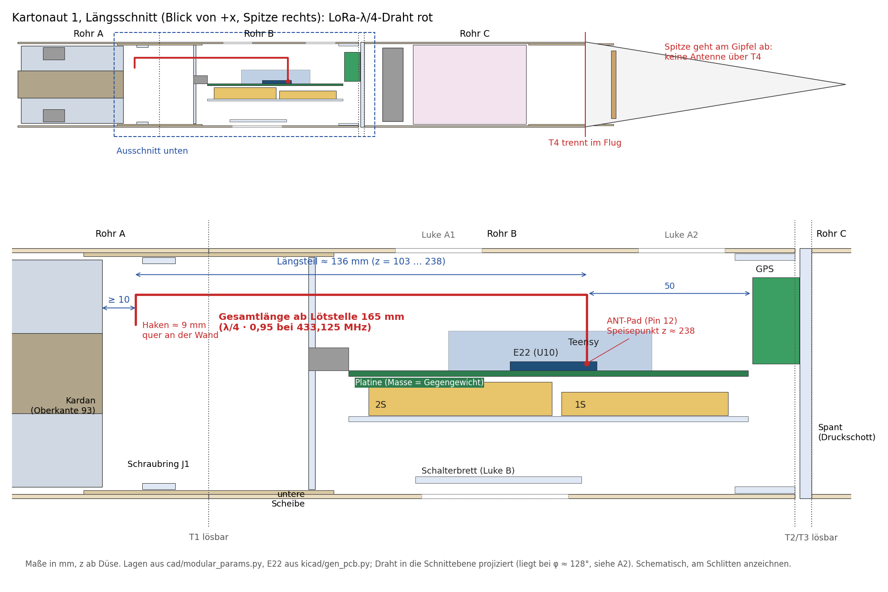
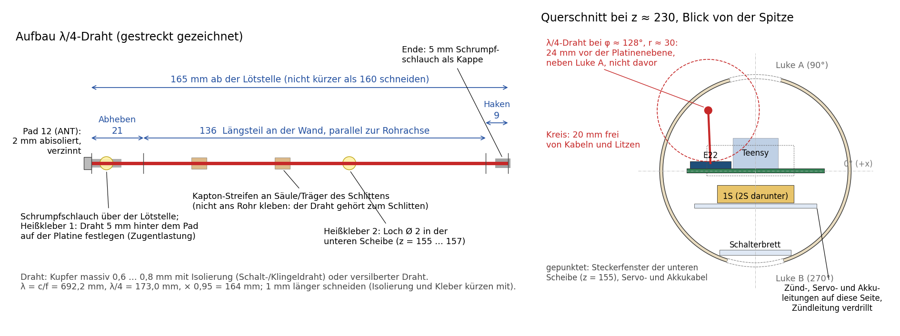

# Kartonaut 1: LoRa-Antenne in der Rakete

<p class="subtitle">Bauanleitung für die 433-MHz-Antenne am E22-400T22S (U10) · Stand 05.11.2026 · Maße aus
<code>cad/modular_params.py</code>, Zeichnungen aus <code>docs/img/antenne/antenne_zeichnungen.py</code></p>

**Kurz:** Für den Flug ein **gerader λ/4-Strahler, 165 mm ab dem Schirmende**, gespeist über ein kurzes
**IPEX-Pigtail (U.FL, 1,13 mm) an der IPEX-Buchse des E22**. Das Koax führt 3–5 cm vom Modul zur Rohrwand
(Bestückungsseite, neben Luke A, φ ≈ 125–135°); dort endet der Schirm, und der Innenleiter läuft an der Wand parallel
zur Rohrachse **nach unten** durch die untere Scheibe und endet mit einem kurzen Haken mindestens 10 mm über dem Kardan.
Schirm und Platine sind das Gegengewicht. Polarisation längs der Rakete, also senkrecht wie der Dipol der Funkbrücke.
Zu kaufen ist ein Pigtail (§10); Masse etwa 2 g.

> **Korrektur 05.11.2026 (Layoutprüfung):** Die erste Fassung lötete den Draht direkt an das ANT-Pad (Pin 12). Pin 12
> liegt aber in der Padreihe **zur Teensy-Buchsenleiste hin**: Das Pad endet 0,2 mm vor dem Lötring der linken
> Leiste, die Modulkante 0,7 mm vor dem Leistenkörper, und die gesteckte Teensy-Platine (x 118,1…135,9 mm) steht
> 8,5 mm darüber genau über der Padspitze. Ein Draht kommt dort weder zum Löten hin noch senkrecht heraus, und die
> ersten Zentimeter lägen zwischen Platine und Teensy-Masse. Deshalb jetzt die IPEX-Buchse auf der Oberseite des Moduls
> (frei zugänglich) mit Pigtail; Länge, Weg und Prüfung bleiben wie unten beschrieben, nur die Speisung ist anders
> (§3.2). Das ANT-Pad bleibt offen; IPEX und Pad gleichzeitig zu belegen verstimmt beide.

| Datei | Inhalt |
|---|---|
| `docs/img/antenne/A1_lage_im_rohr.png` | Längsschnitt der ganzen Rakete und Ausschnitt Rohr B mit Antennenweg |
| `docs/img/antenne/A2_aufbau_querschnitt.png` | Drahtmaße, Klebepunkte, Querschnitt auf Höhe des E22 |
| `docs/img/antenne/antenne_zeichnungen.py` | erzeugt beide Bilder aus den CAD-Parametern |

```bash
python docs/img/antenne/antenne_zeichnungen.py
```

[TOC]

<hr class="pb">

## 1. Ausgangslage

### 1.1 Was im Repository steht

| Thema | Stand | Quelle |
|---|---|---|
| Funkmodul | Ebyte **E22-400T22S** (SX1268, 433-MHz-Band, bis 22 dBm), auf der Platine rev B1 als U10, im linken Funkstreifen, ANT-Ende zur Spitze | `hardware/mainboard/kicad/circuit.py`, `kicad/gen_pcb.py` (U10 bei u = −17,6, v = 61,5, 180°) |
| Antennenanschluss | IPEX/U.FL-Buchse auf dem Modul; das ANT-Pad (Pin 12, zwischen GND 11 und GND 13) ist auf der Platine **offen**, also nur eine isolierte Kupferfläche | `circuit.py`: „Antenne über die IPEX-Buchse des Moduls, ANT-Pad offen“ |
| Frequenz | Kanal **0x17 = 410,125 + 23 = 433,125 MHz**, Luftrate 9,6 kbit/s (Code 0b100) | `groundstation/firmware/src/Config.h`; die Flugfirmware setzt keine Register, das Modul läuft mit dem, was in ihm gespeichert ist; `revb_test` zeigt Kanal und Leistung mit `lora` an |
| Sendeleistung | Station 10 dBm (0b11). Rakete: **nicht gesetzt**, ab Werk sind es 22 dBm | `groundstation/firmware/src/Config.h`, `PROJECT.md` Befund 18 |
| Lage im Rohr | Platine z = 167 … 287 ab Düse, E22 bei z ≈ 215 … 241, ANT-Pad bei z ≈ 238; 1S-Akku direkt hinter dem Modul (Rückseite der Platine), GPS (NEO-6M mit Patch) bei z = 288 … 302 unter dem Spant | `cad/modular_params.py`, `docs/Bauanleitung_Kartonaut1.md` §3 |
| Gegenstelle | Funkbrücke aus Raspberry Pi Pico und drittem E22, **senkrechter Halbwellen-Dipol 2 × 164 mm** am ANT-Pad, im Druckgehäuse auf einem Stativ | `cad/groundbridge.py`, `docs/Plan_Bordzuendung_2026-10-27.md` §5 |
| Trennstellen | T1 (Rohr A/Kuppler), T2 (Schlitten/Rohr B), T3 (Band/Rohr C) sind verschraubt und nur zur Wartung lösbar. **T4 (Spitze) trennt im Flug**: Die Spitze geht am Gipfel ab und hängt an der Schnur | Bauanleitung §2.1, §5.6 |

### 1.2 Bisherige Antennenpläne (widersprechen sich)

| Wann | Plan | Wo es noch steht |
|---|---|---|
| 21.10. | IPEX-Pigtail 10 cm zu einem λ/4-Draht (17 cm) **in der Klima-Spitze**, GPS ebenfalls in der Spitze | `docs/DesignGuide_Mainboard_revB.md`, `hardware/mainboard/README.md`, `EINKAUFSLISTE_revB1.md` 3.11 |
| 22.10. (Stand 2) | Spitze verworfen (sie wird abgesprengt). 433-MHz-Wendel über Pigtail **axial unten durch die untere Scheibe** | `docs/Bauanleitung_Kartonaut1.md` §1.1, §5.5 Schritt 5; CAD `LORA_HELIX`; Massenbudget 5 g bei z = 149 |
| 27.10. abends (Endstand Einkauf) | **Wendel aus einem alten HC-12 direkt am ANT-Pad**, IPEX frei, keine Pigtails | `Beschaffung_2026-10-26.md` §6c „Endstand“, `Plan_Bordzuendung_2026-10-27.md` |

Diese Anleitung ersetzt die Wendel am ANT-Pad durch einen gestreckten λ/4-Draht am selben Pad (Begründung in §2).
Bestellt wurde von den Antennenteilen nichts: Pigtails, TX433-TH-3-Wendeln und die Stabantenne TX433-JZ-10 lagen im
AliExpress-Korb und wurden am 27.10. herausgenommen; die Delock-Teile (88747, 88914) in der Bauanleitung stehen auf ☐.
Bestellt sind nur die drei E22-400T22S-V2.

## 2. Wo die Antenne hin kann



Pappe und PETG sind bei 433 MHz praktisch durchlässig; die Antenne darf innen an der Wand liegen. Was stört, ist
Metall und alles, was wie Metall wirkt: Masseflächen der Platine, die Akkus (Alu-Folie, Elektrolyt), Servokabel und
Zündleitung, die Stahlkapsel CO₂, Kohlefaser und Alufolie (beides ist in *Kartonaut 1* nicht verbaut und soll auch
nicht hinein).

| Ort | Freie Länge | Bewertung |
|---|---|---|
| Spitze (z 501 … 731) | 230 mm Kunststoff, ideal fürs Funken | **nein**: die Leitung müsste T4 überqueren, durch das Druckschott und den Schirmraum; am Gipfel reißt die Spitze sie ab, genau dann, wenn Telemetrie und GPS-Position am wichtigsten sind |
| Rohr C (z 306 … 501) | ca. 190 mm | **nein**: hinter dem Druckschott, Stahlkapsel quer bei z 322 … 346, der Schirm reibt beim Ausstoß über den Draht; Rohr C wird bei jedem Kapselwechsel abgenommen |
| Rohr B oberhalb des E22 (z 241 … 288) | 47 mm | **nein**: zu kurz und direkt am GPS |
| Rohr B neben der Platine, nach unten bis zur Scheibe (z 238 … 157) | 81 mm | ja, mit Abstand zur Platinenebene (Bestückungsseite, gegenüber den Akkus) |
| unter der unteren Scheibe bis zum Kardan (z 155 … 93) | 62 mm, davon 10 mm Sicherheitsabstand | ja; hier laufen aber die Servo- und Akkukabel durch das Steckerfenster |
| Rohr A (Kardan) | – | **nein**: Rahmen, Gestänge aus Stahldraht an der Wand, Servos, lösbare Stelle T1 |

Ein Halbwellen-Dipol (2 × 164 mm) passt also nirgends gerade hinein, ein λ/4-Draht (165 mm) nur, wenn er am ANT-Pad
beginnt und nach unten läuft: 21 mm vom Pad zur Wand, 136 mm an der Wand bis z = 103, Rest als Haken (Bild A1).

### 2.1 Varianten

| | Variante | Kaufen | Masse | Strahlung (Schätzung, nicht gemessen) | Bewertung |
|---|---|---|---|---|---|
| **A** | **λ/4-Draht 165 mm am ANT-Pad, nach unten an der Wand** | nichts | ca. 1,5 g | −1 … −4 dBi | **Empfehlung**: volle Länge, strahlt längs polarisiert, Speisepunkt 50 mm unter dem GPS, Draht läuft vom GPS weg; der obere Teil liegt 24 mm vor der Platinenebene und verliert dort etwas |
| B | HC-12-Wendel am ANT-Pad (Plan 27.10.) | nichts | ca. 1 g | −6 … −12 dBi | Ausweichlösung. Eine Wendel ist schmalbandig und verstimmt sich stark durch Nachbarn; am Pad liegt sie über der Platine, 1S-Akku dahinter. Zeigt sie zur Spitze, endet sie etwa 10 mm vor dem GPS-Modul |
| C | Wendel unter der Scheibe, über Pigtail (Stand 2) | Pigtail | ca. 3 g | −5 … −10 dBi | frei von der Platine, aber Wendel; Pigtail nicht bestellt |
| D | λ/4 in der Spitze | Pigtail | ca. 3 g | 0 … +2 dBi | verworfen: überquert T4 (§2) |
| E | Stabantenne 3 dBi am SMA-Pigtail | beides | 10–15 g | 0 … +2 dBi | nur für den Tisch; 108 mm Stab mit SMA-Metall passt nicht frei ins Rohr |
| F | Sleeve-/Halbwellen-Dipol aus Koax | Pigtail | ca. 4 g | 0 … +2 dBi | passt nicht (330 mm) |

Die Schätzwerte sind Erfahrungswerte für solche Bauformen in dieser Umgebung, keine Messung. Für die Reichweite
im Flug reicht jede Variante (§9); A ist die, die beim liegenden Rumpf nach der Landung am meisten Reserve lässt und
das GPS am wenigsten stört.

## 3. Maße

### 3.1 Länge des Drahts

Wellenlänge und Viertelwelle bei f = 433,125 MHz:

    λ = c / f = 299,792 / 433,125 m = 692,2 mm
    λ/4 = 173,0 mm
    l = k · λ/4,  k ≈ 0,95 für dünnen Draht (Endeffekt; wie beim Bodendipol in cad/groundbridge.py)
    l = 0,95 · 173,0 mm = 164,4 mm  →  165 mm schneiden

| Größe | Wert | Anmerkung |
|---|---|---|
| Strahler ab Lötstelle | **165 mm** | gemessen ab der Kante des Pads; die Länge im Rohr samt Abheben und Haken zählt |
| davon Abheben Pad → Wand | ca. 21 mm | quer, nahe am Pad; hier fließt der größte Strom, kurz halten |
| davon Längsteil an der Wand | ca. 136 mm | z = 238 … 103 |
| davon Haken | ca. 9 mm | quer an der Wand, Spitze nicht zum Kardan |
| Mindestlänge | 160 mm | Isolierung, Pappe und Heißkleber verkürzen elektrisch um geschätzt 1–3 % |
| Empfindlichkeit | 1 mm Länge ≈ 0,6 % ≈ 2,6 MHz | Δf/f = −Δl/l; ein λ/4-Draht hat bei SWR < 2 einige Prozent Bandbreite, ±5 mm sind unkritisch |

Andere Kanäle: l = 0,95 · 299 792 / (4 · f[MHz]) mm, etwa 0,4 mm je MHz. Bei 434,125 MHz (Kanal 0x18) wären es 164 mm.

### 3.2 Speisung über Koax (gilt seit der Korrektur oben)

Ein IPEX-Pigtail (1,13 mm oder RG178) führt vom Modul zur Wand; der Schirm endet dort, der Innenleiter läuft als
Strahler weiter. Ein fertiges Pigtail „U.FL auf SMA-Buchse“ hinter dem SMA-Teil abschneiden.

| Größe | Formel | Wert |
|---|---|---|
| Strahler ab Schirmende | 0,95 · λ/4 | 165 mm (Haken dann ca. 30 mm, weil das Abheben im Koax liegt) |
| λ/4 **im** Koax (Sperrtopf, Leitungslängen) | λ/4 · VF, VF ≈ 0,70 (PTFE, RG178; 1,13-mm-Kabel ähnlich, [Annahme]) | 121 mm |
| Mantel eines Sleeve-Dipols (Schirm über den Mantel zurückgestülpt) | λ/4 · k, k hängt vom Mantelmaterial ab, etwa 0,8 … 0,9 [Annahme] | 140 … 155 mm, nur mit NanoVNA abgleichbar |

Die Koaxlänge zwischen IPEX und Strahler ist bei 50 Ω beliebig; kurz halten (3–5 cm), 1,13-mm-Kabel dämpft bei 433 MHz
etwa 1–1,5 dB je Meter [Annahme], bei 5 cm ohne Belang.

## 4. Material

| Teil | Menge | Status |
|---|---|---|
| Kupferdraht massiv 0,6 … 0,8 mm mit PVC-Isolierung (Schaltdraht, Klingeldraht J-Y(St)Y-Ader) oder versilberter Kupferdraht | 20 cm | Bestand prüfen. **Nicht** der 1,5-mm²-NYM-Draht des Bodendipols: zu steif und zu schwer für das 0,9-mm-Pad |
| Schrumpfschlauch 1,6 mm (Lötstelle, Kappe am Ende) | 2 × 10 mm | Bestand prüfen |
| Heißkleber | – | Bestand prüfen |
| Kapton-Klebeband 10 mm (oder Gewebeband) | 10 cm | Bestand prüfen |
| Flussmittel, feines Lot, Lötspitze ≤ 1 mm | – | vorhanden (Lötanleitung rev B1) |
| Multimeter (Durchgang IPEX ↔ Pad) | – | vorhanden |

Masse: Draht 0,6 mm mit Isolierung etwa 0,7 g, Schrumpfschlauch und Kleber etwa 0,5 g, zusammen **etwa 1,5 g**. Das
Massenbudget (`cad/mass_stand2b.md`) führt „LoRa-Wendel + Pigtail 5 g bei z = 149“; mit dem Draht sind es etwa
3,5 g weniger bei z ≈ 175. Startmasse 704 → ca. 701 g, Schwerpunkt 260 → ca. 260,5 mm: unter der Messgenauigkeit,
das Budget muss deswegen nicht neu gerechnet werden.

## 5. Bau Schritt für Schritt



Voraussetzung: U10 ist eingelötet (Lötanleitung rev B1), die Platine sitzt auf dem Schlitten oder liegt vor dir.
Das E22 **nie ohne Antenne senden lassen**: Die Flugfirmware sendet nach dem Einschalten sofort Telemetrie.

*Seit der Korrektur oben: Schritte 1, 3 und 5 gelten sinngemäß für das Pigtail. Pigtail 3–5 cm lang lassen, am
Wandpunkt den Mantel 165 mm vor dem Ende ringsum einschneiden und abziehen, den Schirm dort kurz (2 mm) abschneiden
und mit Schrumpfschlauch abschließen; der Innenleiter mit seiner Isolierung ist der Strahler. U.FL-Stecker senkrecht
aufdrücken, bis er einrastet, und mit einem Tropfen Heißkleber neben (nicht auf) der Buchse sichern; Koax 5 mm hinter
dem Stecker an der Platine festkleben (Zugentlastung). Das ANT-Pad bleibt unbelötet.*

1. **Pad prüfen.** Multimeter auf Durchgang: IPEX-Mittelkontakt gegen Pad 12 (ANT) des Moduls. Unter 1 Ω: dasselbe
   HF-Signal, das Pad ist benutzbar. Offen: Das Modul trennt die beiden (Bestückungsoption); dann Variante mit Pigtail
   (§3.2). Zusätzlich IPEX-Mitte gegen GND: darf kein Kurzschluss sein. [Annahme: Bei den E22-T22S liegen IPEX und
   Stempelloch-ANT parallel; im Datenblatt der gelieferten V2-Fassung nachsehen.] An die IPEX-Buchse kommt danach
   nichts mehr, beide Anschlüsse gleichzeitig verstimmen sich gegenseitig.
2. **Lage anzeichnen.** Schlitten in Rohr B probehalber einsetzen und die Drahtlinie auf der Bestückungsseite an
   Säulen/Träger markieren: φ ≈ 125–135° (Luke A ist 90°, die Platinenkante auf der Funkseite etwa 180°), also neben
   Luke A und **nicht vor** dem USB-Stecker (Luke A2, z 254 … 280) oder dem SD-Fenster (Luke A1, z 181 … 207).
   Abstand zur Platinenebene mindestens 20 mm, zur Rohrwand 3–6 mm. Wo die Linie die untere Scheibe trifft, ein Loch
   Ø 2 bohren (Rand der Scheibe, r ≈ 30), auf der Seite gegenüber dem Steckerfenster.
3. **Draht ablängen.** 175 mm abschneiden (10 mm Reserve). Ein Ende 2 mm abisolieren, mit Flussmittel verzinnen und
   auf 1,5 mm kürzen, damit das Lot nicht zu den GND-Pads 11 und 13 (Raster 1,27 mm) läuft.
4. **Vorbiegen.** Mit einer Flachzange die Form aus Bild A1 biegen: 21 mm quer, dann längs. Den Draht nicht am Pad
   biegen, sondern vorher fertig formen und anhalten.
5. **Anlöten.** Pad 12 mit Flussmittel benetzen, Draht auflegen, 1–2 s mit 330–350 °C löten. Mit der Lupe prüfen: keine
   Brücke zu 11 oder 13, Pad nicht abgehoben. Durchgang Drahtende ↔ IPEX-Mitte messen.
6. **Zugentlastung.** 10 mm Schrumpfschlauch über die Lötstelle schieben und schrumpfen (oder, wenn er nicht auf das
   Pad passt, direkt dahinter). Einen Tropfen Heißkleber 5 mm hinter dem Pad über Draht und Platine (Klebepunkt 1):
   Ab hier trägt der Kleber den Draht, nicht das Pad.
7. **Verlegen.** Draht an der Linie führen, an zwei Stellen mit Kapton an Säule bzw. Träger des Schlittens heften,
   durch das Loch der unteren Scheibe stecken, dort mit Heißkleber festlegen (Klebepunkt 2). **Nicht ans Rohr kleben**:
   Der Draht gehört zum Schlitten und kommt mit ihm heraus (Wartung, Bauanleitung §6).
8. **Ablängen.** Von der Lötstelle entlang dem Draht 165 mm abmessen, dort abschneiden. Die letzten ca. 9 mm quer zur
   Wand biegen (Haken). Unterstes Ende mindestens 10 mm über dem Kardan (Oberkante z = 93), also z ≥ 103; das sind
   etwa 52 mm unter der Unterseite der Scheibe.
9. **Kappe.** 5 mm Schrumpfschlauch über das Drahtende; so bleibt nichts Spitzes, das an Kabeln scheuert.
10. **Einbau prüfen.** Schlitten in Rohr B einsetzen (Bauanleitung §5.5 Schritt 6). Die Servokabel kommen dabei von
    unten durch den Schraubring: Sie gehören auf die andere Seite des Steckerfensters, weg vom Haken. Nach dem
    Einsetzen durch Luke B nachsehen, dass der Draht nicht eingeklemmt ist, und mit dem Multimeter: Antenne gegen GND
    weiterhin kein Kurzschluss.

**Variante B (HC-12-Wendel), falls A verworfen wird:** Wendel vom HC-12 auslöten, Maße messen und notieren, mit dem
geraden Anschlussbein an Pad 12. Die Wendel zeigt nach **unten** (Richtung Düse) und steht mit Heißkleber 5–10 mm
über der Platine, nicht flach auf dem Modul. Nicht zur Spitze: dort liegt das GPS 50 mm entfernt.

## 6. Abstände und Leitungsführung

| Was | Abstand zum Draht | Grund |
|---|---|---|
| Platinenebene (Masse) | ≥ 20 mm (Plan: 24 mm) | ein Strahler dicht über seiner Masse strahlt kaum |
| 1S- und 2S-Akku | Platine dazwischen (Draht auf der Bestückungsseite, Akkus auf der Rückseite) | Folie und Elektrolyt dämpfen und verstimmen |
| GPS-Modul und Patch | Speisepunkt 50 mm darunter, Draht läuft weg; nichts vom Draht oberhalb z = 245 | 433-MHz-Sendepulse können den GPS-Empfänger zustopfen; mit dem Test in §8.4 prüfen |
| Servo- und Akkukabel durch die untere Scheibe | ≥ 20 mm, andere Seite des Steckerfensters | Kopplung, Störung der Servosignale beim Senden |
| **Zündleitung J9** (Silikonlitze 2 × 26 AWG zur Düse) | ≥ 20 mm, gegenüberliegende Seite, **verdrillt** | 40 cm Leitung sind fast λ/2 bei 433 MHz; verdrillt nimmt sie kaum HF auf. Am Tisch mit Ersatzlast prüfen, dass Senden den Pyro-Sense nicht verändert |
| Kardan, Gestänge (Stahldraht Ø 2) | ≥ 10 mm (Ende z ≥ 103) | mechanisch frei, Rahmen bewegen sich |
| Stahlkapsel CO₂ | durch Spant getrennt, ca. 85 mm | unkritisch |

## 7. Polarisation und Bodenstation

- Rakete und Bodendipol sind beide **senkrecht** polarisiert, solange die Rakete steht, steigt oder am Schirm hängt
  (der Rumpf hängt mit dem Spant nach oben). Das passt.
- Ein senkrechter Dipol strahlt nicht nach oben. Steht die Station nah an der Rampe, sieht sie die Rakete am Gipfel
  steil von unten: bei 15 m Abstand und 64 m Gipfel (Simulation Stand 2b) unter 77°, beide Antennen dämpfen dann
  zusammen etwa 30 dB [Rechnung mit dem Halbwellen-Diagramm]. Bei der Reserve aus §9 bleibt der Empfang, aber
  **Station 30–50 m von der Rampe** ist besser (Höhenwinkel 65–52°, zusammen etwa 18–11 dB).
- Nach der Landung liegt die Rakete waagrecht im Gras: Antenne fast auf dem Boden und quer polarisiert. Das ist der
  schwierigste Fall (§9). Abhilfe am Boden: Funkbrücke **hoch** stellen (Stativ voll ausgezogen oder an einem
  2–3-m-Stab; doppelte Höhe bringt etwa 6 dB) und die letzte GPS-Position aus dem Sinkflug mitschreiben.

## 8. Prüfen

### 8.1 Am Tisch: `lora` aus `revb_test` (Versuch V10)

Material und Ablauf wie `firmware/Versuche_revB1.md` V10, mit dieser Antenne statt einer Stabantenne:

```
fit lora on
lora            AUX, Konfiguration (Kanal, Leistung, RSSI-Byte), PING an die Bodenstation
```

Die Gegenstelle (Funkbrücke oder E22 am USB-UART im Terminal) antwortet auf `KARTONAUT PING <n>` mit einer Zeile, die
`PONG` enthält. RSSI kommt nur, wenn im E22 der Rakete REG3 Bit 7 (RSSI-Byte) gesetzt ist. Notieren: Kanal und
Leistung aus `lora_config` (muss zur Station passen), RSSI bei 1 m und bei 10 m mit Tür.

### 8.2 Optional: NanoVNA

Am eingebauten Draht lässt sich ohne Stecker nicht messen. Wer einen NanoVNA hat, gleicht die Länge an einem Muster ab:

1. Ersatzplatte: kupferkaschiertes Stück etwa 55 × 120 mm (Größe der Platine), SMA-Platinenbuchse am schmalen Ende,
   Masse ringsum auf die Kupferfläche.
2. Draht 175 mm an den Mittelstift, in derselben Form wie im Rohr gebogen (20 mm quer, dann längs von der Platte weg).
3. NanoVNA am Kabelende mit OPEN/SHORT/LOAD kalibrieren, Bereich 380–480 MHz, S11 bzw. SWR anzeigen.
4. In 2-mm-Schritten kürzen, bis das SWR-Minimum bei 433–440 MHz liegt (im Rohr wandert es durch Pappe, Kleber und
   die echte Platine etwas nach unten). Die gefundene Länge statt 165 mm verwenden.

Ein SWR unter 2 bei 433 MHz ist gut. Ohne NanoVNA: 165 mm schneiden und nicht nach RSSI trimmen; der Unterschied
von wenigen Millimetern liegt unter dem Messrauschen des RSSI (±2–3 dB).

### 8.3 Reichweite (vor dem Flug, Pflicht)

Ziel aus `Plan_Bordzuendung_2026-10-27.md` §9: sicherer Empfang über 300 m.

1. **Rakete flugfertig**: Schlitten mit Antenne, beide Akkus, Rohr C mit Kapsel und Schirm, Spitze drauf, Luken zu.
   Senkrecht auf die Rampe oder einen Ständer, Flugfirmware an (Telemetrie 10 Hz, Rahmen `A5 5A`, `firmware/src/Telemetry.h`).
2. **Station** (Funkbrücke am Laptop) auf Stativ, Dipol senkrecht, etwa 1,5 m hoch.
3. Mit der Station weggehen; an jedem Punkt 30 s stehen und mitschreiben: empfangene Rahmen (erwartet 300), RSSI.

| Punkt | Abstand | Rakete | Ziel |
|---|---|---|---|
| 1 | 10 m | steht | 100 % Rahmen, Kommando PING mit ACK |
| 2 | 50 m (Startabstand) | steht | 100 %, PING/ACK; Start-Kommandofolge am Tisch-Aufbau einmal durchspielen (ohne Anzünder) |
| 3 | 100 m | steht, dann je 90° um die Längsachse gedreht | ≥ 99 %, schlechteste Drehlage notieren |
| 4 | 300 m | steht | ≥ 95 %, RSSI ≥ −100 dBm |
| 5 | 500 m, falls Gelände | steht | Empfang ja/nein |
| 6 | 100 m und 200 m | **liegt im Gras** (wie gelandet) | Empfang ja/nein; das ist die Grenze für die Suche |

Was fehlt: Ein Mitschreibwerkzeug für Rahmenrate und RSSI am Laptop (`tools/ground/launch.py` und die Pico-Firmware
sind geplant, aber noch nicht im Repository). Bis dahin reicht ein Terminal mit Hex-Anzeige, in dem man sieht, ob
`A5 5A`-Rahmen kommen.

### 8.4 GPS beim Senden

Bauanleitung §5.6 Schritt 7: draußen, Rakete geschlossen, `gps` (bzw. Flugfirmware) beobachten: Satellitenzahl und
HDOP mit Telemetrie an und aus vergleichen. Fallen beim Senden Satelliten weg, das obere Drahtstück weiter vom GPS
weg führen (Abheben schräg nach unten statt quer).

### 8.5 Vor jedem Flug

| ✓ | Schritt |
|---|---|
| ☐ | Draht fest, Kappe am Ende, nichts eingeklemmt (Blick durch Luke B) |
| ☐ | Antenne gegen GND kein Kurzschluss (vor dem Einschalten) |
| ☐ | Station 30–50 m von der Rampe, Dipol senkrecht, so hoch wie möglich |
| ☐ | Hauptschalter EIN: Telemetrie kommt an der Station an, PING/ACK geht |
| ☐ | GPS-Fix mit laufender Telemetrie |

## 9. Funkbilanz (Abschätzung)

Annahmen, alle nicht gemessen: Empfindlichkeit des E22 bei 9,6 kbit/s etwa −117 dBm (SX1268, LoRa SF7, aus dem
Datenblatt geschätzt); Raketenantenne A −3 dBi, B −10 dBi; Bodendipol im Gehäuse +1 dBi. Freiraum
FSPL = 32,4 + 20·lg(f/MHz) + 20·lg(d/km) dB. Rakete am Boden: Zweiwegemodell L = 40·lg(d/m) − 20·lg(h₁·h₂/m²) mit
h₁ = 0,05 m (liegende Rakete) und h₂ = Höhe der Station; dazu bis 10 dB Polarisationsverlust, nicht eingerechnet.

| Fall | Dämpfung | Empfang A, 10 dBm | Reserve A | Reserve A, 22 dBm | Reserve B, 10 dBm |
|---|---|---|---|---|---|
| Flug, 300 m | 74,7 dB | −67 dBm | 50 dB | 62 dB | 43 dB |
| Flug, 1 km | 85,2 dB | −77 dBm | 40 dB | 52 dB | 33 dB |
| gelandet, 100 m, Station 1,5 m | 102,5 dB | −95 dBm | 22 dB | 34 dB | 15 dB |
| gelandet, 300 m, Station 1,5 m | 121,6 dB | −114 dBm | 3 dB | 15 dB | −4 dB |
| gelandet, 300 m, Station 3 m | 115,6 dB | −108 dBm | 9 dB | 21 dB | 2 dB |

Im Flug ist die Antenne nicht der Engpass. Nach der Landung schon: Liegt die Rakete einige hundert Meter weit weg,
reicht es mit 10 dBm und einer Wendel nicht sicher. Deshalb die bessere Antenne (A), Station hoch, und die letzte
GPS-Position aus dem Sinkflug festhalten.

## 10. Teileliste

| Teil | Zweck | Status |
|---|---|---|
| E22-400T22S-V2 × 3 (CDEBYTE, 28,72 €) | Rakete, Reserve, Funkbrücke | **bestellt** 27.10. (AliExpress) |
| Raspberry Pi Pico | Funkbrücke | Bestand prüfen, sonst Berrybase ca. 5 € (Plan Bordzündung §9) |
| Kupferdraht 1,5 mm² (NYM) | Bodendipol 2 × 164 mm | laut Plan aus Bestand |
| alte HC-12-Module | Wendel für Variante B | Bestand |
| Draht 0,6–0,8 mm massiv, Schrumpfschlauch 1,6 mm, Heißkleber, Kapton | Variante A | **Bestand prüfen**; fehlt etwas: Schaltdraht und Schrumpfschlauch bei Reichelt oder im Baumarkt, wenige Euro |
| IPEX-Pigtail (U.FL → SMA-Buchse), **2 Stück** | **Speisung der Flugantenne** (Korrektur 05.11.: Pad 12 liegt unter dem Teensy), das zweite als Reserve oder Tischantenne mit Stab | **nicht bestellt, jetzt bestellen**; AliExpress `ipex sma female pigtail 15cm` (ca. 0,5 €, aber Einfuhrabgaben je Artikeltyp) oder Reichelt DELOCK 88747 (7,95 €, 20 cm, kommt in 1–2 Tagen) |
| 433-MHz-Stabantenne SMA | Vergleich am Tisch | **nicht bestellt**; Reichelt DELOCK 88914 (4,95 €); für den Flug nicht nötig |
| NanoVNA | Abgleich §8.2 | optional, nicht nötig |

Für Variante A fehlt bei vorhandenem Bastelbestand nur das Pigtail.

## 11. Offen

| Nr. | Punkt |
|---|---|
| A1 | ANT-Pad und IPEX parallel? Mit dem Multimeter am ersten gelieferten E22 prüfen (§5 Schritt 1). Gilt genauso für die Funkbrücke, deren Dipol ebenfalls am ANT-Pad hängt. |
| A2 | **Sendeleistung der Rakete** ist nicht gesetzt (Werk: 22 dBm). Im SRD-Band 433,05 … 434,79 MHz sind 10 mW ERP erlaubt; mit 22 dBm und λ/4 (−3 dBi angenommen) liegt die Rakete etwa 7 dB darüber. 10 dBm halten die Grenze, kosten aber nach der Landung die Reserve (§9). Entscheidung Jan; die Antenne ist davon unabhängig. |
| A3 | Kanal 433,125 MHz liegt 75 kHz über der unteren Bandkante. Welche LoRa-Bandbreite das E22 bei 9,6 kbit/s nutzt, ist nicht geprüft; ist sie 250 kHz oder mehr, ragt das Signal unter 433,05 MHz. Dann Kanal 0x18 (434,125 MHz) auf beiden Seiten, Antenne bleibt 165 mm (−0,4 mm). |
| A4 | Lage des Pads 12 auf der Platine (innere oder äußere Modulkante) und der freie Weg zur Wand bei φ ≈ 130° am echten Schlitten nachsehen; Bild A1/A2 ist schematisch. |
| A5 | Mitschreibwerkzeug für Rahmenrate und RSSI (Funkbrücke, `launch.py`) fehlt noch für den Reichweitentest §8.3. |
| A6 | Wenn A gebaut ist: Bauanleitung §1.1/§5.5 Schritt 5, Kabelplan §7, CAD `LORA_HELIX` und Massenbudget-Zeile „LoRa-Wendel + Pigtail“ nachziehen, ebenso die alten Hinweise auf die Spitze in `DesignGuide_Mainboard_revB.md` und `hardware/mainboard/README.md`. |
