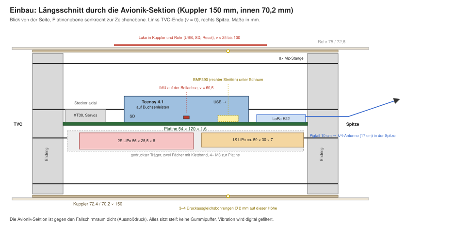
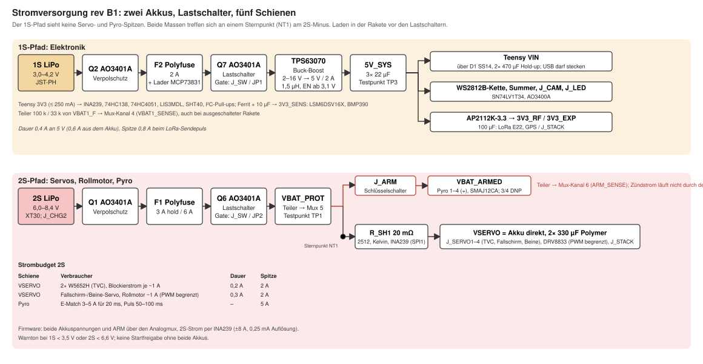
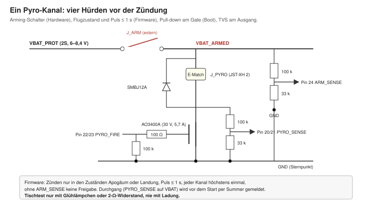
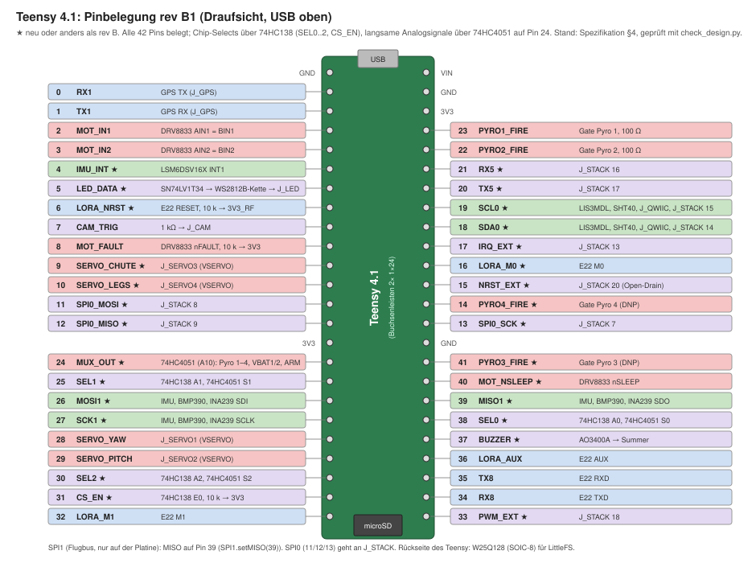
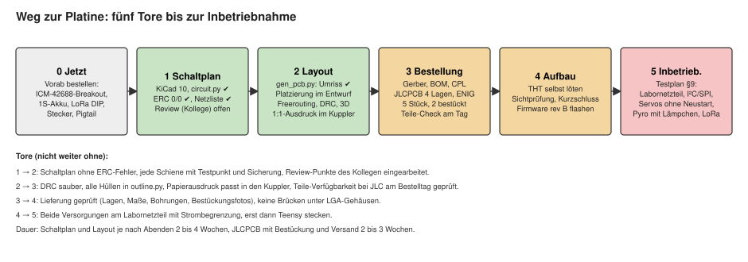

# Flugcomputer-Mainboard rev B – Design Guide

Kartonaut, Modellrakete mit Schubvektorsteuerung · Jan-Philipp Munsch · Stand 21.10.2026 nachts · Schaltplan und Layout als KiCad-Projekt (ERC und DRC sauber), Review vom 21.10. wird eingearbeitet

Dieses Dokument stellt die Elektronik der Rakete vor: was sie tun muss, wie die Platine aufgebaut ist und
warum die Entscheidungen so gefallen sind. Es ist für drei Leser geschrieben. Für den Kollegen, der den
Entwurf vor dem Schaltplan gegenliest (seine Fragen stehen in §13). Für die Dokumentation auf GitHub.
Und für mich selbst in einem halben Jahr. Die verbindliche Spezifikation mit allen Zahlen bleibt
[`hardware/mainboard/README.md`](../hardware/mainboard/README.md); der Bestellplan steht in
[`hardware/mainboard/ORDER.md`](../hardware/mainboard/ORDER.md). Wo dieser Guide und die Spezifikation
abweichen, gilt die Spezifikation.

[TOC]

## 1. Die Elektronik auf einen Blick

Die Rakete ist eine 75-mm-Modellrakete nach dem Vorbild der „Scout F“ von BPS.space: Der Motor hängt in
einem Kardan mit zwei Servos und wird so gesteuert, dass die Rakete ohne Finnen senkrecht steigt. Ein
Rollmotor hält die Rollachse, ein Fallschirm bringt sie zurück. Der Flugcomputer misst Lage und Höhe,
regelt mit 100 Hz, loggt, funkt und zündet die Bergung.

| Was | Wie | Warum so |
|---|---|---|
| Rechner | Teensy 4.1 (i.MX RT1062, 600 MHz) als gestecktes Modul | Firmware existiert, SD-Slot und USB bleiben; der BGA wäre nicht selbst zu bestücken |
| Lage | ICM-42688-P (6 Achsen) an SPI1, genau auf der Rollachse | der bisherige ICM-20948 ist abgekündigt; Lage entsteht aus dem Gyro in der Firmware |
| Höhe | BMP390 an I²C, Kalman-Filter mit der Vertikalbeschleunigung | halbes Rauschen gegenüber dem BMP280, gleiche Bibliothek |
| Strom | INA219 mit 20-mΩ-Shunt im 2S-Pfad, beide Akkuspannungen per ADC | Telemetrie und Nachweis, dass keine Servospitze den Rechner gestört hat |
| Funk | LoRa E22-400T22S (SX1268, 433 MHz, 22 dBm) auf der Platine, Antenne in der Spitze | Reichweite; der HC-12 war auf wenige hundert Meter begrenzt |
| GPS | u-blox-Modul in der Spitze über JST-GH | nur zum Wiederfinden, nicht zur Regelung |
| Aktoren | 2× FrSky W5652H direkt am 2S-Akku, Rollmotor über DRV8833, Fallschirm-Servo als Reserve | die W5652H sind am Akku doppelt so schnell wie an 5 V |
| Bergung | zwei Pyro-Kanäle mit externem Arming, Durchgangsprüfung, TVS | Pyro-Ausstoß ist getestet; zwei Kanäle für Kolben und Reserve |
| Versorgung | **zwei Akkus**: 1S für die Elektronik über Buck-Boost, 2S für Servos, Rollmotor und Pyro | ein Neustart des Rechners im Flug ist das Ende des Flugs |
| Anzeige | 2× WS2812B, Summer; der Program-Taster des Teensy ist durch die Luke erreichbar | Zustand ohne Laptop erkennbar |
| Mechanik | Längs-Schlitten 54 × 120 mm, 4 Lagen, im Kuppler (innen 70,2 mm), Akkus im Träger darunter | der Flugcomputer ist als Modul herausziehbar |
| Fertigung | JLCPCB, 4 Lagen, ENIG, SMD-Bestückung oben, THT selbst | LGA-Gehäuse sind nicht von Hand zu löten |

Alles, was heute als Breakout mit Dupont-Kabeln am Teensy hängt, kommt auf eine Platine. Extern
bleiben nur die Dinge, die woanders sitzen müssen: Akkus, Schalter, Servos, Motor, E-Matches, GPS und
die Antenne.

## 2. Warum eine eigene Platine

Der heutige Aufbau funktioniert am Tisch, aber er ist nicht flugtauglich. Dupont-Kabel rütteln sich bei
den 50 bis 300 Hz der Servos und des Motors los; ein einziger Wackelkontakt an SDA oder an der
Servoversorgung beendet den Flug. Dazu kommen Dinge, die kein Breakout bietet: die IMU exakt auf der
Rollachse, ein Arming-Konzept für die Pyro-Kanäle, saubere Masseführung zwischen Servostrom und Sensorik,
und eine Versorgung, die Spannungseinbrüche vom Rechner fernhält.

Rev A (15.10.2026) hat Bauform und Pinbelegung festgelegt: ein Längs-Schlitten statt einer runden
Scheibe, weil er doppelt so viel Fläche bietet und die Stecker an die Stirnseiten bringt, wo die Kabel
ohnehin hinlaufen. Rev B (21.10.2026) hat Sensorik, Funk, Servos und vor allem die Versorgung neu
entschieden:

| Thema | rev A | rev B | Grund |
|---|---|---|---|
| Versorgung | ein 2S-LiPo, zwei 5-V-Bucks | zwei Akkus, 1S über Buck-Boost für die Elektronik | Servo- und Pyro-Spitzen dürfen den Teensy nie in den Neustart ziehen |
| IMU | ICM-20948 | ICM-42688-P | der 20948 ist *Not For New Designs*; der 42688-P rauscht weniger und misst ±16 g |
| Barometer | BMP280 | BMP390 | halbes Rauschen |
| Funk | HC-12 gesteckt | LoRa E22-400T22S auf der Platine | Reichweite; das DIP-Modul passt nicht in den Funkstreifen |
| TVC-Servos | SG90 an 5 V | W5652H direkt am 2S-Akku | bestellt; schneller und kräftiger |
| Shunt | 0,1 Ω | 20 mΩ | 0,24 V weniger Einbruch bei 3 A |
| Schalter | ein Hauptschalter | zweipolig für beide Akkus | kein Akku wird vergessen |
| Stecker | Stiftleisten, Schraubklemmen | alle verriegelt (XT30, JST) | Vibration |
| Bergung | Servo oder Pyro | Pyro, Servo als Reserve | Pyro-Tests mit ca. 1 g Schwarzpulver erfolgreich |
| Einbau | Rohr, 69 mm angenommen | Kuppler, innen 70,2 mm | Flugcomputer als herausziehbares Modul |

## 3. Mechanische Einbettung

Der Flugcomputer sitzt in einem 150 mm langen Kuppler (innen 70,2 mm), der im 75-mm-Rohr steckt und
sich als Ganzes herausziehen lässt. Im Kuppler trägt ein Ring-Stack aus zwei Endringen (Ø 69 mm) und
acht M2-Gewindestangen den Schlitten. Die Platine liegt mit ihrer Ebene durch die Rollachse; die
Stangen laufen an den Längskanten vorbei. Unter der Platine liegen beide Akkus hintereinander in einem
gedruckten Träger.

Die wichtigsten Maße und Regeln:

- **54 × 120 × 1,6 mm**, 4 Lagen, Ecken R 2 mm, 4× M3 bei u = ±23,5 mm, v = 3,5 / 116,5 mm.
- **Bauhöhe:** mittig über 30 mm frei, am Rand (|u| > 25 mm) wegen der Stangen höchstens 5 mm. Unten
  nur Lötstifte unter 2 mm, darunter liegt der Akku.
- **Teensy** mittig (v = 30 bis 91), SD-Slot zum TVC, USB zur Spitze. Eine Luke in Kuppler und Rohr
  macht USB, SD-Karte und Reset-Taster erreichbar.
- **IMU** unter der Teensy-Mitte bei (u = 0, v = 60,5), also exakt auf der Rollachse und nahe am
  Schwerpunkt. Der Chip ist so gedreht, dass X quer und Y zur Spitze zeigt; die Firmware setzt mit
  `chipToBody(c) = (c.x, -c.z, c.y)` in das Körpersystem mit z = Rollachse um.
- **Barometer** im rechten Streifen unter Schaum; auf seiner Höhe bekommen Kuppler und Rohr 3 bis 4
  Druckausgleichsbohrungen Ø 2 mm. Die Avionik-Sektion ist gegen den Fallschirmraum dicht.
- **Funk** im linken Streifen am Spitzen-Ende, IPEX-Pigtail (10 cm) zu einer λ/4-Antenne (17 cm) in der
  Klima-Kunststoffspitze, frei von Kupfer und Akku. Das GPS-Modul sitzt ebenfalls in der Spitze,
  mindestens 10 cm von der LoRa-Antenne.
- **Stecker** nur an den Stirnseiten: Akkus, Servos und Motor zeigen zum TVC, Pyro, GPS, Kamera und
  Signale zur Spitze. Keiner zeigt seitlich auf das Rohr.
- **Steif montiert.** Keine Gummipuffer. Vibration wird digital gefiltert (IMU-Tiefpass 50 Hz, 1 kHz
  abtasten, auf 100 Hz mitteln), nicht mit einer Platine, die selbst schwingt.

`outline.py` erzeugt den Umriss als DXF für KiCad und den Platzierungsplan, und prüft dabei, dass alle
Bauteil-Hüllen im Kuppler bleiben und keine Stange berühren.

## 4. Stromversorgung

Die Versorgung ist die wichtigste Entscheidung in rev B, deshalb bekommt sie den meisten Platz.

**Das Problem.** Zwischen einem 2S-Akku und einem 5-V-Buck liegen Akku-Innenwiderstand, Stecker,
Verpolschutz-FET und Shunt, zusammen etwa 240 mΩ in rev A. Bei einer Servo-Spitze von 3 A bricht die
Spannung um 0,7 V ein; ein leerer 2S-Akku unter Last (6,0 V) liefert dann 5,3 V an den Buck, der daraus
gerade noch 5 V macht. Ein Pyro-Puls (bis 5 A, Kurzschluss beim Durchbrennen der E-Match) tut dasselbe
noch einmal. Ein Neustart des Teensy im Flug ist nicht reparabel.

**Die Entscheidung: zwei Akkus, fest ausgelegt.**

- **1S-LiPo (3,0–4,2 V, 450–600 mAh)** versorgt über einen **TPS63070 Buck-Boost** (2–16 V Eingang,
  5 V / 2 A) die Schiene 5V_SYS: Teensy (über eine Schottky, damit USB gleichzeitig stecken darf), die
  WS2812B, den Summer und über einen LDO die 3,3-V-Schiene für Funk und GPS. Die Sensoren hängen an den
  3,3 V des Teensy. Der Buck-Boost statt eines reinen Boosts hat einen Grund: Wer versehentlich den
  2S-Akku an J_BAT1 steckt, zerstört nichts.
- **2S-LiPo (6,0–8,4 V, 450–850 mAh)** versorgt die Aktoren. Die W5652H laufen **direkt am Akku** hinter
  einer 3-A-Polyfuse und 1000 µF; dort sind sie mit 0,05 s/60° doppelt so schnell wie an 5 V. Ein
  TPS563201-Buck liefert 5V_SERVO für den Rollmotor-Treiber und den Fallschirm-Servo-Ausgang, der als
  Reserve bleibt. Die Pyro-Kanäle liegen **vor dem Shunt** hinter dem Arming-Schalter, Zündströme
  laufen also nicht durch die Strommessung.
- **Ein zweipoliger Hauptschalter** am Rumpf schaltet beide Akkus zugleich; so wird keiner vergessen.
  Zwei Lötbrücken überbrücken ihn auf dem Tisch. Der Arming-Schalter ist davon getrennt.
- **Masse** beider Akkus trifft sich an einem Sternpunkt am 2S-Minus neben dem Shunt. Servo- und
  Pyro-Rückströme laufen als breite Bahn dorthin und nicht durch die Massefläche unter IMU und
  Barometer.
- **Messen und melden.** Beide Akkuspannungen gehen über Teiler auf ADC-Pins, der INA219 misst Strom und
  Spannung des 2S-Pfads (mit 20 mΩ bis 16 A bei 2 mA Auflösung). Die Firmware warnt per Summer bei
  1S < 3,5 V oder 2S < 6,6 V und gibt ohne beide Akkus keinen Start frei.

**Strombudget**

| Akku / Schiene | Verbraucher | Dauer | Spitze |
|---|---|---|---|
| 1S → 5V_SYS | Teensy 0,1 A, 2× WS2812B 0,12 A, Summer 0,03 A, Funk + GPS 0,15 A | 0,4 A an 5 V (0,6 A aus dem Akku) | 0,8 A (LoRa-Sendepuls) |
| 2S → VSERVO | 2× W5652H, Blockierstrom je ca. 1 A bei 8,4 V | 0,2 A | 2 A |
| 2S → 5V_SERVO | Fallschirm-Servo 0,65 A, Rollmotor ca. 1 A | 0,3 A | 1,7 A |
| 2S → Pyro | E-Match 3–5 A für 20 ms | – | 5 A |

Ein 500-mAh-1S-Akku trägt die Elektronik damit etwa 45 Minuten, genug für Aufbau, Warten auf der Rampe
und Flug. Der Preis der zwei Akkus: etwa 15 bis 20 g mehr Masse, zwei Ladezustände, zwei Stecker.

**Was die Firmware dazu braucht:** einen Watchdog (WDT1 des i.MX RT), der einen hängenden Teensy in
100 ms neu startet, und einen Zustandsspeicher (Flugphase, Startzeit, Höhen-Nullpunkt) im EEPROM-Emulat,
damit ein Neustart im Flug ein Aussetzer von 200 ms ist und nicht das Ende.

## 5. Sensorik

**IMU: ICM-42688-P.** Sechs Achsen, SPI1 mit 7 MHz (bis 24 MHz möglich), Gyro ±2000 °/s, Accel ±16 g,
ODR 1 kHz, interner Tiefpass auf etwa 50 Hz; die Firmware mittelt auf die 100-Hz-Schleife. Kein DMP, keine
Quaternion vom Chip. Das ist Absicht: Die DMP-Quaternion des alten ICM-20948 (mit Magnetometer) sprang
und verrauschte den Regler, und im Flug sind Kompass und Beschleunigungs-Stützung ohnehin unbrauchbar.
Die Lage entsteht in der Firmware als Quaternion rein aus dem Gyro, auf der Rampe mit dem
Beschleunigungssensor initialisiert und dort auch kalibriert (Gyro-Bias). Der Regelfehler kommt aus dem
Oben-Vektor im Körpersystem, das ist stetig und ohne ±180°-Sprung.

Warum SPI statt I²C: Der FIFO-Drain des alten Sensors kostete an I²C rund 1 ms je Frame, ein Zehntel
der Schleife. SPI1 liegt auf den Pins 26/27/39/38; MISO wird auf 39 gelegt, weil Pin 1 das GPS braucht.
Der ±16-g-Bereich löst nebenbei ein altes Problem: Mit einem F35-Motor (6,2 g) wäre der alte Sensor
bei ±4 g gesättigt gewesen.

**Barometer: BMP390.** I²C 0x77, Oversampling Druck ×8, IIR-Koeffizient 3, 50 Hz. Rauschen 0,085 Pa
statt 0,16 Pa beim BMP280, der Kalman-Filter bekommt dadurch eine kleinere Messvarianz und reagiert am
Apogäum schneller. Der Chip liegt weg von Spulen und Teensy-CPU, weil Wärme die Höhe verfälscht, und
unter Schaum gegen Licht und Fahrtwind.

**Strommonitor: INA219** mit 20-mΩ-Shunt in 2512, Kelvin-Anschluss, Adresse 0x40. Die Firmware
loggt Strom, Spannung und Leistung des 2S-Pfads.

## 6. Funk und GPS

**LoRa E22-400T22S.** SMD-Modul 16 × 26 mm mit SX1268, 433 MHz, 22 dBm, UART-Schnittstelle an Serial8
(3,3-V-Pegel, keine Widerstände nötig), M0/M1 für die Betriebsart, AUX als Flusskontrolle. Es ersetzt den
HC-12, der in der Praxis auf wenige hundert Meter kam. Die SMD-Variante wurde gewählt, weil das
DIP-Modul (24 × 43 mm) nicht in den Funkstreifen passt; die Bodenstation bekommt das DIP-Modul
E22-400T22D mit SMA-Antenne. Die Konfiguration (Adresse, Kanal, 9600 Bd, Luftrate 2,4 kbps, 22 dBm) setzt
die Firmware einmalig über M0 = M1 = 1. Das Modul bekommt eine eigene 3,3-V-Schiene (AP2112K, 100 µF),
damit der Sendepuls von 110 mA nicht auf den Sensoren landet.

**GPS** sitzt nicht auf der Platine, sondern als u-blox-Modul (MAX-M10S oder NEO-M9N) in der Spitze mit
Patchantenne nach oben, angeschlossen über J_GPS (JST-GH 4: 3V3_RF, GND, TX, RX) an Serial1. u-blox
lässt das Dynamikmodell *airborne < 4 g* zu. Für den ersten Flug ist GPS nur Komfort zum Wiederfinden.

## 7. Aktoren

**TVC-Servos FrSky Xact W5652H** (10 g, Hall-Sensor statt Poti, 3,7–8,4 V, 4,8 kg·cm und 0,05 s/60° bei
8,4 V) an den Pins 28/29, versorgt direkt aus dem 2S-Akku über J_SERVO1/2. Der Kardan wird für sie neu
konstruiert; die Umrechnung TVC-Winkel → Servowinkel wird am neuen Kardan gemessen (Sprungantworten,
dann Übertragungsfunktion für die Simulation).

**Rollmotor** über einen DRV8833 mit beiden Brücken parallel (2× 1,5 A), 20-kHz-PWM auf den Pins 2/3,
versorgt aus 5V_SERVO.

**Fallschirm-Servo** (Pin 9, J_SERVO3 an 5V_SERVO) bleibt als Footprint und Reserve, falls die
Pyro-Bergung einmal nicht zur Verfügung steht.

## 8. Pyro-Kanäle und Sicherheit

Jeder der beiden Kanäle ist ein Low-Side-Schalter (AO3400A, 30 V, 5,7 A) mit 100 Ω am Gate und 100 kΩ
Pull-down, damit der FET beim Booten, wenn die Teensy-Pins hochohmig sind, sicher aus bleibt. Plus
kommt von **VBAT_ARMED**, das nur hinter dem externen Arming-Schalter Spannung führt; ohne Arming kann die
Firmware nichts zünden, egal was sie tut. Die Durchgangsprüfung misst den Drain über einen Teiler: Mit
Arming und eingesteckter E-Match liegt er auf VBAT, ohne E-Match ziehen ihn 100 kΩ nach GND. Eine
bidirektionale TVS (SMBJ12CA, im KiCad-Projekt statt der SMBJ12A gewählt, damit die Bestückrichtung keine Rolle
spielt) fängt die Abschaltspitze der Zuleitung ab. Die Stecker sind JST-XH 2-polig mit Zugentlastung.

Die Firmware ergänzt vier Regeln: Zünden nur in den Zuständen *Apogäum* oder *Landung*, Puls ≤ 1 s, jeder
Kanal höchstens einmal, ohne ARM_SENSE keine Freigabe. Vor dem Start meldet der Summer den Durchgang.

> Tischtests nur mit Glühlämpchen oder 2-Ω-Widerstand, nie mit Ladung. Für Schwarzpulver gelten die
> örtlichen Regeln (in Deutschland das Sprengstoffrecht).

## 9. Pinbelegung Teensy 4.1

Alle heute in `Config.h` benutzten Pins bleiben, wo sie sind; neu kommen SPI1, Pyro, Arming, LoRa-Steuerung,
GPS, die zweite Akkuspannung, ein Kamera-Trigger und die Fehlermeldung des Motortreibers (Pin 8, aus dem
KiCad-Projekt) dazu. Zehn Pins bleiben frei und liegen auf einer 2×7-Erweiterungsleiste. Die Netzliste des
KiCad-Projekts ist am 21.10.2026 gegen diese Tabelle geprüft (`hardware/mainboard/review_netlist_2026-10-21.md`).

## 10. Layout-Regeln (Kurzfassung)

- Lage 2 durchgehend GND, Lage 3 Versorgungsflächen, Bestückung nur oben.
- Bahnbreiten (1 oz, 10 K): VBAT, VSERVO und Pyro 2 mm auf beiden Außenlagen mit ≥ 4 Vias je Übergang;
  5V_SYS 0,8 mm; 3V3 0,5 mm; Signale 0,2 mm.
- Wandler und Spulen im Streifen links neben dem Teensy, mindestens 15 mm von der IMU; 5 mm Freiraum um
  die IMU auf allen Lagen, darunter eine ruhige Massefläche ohne Vias.
- BMP390 weg von Spulen und CPU. LoRa-Modul auf einer Massefläche, keine Signale darunter.
- Shunt mit vier Pads (Kelvin), Messleitungen direkt zum INA219.
- Jede Schiene mit Testpunkt; Stecker mit Pin-1-Markierung und S / + / − im Bestückungsdruck; IMU-Achsen
  als Pfeile.
- DRC mit JLC-Regeln (0,127 mm, Via 0,3 mm), 3D-Ansicht gegen die Hüllen aus `outline.py`,
  1:1-Papierausdruck in den Kuppler halten.

Die vollständige Prüfliste steht in `docs/Plan_2026-10-21.md` §2.6.

## 11. Fertigung und Bestellung

**Stand des KiCad-Projekts** (`hardware/mainboard/kicad/`, KiCad 10.0.6): Die Schaltung ist als Code in
`circuit.py` beschrieben, daraus werden Schaltplan (7 Blätter, ERC 0/0, PDF in `kicad/out/`) und Platine
erzeugt. Die Platine ist komplett platziert und auf vier Lagen geroutet (DRC 0 Fehler, drei Verbindungen
von Hand zu ziehen; Renders und Lagenbilder in `kicad/img/`). Ein Zweitmeinung-Review
(`hardware/mainboard/review_kicad_2026-10-21.md`) hat Schaltung und Layout gegen Datenblätter und
Spezifikation geprüft; seine acht A-Punkte (Ausgangskapazität des TPS63070, 1S-Unterspannungsschwelle,
Hauptschalter über FETs, Sicherung je Akku, Kelvin-Shunt, Stromnetze auf den Außenlagen und weg von der IMU,
Breite von VSYS_IN und 5V_SERVO) kommen vor den Fertigungsdaten hinein. Entscheidungen, die das Projekt über
die Spezifikation hinaus getroffen hat, stehen in `kicad/README.md` §6: eigenes Netz GND_PWR mit Sternpunkt,
Unterspannungsschutz über den EN-Teiler des TPS63070 (an ab 3,44 V, aus unter 3,01 V), 220 Ω in den
Servoleitungen, stehende Stecker an den Stirnseiten, Stromnetze 1,2 mm statt 2 mm.

JLCPCB, 4 Lagen, 54 × 120 mm, ENIG, 5 Platinen, davon 2 mit Economic-PCBA auf der Oberseite bestückt;
THT-Teile (Stecker, Buchsenleisten, Elkos, Summer) löte ich selbst. Geschätzte Kosten des Platinenlaufs
120 bis 180 €, dazu 90 bis 140 € für Akkus, Stecker, LoRa-Gegenstelle und Breakouts, die schon vor der
Platine bestellt werden. Lieferzeit 2 bis 3 Wochen ab Upload. Teileverfügbarkeit, Extended-Gebühren und
die Tore vor der Bestellung stehen in [`ORDER.md`](../hardware/mainboard/ORDER.md); drei Punkte sind
dort als Risiko markiert: Der BMP390 war bei LCSC zuletzt ohne Bestand (Rückfall BMP388, gleiches
Gehäuse), der TPS63070-Bestand schwankt, und das bei LCSC zum ICM-42688-P verlinkte Datenblatt trägt die
Marke Tokmas statt TDK, der Hersteller ist also am Bestelltag zu prüfen. Seit dem 1.7.2026 fallen zudem 3 €
Zoll je Warenposition an. Der Vergleich mit PCBWay, Aisler, Eurocircuits und anderen steht in
`hardware/mainboard/Fertiger_2026-10-21.md`; Aisler ist der Rückfall in der EU.

## 12. Inbetriebnahme

1. Ohne Teensy, beide Akkupfade am Labornetzteil mit 100 mA Begrenzung: 5V_SYS und 3V3_RF aus 3,7 V,
   VSERVO und 5V_SERVO aus 7,4 V messen. Verpolung testen.
2. Teensy stecken, nur USB: I²C-Scan findet 0x40 und 0x77; ICM-42688-P antwortet per SPI (WHO_AM_I = 0x47).
3. 1S-Akku, Flug-Firmware: Loop-Timing, Teleplot IMU/Baro, beide Akkuspannungen, INA219.
4. 2S-Akku dazu: Servos einzeln bis zum Blockieren, Rollmotor; der Watchdog-Zähler im Log muss 0 bleiben.
   Einbruch von VBAT2 und 5V_SYS mit dem Oszilloskop.
5. Pyro nur mit Lämpchen: ohne ARM keine Zündung, ARM_SENSE, Durchgang, Pulsdauer.
6. LoRa-Strecke im Freien (Reichweite, Paketverlust), GPS-Fix in der Spitze.

Firmware-Änderungen für rev B: neuer IMU-Treiber über SPI1 ohne DMP mit Gyro-Quaternion, BMP390 über
`BMP3XX`, `Radio.cpp` für den E22, `FlightState.cpp` (Pad → Boost → Coast → Apogäum → Bergung →
Landung) mit Pyro-Logik und Arming, Watchdog und Zustandsspeicher, Rampenkalibrierung des Gyro-Bias,
neue Pins und Grenzen in `Config.h`.

## 13. Fragen an den Reviewer

Das sind die Punkte, bei denen mir ein zweites Paar Augen am meisten hilft, bevor der Schaltplan entsteht.

*Stand 21.10.2026 nachts:* Das Zweitmeinung-Review (`hardware/mainboard/review_kicad_2026-10-21.md`) hat die
Fragen 1, 2, 3, 4, 7, 8, 9 und 10 beantwortet (dort A1 bis A5, B1, B2, B5, B9, B10, C3); die Antworten in Kürze:
Trennung 1S/2S ist sauber, aber der Hauptschalter gehört aus dem Strompfad (A3); 1,5 µH reichen, der
1000-µF-Elko muss hinter die Schottky (A1); Shunt vor beiden Verbrauchern ist richtig, aber Kelvin fehlt (A5);
Pyro-Kanal in Ordnung, Zündpuls auf 50 bis 100 ms kürzen (A4); Stecker im Strompfad auf JST-XH (A3); Economic
ist möglich, die WS2812B-2020 sind das Risiko (C3); Sicherung je Akku ja (A4), CS-Pull-up vorhanden, LoRa-Pins
haben interne Pull-ups, ESD am USB nicht nötig (B9); PS/SYNC hoch bleibt, NRST an einen Teensy-Pin, RESV-Pins
stimmen (B2, B9, B10). Offen für den Kollegen bleiben 5 (IMU unter dem Teensy) und 6 (Funk/GPS-Abstand).

1. **Versorgung.** Ist die Trennung 1S/2S so sauber, oder übersehe ich einen Pfad, über den eine
   Servo- oder Pyro-Spitze doch beim Teensy ankommt (Masseführung, Sternpunkt am Shunt, gemeinsame Masse
   der Servosignale)?
2. **Buck-Boost.** TPS63070 aus 3,0 bis 4,2 V auf 5 V / 0,6 A: reicht 1,5 µH mit 1000 µF Polymer am
   Ausgang, oder braucht es mehr Hold-up für den LoRa-Sendepuls? Alternative TPS63020?
3. **Shunt.** 20 mΩ in 2512 mit Kelvin-Anschluss vor Servo-Schiene und Buck: reicht die Auflösung
   (2 mA) und ist die Lage vor den beiden Verbrauchern sinnvoll?
4. **Pyro.** AO3400A low-side mit 100 Ω / 100 kΩ, SMBJ12A am Ausgang, Durchgangsprüfung über 100 k/33 k:
   Fehlt eine Strombegrenzung oder ein Freilauf für die induktive Zuleitung? Ist die Prüfung nur im
   scharfen Zustand akzeptabel?
5. **IMU-Platzierung.** Unter dem Teensy auf der Achse, 15 mm von den Spulen, 5 mm Freiraum: Sind
   Teensy-CPU und Buchsenleisten als Wärme- und Störquelle direkt darüber ein Problem?
6. **Funk.** LoRa-Modul auf der Platine, Pigtail 10 cm zur Antenne in der Kunststoffspitze, GPS 10 cm
   daneben: genügt der Abstand, oder sollte der Sendepuls beim GPS-Fix in der Firmware ausgeblendet
   werden?
7. **Stecker.** JST-XH für Servos und Pyro, JST-PH für 1S-Akku und Schalter, XT30 für 2S: richtige Wahl
   für Vibration und Strom (W5652H bis 1 A je Servo, Pyro 5 A kurz)?
8. **Fertigung.** 4 Lagen, 1 oz außen, ENIG, Economic-PCBA: Sehen Sie ein Bauteil, das Standard-PCBA
   erzwingt oder das man besser von Hand bestückt?
9. **Was fehlt?** ESD am USB (der Teensy hat keinen eigenen Schutz), Pull-ups an CS und den
   LoRa-Steuerleitungen während des Boots, eine Sicherung im 1S-Pfad?
10. **Aus der Netzlistenprüfung.** TPS63070 PS/SYNC liegt auf high (Stromsparbetrieb bei Teillast,
    mehr Ripple im Leerlauf): so lassen oder forced PWM? E22 NRST offen oder über 10 k hochziehen?
    ICM-42688-P RESV-Pins 2, 3, 7, 10, 11 an GND: stimmt das mit DS-000347 Tabelle 9, ist Pin 7 „do not
    connect“?

## Anhang A: Stückliste (Entwurf)

Auszug aus `hardware/mainboard/README.md` §7; die LCSC-Nummern und ihr Status stehen in `ORDER.md` §3.3.

| Ref | Bauteil | Gehäuse | Anz. | Funktion |
|---|---|---|---|---|
| U_TEENSY | Teensy 4.1 + 2× Buchsenleiste 1×24 | THT | 1 | MCU (vorhanden) |
| U4 | TDK ICM-42688-P | LGA-14 | 1 | IMU |
| U5 | Bosch BMP390 | LGA-10 | 1 | Barometer |
| U6 | TI INA219AIDR + 20 mΩ 2512 | SOIC-8 | 1 | Strom/Spannung 2S |
| U1 | TI TPS563201 + 2,2 µH | SOT-23-6 | 1 | 5V_SERVO |
| U2 | TI TPS63070 + 1,5 µH | VQFN-15 | 1 | 5V_SYS aus 1S |
| U3 | Diodes AP2112K-3.3 | SOT-23-5 | 1 | 3V3_RF |
| U7 | TI DRV8833 | HTSSOP-16 | 1 | Rollmotor |
| U8, U9 | 74AHCT1G125 | SOT-23-5 | 2 | Pegel 3,3 → 5 V für WS2812B |
| U10 | Ebyte E22-400T22S | SMD-Modul | 1 | LoRa |
| LED1, LED2 | WS2812B-2020 | 2020 | 2 | Status |
| Q1, Q2 | AO3401A | SOT-23 | 2 | Verpolschutz 2S / 1S |
| Q_P1, Q_P2, Q_BZ | AO3400A | SOT-23 | 3 | Pyro 1/2, Summer |
| D1 | SS14 | SMA | 1 | VIN-Entkopplung |
| D_TVS | SMBJ12A | SMB | 2 | Pyro-Ausgänge |
| F1 | Polyfuse 3 A | 1812 | 1 | VSERVO |
| BZ1 | aktiver Summer 5 V | THT | 1 | Signalgeber |
| C_BULK | 1000 µF Polymer, 1000 µF Low-ESR, 470 µF | Elko stehend | 3 | Puffer |
| J_BAT2 / J_BAT1 | XT30PW-M / JST-PH 2 | THT | 1+1 | Akkus |
| J_SW / J_ARM | JST-PH 4 / JST-PH 2 | THT | 1+1 | Hauptschalter, Arming |
| J_SERVO1..3 | JST-XH 3 | THT | 3 | Servos |
| J_MOT | JST-PH 2 | THT | 1 | Rollmotor |
| J_PYRO1, J_PYRO2 | JST-XH 2 | THT | 2 | E-Matches |
| J_GPS, J_QWIIC, J_CAM, J_LED | JST-GH 4 / SH 4 / GH 3 / GH 3 | SMD | 4 | GPS, I²C, Kamera, LEDs |
| J_EXP | Stiftleiste 2×7 | THT | 1 | freie Pins |
| JP1, JP2, TP1..6 | Lötbrücken, Testpunkte | – | | Tisch, Inbetriebnahme (Reset-Taster entfallen: der Teensy-Sockel führt keinen Reset) |

## Anhang B: Dateien

| Datei | Inhalt |
|---|---|
| `hardware/mainboard/README.md` | Spezifikation rev B (verbindlich) |
| `hardware/mainboard/rev_a_2026-10-15.md` | rev A mit den Begründungen, die weiter gelten |
| `hardware/mainboard/ORDER.md` | Bestellplan, Teilestatus, Kosten, Tore |
| `hardware/mainboard/Fertiger_2026-10-21.md` | Vergleich der Fertiger (JLCPCB, PCBWay, Aisler, Eurocircuits), Zoll seit 07/2026 |
| `hardware/mainboard/kicad/` | KiCad-Projekt: `circuit.py` als Quelle, Schaltplan, Platinen-Generator, `kicad/README.md` mit Entscheidungen |
| `hardware/mainboard/review_netlist_2026-10-21.md` | Tor-1-Prüfung der Netzliste gegen die Spezifikation |
| `hardware/mainboard/review_kicad_2026-10-21.md` | Zweitmeinung-Review von Schaltung und Layout (A1 bis A8 vor der Bestellung), Prüfskript `review_check_layout.py` |
| `hardware/mainboard/Fertiger_2026-10-21.md` | Fertigervergleich und Entscheidung (JLCPCB Economic, Aisler als Rückfall) |
| `hardware/mainboard/outline.py` | Umriss (DXF) und Platzierungsplan (SVG), Hüllenprüfung |
| `hardware/mainboard/figures.py` | die Abbildungen dieses Guides |
| `docs/Plan_2026-10-21.md` | Planungsrunde mit Bewertung von rev A, Versorgungsrechnung, Layout-Checkliste |
| `docs/build_design_guide.py` | baut aus dieser Datei die PDF-Fassung |
| `firmware/src/Config.h` | heutige Pinbelegung der Firmware |
