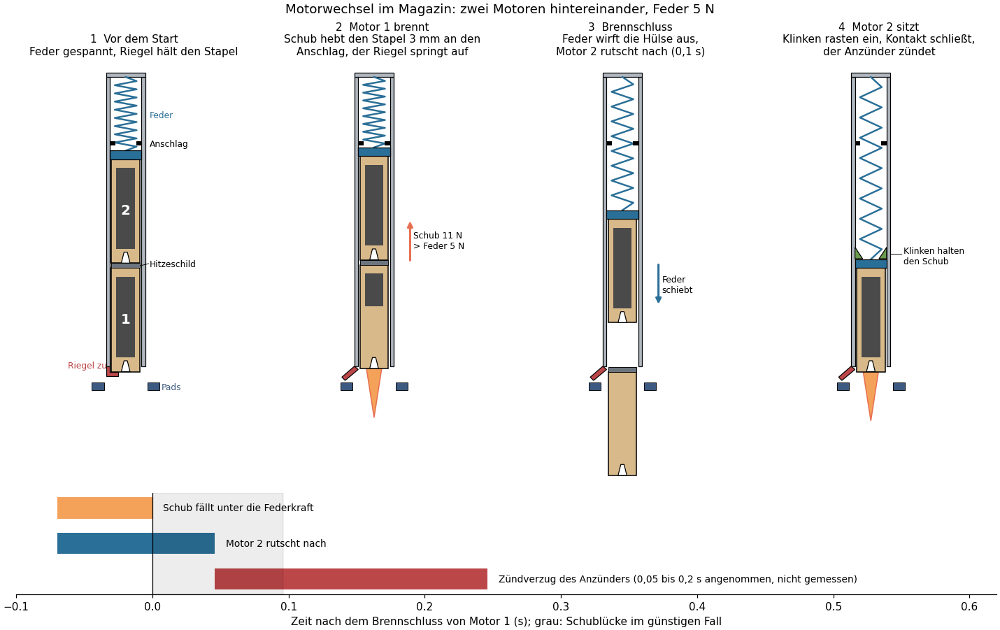
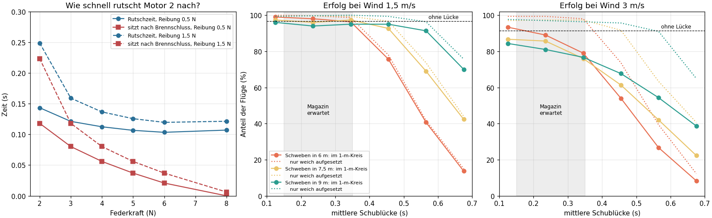
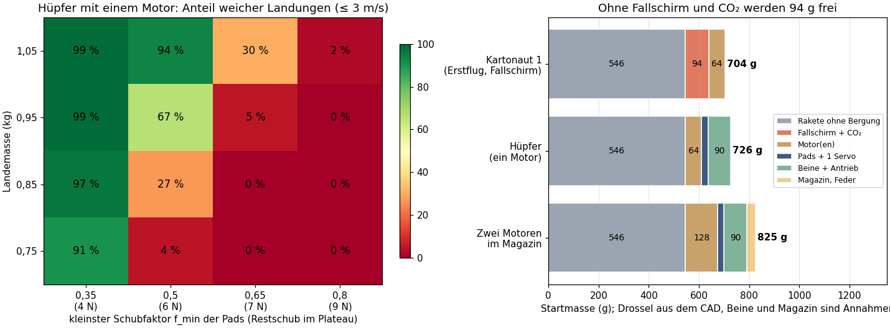
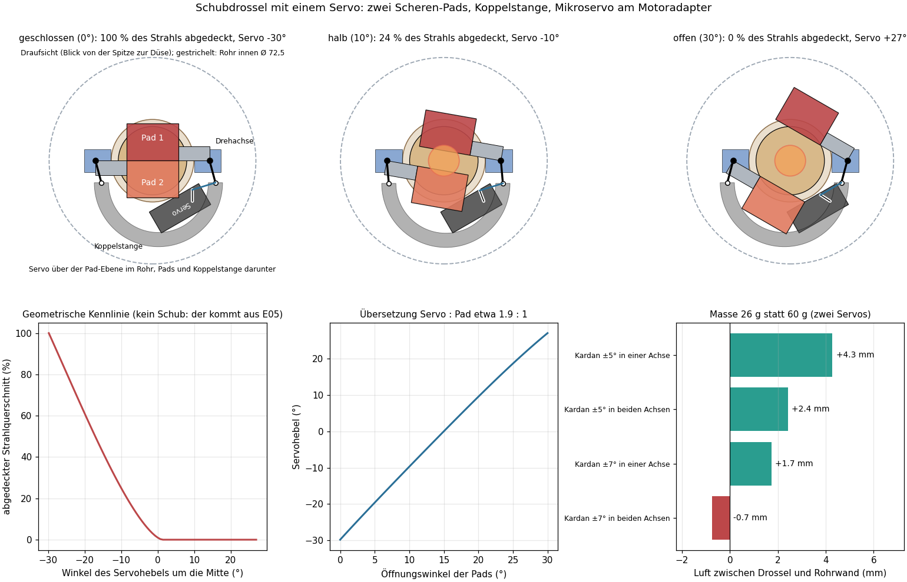
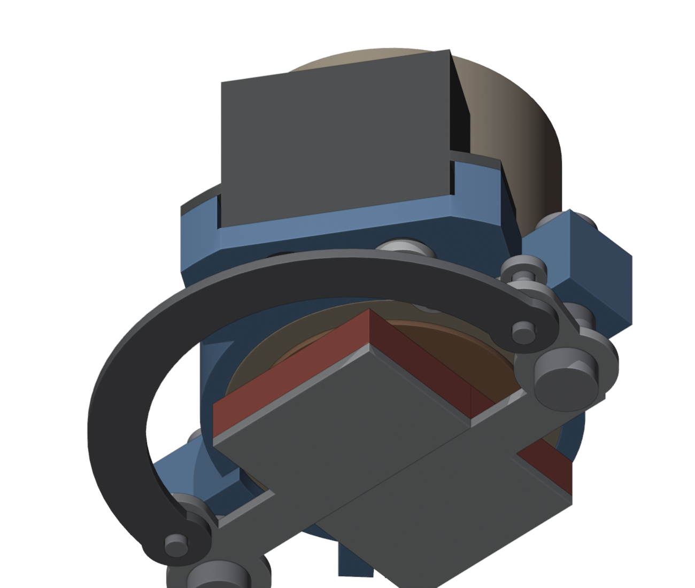
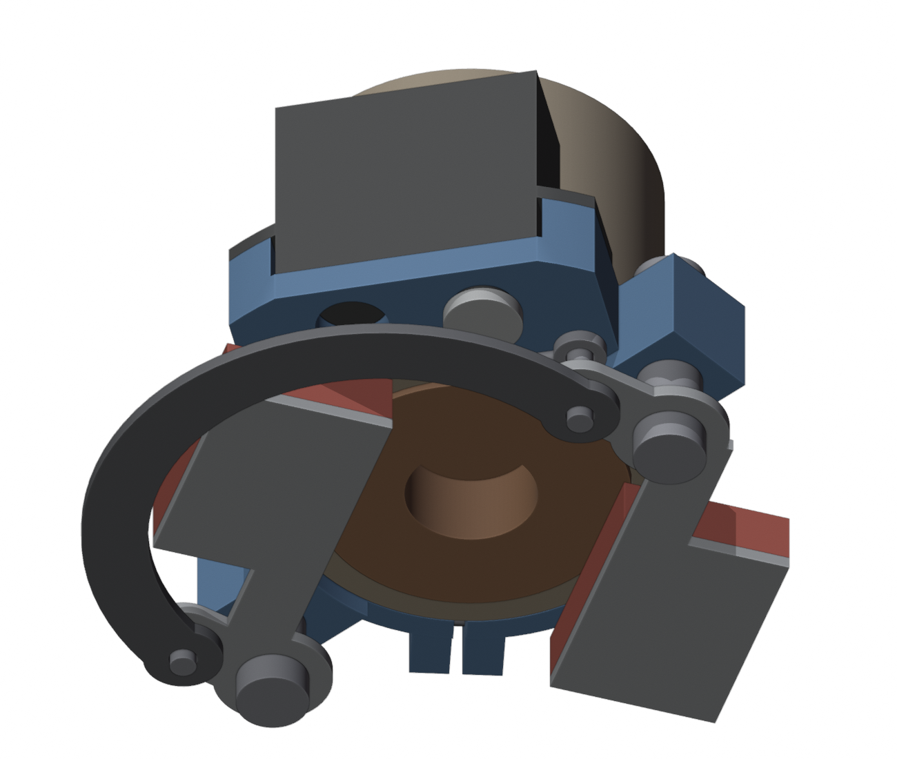
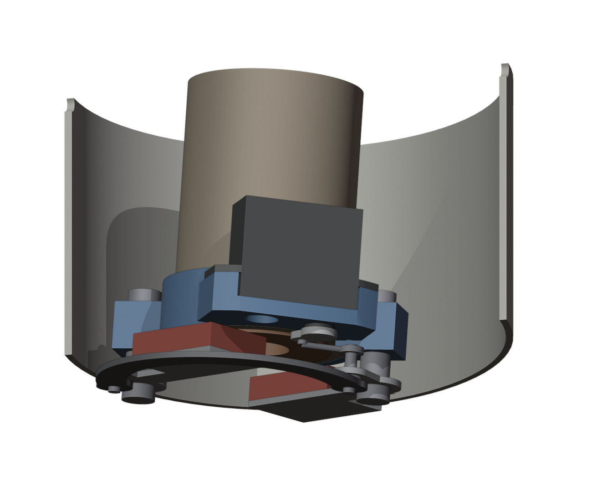

# Motorwechsel im Magazin, Schubdrossel und der Hüpfer als erster Landeversuch

Stand 15.11.2026, Nachtrag zu [Navigation_und_Landung_2026-11-15.md](Navigation_und_Landung_2026-11-15.md).
Anlass sind Jans Rückmeldungen vom selben Tag:

- Zwei Motoren **nebeneinander** fallen weg: der Platz im 75-mm-Rohr reicht vermutlich nicht, und der Stellweg
  des Kardans soll nicht kleiner werden. **Hintereinander** ist die bevorzugte Anordnung.
- Idee aus einem YouTube-Projekt: ein Wechsel mit „Kugelschreiber-Logik“. Der erste Motor schaltet die Mechanik
  scharf, sobald er schiebt, wird nach dem Brennschluss ausgeworfen, und der zweite rutscht nach.
- Eine Kamera ist nicht fest geplant und scheitert vermutlich am Gewicht.
- Der Schubfaktor der Pads muss gemessen werden; die Pads (Ofenmörtel) und ihre Servos kosten Gewicht, dafür
  könnte der Fallschirm entfallen.
- Vielleicht ist der Hüpfer mit einem Motor doch der beste erste Landeversuch.

Gerechnet mit `simulation/tvcsim/motorswap.py` (Nachrutschen), `simulation/tvcsim/pinpoint.py` (6DOF, neuer
Parameter `swap_time`) und `simulation/scripts/motorwechsel_study.py` (300 Flüge je Fall).
**Alle Zahlen sind Modellwerte, die Mechanik ist ein Konzept und nicht konstruiert.**

## 1. Ergebnis in Kürze

1. **Der Wechsel im Magazin geht im Modell.** Eine Feder mit 5 N schiebt Motor 2 in etwa 0,1 s nach. Mit dem
   Zündverzug des Anzünders ergibt das 0,15 bis 0,35 s ohne Schub. Bis 0,35 s landet die Rakete aus 6 m Höhe
   so gut wie ohne Lücke (96 bis 99 % bei 1,5 m/s Wind, 79 bis 93 % bei 3 m/s).
2. **Über 0,4 s wird es eng.** Dann fehlt die Zeit zum Bremsen. Höher schweben (9 m) verschiebt die Grenze
   auf etwa 0,55 s, kostet bei Wind aber Treffgenauigkeit. Der Zündverzug ist also die Zahl, die gemessen
   werden muss.
3. **Die Mechanik hat fünf Teile, die alle funktionieren müssen** (Riegel, Feder, Hitzeschild, Sperrklinken,
   Zündkontakt), und sie macht die schwenkende Einheit etwa 205 mm lang. Ob das mit vollem Kardanweg ins Rohr
   passt, zeigt erst das CAD.
4. **Die Pads braucht jede Variante.** Ohne Drossel landet nichts weich. Wie tief sie drosseln müssen, hängt
   an der Masse: bei 0,75 kg Schubfaktor 0,35, bei 1,05 kg reicht 0,5.
5. **Der Fallschirm kann bei diesen Flügen weg.** Aus 3 bis 9 m Höhe öffnet er nicht rechtzeitig. Ohne ihn
   und das CO₂-Modul werden 94 g frei; die Drossel mit einem Servo (26 g) und die Beine brauchen etwa 116 g.
6. **Empfehlung: der Hüpfer zuerst.** Er prüft Pads, Führung und Fahrwerk mit einem Motor und ohne Mechanik.
   Das Magazin wird parallel auf dem Tisch und dem Prüfstand entwickelt und fliegt danach.

## 2. Das Magazin („Kugelschreiber-Logik“)



Beide Motoren stecken hintereinander in einem Rohr, das als Ganzes im Kardan schwenkt. Motor 1 sitzt unten in
Brennstellung, die Pads stehen an seiner Düse. Der Ablauf:

| Schritt | Was passiert | Wodurch |
|---|---|---|
| 1 Vor dem Start | Die Feder drückt den Stapel nach unten, ein Riegel unter Motor 1 hält ihn | Riegel |
| 2 Motor 1 brennt | Der Schub (11 N im Plateau) ist größer als die Federkraft (5 N) und hebt den Stapel 3 mm an einen festen Anschlag. Dieser Hub lässt den Riegel aufspringen. Das ist der „Klick“ des Kugelschreibers | Schub gegen Feder |
| 3 Brennschluss | Der Schub fällt unter die Federkraft. Die Feder schiebt die leere Hülse hinaus und Motor 2 eine Motorlänge (95 mm) nach unten | Feder |
| 4 Motor 2 sitzt | Zwei Sperrklinken rasten hinter dem Kolben ein und nehmen den Schub von Motor 2 auf. Erst in dieser Stellung schließt der Kontakt zum Anzünder | Klinken, Kontakt |

Was das Konzept braucht und was daran kritisch ist:

- **Feder mit konstanter Kraft** (Rollfeder oder lange Druckfeder), 4 bis 6 N. Sie muss schwächer sein als der
  kleinste Schub im Plateau und stärker als die Reibung. Unter 3 N wird das Nachrutschen bei viel Reibung
  langsam (0,25 s).
- **Hitzeschild zwischen den Motoren.** Der TSP E12-0 hat keine Verzögerung und keine Ausstoßladung. Ob er am
  Brennschluss nach vorn durchbrennt wie eine klassische Stufenzündung, ist nicht gemessen. Wenn ja, würde er
  Motor 2 in der oberen Stellung zünden, und dessen Schub hielte ihn dort fest. Eine Scheibe aus Stahl oder
  Keramik zwischen den Motoren verhindert das; sie fällt mit der Hülse heraus.
- **Zündkontakt erst in Brennstellung.** Die Leitungen des Anzünders enden auf zwei Kontakten am Kolben. So
  kann Motor 2 nicht zünden, bevor er sitzt, und es schleifen keine Kabel mit.
- **Sperrklinken für 30 N** (Schubspitze 28 N) an einer Stelle, an der vorher Motor 1 heiß geworden ist. Nicht
  aus PLA.
- **Länge.** Zwei Motoren und Kolben sind etwa 205 mm, mit einer Druckfeder obenauf 260 mm. Die Kardanachse
  liegt 70 mm über der Düse. Das obere Ende schwenkt bei ±5° um 12 mm, bei ±8° um 19 mm aus; mit 16 mm
  Halbmesser braucht das Magazin dort 28 bis 35 mm freien Radius bei 36 mm Rohr-Innenradius. Auf dem Papier
  passt es, im CAD ist es nicht geprüft (Rahmen, Servos und Akku sitzen heute über dem Motor).
- **Die ausgeworfene Hülse** ist heiß und fällt aus 6 bis 9 m. Startplatz entsprechend wählen.
- **Schwerpunkt.** Motor 2 rutscht 95 mm nach unten, die Hülse (36 g) geht ab. Der Schwerpunkt wandert etwa
  8 mm nach unten, der Hebelarm des Kardans wird 4 % kürzer.

Eine verwandte Lösung fliegt beim Projekt JRD Propulsion: dort wirft ein Federpaar den Aufstiegsmotor nach dem
Brennschluss aus, der Landemotor zündet später ([Hackster](https://hackster.io/news/right-back-where-we-started-from-649b1bd7f87c),
[Fabbaloo](https://fabbaloo.com/news/design-of-the-week-propulsive-landing-rocket)). Ob der Landemotor dort
nachrutscht, steht in den Berichten nicht.

## 3. Wie lang die Schublücke sein darf



**Nachrutschen** (`motorswap.py`: Stapel 108 g, Weg 98 mm, Schubkurve des TSP E12, Rakete im freien Fall, das
Gewicht hilft also nicht):

| Federkraft | Reibung 0,5 N: Rutschzeit / sitzt nach Brennschluss | Reibung 1,5 N |
|---|---|---|
| 2 N | 0,14 s / 0,12 s | 0,25 s / 0,22 s |
| 3 N | 0,12 s / 0,08 s | 0,16 s / 0,12 s |
| 5 N | 0,11 s / 0,04 s | 0,13 s / 0,06 s |
| 8 N | 0,11 s / 0 s | 0,12 s / 0,01 s |

Eine stärkere Feder rutscht kaum schneller, löst aber früher aus, weil der Schub von Motor 1 über 0,25 s
ausläuft. Bei 5 N sitzt Motor 2 rund 0,05 s nach dem Brennschluss. Die Lücke bestimmt dann der Anzünder
(im Modell 0,05 bis 0,2 s, **nicht gemessen**).

**Landung in 6DOF** (Profil `wechsel`, 0,8 kg, Schubfaktor 0,35, GPS; Zündung erst nach dem wirklichen
Brennschluss plus Rutschzeit). Erfolg im 1-m-Kreis / weich aufgesetzt:

| mittlere Schublücke | Wind 1,5 m/s: 6 m | 7,5 m | 9 m | Wind 3 m/s: 6 m | 7,5 m | 9 m |
|---|---|---|---|---|---|---|
| ohne Lücke (Bezug) | 97 / 98 % | | | 91 / 98 % | | |
| 0,12 s | 99 / 100 % | 97 / 99 % | 96 / 99 % | 93 / 99 % | 87 / 97 % | 84 / 98 % |
| 0,24 s | 98 / 100 % | 96 / 100 % | 94 / 100 % | 89 / 99 % | 86 / 97 % | 81 / 97 % |
| 0,35 s | 96 / 99 % | 97 / 99 % | 95 / 100 % | 79 / 98 % | 76 / 97 % | 77 / 96 % |
| 0,46 s | 76 / 78 % | 93 / 97 % | 95 / 99 % | 54 / 74 % | 61 / 92 % | 68 / 96 % |
| 0,57 s | 41 / 42 % | 69 / 74 % | 91 / 96 % | 27 / 39 % | 42 / 63 % | 54 / 91 % |
| 0,68 s | 14 / 15 % | 42 / 44 % | 70 / 76 % | 8 / 12 % | 22 / 41 % | 39 / 65 % |

- Bis 0,35 s Lücke setzt die Rakete aus 6 m fast immer weich auf. Bei 3 m/s Wind treibt sie in der Lücke ab
  und kippt, deshalb sinkt der Anteil im 1-m-Kreis von 91 auf 79 %.
- Über 0,4 s fällt sie aus 6 m zu schnell für den zweiten Motor. Aus 9 m bleibt sie bis 0,57 s weich, landet
  aber ungenauer, weil sie länger im Wind hängt.
- Der Befund „Punktlandung braucht Schub ohne Lücke“ aus der ersten Studie gilt damit genauer: eine Lücke
  von einem Drittel Sekunde bei 1 bis 2 m/s Geschwindigkeit ist verkraftbar, mehrere Sekunden freier Fall
  nicht.

## 4. Schubdrossel: Pads aus Ofenmörtel, und was die Masse dazu tut



**Ohne Drossel geht keine der Varianten.** Der E12 schiebt im Plateau mit 11 N, die Rakete wiegt 7 bis 10 N.
Für eine geführte Landung muss der Schub unter das Gewicht geregelt werden können. Hüpfer mit einem Motor,
Anteil weicher Landungen (Wind 1,5 m/s):

| Landemasse | f_min 0,35 (4 N) | 0,5 (6 N) | 0,65 (7 N) | 0,8 (9 N) |
|---|---|---|---|---|
| 0,75 kg | 91 % | 4 % | 0 % | 0 % |
| 0,85 kg | 97 % | 27 % | 0 % | 0 % |
| 0,95 kg | 99 % | 67 % | 5 % | 0 % |
| 1,05 kg | 99 % | 94 % | 30 % | 2 % |

Die Masse ist also die zweite Stellschraube: schafft der Prüfstand (E05) nur Schubfaktor 0,5, landet der
Hüpfer mit 300 g Ballast trotzdem. Viel mehr geht nicht: ab 1,15 kg trägt der Schub im Plateau das Gewicht nicht mehr.

**Zu den Pads aus Ofenmörtel:**

- Als Werkstoff für den ersten Versuch ist er richtig: billig, formbar, hält die Temperatur. Schwächen sind
  Sprödigkeit und Risse beim schnellen Aufheizen. Ein Drahtgewebe oder ein Blechträger im Mörtel hält die
  Stücke zusammen, wenn er reißt. Der Abbrand von Schwarzpulver setzt außerdem Schlacke ab; nach jedem
  Brennen wiegen und fotografieren (steht so in E05).
- Die Pads selbst wiegen wenige Gramm. Schwer waren die zwei Servos mit Gestänge (60 g nach
  `docs/Baustellen_2026-10-26.md`). Mit einem Servo sind es 26 g, siehe unten.
- **E05 entscheidet.** Die Kennlinie Pad-Stellung gegen Schub und der kleinste erreichbare Schubfaktor sind
  die Messung, an der Hüpfer und Magazin gleichermaßen hängen.

**Drossel mit einem Servo (CAD, `cad/throttle.py`).** Zwei Pads drehen sich wie eine Schere um senkrechte
Achsen direkt unter der Düse. Die Kraft des Strahls geht längs der Achse in die Schraube und nicht ins Servo.
Eine Koppelstange um die Düse herum zwingt beide Pads auf denselben Winkel, ein Mikroservo (4,3 g) am
Motoradapter stellt beide über eine kurze Stange. Alles schwenkt mit dem Kardan.



| geschlossen, von unten | offen | im Rohr, Kardan 5°/5° |
|---|---|---|
|  |  |  |

| Prüfung (`python cad/throttle.py`) | Ergebnis |
|---|---|
| Masse | **26 g** statt 60 g mit zwei Servos (Servo mit Kabel 5,8 g, Druckteil 4,5 g, Bleche 8,3 g, Mörtel 3,7 g, Schrauben 3,7 g) |
| Teile gegeneinander über den ganzen Stellweg | frei |
| Strahl bei offenen Pads (30°) | frei, 3,3 mm Luft zur Pad-Kante |
| Luft zur Rohrwand bei Kardan ±5° in einer / in beiden Achsen | 4,3 mm / 2,4 mm |
| bei Kardan ±7° in einer / in beiden Achsen | 1,7 mm / **−0,7 mm** (Servoecke stößt an) |
| Stellweg | Servo −30° … +27° für 0 … 30° am Pad, Übersetzung 1,9 : 1; die Pads greifen auf den ersten 31° Servoweg in den Strahl |
| Servomoment in der Schubspitze | 59 von 78 mN·m, wenn die Querkraft des Strahls ein Viertel der Axialkraft ist [Annahme]; Reserve 1,3-fach |

Was daran offen ist:

- **Der volle Kardanweg bleibt bis ±5° in beiden Achsen** (so rechnet die Simulation) und bis ±7° in einer
  Achse. Bei ±7° in beiden Achsen zugleich fehlen 0,7 mm an einer Ecke des Servos. Ein kleineres Servo passt
  nicht besser, weil der Adapter den Platz innen begrenzt.
- **Die Querkraft des Strahls auf die Pad-Kante ist geschätzt.** Sie bestimmt das Servomoment. Die Kante sollte
  nach unten abgeschrägt sein, damit der Strahl keine Stirnfläche trifft. E05 muss das messen; reicht das
  Servo nicht, braucht es längere Kurbeln an den Hebeln (mehr Übersetzung).
- **Wärme.** Der Träger sitzt direkt über der Düse. PETG wird dort vermutlich weich; ASA, PC oder ein
  Aluring sind die Alternativen. Die Drehachsen liegen in der Verlängerung des Spalts zwischen den Pads, also
  dort, wohin das abgelenkte Gas ausweicht.
- **Der Adapter muss bis zur Düsenebene reichen,** damit der Klemmring greift. Am gebauten Teil messen.
- Die Pads hängen 9 mm unter der Rohrunterkante. Das Fahrwerk muss das freihalten.
- Die gesparten 34 g helfen dem Kardan (weniger schwenkende Masse) und dem Fahrwerk, nicht der Drossel: eine
  leichtere Rakete braucht eine tiefere Drosselung.

**Fallschirm weglassen:** Ja, für diese Flüge. Aus 3 bis 9 m fällt die Rakete 0,8 bis 1,4 s; in der Zeit
öffnet kein Schirm. Er wäre nur Ballast. Die Folge ist, dass ein Fehlversuch mit bis zu 13 m/s aufschlägt;
Platine und Kardan sollten dafür geschützt sein.

| Start­masse | Rakete ohne Bergung | Fallschirm + CO₂ | Motoren | Pads + 1 Servo | Beine + Antrieb | Magazin, Feder | Summe |
|---|---|---|---|---|---|---|---|
| Kartonaut 1 (Erstflug) | 546 g | 94 g | 64 g | | | | 704 g |
| Hüpfer | 546 g | | 64 g | 26 g | 90 g | | 726 g |
| Zwei Motoren im Magazin | 546 g | | 128 g | 26 g | 90 g | 35 g | 825 g |

Die Drossel kommt aus dem CAD, Beine und Magazin sind Annahmen. Der Hüpfer landet mit etwa 0,70 kg und braucht
damit Schubfaktor 0,35 oder Ballast. Das Magazin landet nach Abwurf der Hülse (36 g) und Abbrand mit etwa 0,73 kg.

**Kamera:** bleibt draußen. Mit GPS erreicht die Simulation 90 % im 1-m-Kreis, der Hüpfer kommt auch ohne GPS
auf 92 %; die Kamera brächte nur die Ablage von 0,3 auf 0,1 m.

## 5. Vergleich und Empfehlung

| | Hüpfer, ein Motor | Zwei Motoren im Magazin | Zwei Motoren nebeneinander |
|---|---|---|---|
| Flug | 3 m hoch, 3,4 s | Schweben in 6 m, 7 s | wie Magazin |
| Erfolg im 1-m-Kreis, Wind 1,5 / 3 m/s | 94 / 90 % | 96 bis 99 / 79 bis 93 % (Lücke bis 0,35 s) | 97 / 86 % (schräg eingebaut) |
| Neue Mechanik | Pads, Beine | Pads, Beine, Magazin mit fünf Funktionen | Pads unter zwei Düsen, Beine, breiter Kardan |
| Was schiefgehen kann | Drossel zu schwach | dazu: Riegel, Klemmen, Durchzünden, Zündverzug über 0,4 s | Platz im Rohr, Kardanweg |
| Startmasse | 726 g | 825 g | etwa 820 g |
| Stand | bevorzugt als erster Versuch | Konzept, nach dem Hüpfer | von Jan verworfen (15.11.) |

**Vorschlag für die Reihenfolge** (ersetzt Punkt 4 und 5 in Abschnitt 8 des Navigationsdokuments):

1. Erstflug am Fallschirm, E01 (Servos) und E05 (Pads) wie geplant. In E05 zusätzlich den **Zündverzug** des
   Anzünders messen und prüfen, ob der **E12-0 nach vorn durchbrennt**.
2. **Hüpfer mit einem Motor** als erster Landeversuch: Pads, Beine, Führung, kein Fallschirm.
3. Parallel das **Magazin auf dem Tisch**: Druckteil mit Feder und Attrappen, Nachrutschen mit 240 Bildern/s
   filmen (Soll 0,1 s), danach ein Standversuch mit zwei echten Motoren.
4. Wenn beides steht: Landung mit zwei Motoren aus 6 m.

## 6. Nachrechnen

```bash
cd simulation
python -m pytest tests/test_motorswap.py           # 3 Tests
python scripts/motorwechsel_study.py               # 2 Minuten, schreibt out/motorwechsel_*.png und .csv
python ../cad/throttle.py                          # Drossel bauen und prüfen, 35 s (CadQuery, Bilder mit Blender)
```

```python
from tvcsim.motorswap import swap_kinematics
from tvcsim.pinpoint import profile, run, summarize
print(swap_kinematics(spring_n=5.0, friction_n=1.0))
print(summarize(run(profile("wechsel", wind10=3.0, swap_time=0.1), n=500)))
```
