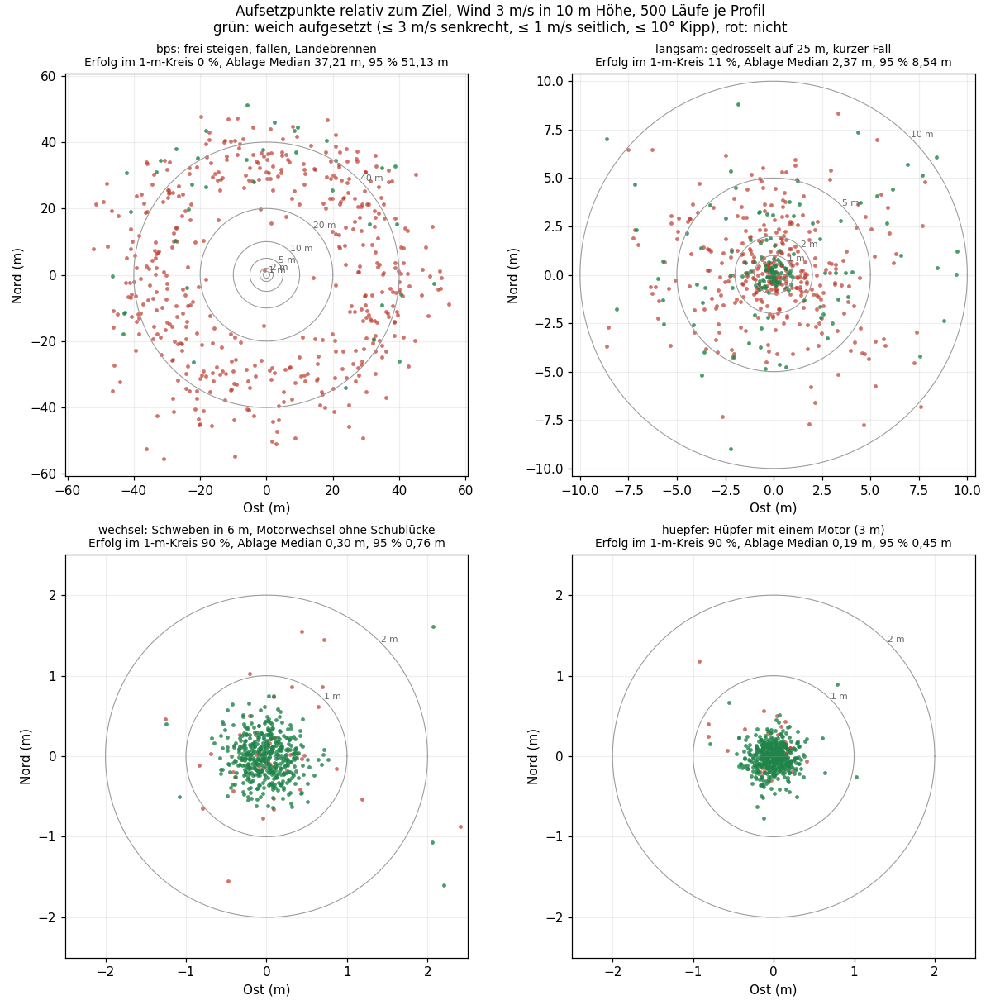
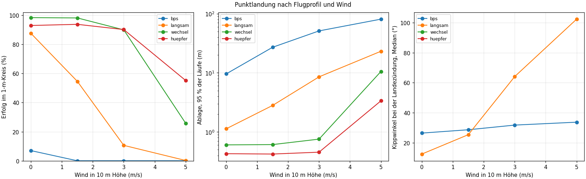
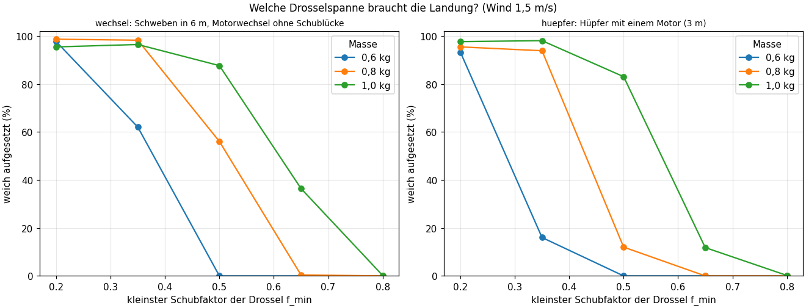
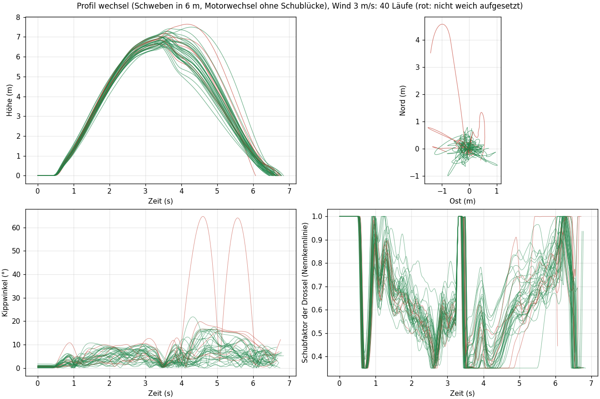
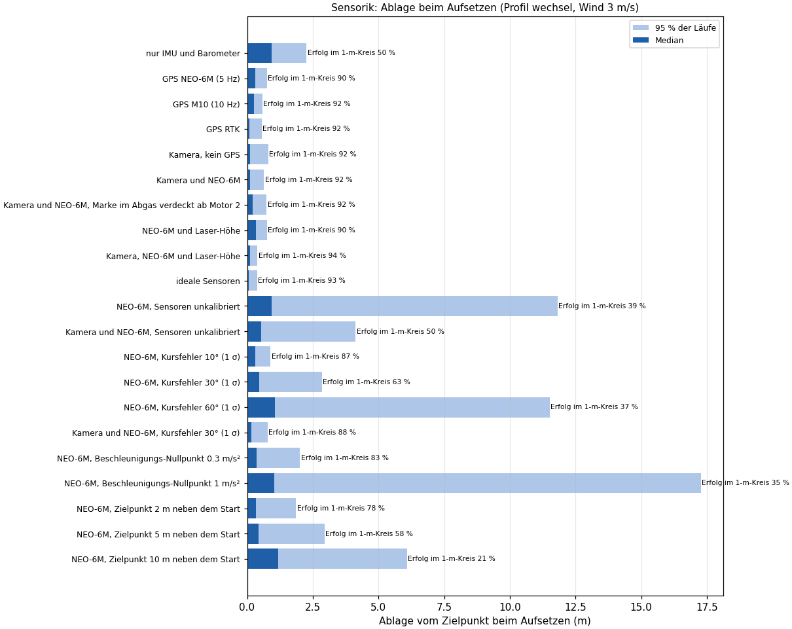

# Sensorfusion, Zustandsschätzung, Navigation und Punktlandung (15.11.2026)

Anlass: Jans Bitte, die Gedanken zu Sensorfusion, Zustandsschätzung und Navigation festzuhalten und zu
simulieren, ob GPS, Magnetometer und eventuell ein Kamerabild eine Landung mit TVC am Landeort möglich
machen: welche Schubreduzierung in welchem Maß, wie gut die Stabilisierung sein muss, auf welche Fläche man
sich begrenzen kann, mit Unsicherheiten in Brennkurve, Stellgliedern, Wind, Sensorrauschen und Kalibrierung.

Neu im Repository: `simulation/tvcsim/pinpoint.py` (6DOF-Monte-Carlo des ganzen Flugs mit Sensoren,
Schätzer und Führung), `simulation/scripts/pinpoint_study.py` (157 Szenarien), `simulation/tests/test_pinpoint.py`
(12 Tests). **Alle Zahlen sind Modellwerte.** Gemessen ist nichts davon; die Annahmen stehen in Abschnitt 3
und die, an denen das Ergebnis hängt, noch einmal in Abschnitt 6.

## 1. Ergebnis in Kürze

1. **Eine Punktlandung im 1-m-Kreis geht im Modell, wenn der Schub nie aussetzt.** Schwebt die Rakete in 6 m
   Höhe und übernimmt der zweite Motor, bevor der erste ausbrennt (Profil `wechsel`), oder fliegt sie einen
   3-m-Hüpfer auf einem Motor (`huepfer`), dann setzt sie bei 3 m/s Wind in 90 % der Läufe weich und im
   1-m-Kreis auf; die Ablage liegt im Median bei 0,2 bis 0,3 m, in 95 % der Läufe unter 0,8 m. Bei 1,5 m/s Wind
   sind es 98 % und 94 %.
2. **Das Profil nach Scout F (frei steigen, antriebslos über den Gipfel, Landebrennen) trifft den Punkt
   nicht.** Ohne Schub hat der Kardan keine Wirkung, und die finnenlose Rakete kippt weg: bei der
   Landezündung steht sie im Median 26 bis 34° schief, jeder zwanzigste Lauf über 120°. Bei 3 m/s Wind
   landet sie im Median 37 m neben dem Ziel. Auch das langsame Profil mit nur einer Sekunde freiem Fall
   schafft bei 3 m/s Wind nur 11 %.
3. **Schubreduzierung:** Die Pads müssen den Schub im Schwanz der Kurve auf höchstens das halbe Gewicht
   drücken können. Das heißt f_min ≈ 0,35 bei 0,8 bis 1,0 kg und f_min ≈ 0,2 bei 0,6 kg. Mit f_min 0,5 landet
   bei 0,8 kg nur noch gut die Hälfte weich, mit 0,65 keiner. Kippen als Ersatz für die Drossel taugt nicht.
4. **Stabilisierung:** Servo-Totzeit höchstens 30 ms (mit 50 ms 59 %, mit 80 ms 0 %), Kardanbereich ±5 bis ±8°,
   Nullstellung auf 1° genau, Bandbreite des Lagereglers wie heute (7 rad/s). Zwei Motoren nebeneinander im
   Kardan gehen nur, wenn sie schräg eingebaut sind und ihr Schub durch den Schwerpunkt zeigt (4.9); gerade
   eingebaut verbraucht der Schubversatz den Stellbereich.
5. **Sensorik:** Für 7 s Flug reichen IMU und Barometer allein für 0,9 m Ablage im Median (50 % im 1-m-Kreis).
   Das vorhandene GPS NEO-6M, auf den Startpunkt eingemessen, bringt 0,30 m und 90 %; eine Kamera mit
   Zielmarke 0,11 m. Das Magnetometer wird für den Kurs gebraucht, sobald GPS führt: 10° Kursfehler sind
   unkritisch, 30° kosten ein Drittel der Landungen. Ohne Kalibrierung der Sensoren fällt der Erfolg auf 39 %.
6. **Wind ist die größte einzelne Störung.** Bis 3 m/s hält die Rakete den Punkt, bei 5 m/s nicht mehr
   (26 % und 55 % im 1-m-Kreis).
7. **Nebenbefund für den Erstflug:** Mit dem aerodynamischen Moment im Modell verliert *Kartonaut 1* im
   Aufstieg ab 5 m/s Wind in 6 % der Läufe die Lage, ab 6 m/s in 20 %. Mit ±3,75° Kardanbereich (Fenster der
   Firmware bei Servo-Umrechnung 6) schon ab 4 m/s in 8 %. Bis 3 m/s bleibt der Kippwinkel unter 8°.



## 2. Gedanken zu Sensorfusion, Zustandsschätzung und Navigation

### 2.1 Was wir am 5.11.2026 besprochen und entschieden haben

| Frage | Überlegung | Entscheidung, Stand im Code |
|---|---|---|
| Steht die Sensorfusion schon? | Die Lage kam nur aus dem Gyro und driftete auf der Rampe; das Kalman-Filter für die Höhe traute dem Barometer kaum (30 m) und rechnete denselben Barometerwert in jedem Takt neu ein; das Magnetometer las der Flug-Code gar nicht | Siehe 2.2: alles drei geändert |
| Regeltakt | 100 Hz Regelung bei 250 Hz Servo-Pulsen gibt jeden Sollwert zwei- bis dreimal aus. Jans Punkt: die Servomechanik glättet ohnehin, also lieber schnell reagieren als elektronisch filtern | **250 Hz** für Regelung und Servos. Die Totzeit von der Messung zum Stellbefehl sinkt von 5 auf 2 ms. Der Engpass bleibt der Servo, nicht der Takt (`simulation/README.md`, Regeltakt) |
| Rauschen und Vibration | Das Sensorrauschen ist winzig und darf ungefiltert durch. Gefährlich sind Vibrationen: liest der Regler nur einen von 960 Messwerten je Sekunde, faltet sich eine 300-Hz-Schwingung zu einer scheinbar langsamen Drehung herunter, und die glättet kein Servo mehr | Gyro und Beschleunigung als **Mittel der FIFO-Werte über den 4-ms-Takt**; Tiefpass 30 Hz nur im D-Anteil; Begrenzung der Stellrate als Schutz |
| Lage im Flug stützen? | Unter Schub misst der Beschleunigungssensor den Schub und nicht die Schwerkraft, eine Korrektur nach Mahony oder Madgwick würde in der Brennphase stören. Das Magnetometer sitzt nahe an Servo- und Motorströmen | **Auf der Rampe** stützen Schwerkraft (Kippwinkel) und Magnetometer (Kurs) die Lage und lernen den Gyro-Nullpunkt; **ab dem Start nur der Gyro**. Das Magnetometer wird im Flug mitgeloggt |
| Wirkt die Servobewegung auf die Lage zurück? | Beschleunigt der Servo den Kardan, dreht der Rumpf dagegen, und der Gyro sieht das | Gerechnet: 2,4 % des Quer-Trägheitsmoments, Kippwinkel ändert sich um unter 0,05°, keine Rückkopplung (`scripts/rate_study.py`) |
| Logging | SD-Schreibpausen von 10 bis 100 ms dürfen den Regelkreis nicht anhalten | Ringpuffer im PSRAM, SD nur in freier Zeit, Flugschreiber im Flash |

### 2.2 Was heute im Flug-Code steht

| Größe | Wie | Datei |
|---|---|---|
| Lage | Quaternion Körper → Navigation, mit 250 Hz aus dem gemittelten Gyro fortgeschrieben; Startlage und Gyro-Nullpunkt aus 4 s Ruhe; `MahonyAid` stützt am Boden mit Beschleunigung und kalibriertem Magnetometer | `firmware/src/Attitude.*` |
| Höhe und Steiggeschwindigkeit | Kalman-Filter mit zwei Zuständen: Vorhersage jeden Takt mit der senkrechten Beschleunigung, Barometer nur bei neuem Wert (50 Hz, 0,5 m), Ausreißertor 5 σ gegen Druckstöße | `firmware/src/KalmanZ.*` |
| Schub | Betrag der Beschleunigung mal Masse, Tiefpass 95 ms | `firmware/src/ControlLaw.*` |
| Seitliche Position und Geschwindigkeit | **fehlt** | – |
| GPS | wird im Flug nicht gelesen; die Testkonsole liest NMEA | `examples/revb_test/Nmea.h` |

Für den Erstflug am Fallschirm genügt das: geregelt wird nur die Lage, und die braucht keine Position.

### 2.3 Was für die Navigation zum Landeort dazukommt

**Drei Ebenen.** Innen hält der Lageregler die Schubrichtung (250 Hz, Sekundenbruchteile). Darüber liegt die
Schätzung von Position und Geschwindigkeit. Außen entscheidet die Führung, wohin der Schub zeigen und wie
stark er sein soll. Bisher gibt es nur die innere Ebene und von der mittleren die Höhe.

**Warum Trägheitsnavigation allein nicht lange trägt.** Die seitliche Position entsteht aus der zweifach
integrierten Beschleunigung. Jeder konstante Fehler a wächst mit ½ a t². Ein Lagefehler von 0,3° dreht 0,05 m/s²
der Schwerkraft in die Waagerechte, ein Nullpunktfehler des Beschleunigungssensors von 5 mg wirkt genauso: nach
7 s sind das jeweils gut 1 m, nach 15 s fast 6 m. Die Simulation bestätigt die Größenordnung (0,94 m im Median
nach 6,6 s, 0,29 m nach 3,4 s). Für einen Hüpfer reicht die IMU, für alles Längere braucht es eine Stützung
von außen.

**Was jeder Sensor beiträgt:**

| Sensor | Misst | Fehler im Modell (1 σ) | Rolle |
|---|---|---|---|
| Gyro (LSM6DSV16X) | Drehrate, 250 Hz | Nullpunkt 0,03 °/s nach dem Abgleich auf der Rampe, Skala 0,3 %, Achsfehler 0,3°, Rauschen 0,05 °/s, unter Schub 0,3 °/s | Lage; ihr Fehler nach 7 s liegt im Modell bei 0,7° im Median |
| Beschleunigung | spezifische Kraft, 250 Hz | Nullpunkt 0,05 m/s² nach der Sechs-Lagen-Kalibrierung, Skala 0,3 %, unter Schub 1 m/s² Vibration | Vorhersage von Geschwindigkeit und Position, Schubschätzung, Startlage |
| Barometer (BMP390) | Höhe, 50 Hz | Rauschen 0,25 m, Nullpunkt 0,1 m, 5 % des Staudrucks als Höhenfehler | Höhe; in den letzten Metern zu grob, dort hilft ein Laser |
| Magnetometer (LIS3MDL) | Kurs, nur auf der Rampe | Rest nach dem Ellipsoid-Fit 1 µT bei 20 µT Horizontalfeld, Störfeld der Rampe 1 µT, Missweisung 1°: zusammen 4° Kursfehler | Verbindet die GPS-Koordinaten (Nord, Ost) mit den Körperachsen, in denen der Kardan stellt |
| GPS (NEO-6M) | Position und Geschwindigkeit, 5 Hz | langsam wandernder Fehler 1,5 m (Zeitkonstante 60 s), Rauschen 0,5 m und 0,1 m/s, Latenz 150 ms, Ausfall über 4 g | Hält die Position über Sekunden fest. Weil der Zielpunkt mit demselben Empfänger vor dem Start eingemessen wird, zählt nur, wie weit der Fehler während des Flugs wandert |
| Kamera mit Zielmarke | Richtung zur Marke im Körpersystem, 20 Hz | Winkelrauschen 0,4°, Einbaufehler 0,5°, Latenz 60 ms, Sichtfeld ±35°, Reichweite 40 m | Positionsfehler = Höhe × Winkelfehler: je tiefer, desto genauer, also genau dort gut, wo es zählt. Braucht keinen Kurs |
| Laser-Höhenmesser | Abstand zum Boden bis 8 m, 50 Hz | 3 cm | Höhe in der Endphase |

**Der Filter.** Je Achse (Ost, Nord, oben) ein Kalman-Filter mit drei Zuständen: Position, Geschwindigkeit
und Fehler der Beschleunigung. Vorhergesagt wird jeden Takt mit der ins Navigationssystem gedrehten
Beschleunigung; Barometer, GPS, Kamera und Laser korrigieren, wenn ein neuer Wert da ist, jeweils mit
Ausreißertor. Das ist `KalmanZ` aus der Firmware, auf drei Achsen und einen Zustand mehr erweitert, mit
geschlossenen Formeln für die 3×3-Kovarianz und ohne Matrizenbibliothek. Der dritte Zustand fängt beides
auf, was sich wie eine konstante Beschleunigung verhält: den Sensornullpunkt und den Anteil der Schwerkraft,
den ein kleiner Lagefehler in die Waagerechte dreht. Latenz wird mit der geschätzten Geschwindigkeit
ausgeglichen (GPS 150 ms, Kamera 60 ms; für die Kamera wird die Lage zum Aufnahmezeitpunkt benutzt).

Was dieser Filter nicht kann: den Lagefehler selbst schätzen und den Kurs im Flug aus GPS-Geschwindigkeit und
Beschleunigung nachführen. Das wäre ein Fehlerzustandsfilter über Lage, Geschwindigkeit und Position mit 15
Zuständen. Die Studie zeigt, dass er für Flüge von wenigen Sekunden nicht nötig ist; lohnen würde er sich für
lange Flüge oder wenn das Magnetometer am Startplatz unbrauchbar ist.

**Die Führung.** Senkrecht plant die Drossel mit der Schubkurve selbst: gesucht ist das in der Zeit lineare
Drosselprofil, das mit dem restlichen Schub des Motors Höhe null und 0,5 m/s Sinkrate zum geplanten Aufsetzen
kurz vor dem Brennschluss erreicht; gestellt wird der erste Wert, im nächsten Takt wird neu gerechnet. Für
konstanten Schub ist das die Zero-Effort-Miss-Regel aus `throttle.py`; mit der echten Kurve verschenkt sie
die Schubspitze nicht. Seitlich führt dieselbe Regel über den Kippwinkel auf den Zielpunkt: geforderte
Querbeschleunigung geteilt durch die Schubbeschleunigung gibt den Sollkippwinkel, begrenzt auf 15° und unter
3 m Höhe auf 6°, damit die Rakete aufrecht aufsetzt. Die Landezündung im Profil mit freiem Fall kommt aus einer
Tabelle Zündhöhe über Sinkrate, die das schlechteste Aufsetzen über einen schwachen und einen starken Motor
und einen kurzen und einen langen Zündverzug minimiert.

**Warum der Kurs zählt.** GPS misst in Nord und Ost, der Kardan stellt in Körperachsen. Ein Kursfehler ψ
dreht jeden Stellbefehl um ψ; ein Anteil sin ψ wirkt quer zur gewollten Richtung. Bis etwa 10° merkt die
Führung nichts, bei 30° schwingt sie um den Zielpunkt. Die Kamera misst dagegen schon im Körpersystem,
Messung und Stellbefehl teilen denselben Fehler, und er hebt sich auf.

## 3. Simulation: Modell und Annahmen

`tvcsim/pinpoint.py` rechnet alle Läufe eines Szenarios gleichzeitig als Felder (500 Flüge in etwa 5 s).
Koordinaten wie in der Firmware: Ost, Nord, oben; Körper-z zur Spitze.

**Wahrheit.** Starrkörper mit Quaternion, RK4 mit 4 ms. Zwei E12 mit gestreutem Gesamtimpuls und gestreuter
Brenndauer. Kardan und Pads als PT2 mit Totzeit, der Kardan mit Ratenbegrenzung, Verstärkungs- und
Nullpunktfehler. Wind mit Höhenprofil und Böen. Aerodynamik: Axialwiderstand, Querkraft der Spitze nach
Barrowman (im Rückwärtsfall eine kleinere am Heck), Queranströmwiderstand des Rumpfs; die Querkräfte greifen
an ihren Druckpunkten an, mit der örtlichen Anströmung einschließlich der Drehung (das gibt die Dämpfung).

| Streuung | Annahme (1 σ, sonst genannt) |
|---|---|
| Gesamtimpuls und Brenndauer je Motor | je 4 % |
| Zündverzug des Landemotors | 50 bis 200 ms gleichverteilt, die Führung rechnet mit 100 ms |
| Masse, Quer-Trägheitsmoment, Hebelarm | 10 g, 5 %, 5 mm |
| Schwerpunkt seitlich, Schiefstand auf der Rampe | 1,5 mm, 0,5° |
| Kardan: Verstärkung, Nullstellung, Totzeit, Eigenfrequenz | 5 %, 0,5° je Achse, 4 bis 30 ms, 40 bis 80 rad/s (Annahme W5652H bis SG90-Fit) |
| Pads: f_min, Kennlinie f = 1 − (1 − f_min) u^γ, Schubablenkung | 5 %, γ 0,7 bis 1,4, 1° bei voll eingeschwenkten Pads |
| Wind | Betrag vorgegeben (in 10 m Höhe), Richtung zufällig, Profil (z/10 m)^0,2, Böen 20 % als Gauß-Markov-Prozess mit 3 s |
| Aerodynamik | Spitze C_Nα = 2 je rad bei 0,62 m über der Düse, Seitenfläche 0,05 m² mit Cd 1,1 bei 0,36 m, Heck im Rückwärtsfall C_Nα 0,3 bis 2; Beiwerte ±15 %, Druckpunkte ±3 cm; Schwerpunkt 0,27 m |
| Sensoren | Tabelle in 2.3 |

**Erfolg** heißt: aufgesetzt mit höchstens 3 m/s Sinkrate, 1 m/s seitlich und 10° Kippwinkel, kein
Wiederabheben, und im genannten Radius um den Zielpunkt. „Weich“ ist dasselbe ohne den Radius.

**Flugprofile:**

| Profil | Ablauf | Masse, Drossel |
|---|---|---|
| `bps` | frei steigen (Gipfel 80 m), antriebslos über den Gipfel, Landezündung aus der Tabelle, Landebrennen mit seitlicher Führung | 0,60 kg, f_min 0,5 |
| `langsam` | gedrosselt mit höchstens 6 m/s auf 25 m, schweben bis zum Brennschluss, etwa 1 s fallen, Landebrennen | 0,60 kg, f_min 0,35 |
| `wechsel` | gedrosselt auf 6 m, schweben; Motor 2 zündet 0,35 s vor dem Brennschluss von Motor 1; Abstieg auf Motor 2. Der Schub setzt nie aus, der Flug dauert 6,6 s | 0,80 kg, f_min 0,35 |
| `huepfer` | ein Motor: gedrosselt auf 3 m, nach 1,3 s Landeführung auf demselben Motor, 3,4 s Flug | 0,80 kg, f_min 0,35 |

In allen gedrosselten Profilen führt die Rakete schon im Aufstieg seitlich auf den Zielpunkt.

**Nicht modelliert:** Fahrwerk und Umkippen nach dem Aufsetzen, Wiederabheben (wird nur als Zustand beim
Aufsetzen gezählt), Schwerpunktwanderung beim Abbrand, Wirkung des Abgasstrahls auf die Aerodynamik und auf
das Barometer am Boden, Hebelarm des Sensors zum Schwerpunkt, Versagen der zweiten Zündung, Erwärmung und
Abbrand der Pads.

## 4. Ergebnisse

Zahlen aus `python scripts/pinpoint_study.py --runs 500` (Seed 0). Ein Anteil aus 500 Läufen ist auf etwa
±2 bis ±4 Prozentpunkte genau.

### 4.1 Flugprofil und Wind

| Profil, Wind in 10 m | Gipfel | Kipp bei Landezündung 50 / 95 % | Ablage bei Landezündung 50 % | Erfolg ≤ 1 m | weich | Ablage 50 / 95 % | Sinkrate 50 / 95 % |
|---|---|---|---|---|---|---|---|
| `bps`, 0 m/s | 81 m | 26° / 124° | 3,0 m | 7 % | 14 % | 1,6 / 9,6 m | 2,0 / 9,3 m/s |
| `bps`, 1,5 m/s | 79 m | 29° / 120° | 16 m | 0 % | 1 % | 16 / 27 m | 1,9 / 9,4 m/s |
| `bps`, 3 m/s | 77 m | 32° / 134° | 31 m | 0 % | 8 % | 37 / 51 m | 2,0 / 11,3 m/s |
| `bps`, 5 m/s | 73 m | 34° / 135° | 49 m | 0 % | 16 % | 62 / 81 m | 1,9 / 11,5 m/s |
| `langsam`, 0 m/s | 18 m | 12° / 28° | 0,3 m | 88 % | 92 % | 0,40 / 1,13 m | 1,4 / 2,4 m/s |
| `langsam`, 1,5 m/s | 18 m | 25° / 48° | 0,4 m | 55 % | 61 % | 0,63 / 2,81 m | 1,4 / 3,1 m/s |
| `langsam`, 3 m/s | 18 m | 64° / 105° | 1,1 m | 11 % | 29 % | 2,4 / 8,5 m | 1,5 / 6,2 m/s |
| `langsam`, 5 m/s | 18 m | 102° / 149° | 4,2 m | 0 % | 33 % | 11 / 23 m | 1,6 / 8,9 m/s |
| `wechsel`, 0 m/s | 7 m | 3° / 5° | 0,1 m | **98 %** | 98 % | 0,28 / 0,60 m | 1,7 / 2,6 m/s |
| `wechsel`, 1,5 m/s | 7 m | 3° / 5° | 0,1 m | **98 %** | 98 % | 0,28 / 0,61 m | 1,7 / 2,6 m/s |
| `wechsel`, 3 m/s | 7 m | 4° / 9° | 0,3 m | **90 %** | 91 % | 0,30 / 0,76 m | 1,7 / 2,7 m/s |
| `wechsel`, 5 m/s | 7 m | 9° / 11° | 1,0 m | 26 % | 65 % | 2,3 / 10,5 m | 1,8 / 2,8 m/s |
| `huepfer`, 0 m/s | 3 m | – | – | **93 %** | 93 % | 0,18 / 0,43 m | 1,7 / 2,8 m/s |
| `huepfer`, 1,5 m/s | 3 m | – | – | **94 %** | 94 % | 0,19 / 0,42 m | 1,7 / 2,9 m/s |
| `huepfer`, 3 m/s | 3 m | – | – | **90 %** | 91 % | 0,19 / 0,45 m | 1,7 / 2,9 m/s |
| `huepfer`, 5 m/s | 3 m | – | – | 55 % | 84 % | 0,64 / 3,36 m | 1,7 / 3,0 m/s |



### 4.2 Warum der freie Fall die Lage kostet

Zwei Zahlen erklären das Bild:

- **Vorwärts im Flug ist die finnenlose Rakete instabil.** Die Querkraft der Spitze greift 35 cm vor dem
  Schwerpunkt an. Bei 25 m/s gibt das 1,2 N·m je rad Anstellwinkel, so viel wie die Lagerückführung der
  Firmware (Kp entspricht 1,15 N·m/rad), und ohne Schub wächst ein Kippfehler mit einer Zeitkonstante von 0,1 s.
  Der Kardan bringt im Schwanz der Kurve höchstens 11 N × 0,2 m × sin 5° = 0,19 N·m auf; das reicht für 9°
  Anstellwinkel, und 3 m/s Seitenwind bei 25 m/s Fahrt sind schon 7°.
- **Bei wenig Fahrt drückt der Seitenwind die Spitze weg.** Die Seitenfläche des Rumpfs liegt mit ihrem
  Schwerpunkt 9 cm über dem Massenschwerpunkt, der tief sitzt (37 % der Länge). 3 m/s Wind geben 0,3 N und
  0,027 N·m; ohne Schub sind das nach 1 s rund 40° Kippwinkel. Deshalb reicht selbst die eine Sekunde freier
  Fall im Profil `langsam` nicht.

Unter Schub hält der Kardan beides. Daraus folgt die Regel dieser Studie: **nie ohne Schub fliegen, und
langsam fliegen**, denn das störende Moment wächst mit Fahrt mal Seitenwind, das Stellmoment mit dem Schub.
Die Seitenfläche tiefer zu legen (Beine als Leitwerk) senkt den Kippwinkel bei der Landezündung im Profil
`langsam` von 64° auf 19°, rettet aber die Landung nicht (27 % im 1-m-Kreis); im Profil `bps` wird es
schlechter, weil die Rakete dann im Steigflug nach Brennschluss umschlägt (Block G der Studie).

### 4.3 Schubreduzierung: welche Form, wie viel

Anteil weicher Landungen bei 1,5 m/s Wind:

| f_min | `wechsel` 0,6 kg | `wechsel` 0,8 kg | `wechsel` 1,0 kg | `huepfer` 0,6 kg | `huepfer` 0,8 kg | `huepfer` 1,0 kg |
|---|---|---|---|---|---|---|
| 0,2 | 98 % | 99 % | 95 % | 93 % | 95 % | 98 % |
| 0,35 | 62 % | **98 %** | **96 %** | 16 % | **94 %** | **98 %** |
| 0,5 | 0 % | 56 % | 88 % | 0 % | 12 % | 83 % |
| 0,65 | 0 % | 0 % | 36 % | 0 % | 0 % | 12 % |
| 0,8 | 0 % | 0 % | 0 % | 0 % | 0 % | 0 % |



- **Das Maß:** Der Schwanz der E12 schiebt mit 11 N. Weich wird es, wenn f_min · 11 N höchstens etwa das
  halbe Gewicht ist: 0,8 kg wiegen 7,8 N, also f_min ≤ 0,35; 0,6 kg wiegen 5,9 N, also f_min ≤ 0,27. „Knapp
  unter dem Gewicht“ reicht nicht, weil die Rakete in der festen Brenndauer auch wieder herunter muss, weil
  die Schubspitze von 28 N selbst gedrosselt noch anschiebt und weil ein starker Motor 10 % mehr bringt.
  Nach oben braucht es 11 N ≥ 1,1 × Gewicht, sonst fehlt das Bremsvermögen; 1,0 kg ist die Grenze.
- **Schwerer hilft:** Jedes Zehntel Kilogramm senkt den Bedarf an Drosselspanne. Bei 1,0 kg genügt f_min 0,5 für
  83 bis 88 %. Das ist die Gegenrichtung zum Leichtbau des Erstflugs.
- **Tempo und Kennlinie der Pads sind unkritisch:** mit 15 statt 37 rad/s Eigenfrequenz 96 statt 98 %, mit
  80 ms statt 30 ms Totzeit 97 %. Die Kennlinie war mit γ zwischen 0,7 und 1,4 gestreut; die Führung schließt
  den Kreis über den gemessenen Schub.
- **Andere Formen:** Nur der Zündzeitpunkt (f_min 1) gibt 0 % weiche Landungen, wie in der 1D-Studie vom 23.10.
  Kippen als Drossel bringt cos 15° = 3 % und bräuchte 60° für die Hälfte. Bleiben Pads oder ein anderer
  Eingriff in den Strahl, mehr Masse, oder ein Motor mit flacherer Kurve und niedrigerem Schwanz.
- **Preis der Drossel:** Das Stellmoment des Kardans ist Schub mal Hebelarm mal Winkel. Gedrosselt auf ein
  Drittel hat der Kardan ein Drittel der Wirkung. Im Aufstieg mit 15 m/s und 3 m/s Seitenwind überschlug sich
  die Rakete im Modell, sobald die Drossel zuging. Gedrosselt fliegen heißt deshalb langsam fliegen (im Profil
  höchstens 4 bis 6 m/s).

### 4.4 Wie gut die Stabilisierung sein muss

Profil `wechsel`, 3 m/s Wind, Bezug 90 % im 1-m-Kreis:

| Änderung | Erfolg ≤ 1 m | Ablage 95 % | Kardan am Anschlag |
|---|---|---|---|
| Kardan ±3° / ±5° (Bezug) / ±8° / ±12° | 66 / 90 / 91 / 78 % | 5,4 / 0,76 / 0,73 / 1,6 m | 45 / 20 / 15 / 19 % |
| Servo-Totzeit 4 / 30 / 50 / 80 ms | 92 / 84 / 59 / 0 % | 0,73 / 0,94 / 2,7 / 7,9 m | 14 / 32 / 61 / 96 % |
| Nullfehler des Kardans 0,2 / 1 / 2° | 90 / 84 / 65 % | 0,74 / 1,5 / 16 m | 19 / 23 / 34 % |
| Bandbreite des Lagereglers 4 / 7,4 (Bezug) / 11 rad/s | 54 / 90 / 20 % | 3,1 / 0,76 / 5,0 m | 8 / 20 / 86 % |
| Stellrate am Kardan 50 statt 150 °/s | 65 % | 2,4 m | 42 % |
| Gyro-Vibration 1 / 3 °/s statt 0,3 | 90 / 89 % | 0,76 / 0,81 m | 20 / 21 % |
| Kippgrenze im Landebrennen 8 / 15 (Bezug) / 25° | 83 / 90 / 93 % | 1,7 / 0,76 / 0,68 m | 19 / 20 / 22 % |
| Überlappung beim Motorwechsel 0,2 / 0,35 (Bezug) / 0,5 / 0,7 s | 91 / 90 / 86 / 53 % | | |
| zwei Motoren nebeneinander (je 12,5 mm neben der Achse), Kardan ±5° / ±12° | 3 / 28 % | 21 / 5,7 m | 71 / 34 % |

Lesart:

- **Die Servo-Totzeit ist die härteste Anforderung.** Bis 30 ms ist alles gut, bei 50 ms steht der Kardan 61 %
  der Zeit am Anschlag, bei 80 ms ist die Schleife instabil. Der SG90-Fit liegt bei 30 ms, die W5652H sind
  nicht vermessen: Experiment E01 entscheidet, ob eine Landung überhaupt in Reichweite ist.
- **Die Bandbreite hat ein Fenster.** Langsamer als heute verliert gegen den Wind, schneller schwingt mit
  Totzeit und Servodynamik auf. Die Gewinne der Bayes-Optimierung (Kp 2 / Ki 1 / Kd 0,45 bei 0,021 kg·m²,
  mit dem Trägheitsmoment skaliert) liegen richtig.
- **Kardanbereich ±5 bis ±8°.** ±3° reicht nicht gegen 3 m/s Wind; ±12° ist mit 150 °/s Stellrate schlechter,
  weil der Servo große Ausschläge nicht schnell genug fährt.
- **Lage halten heißt hier: Kippwinkel unter etwa 10° im Schwebeflug** (95 % der Läufe), davon bis 6° gewollt,
  denn gegen 3 m/s Wind muss die Rakete 2° schräg stehen, gegen 5 m/s 6°. Die Gyro-Lage selbst ist nach 7 s
  auf 0,7° genau (95 %: 1,7°); Vibration am Gyro bis 3 °/s je Takt ändert nichts.
- **Zwei Motoren nebeneinander** stehen je 12,5 mm neben der Kardanachse und verlangen 3,6° Trimm, beim
  Wechsel mit umgekehrtem Vorzeichen. Das geht mit diesem Regler nicht. Abschnitt 4.9 rechnet die Auswege:
  schräg eingebaute Motoren, deren Schub durch den Schwerpunkt zeigt, vorgesteuerter Trimm, oder Motoren
  hintereinander.



### 4.5 Sensorik und Kalibrierung

Profil `wechsel`, 3 m/s Wind:

| Sensorsatz | Erfolg ≤ 1 m | ≤ 2 m | Ablage 50 / 95 % | Navigationsfehler 50 / 95 % |
|---|---|---|---|---|
| nur IMU und Barometer | 50 % | 87 % | 0,94 / 2,26 m | 0,95 / 2,14 m |
| GPS NEO-6M, 5 Hz (vorhanden) | **90 %** | 90 % | 0,30 / 0,76 m | 0,30 / 0,66 m |
| GPS u-blox M10, 10 Hz | 92 % | 92 % | 0,25 / 0,59 m | 0,24 / 0,52 m |
| GPS mit RTK | 92 % | 92 % | 0,10 / 0,55 m | 0,02 / 0,05 m |
| Kamera mit Zielmarke, kein GPS | 92 % | 93 % | 0,11 / 0,81 m | 0,04 / 0,23 m |
| Kamera und NEO-6M | 92 % | 94 % | 0,12 / 0,65 m | 0,05 / 0,22 m |
| Kamera und NEO-6M, Marke ab Motor 2 im Abgas verdeckt | 92 % | 93 % | 0,20 / 0,74 m | 0,17 / 0,37 m |
| Kamera, NEO-6M und Laser-Höhe | 94 % | 94 % | 0,12 / 0,39 m | 0,04 / 0,19 m |
| ideale Sensoren | 93 % | 94 % | 0,05 / 0,39 m | 0,02 / 0,18 m |
| NEO-6M, Sensoren unkalibriert | 39 % | 42 % | 0,94 / 11,8 m | 0,48 / 4,0 m |
| Kamera und NEO-6M, Sensoren unkalibriert | 50 % | 56 % | 0,54 / 4,1 m | 0,34 / 2,7 m |
| NEO-6M, Kursfehler 10° / 30° / 60° | 87 / 63 / 37 % | | 0,32 / 0,46 / 1,07 m (Median) | |
| Kamera und NEO-6M, Kursfehler 30° | 88 % | 89 % | 0,16 / 0,78 m | |
| NEO-6M, Nullpunkt der Beschleunigung 0,3 / 1,0 m/s² | 83 / 35 % | | 0,35 / 1,03 m (Median) | |
| NEO-6M, Zielpunkt 2 / 5 / 10 m neben dem Start | 78 / 58 / 21 % | | 0,35 / 0,43 / 1,17 m (Median) | |



- **Das vorhandene GPS genügt für den 1-m-Kreis**, wenn der Zielpunkt vor dem Start mit demselben Empfänger
  eingemessen wird und der Flug kurz ist. Es drückt den Navigationsfehler von 0,95 auf 0,30 m. Ein besserer
  Empfänger bringt wenig, RTK macht die Navigation perfekt, aber nicht die Landung: die restlichen 7 % sind
  Wind und Stellglieder.
- **Die Kamera bringt die Ablage auf 0,1 m** und macht GPS und Kurs entbehrlich. Sie hilft auch dann, wenn
  das Abgas die Marke im Abstieg verdeckt, weil sie die Position vorher festlegt.
- **Der Laser** senkt die Sinkrate in 95 % der Läufe von 2,7 auf 2,2 m/s; an der Ablage ändert er nichts.
- **Das Magnetometer** muss den Kurs auf etwa 10° liefern. Dafür ist die Kalibrierung an der Werkbank
  (Ellipsoid-Fit) nötig und ein Blick auf den Stahl der Rampe; roh liegt es weit daneben.
- **Kalibrierung ist keine Kür:** Mit Datenblatt-Toleranzen (Nullpunkt 0,3 m/s², Skala 1 %, Achsfehler 1°,
  Magnetometer roh) fällt der Erfolg von 90 auf 39 %.
- **Beim Hüpfer** (3,4 s) ist die IMU allein so gut wie mit GPS (92 gegen 90 %); mit Kamera 93 % und 0,10 m.
- **Seitlich versetzen** geht im 6,6-s-Flug bis etwa 2 m gut (78 %), 5 m nur noch in 58 % der Läufe.

### 4.6 Was die Streuung treibt

Profil `wechsel`, 3 m/s Wind, je eine Gruppe abgeschaltet:

| Fall | Erfolg ≤ 1 m | Ablage 50 / 95 % | Sinkrate 95 % | seitlich 95 % |
|---|---|---|---|---|
| alles an | 90 % | 0,30 / 0,76 m | 2,7 m/s | 1,2 m/s |
| ohne Wind | 98 % | 0,28 / 0,60 m | 2,6 m/s | 0,6 m/s |
| ohne Motorstreuung | 93 % | 0,30 / 0,75 m | 2,4 m/s | 1,0 m/s |
| ohne Stellgliedfehler | 92 % | 0,30 / 0,73 m | 2,6 m/s | 0,9 m/s |
| ohne Massen- und Schwerpunktfehler | 90 % | 0,30 / 0,67 m | 2,7 m/s | 1,2 m/s |
| ohne Streuung der Aerodynamik | 92 % | 0,30 / 0,69 m | 2,7 m/s | 1,2 m/s |
| ideale Sensoren | 93 % | 0,05 / 0,39 m | 2,3 m/s | 0,9 m/s |
| nur Wind, sonst alles nominal | 98 % | 0,05 / 0,15 m | 1,6 m/s | 0,3 m/s |

Der Wind entscheidet, ob eine Landung gelingt (seitliche Geschwindigkeit beim Aufsetzen); die Sensoren
entscheiden, wie nah am Punkt (Ablage); die Motorstreuung bestimmt die Sinkrate. Keine Gruppe allein kippt das
Ergebnis: Wind allein, mit sonst nominaler Rakete, gibt 98 %.

### 4.7 Auf welche Fläche man sich begrenzen kann

Mit 2000 Läufen je Fall gerechnet:

| Profil, Wind | Ablage 50 % | 90 % | 95 % | 99 % | größte | weiter als 2 m |
|---|---|---|---|---|---|---|
| `wechsel`, 1,5 m/s | 0,29 m | 0,55 m | 0,63 m | 0,82 m | 3,8 m | 0,1 % |
| `wechsel`, 3 m/s | 0,31 m | 0,62 m | 0,83 m | 2,6 m | 6,6 m | 1,8 % |
| `wechsel`, 3 m/s, mit Kamera | 0,11 m | 0,27 m | 0,49 m | 2,0 m | 6,4 m | 1,1 % |
| `huepfer`, 1,5 m/s | 0,20 m | 0,36 m | 0,42 m | 0,53 m | 0,9 m | 0 % |
| `huepfer`, 3 m/s | 0,20 m | 0,38 m | 0,46 m | 1,06 m | 3,4 m | 0,2 % |

- **Landefläche:** ein Kreis mit 1 m Radius fängt 95 % der Landungen bis 3 m/s Wind, mit Kamera 0,5 m.
  Für 99 % sind es 2,6 m (`wechsel`) und 1,1 m (`huepfer`).
- **Sicherheitsbereich** ist etwas anderes: die schlechtesten Läufe enden 3 bis 7 m neben dem Ziel, aus höchstens
  7 m Flughöhe. Ein Absperrradius von 15 bis 20 m um den Startpunkt deckt diese Profile ab. Im Profil `bps`
  wären es 80 m und mehr.
- **Wind:** bis 3 m/s in 10 m Höhe. Bei 5 m/s reicht die zulässige Schräglage nicht mehr, um den Punkt zu
  halten.

### 4.8 Nebenbefund: Erstflug im Wind

*Kartonaut 1* (704 g, ein Motor, keine Drossel, Regler wie die Firmware), nur der Aufstieg. Gipfel im Modell
63 m bei 22 m/s Brennschlussgeschwindigkeit.

| Wind in 10 m | Kipp im Brennen (95 %), Kardan ±5° | Läufe mit Kipp > 30° | mit Kardan ±3,75°: Kipp (95 %) | Läufe mit Kipp > 30° |
|---|---|---|---|---|
| 0 m/s | 5° | 0 % | | |
| 2 m/s | 6° | 0 % | 6° | 0 % |
| 3 m/s | 7° | 0 % | 8° | 0 % |
| 4 m/s | 11° | 0 % | 168° | 8 % |
| 5 m/s | 63° | 6 % | 177° | 28 % |
| 6 m/s | 174° | 20 % | | |
| 8 m/s | 177° | 56 % | | |

Ohne das aerodynamische Moment im Modell bleibt der Kippwinkel bei 4 m/s Wind unter 6°; so hatten die bisherigen
Studien gerechnet. Der Unterschied ist die Querkraft der Spitze, die 35 cm vor dem Schwerpunkt angreift und
mit Fahrt mal Seitenwind wächst. **Empfehlung für den Erstflug: nicht über 3 m/s Wind starten** und am
gebauten Kardan nachmessen, wie viel Ausschlag wirklich zur Verfügung steht (Experiment E01/E02). Nach dem
Brennschluss kippt die Rakete in jedem Fall; das ist beim Flug am Fallschirm ohne Folgen, erklärt aber, warum
der Schirm nicht lange nach dem Gipfel warten sollte.

### 4.9 Zwei Motoren: wie sie eingebaut sein müssen

Jan hat am 15.11.2026 entschieden, dass die erste Landung mit zwei Motoren fliegen soll. Das Profil `wechsel`
setzt voraus, dass der zweite Motor schon im Kardan sitzt, wenn der erste ausbrennt. Block H der Studie
vergleicht, wie das gehen kann (je 500 Läufe, Erfolg im 1-m-Kreis):

| Einbau | Wind 1,5 m/s | Wind 3 m/s | Ablage bei 3 m/s (50 / 95 %) | Kardan am Anschlag (3 m/s) |
|---|---|---|---|---|
| Schubachsen auf der Kardanachse (Bezug, so nicht baubar) | 98 % | 90 % | 0,30 / 0,76 m | 20 % |
| nebeneinander (je 12,5 mm neben der Achse), gerade, Kardan ±5° | 4 % | 3 % | 5,7 / 21 m | 71 % |
| nebeneinander, gerade, Trimm vorgesteuert, Kardan ±5° | 34 % | 25 % | 2,1 / 13 m | 60 % |
| nebeneinander, gerade, Trimm vorgesteuert, Kardan ±8° | 86 % | 71 % | 0,37 / 3,5 m | 26 % |
| nebeneinander, gerade, Trimm vorgesteuert, Kardan ±12° | 85 % | 63 % | 0,44 / 3,7 m | 24 % |
| nebeneinander, gerade, Trimm vorgesteuert, Kardan ±12°, Stellrate 300 statt 150 °/s | 98 % | 93 % | 0,31 / 0,81 m | 9 % |
| **nebeneinander, schräg durch den Schwerpunkt (je 3,6°), Kardan ±5°** | **97 %** | **86 %** | 0,34 / 1,09 m | 21 % |
| **nebeneinander, schräg durch den Schwerpunkt, Kardan ±8°** | **98 %** | **90 %** | 0,32 / 0,85 m | 17 % |
| hintereinander, Zündkommando beim Nenn-Brennschluss von Motor 1 | 98 % | 90 % | 0,34 / 1,19 m | 21 % |
| hintereinander, Zündkommando 0,2 s später | 87 % | 69 % | 0,44 / 1,77 m | 33 % |

Lesart:

- **Gerade nebeneinander geht nicht ohne Weiteres.** Jeder Motor schiebt 12,5 mm neben der Kardanachse und
  verlangt 12,5 mm / 200 mm = 3,6° Trimm; beim Wechsel springt der Trimm auf −3,6°. Mit ±5° bleiben dem Regler
  1,4°. Stellt der Regler den Trimm aus Nennkurve und Zündzeit vor, hilft das erst mit ±12° Ausschlag **und**
  doppelt so schnellem Servo (93 % bei 3 m/s Wind); mit ±12° und der heutigen Stellrate ist es schlechter als
  mit ±8°.
- **Schräg eingebaut ist die einfachste Lösung.** Zeigen beide Schubachsen durch den Schwerpunkt (jeder Motor
  um 3,6° zur Mitte geneigt), entsteht kein Moment, und der Kardan behält seinen Bereich. Übrig bleibt eine
  Querkraft von 6 % des Schubs, die beim Wechsel die Seite tauscht; die Rakete gleicht sie aus, indem sie sich
  3,6° gegenlehnt. Im Modell kostet das gegenüber dem idealen Fall nichts (98 und 90 % mit ±8°, 97 und 86 % mit
  ±5°). Der Winkel passt nur zu einer Schwerpunktlage; 5 mm Fehler im Hebelarm sind in der Streuung enthalten.
- **Hintereinander wie bei Scout F** (die leere Hülse fällt heraus, der zweite Motor sitzt darüber) geht im
  Modell ebenso gut, wenn das Zündkommando ohne Verzug zum Brennschluss kommt: die Rakete ist dann etwa 0,3 bis
  0,5 s ohne tragenden Schub. 0,2 s mehr kosten 10 bis 20 Prozentpunkte. Nicht modelliert ist, ob die Hülse
  in dieser Zeit wirklich aus dem Weg ist und was der Abwurf mit Masse und Schwerpunkt macht; das ist die
  riskantere Mechanik.

Offen und zu konstruieren: ein Kardan für zwei Motoren (128 g statt 64 g am Kardan, rund 52 mm breit; ob er mit
±5 bis ±8° Ausschlag im Rohr mit 75 mm Platz hat, zeigt erst das CAD), die Pads unter zwei Düsen, und der
Schwerpunkt der Landeversion, nach dem sich der Einbauwinkel richtet.

## 5. Anforderungen aus der Studie

| Größe | Anforderung | Woher |
|---|---|---|
| Flugprofil | Schub ohne Lücke von der Rampe bis zum Aufsetzen (höchstens 0,3 bis 0,5 s ohne tragenden Schub); Steig- und Sinkgeschwindigkeit höchstens 4 bis 6 m/s | 4.1, 4.2, 4.9 |
| Zwei Motoren | nebeneinander und je 3,6° zur Mitte geneigt, so dass der Schub durch den Schwerpunkt geht; Zündung des zweiten 0,2 bis 0,5 s vor dem Brennschluss des ersten | 4.4, 4.9 |
| Drosselspanne | kleinster Schub ≤ halbes Gewicht: f_min ≤ 0,35 bei 0,8 bis 1,0 kg | 4.3 |
| Masse bei der Landung | 0,8 bis 1,0 kg mit der E12 (Schwanz 11 N: 1,1- bis 1,4-faches Gewicht) | 4.3 |
| Pads | Eigenfrequenz ≥ 15 rad/s, Totzeit ≤ 80 ms; Kennlinie darf ±30 % krumm sein | 4.3 |
| Servo am Kardan | Totzeit ≤ 30 ms, Stellrate ≥ 150 °/s am Kardan | 4.4 |
| Kardan | ±5 bis ±8°, Nullstellung auf ≤ 1° | 4.4 |
| Lageregler | Bandbreite 7 rad/s (heutige Gewinne, mit dem Trägheitsmoment skaliert) | 4.4 |
| Gyro, Beschleunigung | kalibriert: Nullpunkt ≤ 0,1 m/s², Skala und Achsen auf 0,3 % und 0,3° | 4.5 |
| Kurs | ≤ 10° aus dem kalibrierten Magnetometer, falls GPS führt | 4.5 |
| Position | NEO-6M auf den Startpunkt eingemessen genügt für 1 m; Kamera für 0,5 m | 4.5, 4.7 |
| Wind | ≤ 3 m/s in 10 m Höhe | 4.1 |
| Fahrwerk | 3 m/s senkrecht, 1 m/s seitlich, 10° Schräglage | Erfolgskriterium |
| Landefläche | Radius 1 m (95 %), Absperrung 15 bis 20 m | 4.7 |

## 6. Woran das Ergebnis hängt

1. **Aerodynamik.** Die Querkraft der Spitze (C_Nα = 2, Barrowman) und die Lage der Seitenfläche über dem
   Schwerpunkt tragen die Aussagen in 4.2 und 4.8. Beides ist Lehrbuch, aber nicht gemessen; im
   Rückwärtsfall ist das Modell eine grobe Annahme. Der Erstflug misst es: Drehrate und Lage in den Sekunden
   nach dem Brennschluss, bevor der Schirm kommt.
2. **Servo.** Totzeit und Stellrate der W5652H am gebauten Kardan (E01). Über 30 ms Totzeit ist die Landung
   in diesem Modell nicht zu halten.
3. **Pads.** f_min 0,35 ist tiefer, als ich es ohne Messung einer Mechanik zutrauen würde; E05 misst die
   Kennlinie. Ob die Pads 7 s im Strahl überstehen, ist offen.
4. **Motorwechsel.** Das Profil `wechsel` verlangt zwei Motoren, die gleichzeitig im Kardan sitzen und deren
   Schub durch den Schwerpunkt geht (4.9). Der Kardan dafür ist nicht konstruiert, und ob er ins Rohr passt,
   ist offen. Ebenso offen: ob der zweite Motor zuverlässig und im Zeitfenster zündet; ein Versager ist im
   Modell nicht enthalten und heißt Absturz aus 6 m.
5. **Wind am Boden.** Gerechnet ist ein Profil mit Böen von 20 %; hinter Hindernissen ist der Wind unruhiger.
6. **GPS im Flug.** Das Modell lässt den NEO-6M unter 4 g durchlaufen. In den gedrosselten Profilen bleibt die
   Beschleunigung unter 2 g; ob der Empfänger dabei sauber nachführt, zeigt erst ein Versuch.
7. **Kamera.** Angenommen ist eine nach unten blickende Kamera, die die Marke an Bord findet und nur die
   Richtung meldet. An `J_CAM` hängt bisher nur ein Auslöser für eine Aufzeichnung.

## 7. Nachrechnen

```bash
cd simulation
python -m pytest tests/test_pinpoint.py            # 12 Tests, 20 s
python scripts/pinpoint_study.py                   # alle Blöcke, 300 Läufe je Szenario, 2 bis 5 Minuten
python scripts/pinpoint_study.py --runs 500        # die Zahlen dieses Dokuments
python scripts/pinpoint_study.py --blocks A F      # nur Flugprofile und Erstflug
python scripts/pinpoint_study.py --list            # Szenarien auflisten
```

Ausgaben in `simulation/out/`: `pinpoint_study.csv`, `pinpoint_profiles.png`, `pinpoint_wind.png`,
`pinpoint_throttle.png`, `pinpoint_sensors.png`, `pinpoint_flight.png`. Eigene Fälle:

```python
from tvcsim.pinpoint import profile, run, summarize
res = run(profile("huepfer", wind10=2.0, cam=True, f_min=0.4), n=500, seed=1)
print(summarize(res))
```

## 8. Vorschlag für die Reihenfolge

> **Nachtrag vom selben Tag:** Jan hat die Anordnung nebeneinander verworfen (Platz, Kardanweg) und zieht die
> Motoren hintereinander vor; der Hüpfer ist wieder als erster Landeversuch im Gespräch. Punkt 4 und 5 sind
> ersetzt durch [Motorwechsel_und_Huepfer_2026-11-15.md](Motorwechsel_und_Huepfer_2026-11-15.md).

1. **Erstflug am Fallschirm wie geplant**, bei höchstens 3 m/s Wind. Das Log liefert die Aerodynamik nach dem
   Brennschluss, die Schubstreuung der E12 und das Verhalten des GPS.
2. **E01 an den W5652H** (Totzeit, Stellrate) und **E05** (Kennlinie der Pads). Diese beiden Messungen
   entscheiden, ob die Anforderungen aus Abschnitt 5 erreichbar sind.
3. **Firmware:** `KalmanZ` auf drei Achsen mit Fehlerzustand erweitern, GPS im Flug lesen und auf den
   Startpunkt einmessen, seitliche Führung; alles gegen `pinpoint.py` als Software-in-the-Loop prüfen wie
   bisher den Lageregler.
4. **Erste Landung mit zwei Motoren** (Jans Entscheidung vom 15.11.2026): Profil `wechsel`, Schweben in 6 m,
   6,6 s Flug, 0,8 kg, beide E12 schräg nebeneinander im Kardan (4.9). Dafür zu konstruieren: Kardan für zwei
   Motoren, Pads unter beiden Düsen, Fahrwerk; zu messen: Zündverzug des Anzünders (das Fenster für den
   Wechsel ist 0,2 bis 0,5 s breit).
5. Der Hüpfer mit einem Motor (3 m, 3,4 s) bleibt als Vorversuch möglich: derselbe Regler, dieselbe Drossel,
   ohne zweite Zündung. Er wäre der Flug mit dem kleinsten Risiko für Drossel, Führung und Fahrwerk.
