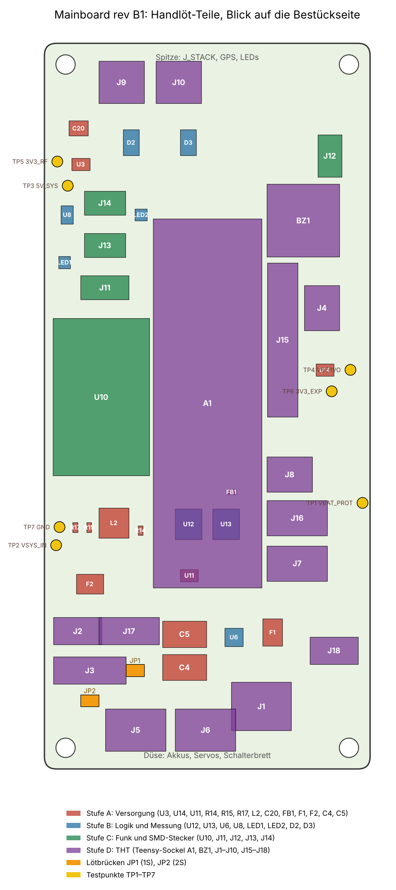

# Teil II: Platine rev B1 bestücken, prüfen, in Betrieb nehmen

<p class="subtitle">Handlöt-Teile in vier Stufen, Multimeter-Prüfung nach jeder Stufe, danach die Tests mit der Testkonsole
<code>revb_test</code>, der Flug-Firmware und der Bordzündung · Stand 28.10.2026 · gehört zur Bauanleitung
<em>Kartonaut 1</em> (Teil I) und wird mit ihr in ein PDF gebaut</p>

Die Platine kommt von JLCPCB mit 30 bestückten SMD-Positionen (alle Passiven, Dioden, FETs, Shunt, Hold-up-Elkos,
TPS63070, IMU LSM6DSV16X, Barometer BMP388, DRV8833, LIS3MDL, SHT40). Alles andere lötest du selbst: 26 SMD-Teile
und 16 THT-Teile. Diese Anleitung sagt, in welcher Reihenfolge, was du nach jeder Stufe mit dem Multimeter prüfst, und
welche Prüfungen danach die Firmware übernimmt. Quellen: `hardware/mainboard/Bestellung_JLCPCB_2026-10-26.md` §2,
`hardware/mainboard/Beschaffung_2026-10-26.md` §6a/6b, `hardware/mainboard/README.md` §3–§9,
`firmware/Tischtest_revB1.md`, `firmware/Versuche_revB1.md` (V01–V12), `docs/Plan_Bordzuendung_2026-10-27.md` §6.

**Grundregel:** Erst messen, dann einschalten, dann flashen. Nach jeder Stufe eine Prüfung; ein Wert daneben heißt
anhalten und das Bauteil suchen, nicht weiterlöten.

[TOC]

## 1. Was ankommt, was fehlt, was das für die Reihenfolge heißt

| Quelle | Inhalt | Stand 28.10. |
|---|---|---|
| JLCPCB W2026102623077325 | 5 Platinen, 2 davon bestückt mit 30 Positionen (§2.1 der Bestellung). **BMP388 statt BMP390** (CHIP_ID 0x50, Firmware erkennt beide) | in Fertigung, Ankunft um den 4.–6.11. |
| DigiKey 102484398 | alle Handlöt-Teile aus §4 außer E22, Teensy-Leisten (Sullins 1×24) und Summer | erste Sendung unterwegs. **Rückstand:** INA239 (U6) und JST-GH-4 (J11) am 2.11., **130 k (R15) am 9.11.** |
| AliExpress | E22-400T22S ×3 (zwei Platinen, eins Funkbrücke) | noch nicht bestellt (`Beschaffung` §6c) |
| Bestand | Teensy 4.1, Stiftleisten, Summer, Schiebeschalter, microSD, Lötzubehör, Multimeter, Labornetzteil | vorhanden |

Folgen für die Reihenfolge:

- **Ohne R15 (130 k) läuft der TPS63070 nicht** (Rückkopplungsteiler 680 k / 130 k, 5V_SYS = 0,8 V · (1 + 680/130) =
  4,98 V). Kommt die 130 k erst am 9.11., nimm ersatzweise **133 k** (E96, 0603) aus dem Sortiment: 4,89 V, innerhalb
  des Sollbereichs 4,85–5,15 V. 120 k gäbe 5,33 V, das ist für die LDOs noch gut, liegt aber außerhalb des
  Prüfbereichs und am Rand für den Teensy-VIN (bis 5,5 V): nicht nehmen.
- **Ohne U6 (INA239)** fehlen Strom- und Busspannung; `ina*` meldet `FEHL`, `cal ina` entfällt, der Servo-Selbsttest
  der Bordzündung prüft den Strom erst, wenn `SERVO_TEST_MIN_A` > 0 steht (heute 0). Alles andere ist prüfbar.
- **Ohne J11** kein GPS-Stecker; V11 wartet. Kein Einfluss auf den Rest.
- **Ohne E22** keine Funkprüfung (V10) und keine Bordzündung am Tisch; alles bis V09 geht.

## 2. Werkzeug, Material, Vorsicht

| Was | Wofür |
|---|---|
| Lötkolben mit feiner Spitze (0,8–1,2 mm), 320–350 °C, bleifreies Lot 0,5 mm, **Flussmittel-Gel**, Entlötlitze | SMD 0603 bis TSSOP, E22-Randpads |
| Lupe oder USB-Mikroskop, Pinzette, Isopropanol | Pin-1-Kontrolle, Brücken zwischen TSSOP-Pins, Reinigung |
| Heißluft (optional) | WS2812B-2020 (2 × 2 mm), Nacharbeit |
| Multimeter: Gleichspannung 20 V, Strom 2 A, Widerstand, Diodentest mit Piepser | alle Prüfungen in §3, §5, §6 |
| Labornetzteil mit zwei Kanälen und Strombegrenzung | 1S (4,0 V) und 2S (7,4 V), Begrenzung zuerst 100 mA |
| Kabel: JST-PH 2 (J2), XT30 (J1), JST-XH 2 (J4, J9), JST-XH 3 (J5, J7), USB Micro-B | Versorgung, ARM-Brücke, Lämpchen, Last, Teensy |
| Glühlampe 12 V / 5 W mit XH-2-Stecker, Leistungswiderstand 22 Ω / 5 W mit XH-3-Stecker, 1 Ω / 5 W für die Bordzündung | Pyro-Last, INA-Last, Ersatzlast Startpuls. **Nie ein Anzünder, nie eine Ladung auf dem Tisch.** |
| ESD-Matte oder zumindest Erdung am Netzteilgehäuse | IMU, Barometer, Funkmodul |

Vorsicht:

- Polymer-Elkos C4/C5 (7343) haben **die Markierung am Pluspol** (anders als Alu-Elkos). Plus liegt an VSERVO.
- Der Teensy läuft nur bei versorgtem 1S-Zweig; USB liefert Daten, keine Versorgung (D1 trennt). Neustart = 1S aus/ein.
- Die VIN–VUSB-Brücke auf dem Teensy bleibt geschlossen (B11).
- Bei jedem ersten Einschalten einer Stufe: Strombegrenzung 100 mA, Strom ablesen, dann erst Spannungen messen.

## 3. Eingangsprüfung der gelieferten Platine (vor dem ersten Lötpunkt)

1. **Sichtprüfung** mit Lupe, gegen die Platzierungsbestätigung (`Bestellung_JLCPCB_2026-10-26.md` §4): Pin 1 von
   U2 (VQFN, Punkt), U4 (LGA-14, Punkt), U5 (LGA-10), U7 (HTSSOP-16, Punkt oder Fase); Kathodenstrich von D1 (SS14)
   zur Seite TEENSY_VIN und von D4 (SOD-123) zu BZ_NEG; keine verschobenen oder stehenden Teile („Grabstein“), keine
   Lotbrücken an U2 und U7, kein Flussmittelrest unter den LGA.
2. **Kurzschlusstest ohne Spannung**, Multimeter im Diodentest, schwarze Spitze an TP7 GND. Erwartet wird jeweils
   **kein Piepser**; ein Wert unter 0,1 V heißt Kurzschluss:

| Rote Spitze an | Soll (Diodentest, V) | Was dahinter liegt |
|---|---|---|
| TP3 5V_SYS | > 0,3, langsam steigend (Kondensatoren laden) | TPS63070-Ausgang, 3 × 22 µF, WS2812-Zweig |
| TP2 VSYS_IN | > 0,3 | TPS63070-Eingang, R330k/115k |
| TP1 VBAT_PROT | > 0,3 | 2S-Pfad hinter Q6, Teiler |
| TP4 VSERVO | > 0,3 | Servo-Schiene, DRV8833 |
| Teensy-Sockel-Pad „3.3V“ | > 0,3 | 3V3-Zweig: FB1 fehlt noch, also nur die Teensy-Seite |
| J2 Pin 1 gegen J2 Pin 2 | > 0,3 | 1S-Eingang mit Verpolschutz Q2 |
| J1 Pin 1 gegen J1 Pin 2 | > 0,3 | 2S-Eingang mit Verpolschutz Q1 |

Alles frei: weiter mit Stufe A. Ein Kurzschluss auf 5V_SYS oder VSERVO vor dem ersten Löten ist ein Bestückungsfehler
von JLCPCB (Foto, Reklamation), nicht deiner.

## 4. Bestückungsplan der Handlöt-Teile



Blick auf die Bestückseite, Spitze (J_STACK, GPS, LEDs) oben, Düse (Akkus, Servos, Schalterbrett) unten. Farben =
Lötstufen aus §5. Lötbrücken JP1/JP2 orange, Testpunkte gelb. Erzeugt von `docs/platine/bestueckungsplan.py` aus
der Platinendatei; die Teilegrößen sind grob, die Lage stimmt.

| Stufe | Ref | Teil | Gehäuse | Worauf achten |
|---|---|---|---|---|
| A | R14, R15, R17 | 680 k, 130 k (oder 133 k), 115 k | 0603 | Rückkopplung (R14/R15) und Einschaltschwelle (R17) des TPS63070; Werte nicht vertauschen |
| A | L2 | 1,5 µH, Isat ≥ 4 A | 5040 | keine Polung; beide Pads gut benetzen, die Spule sitzt im Buck-Boost-Pfad |
| A | U3, U14 | AP2112K-3.3 | SOT-23-5 | Pin 1 links unten bei der Beschriftung; U3 = 3V3_RF, U14 = 3V3_EXP |
| A | C20 | 100 µF / 6,3 V | 1210 | keramisch, keine Polung; Ausgang 3V3_RF |
| A | FB1 | Ferrit 600 Ω | 0603 | keine Polung; verbindet 3V3 (Teensy) mit 3V3_SENS (IMU, Barometer) |
| A | U11 | MCP73831T-2ACI | SOT-23-5 | 1S-Lader; Pin 1 wie U3 |
| A | F2 | Polyfuse 2 A | 1812 | keine Polung; 1S-Pfad |
| A | F1 | Polyfuse 3 A / 6 A | 1812 | keine Polung; 2S-Pfad, auch Zündstrom |
| A | C4, C5 | 330 µF / 16 V Polymer | 7343 | **Strich = Plus**, Plus an VSERVO (Richtung Shunt), Minus an GND_PWR |
| A | J2, J1 | JST-PH 2 (1S), XT30PW-M (2S) | THT | schon in Stufe A, damit V01 am Stecker läuft; Pin 1 = Plus (Markierung im Bestückungsdruck) |
| B | U12 | 74HC138PW | TSSOP-16 | Pin 1 (Punkt) zur Markierung; Pins mit Flussmittel schleppen, dann mit Litze entbrücken |
| B | U13 | 74HC4051PW | TSSOP-16 | wie U12; Analogmux |
| B | U6 | INA239AIDGSR | VSSOP-10 | Pin 1 zur Markierung; Rückstand bis 2.11. |
| B | U8 | SN74LV1T34DBVR | SOT-23-5 | Pegelwandler für die LED-Kette |
| B | LED1, LED2 | WS2812B-2020 | 2020 | Pin-1-Ecke abgeschrägt, Datenrichtung LED1 → LED2 → J14; heiß lieber mit Heißluft |
| B | D2, D3 | SMAJ12CA | SMA | bidirektional, keine Polung; TVS über Pyro 1 und 2 |
| C | U10 | E22-400T22S | SMD-Modul, 26 Randpads | Pin 1 laut Bestückungsdruck; erst zwei gegenüberliegende Eckpads heften, Lage prüfen, dann alle; ANT-Pad bleibt frei bis die Wendel kommt, IPEX frei |
| C | J11 | JST-GH 4 (GPS) | SMD 1,25 mm | Rückstand bis 2.11.; Nase der Buchse nach außen |
| C | J12 | JST-SH 4 (Qwiic) | SMD 1,0 mm | Belegung Qwiic: GND, 3V3, SDA, SCL |
| C | J13, J14 | JST-GH 3 (Kamera, LEDs) | SMD 1,25 mm | 5V_SYS, Signal, GND |
| D | A1 | 2 × Buchsenleiste 1×24, 8,5 mm | THT | gerade und parallel: Teensy mit Stiftleisten als Lehre einstecken, dann löten (§5.5) |
| D | BZ1 | Summer 5 V, 12 mm, RM 7,6 | THT | Plus (langes Bein, Markierung) an 5V_SYS = Pin 1 |
| D | J3 | JST-PH 4 (Schalterbrett) | THT | 1 SW1_G, 2 GND, 3 SW2_G, 4 GND_PWR |
| D | J17, J18 | JST-PH 3 (USB-C-Lader), JST-PH 2 (2S-Laden) | THT | J17: 1 VBUS, 2 GND, 3 Lade-LED (Kathode) |
| D | J4, J8 | JST-XH 2 stehend (Arming, Rollmotor) | THT | J4: 1 VBAT_PROT, 2 VBAT_ARMED |
| D | J5, J6 | JST-XH 3 (TVC-Servos) | THT | DigiKey liefert B3B (stehend) statt S3B (liegend): Kabel gehen nach oben; S / + / − |
| D | J7, J16 | JST-XH 3 stehend (Fallschirm-Servo, Beine) | THT | S / + / − |
| D | J9, J10 | JST-XH 2 liegend (Pyro 1, 2) | THT | 1 VBAT_ARMED, 2 PYROn_NEG; J9 ist der Startkanal der Bordzündung |
| D | J15 | Stiftleiste 2×10 | THT | Pin 1 (Quadrat) an GND |

## 5. Löten in vier Stufen

Reihenfolge innerhalb jeder Stufe: kleine SMD zuerst, dann große SMD, THT zuletzt. Nach jeder Stufe Flussmittel
abwaschen, mit der Lupe auf Brücken sehen, dann die Prüfung der Stufe.

### 5.1 Stufe A: Versorgung (R14, R15, R17, L2, U3, U14, C20, FB1, U11, F2, F1, C4, C5, J2, J1)

Erst die drei Widerstände am TPS63070 (sie liegen eng an U2), dann L2, die beiden LDOs und C20, FB1, U11, die
Polyfuses, zuletzt die beiden Polymer-Elkos und die zwei Akkustecker.

**Prüfung A1, ohne Spannung** (Diodentest gegen TP7 wie in §3): TP3, TP2, TP1, TP4 und zusätzlich **TP5 3V3_RF** und
**TP6 3V3_EXP** jeweils > 0,3 V und kein Piepser. Widerstand J2 Pin 1 gegen TP2 VSYS_IN: hochohmig (Q7 ist aus, kein
JP1).

**Prüfung A2, 1S-Zweig** (Versuch V01 ohne Teensy): Netzteil 4,0 V, 100 mA an J2 (Pin 1 Plus), **JP1 brücken**
(Lötbrücke oder Schalter an J3 Pin 1–2).

| Messung | Soll | Hinweis |
|---|---|---|
| Strom 1S | < 60 mA | mehr: sofort aus, Kurzschluss oder verdrehtes SOT-23 |
| TP2 VSYS_IN | 4,0 V minus < 0,1 V | hinter Q2 und Q7 |
| TP3 5V_SYS | 4,85–5,15 V | TPS63070 läuft; fehlt die Spannung: R14/R15/R17 prüfen (R17 ist die EN-Schwelle 3,1 V) |
| TP5 3V3_RF | 3,20–3,40 V | U3 |
| TP6 3V3_EXP | 3,20–3,40 V | U14 |
| JP1 öffnen | TP2 fällt auf 0 V | Lastschalter Q7 trennt |
| Netzteil auf 3,0 V | TP3 bleibt 4,85–5,15 V | Boost-Betrieb; unter 2,7 V schaltet EN ab |

**Prüfung A3, 2S-Zweig**: Netzteil 7,4 V, 100 mA an J1 (Pin 1 Plus), **JP2 brücken** (oder J3 Pin 3–4).

| Messung | Soll |
|---|---|
| Strom 2S | < 10 mA (nur Teiler) |
| TP1 VBAT_PROT | 7,4 V minus < 0,1 V (hinter Q1, F1, Q6) |
| TP4 VSERVO | VBAT_PROT minus < 0,05 V (hinter dem Shunt) |
| JP2 öffnen | TP1 fällt auf 0 V |

**Prüfung A4, 1S-Lader**: 1S-Akku (oder Netzteil 3,8 V, 1 A) an J2, **5,0 V an J17 Pin 1 (VBUS) gegen Pin 2**, Strom
im VBUS-Zweig messen: **450–550 mA** (R_PROG 2 k), J17 Pin 3 (CHG_STAT) liegt beim Laden tief (< 0,5 V), nach dem
Ende hochohmig. Am Netzteil statt Akku: Spannung auf 3,8 V stellen, der Lader liefert dann den vollen Strom.

### 5.2 Stufe B: Logik und Messung (U12, U13, U6, U8, LED1, LED2, D2, D3)

Erst die beiden TSSOP (Pin-1-Punkt zur Markierung, einen Pin heften, Lage prüfen, dann mit Flussmittel durchziehen
und Brücken mit Litze abnehmen), dann U6 und U8, die beiden LEDs (Heißluft oder sehr kurz mit feiner Spitze),
zuletzt D2/D3.

**Prüfung B1, ohne Spannung**: Diodentest TP3 5V_SYS und Teensy-Pad „3.3V“ gegen TP7 weiterhin frei; **jedes
TSSOP-Pinpaar** mit der Lupe auf Brücken; Durchgang (Widerstand) VSERVO (TP4) gegen VBAT_PROT (TP1): **< 1 Ω** (Shunt
20 mΩ). Das Multimeter zeigt hier die Leitungen, nicht den Shunt.

**Prüfung B2, mit 1S** (JP1, 4,0 V): Strom weiterhin < 60 mA; TP3 unverändert. Die WS2812B ziehen ohne Daten etwa
1 mA je Stück und bleiben dunkel.

Alles Weitere an Stufe B prüft die Firmware (V02 Mux, V06 INA239, V12 LEDs), weil die Bausteine am Teensy hängen.

### 5.3 Stufe C: Funk und SMD-Stecker (U10, J11, J12, J13, J14)

E22: Lötpaste oder vorverzinnte Pads, Modul auflegen, Pin 1 laut Bestückungsdruck, zwei gegenüberliegende Eckpads
heften, Lage prüfen, dann alle 26 Pads mit Flussmittel. Das ANT-Pad bleibt frei, bis die Wendel aus den HC-12-Modulen
dran kommt (Plan Bordzündung); **nie ohne Antenne senden**. Danach die vier kleinen Stecker.

**Prüfung C1, ohne Spannung**: Diodentest TP5 3V3_RF gegen TP7 frei (das E22 hängt an 3V3_RF). Durchgang E22-Pad
GND gegen TP7: 0 Ω.

**Prüfung C2, mit 1S**: Strom 1S steigt um etwa **12–15 mA** (E22 im Empfang, M0 = M1 = 0 ohne Teensy über die
Pull-downs). TP5 bleibt 3,20–3,40 V.

### 5.4 Stufe D: THT (A1, BZ1, J3, J4, J5–J10, J15, J16, J17, J18)

Erst den Teensy-Sockel (§5.5), dann die niedrigen Stecker (PH, XH stehend), dann XH liegend, die Stiftleiste J15 und
zuletzt den Summer. Beine kurz schneiden, bevor die Platine auf den Schlitten kommt.

**Prüfung D1, ohne Spannung, Teensy noch nicht gesteckt**: Durchgang vom Sockel gegen die Testpunkte:

| Sockel-Pad (Teensy-Beschriftung) | gegen | Soll |
|---|---|---|
| GND (neben USB) | TP7 | 0 Ω |
| VIN | TP3 5V_SYS | Diodentest 0,2–0,4 V (D1, rote Spitze an TP3) |
| 3.3V | Pad U4 Versorgung (3V3_SENS, über FB1) | < 1 Ω |
| 5V (VUSB) | TP3 | hochohmig (D1 sperrt; die VIN-VUSB-Brücke verbindet VUSB nur mit VIN) |
| J15 Pin 1 | TP7 | 0 Ω; Pin 3 gegen TP6 3V3_EXP 0 Ω; Pin 4 gegen TP3 0 Ω |
| J4 Pin 1 | TP1 VBAT_PROT | 0 Ω; Pin 2 (VBAT_ARMED) gegen TP1 hochohmig |
| J9 Pin 1 | J4 Pin 2 | 0 Ω (VBAT_ARMED); J9 Pin 2 gegen TP7 hochohmig (FET aus) |
| J5 Pin 2 (+) | TP4 VSERVO | 0 Ω; Pin 3 gegen TP7 0 Ω |
| BZ1 Plus | TP3 | 0 Ω |

### 5.5 Teensy vorbereiten und stecken

1. Zwei Stiftleisten 1×24 an den Teensy löten (Stifte nach unten, erst je einen Eckpin, Ausrichtung prüfen).
2. **VIN–VUSB-Brücke nicht trennen** (B11; D1 trennt die 5V_SYS vom USB).
3. Die beiden Buchsenleisten auf die Stifte des Teensy stecken, das Paket in die Platine setzen, Teensy-USB zeigt
   zur Spitze (Bestückungsdruck „USB“), je einen Eckpin der Buchsenleisten löten, Sitz prüfen, Rest löten. Teensy
   abziehen, Flussmittel waschen.
4. Vor dem ersten Stecken: Prüfung D1. Dann Teensy stecken, noch ohne USB, 1S einschalten (100 mA): Strom
   **80–150 mA** (Teensy 4.1 bei 600 MHz ohne Firmware etwa 100 mA). Danach USB stecken; der Teensy meldet sich
   als Gerät, auch ohne unsere Firmware.

## 6. Multimeter-Übersicht: Messpunkt, Zustand, Soll

Alle Spannungen gegen TP7 GND. „1S“ = 4,0 V am J2 mit JP1, „2S“ = 7,4 V am J1 mit JP2.

| Messpunkt | Zustand | Soll | Funktion, die das belegt |
|---|---|---|---|
| Strom 1S | ohne Teensy / mit Teensy / mit E22 und Teensy | < 60 mA / 80–150 mA / 100–170 mA | Versorgung, kein Kurzschluss |
| Strom 2S | ohne Last | < 10 mA | 2S-Pfad, Teiler, INA239 |
| TP2 VSYS_IN | 1S | 1S minus < 0,1 V | Verpolschutz Q2, Polyfuse F2, Lastschalter Q7 |
| TP3 5V_SYS | 1S, auch bei 3,0 V | 4,85–5,15 V | TPS63070 mit L2, R14, R15, R17 |
| TP5 3V3_RF | 1S | 3,20–3,40 V | U3, C20; Funk und GPS |
| TP6 3V3_EXP | 1S | 3,20–3,40 V | U14; Zusatzplatinen |
| Teensy 3.3V | 1S, Teensy gesteckt | 3,25–3,35 V | Teensy-Regler; über FB1 die Sensoren |
| TP1 VBAT_PROT | 2S | 2S minus < 0,1 V | Q1, F1, Q6 |
| TP4 VSERVO | 2S | TP1 minus < 0,05 V | Shunt, C4/C5 |
| J4 Pin 2 VBAT_ARMED | 2S, Schalter/Brücke an J4 ein | = TP1 | Arming-Pfad, Mux-Kanal 6 |
| J9 Pin 1 | wie oben | = TP1 | Pyro 1 Plus |
| J9 Pin 2 | ARM ein, Lämpchen gesteckt, kein Puls | ≈ TP1 (über das Lämpchen) | Durchgangsmessung: Sense > 80 % von ARM |
| J9 Pin 2 | während `pyro 1 500` | < 0,5 V | FET Q3 schaltet |
| J17 Pin 1 → Strom | 5 V eingespeist, 1S-Akku | 450–550 mA | Lader U11 |
| J17 Pin 3 | beim Laden | < 0,5 V | Lade-LED-Ausgang |
| J2 Pin 1 ↔ Mux | `mux` in der Konsole | Multimeter ± 0,05 V | Teiler und ADC (V02) |
| TP1 Min/Max | während `pyro 1 500` mit Lämpchen | Einbruch < 0,5 V | 2S-Pfad unter Last (V09) |
| TP1 Min/Max | Startpuls mit 1-Ω-Ersatzlast (§7.5) | Einbruch und F1-Verhalten protokollieren | Plan Bordzündung §2.1, §9 |

## 7. Tests mit Code

### 7.1 Am PC, bevor die Platine da ist

Das sind die Prüfungen der CI; sie laufen ohne Hardware und sagen, ob der Stand im Repo in sich stimmt:

```bash
cd firmware
python tools/check_board_pins.py            # Pins in BoardRevB.h gegen kicad/circuit.py
pio test -e native                          # 66 native Tests (Zustandsautomat, Pyro, Bordzündung, Protokoll)
python tools/run_native_tests.py            # dieselben Tests mit g++, ohne PlatformIO
python -m pytest -q tools/test_bench_test.py        # Parser von bench_test.py
g++ -std=c++17 -I lib/mainboard_revb test/host/test_lsm6dsv16x.cpp -o /tmp/t && /tmp/t   # IMU-Kern
g++ -std=c++17 -I lib/calstore test/host/test_calstore.cpp -o /tmp/t && /tmp/t           # Kalibrierblock
pio run -e revb_test && pio run -e revb_bringup && pio run -e teensy41_revb              # bauen
cd .. && python -m pytest -q tools/ground           # Laptop-Protokoll gegen die Firmware-Testvektoren
pio run -d tools/ground/bridge_pico                 # Funkbrücke
```

Alles grün? Dann ist alles, was folgt, Hardware.

### 7.2 Testkonsole `revb_test`: Reihenfolge und was jede Prüfung belegt

Flashen: `cd firmware && pio run -e revb_test -t upload` (oder `python tools/bench_test.py --flash`). Konsole:
`pio device monitor` (115200 Bd) oder `bench_test.py`, das die Befehle anstößt und den Bericht nach
`firmware/test_reports/` schreibt. Jeder Befehl endet mit `END <befehl> OK|FEHL|SKIP`; `SKIP` heißt „Voraussetzung
fehlt“ (kein 2S, nicht scharf, DNP), nie „kaputt“. Vollständige Sollwerte und Protokollfelder: `Versuche_revB1.md`.

| Nr. | Versuch | Versorgung, Aufbau | Befehl | Ergebniszeilen | Soll (Kurzfassung) |
|---|---|---|---|---|---|
| V01 | Versorgung ohne Teensy | 1S, 2S, JP1/JP2 | `python tools/bench_test.py` fragt die Testpunkte ab | Bericht `rails` | wie §6 |
| V02 | Mux, ADC-Teiler | 1S, 2S, J4-Brücke, Lämpchen an J9/J10 | `mux`, `cal adc`, `cal save` | `mux_gnd`, `mux_vbat1/2`, `mux_arm`, `mux_pyro1..4`, `cal_adc4/5/6` | GND < 0,05 V; Akkus ± 0,05 V; ARM „SCHARF“ nur mit Brücke; Pyro „Durchgang“ mit Lämpchen; Faktor 0,98–1,02 |
| V03 | IMU LSM6DSV16X | 1S, Platine flach, ruhig | `imu`, `cal gyro 30`, `cal acc`, `cal save` | `imu_whoami` 0x70, `imu_config`, `imu_rate`, `imu_rest`, `imu_selftest_gyro/acc` | 860–1060 Hz; \|a\| 9,0–10,6 m/s², \|ω\| < 5 °/s; Selbsttest 20–80 °/s und 0,05–1,7 g je Achse |
| V04 | Magnetometer, Achsen | 1S-Akku (kein Netzteilkabel) | `mag`, `cal mag 40`, `cal axes`, `cal save` | `mag_whoami` 0x3D, `mag_selftest`, `cal_mag_*`, `cal_axes_*` | Feldbetrag 0,3–0,6 G, Residuum klein, Achszuordnung eindeutig |
| V05 | Barometer, SHT40 | 1S | `baro`, `sht`, `cal baro 20` | `baro1` (Chip-ID 0x50 = BMP388), `baro2` SKIP (DNP), `sht_serial`, `sht_read` | Druck 950–1050 hPa, Temperatur ± 2 K zum Thermometer |
| V06 | INA239 | 1S, 2S, 22 Ω an J7 Pin 2–3 | `ina`, `ina load`, `cal ina`, `cal save` | `ina_id` 0x5449, `ina_bus`, `ina_load` | Bus = 2S ± 0,1 V; 0,30–0,38 A bei 22 Ω; Offset < 20 mA |
| V07 | Servos | 1S, 2S (1 A), W5652H an J5/J6 | `servo 1 center`, `servo 1 sweep`, `cal servo 1` … | `servo` | läuft im Fenster aus `Config.h`, Strom am Netzteil plausibel |
| V08 | Rollmotor | 2S (3 A), Motor an J8 | `motor` | `motor_pulse`, `motor_nfault_idle/run` | zwei Pulse, nFAULT hoch |
| V09 | Pyro mit Lämpchen | 2S (3 A), Schalter an J4, Lämpchen an J9 | `pyro 1 500` (`JA`), `pyro 2 500`, `pyro 1 80` | `pyro` | ohne ARM/ohne Lämpchen `SKIP`; Sense im Puls < 30 %, danach > 80 %; Einbruch TP1 < 0,5 V |
| V10 | LoRa | 1S, Antenne am E22, Funkbrücke am Laptop | `lora` | `lora_aux`, `lora_config`, `lora_ping` | Register laut `Config.h` (Kanal 23, 9,6 kbit/s); Ping/Pong mit RSSI |
| V11 | GPS | 1S, NEO-6M an J11, draußen | `gps` | `gps_nmea`, `gps_fix` | NMEA-Sätze, Fix mit ≥ 4 Satelliten |
| V12 | SD, Timing, Watchdog, Signal | 1S, microSD | `sd`, `timing`, `watchdog`, `watchdog fire`, `led`, `buzzer`, `cam` | `sd_init/write/read`, `timing_loop`, `watchdog_feed`, `watchdog_reset` | ≥ 1 MB/s; keine Überläufe bei 100 Hz; Banner nach dem Neustart |

Kurzform: `python tools/bench_test.py --skip-rails` (V02–V06, V12 ohne Rückfragen), dann `--full` (mit Aktoren) und
`--cal` (Kalibrierung, endet mit `cal save`). Pyro nur einzeln über `--commands "pyro 1 500"`.

### 7.3 Kalibrierung sichern

Am Ende von V02–V06: `cal show`, dann 1S aus und ein, wieder `cal show`: die Werte müssen wiederkommen, das Banner
meldet „Kalibrierung ok“. Erst damit lädt die Flug-Firmware beim Start die Werte (Versionsnummer und CRC-32 im
EEPROM-Emulat).

### 7.4 Flug-Firmware `teensy41_revb`

`pio run -e teensy41_revb -t upload`, Konsole mit `pio device monitor`:

| Schritt | Eingabe | Erwartet |
|---|---|---|
| Start | 1S ein | Banner „Kartonaut Flug-Firmware, Board rev B“, Kalibrierung geladen, IMU ok, Baro ok; 4 s Kalibrierung, Kipp < 2° auf dem Tisch |
| Status | `?` | Zustand SAFE, kalibriert 1, ARM/Durchgang entsprechend Schalter und Lämpchen, Akkus wie Multimeter; zweite Zeile „Start: Vorbedingungen …“ |
| Kalibrieren | `c` | Nullpunkte neu, Ausgabe „Kalibriert: Gyro-Bias … Bodendruck …“ |
| Pad | `r` | PAD_READY (grün), die TVC-Servos zucken 1,5 s (Selbsttest), Logging läuft (`LOG_DATA = true` und microSD) |
| Zurück | `s` | SAFE (blau) |
| Abbruch | `a` | ABORT (rot), dann `s` |
| Teleplot | `PLOT_STATE`, `PLOT_ELECTRICS` in `Config.h` | Zustand, \|a\|, Akkus, Strom als Kurven |
| Watchdog | `WDT_ENABLED`, Loop blockieren (Debug) | Neustart nach 250 ms, in PAD_READY Wiederaufnahme mit Flag RESTORED |

### 7.5 Bordzündung am Tisch (Plan Bordzündung §6, mit Ersatzlast)

Voraussetzungen: E22 mit Antenne auf der Platine, Funkbrücke (Pico + E22) am Laptop, Schlüssel erzeugt
(`python tools/ground/launch.py --new-key`, Firmware danach neu geflasht), Arming-Schalter oder Brücke an J4,
**Ersatzlast 1 Ω / 5 W (oder 12-V-Lampe) an J9**, microSD, `LOG_DATA = true`. Kein Anzünder, kein Motor.

1. `python tools/ground/launch.py --port … --config`: Brücke meldet die E22-Register wie die Rakete.
2. `python tools/ground/launch.py --port …`: Telemetrie `SAFE`, Flags `ARM Durchgang1` nach dem Einschalten der
   Brücke an J4.
3. `r` → PAD_READY, Servotest. `a` → ARM: erst ohne Brücke an J4 probieren: der Laptop nennt „Arming-Schalter“ als
   fehlende Bedingung. Mit Brücke: `SCHARF`, Summer im Sekundentakt.
4. `l`, `START`, Enter → COUNTDOWN 5 s, Summer schnell, letzte Sekunde Dauerton, dann IGNITION: Puls auf J9 bis
   300 ms (die Ersatzlast brennt nicht durch, also läuft der Puls voll), danach MISFIRE, weil kein Schub kommt.
   Konsole und Laptop zeigen den `IGN`-Rahmen: Puls an ≈ 0 ms, Durchgang weg „-“, Puls aus ≈ 300 ms, Grund
   „300 ms“, VBAT_ARMED vorher und Minimum. **Multimeter Min/Max an TP1**: Einbruch notieren; **F1** darf nicht
   auslösen (7,4 V / 1 Ω ≈ 7 A über 300 ms, das ist der Fall aus Plan §9: löst sie aus, Pulsgrenze senken).
5. 60 s warten, `s` → SAFE. Log von der SD prüfen: Zustände 9–12, Bit 10 (Startpuls) im Pyro-Kanal, VBAT_ARMED
   in `load_V`.
6. Funkabbruch: ARM, LAUNCH, im Countdown das USB-Kabel der Brücke ziehen → nach ≈ 1 s SAFE (Ereignis
   HEARTBEAT_LOST).
7. Leertaste im Countdown → SAFE (Ereignis CMD).
8. Erst danach, im Freien und auf Abstand: ein Anzünder ohne Motor (Durchbrennzeit, Durchgang weg im `IGN`-Rahmen,
   Spannungseinbruch, VSERVO), dann mit Motor auf der Rampe (Bauanleitung §6.1).

### 7.6 Was jede Prüfung über die Hardware sagt

| Funktion | Belegt durch |
|---|---|
| Versorgung, Lastschalter, Lader | §5 Multimeter (A2–A4), V01 |
| Teiler, Mux, ADC-Referenz | V02 `mux`, `cal adc` |
| SPI1 mit CS-Decoder, IMU, Barometer, INA | V03, V05, V06: schon `*_whoami`/`*_id` zeigen, dass Decoder und Bus laufen |
| I²C, Magnetometer, SHT40 | V04, V05 |
| Pyro-FETs, TVS, Durchgangsmessung | V09 und §7.5 (Messlücke, Startpuls) |
| Servoausgänge, VSERVO | V07, Servo-Selbsttest in PAD_READY |
| Funkmodul, Antenne, Register | V10, `launch.py` |
| LEDs, Summer, Pegelwandler | V12 `led`, `buzzer`; Startablauf-Signale in §7.5 |
| SD, Loop-Timing, Watchdog, Zustandsspeicher | V12, §7.4 |

## 8. Fehlersuche

| Symptom | Wahrscheinliche Ursache | Prüfen |
|---|---|---|
| Strom 1S > 60 mA ohne Teensy | Kurzschluss, SOT-23-5 verdreht (U3, U14, U11), TPS63070-Brücke | Diodentest der Schienen (§3), Lupe an U2/U3/U14 |
| TP3 fehlt oder < 4,8 V | R14/R15/R17 falsch oder offen, L2 nicht benetzt, VSYS_IN unter 3,1 V (EN) | Widerstandswerte mit dem Multimeter in der Schaltung: R15 gegen GND 130 k, R17 gegen GND 115 k |
| TP3 5,3 V | R15 = 120 k statt 130 k | tauschen |
| TP5/TP6 fehlen bei gutem TP3 | LDO verdreht, C20 kurz | Diodentest TP5 gegen GND |
| TP2 bleibt 0 V trotz JP1 | Q7 oder Q2 verdreht, F2 offen | Gate von Q7 (J3 Pin 1) auf GND? Spannung vor/hinter F2 |
| `imu_whoami` 0x00 oder 0xFF | Decoder U12 ohne Versorgung/verdreht, SEL-Leitungen, 3V3_SENS fehlt (FB1) | Spannung am IMU-Pad, U12 Pins, `mux` (teilt die SEL-Leitungen) |
| `imu_whoami` 0x47 | alter Treiber (ICM) im Build | `revb_test` ab 28.10.2026 neu bauen |
| `mux_*` alle gleich oder 0 | U13 verdreht, SEL/CS_EN vertauscht, Pin 24 | `check_board_pins.py`, Lupe an U13 |
| `mux_vbat1` weicht > 5 % ab | Teiler 100 k / 33 k (JLCPCB), ADC-Referenz | `cal adc` korrigiert bis ± 10 % |
| `ina_id` falsch | U6 verdreht, SPI-Modus 1 | Lupe; INA239 ist der einzige Baustein mit Modus 1 |
| `pyro` Sense im Puls hoch | Q3/Q4 schaltet nicht: Gate-Widerstand, Pin 23/22 | Spannung am Gate während des Pulses |
| Bordzündung: ARM verweigert „Durchgang“ bei gesteckter Last | Last nicht an J9, ARM-Brücke fehlt, Mux-Kanal 0 | `mux_pyro1` in `revb_test` |
| ARM verweigert „Logging“ | `LOG_DATA = false` oder keine microSD | Flag „Log“ in der Telemetrie |
| ARM verweigert „Schlüssel“ | `Secrets.h` fehlt oder nur Nullen | `?` zeigt „Schluessel FEHLT“ |
| Laptop sieht keine Telemetrie | Brücke nicht konfiguriert (2,4 statt 9,6 kbit/s), Antenne, M0/M1 | `launch.py --config`, LED der Brücke blinkt = kein Empfang |
| Teensy startet in Schleife neu | Watchdog, weil die Schleife blockiert (SD-Flush, I²C hängt) | `WDT_ENABLED = false` zum Suchen, `timing` in `revb_test` |

## 9. Abnahme und Protokoll

Die Platine ist flugbereit, wenn:

- [ ] §3 und alle Stufenprüfungen A1–D1 ohne Abweichung, Werte im Protokoll
- [ ] `bench_test.py --skip-rails --full --cal` ohne `FEHL`; `SKIP` nur für DNP (ADXL375, Baro 2, Pyro 3/4) und fehlende Rückstandsteile
- [ ] Kalibrierung überlebt den Neustart (`cal show`)
- [ ] Flug-Firmware: SAFE → PAD_READY → SAFE, Servotest, Logging, `?` ohne Warnung
- [ ] Bordzündung am Tisch: ARM-Verweigerung mit Klartext, voller Ablauf mit Ersatzlast, `IGN`-Rahmen und Log, Funkabbruch, Leertaste; F1 hält
- [ ] Protokoll abgelegt: `firmware/test_reports/bench_<datum>.md`, Multimeterwerte aus §6, `tools/ground/logs/`

Protokollkopf: Datum, Platine (Nummer 1–5, Bestückungsstand nach Stufen), Firmware-Commit, Netzteil oder Akku mit
Einstellung, Raumtemperatur, Multimeter.

## 10. Offen

- Grenzwerte des IMU-Selbsttests (ST-Datenblatt) und die Mux-Einschwingzeit sind an der Platine zu bestätigen.
- Ersatz 133 k für R15, falls die 130 k am 9.11. nicht da ist; den Wert im Protokoll festhalten.
- Lage der Pin-1-Markierungen für U6, U12, U13 im Bestückungsdruck nach dem Auspacken fotografieren und hier ergänzen.
- E22-Registerlage am gelieferten Modul gegen das Datenblatt prüfen (`E22Config.h`), bevor `launch.py --config` schreibt.
