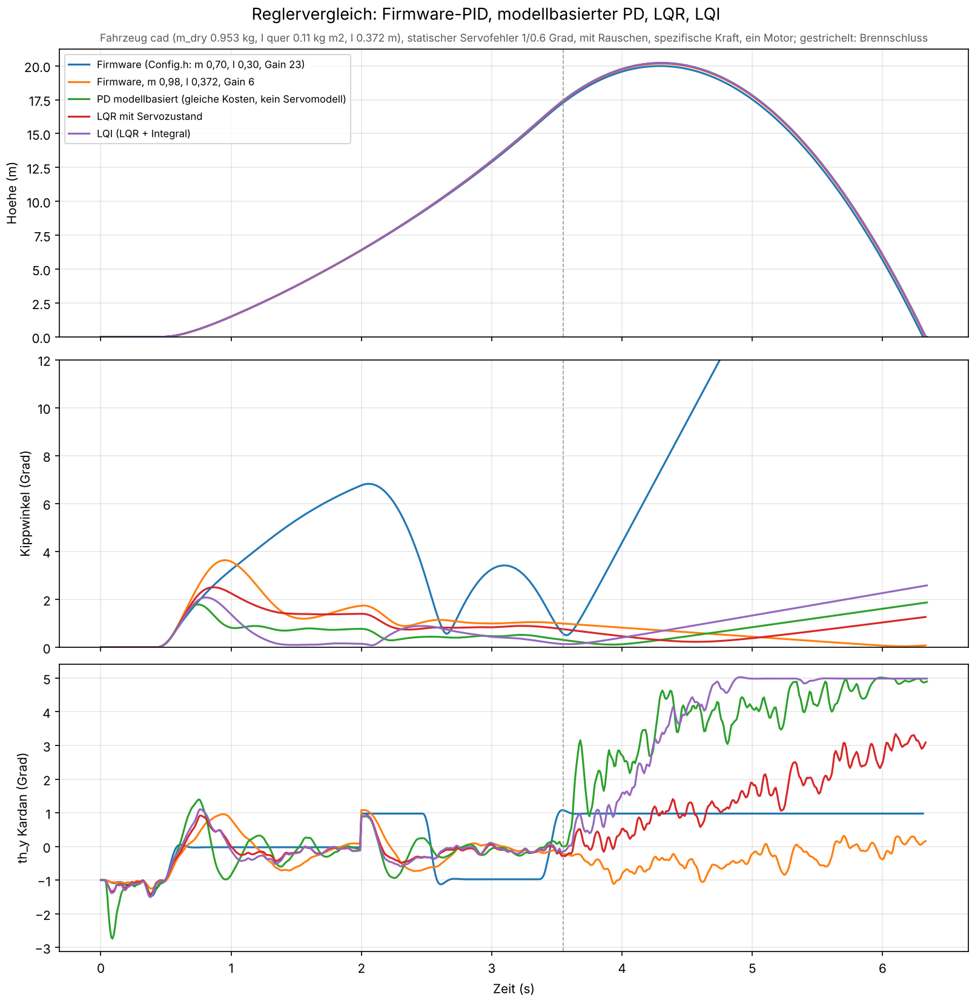
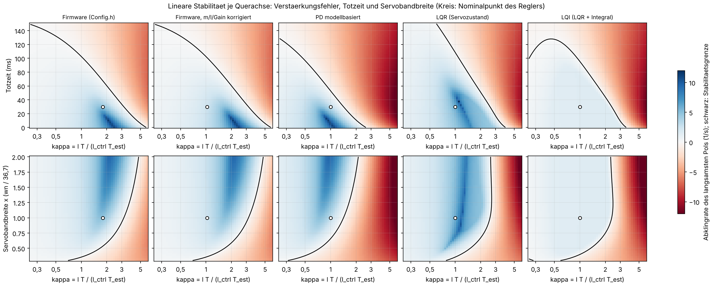
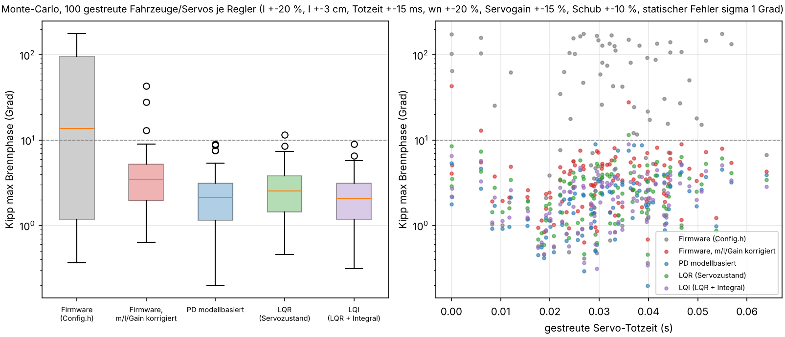

# Reglervergleich: PID, modellbasierter PD, LQR mit Servozustand (24.10.2026)

Anlass: Gedankenexperiment von Jan, ob ein PID für die Lageregelung das Richtige ist, wenn man
mehr über das System weiß, und ob ein anderer Regler die Stabilisierung robuster macht. Wind und
Aerodynamik bleiben vorerst außen vor (Flug nur bei wenig Wind; Positionsregelung für eine Landung
später). Hier geht es um die Frage: **Wie viel Fehler in Fahrzeug und Servo verträgt jeder Regler?**

Werkzeuge: `simulation/tvcsim/linear.py` (Linearmodell, LQR-Entwurf, Stabilitätsreserven),
`LQRController` in `controller.py`, Skripte `scripts/compare_controllers.py` und
`scripts/robustness.py`. Die Tabellen hier sind `simulation/out/robustness_summary.md` aus dem
vollen Lauf (9 Werte je Sweep, 100 Monte-Carlo-Läufe je Regler, 591 s auf 4 Kernen).

## 1. Ausgangslage

Der Regler in `Control.cpp` ist schon halb modellbasiert: Der PID liefert ein Soll-Moment, und
`M = l·m·|a|·sin δ` rechnet es in einen Kardanwinkel um (Modellinversion). Übrig bleibt für den
PID die Strecke `θ'' = M/I`, ein Doppelintegrator, weil ohne Aerodynamik nichts vom Winkel selbst
abhängt. **Für den Doppelintegrator ist ein PD die LQR-Lösung.** Die Firmware-Gewinne Kp 5, Kd 1
(Skala −100) sind auf dem CAD-Fahrzeug (I quer 0,11 kg m²) ein PD mit wn 5,1 rad/s und ζ 0,5.

Was der PID nicht kennt:

1. **Das Servo**: PT2 mit 5,8 Hz, ζ 0,6, 30 ms Totzeit (SG90-Fit), dazu 10 ms Regeltakt. Das ist
   das, was in Befund 11 den Grenzzyklus der Tuner-Gewinne erzeugt hat.
2. **Die Sättigung**: ±5° TVC, mit Servogain 23 und dem Fenster 70..115 nur ±0,98°.
3. **Die eigenen Parameterfehler**: `MASS_KG` 0,70 statt etwa 1,0, `MOMENT_ARM_M` 0,30 statt
   0,37. Zusammengefasst in `kappa = l·T / (l_ctrl·T_est)`, dem Verstärkungsfehler der
   Modellinversion: mit Config.h beim CAD-Fahrzeug **kappa 1,8**.

## 2. Verglichene Regler

Alle modellbasierten Regler sind mit derselben Kostenfunktion (Bryson: θ 3°, ω 30 °/s, TVC 5°
bei 11 N) auf dasselbe Entwurfsmodell ausgelegt (I quer 0,11 kg m², l 0,372 m, Servofit, Totzeit
30 ms) und bleiben dann fest, während die *wahren* Parameter variiert werden.

| Regler | Was | Gewinne |
|---|---|---|
| Firmware (Config.h) | `Control.cpp` 1:1: m 0,70, l 0,30, Servogain 23 (Fenster ±0,98° TVC), Rundung | Kp 5, Ki 0, Kd 1 |
| Firmware, m/l/Gain korrigiert | dieselben Gewinne mit m 0,98, l 0,372, Servogain 6 (Fenster ±3,75°) | Kp 5, Ki 0, Kd 1 |
| PD modellbasiert | Simulink-Regler, Gewinne aus der Kostenfunktion ohne Aktuatormodell | kp 11,2, kd 0,0235 (Firmware-Skala Kp 11,2, Kd 2,35); wn 7,6 rad/s, ζ 0,8 |
| LQR (Servozustand) | Zustandsregler je Querachse auf `[rot, ω, M^, M^', drei verzögerte Kommandos]`; den Servozustand kennt er nur aus seinem Modell (Prädiktor, kein Kardansensor); Sättigung im Prädiktor | K aus `design_lqr` |
| LQI | LQR plus Integralzustand `∫rot`, bedingte Integration | K aus `design_lqr(integral=True)` |

Der modellbasierte PD ist absichtlich genauso „schnell“ wie der LQR (gleiche Kosten), damit der
Vergleich zeigt, was allein das Servowissen bringt. Die Firmware-Gewinne sind langsamer (wn 5,1
statt 7,6 rad/s) und dadurch von Haus aus robuster gegen Verstärkungsfehler.

Randbedingungen aller Läufe: CAD-Fahrzeug (1,013 kg Start, Schub-Gewicht 1,1), ein E12, Rauschen
an, Beschleunigungssensor als spezifische Kraft, statischer Servofehler 1°/0,6° als Grundlast.
Die Sweeps und Monte-Carlo rechnen ohne Boden, damit ein Schub unter dem Gewicht die Lagedynamik
nicht ausblendet. Kriterium „ok“: Kippwinkel in der Brennphase unter 10° und bei Brennschluss
unter 5°.

## 3. Nominal

| Regler | Kipp max Brennphase | Kipp Brennschluss | Kardan max |
|---|---|---|---|
| Firmware (Config.h) | 6,8° | 0,6° | 1,5° (am Fenster) |
| Firmware korrigiert | 3,6° | 1,0° | 1,3° |
| PD modellbasiert | 1,8° | 0,3° | 2,7° |
| LQR | 2,5° | 0,8° | 1,4° |
| LQI | 2,1° | 0,1° | 1,5° |

Nominal sind alle brauchbar. Die Firmware mit Config.h hängt zwischen 1 und 2 s am Fenster: Der
statische Fehler von 1° ist mit ±0,98° Stellbereich nicht ausgleichbar (unterstes Feld, flache
Linie bei 0 und bei −1). Die Regler ohne I-Anteil behalten eine bleibende Neigung von 0,3 bis 1°.

## 4. Lineare Reserven je Querachse

Abklingrate des langsamsten Pols über dem Verstärkungsfehler kappa und der Totzeit (oben) bzw.
der Servobandbreite (unten); blau stabil, rot instabil, schwarz die Grenze, Kreis der Nominalpunkt.

| Regler | kappa nominal | Abklingrate (1/s) | kappa max stabil | kappa min stabil | Totzeit max (ms) |
|---|---|---|---|---|---|
| Firmware (Config.h) | 1,80 | 4,8 | 3,18 | 0 | 67 |
| Firmware korrigiert | 1,03 | 2,5 | 3,18 | 0 | 100 |
| PD modellbasiert | 1,00 | 3,1 | 1,42 | 0 | 52 |
| LQR (Servozustand) | 1,00 | 6,1 | 2,57 | 0 | 108 |
| LQI | 1,00 | 1,5 | 2,38 | 0,15 | 95 |

Lesart:

- **Der LQR klingt bei gleicher Kostenfunktion doppelt so schnell ab wie der PD (6,1 gegen
  3,1 1/s) und verträgt dabei fast doppelt so viel Verstärkungsfehler (kappa 2,6 gegen 1,4) und
  Totzeit (108 gegen 52 ms).** Das ist der Gewinn des Servowissens: Der Prädiktor weiß, dass das
  kommandierte Moment erst 30 ms später und gefiltert ankommt, und fordert nicht nach.
- Die Firmware-Gewinne haben die größte kappa-Reserve (3,2), weil sie langsam sind. Mit Config.h
  ist davon aber die Hälfte schon verbraucht (kappa 1,8), und die Totzeitreserve schrumpft auf
  67 ms. Mit korrigierten Parametern sitzt der Nominalpunkt wieder in der Mitte.
- Die Stabilitätsgrenze fällt bei allen Reglern im unteren Feld steil ab, wenn das Servo
  langsamer als etwa 60 % des Fits wird: Die neuen W5652H müssen vermessen werden, bevor
  irgendein Regler darauf ausgelegt wird.

## 5. Sweeps im 6DOF-Modell

Max. Kippwinkel in der Brennphase in Grad, in Klammern die ok-Fälle von 9:

| Parameter (Bereich) | Firmware (Config.h) | Firmware korrigiert | PD modellbasiert | LQR | LQI |
|---|---|---|---|---|---|
| Trägheit quer × (0,4 .. 2,5) | 4,8 (9/9) | 3,5 (9/9) | 4,9 (8/9) | 2,5 (9/9) | 2,0 (9/9) |
| Hebelarm l (0,24 .. 0,50 m), Regler glaubt 0,372 | 5,7 (9/9) | 3,3 (9/9) | 1,6 (9/9) | 2,4 (9/9) | 1,9 (9/9) |
| Schub × (0,7 .. 1,3) | 6,0 (9/9) | 4,3 (9/9) | 2,1 (9/9) | 3,2 (9/9) | 2,5 (9/9) |
| Servo-Totzeit (0 .. 100 ms), Regler glaubt 30 | 5,9 (9/9) | 3,7 (9/9) | 8,5 (7/9) | 3,2 (9/9) | 3,1 (9/9) |
| Servobandbreite × (0,5 .. 1,5) | 5,6 (9/9) | 3,6 (9/9) | 3,6 (9/9) | 2,9 (9/9) | 2,4 (9/9) |
| Servoverstärkung × (0,6 .. 1,6) | 39,2 (6/9) | 5,7 (9/9) | 2,7 (9/9) | 4,2 (9/9) | 3,2 (9/9) |
| statischer Servofehler y (0 .. 3°), z = 0,6 y | 179,0 (3/9) | 12,4 (8/9) | 5,2 (9/9) | 7,7 (9/9) | 6,1 (9/9) |
| Gyro-Rauschen σ (0 .. 3 °/s) | 6,3 (9/9) | 3,7 (9/9) | 1,8 (9/9) | 2,7 (9/9) | 2,2 (9/9) |

Was auffällt:

- **Firmware (Config.h) kippt, sobald das Fenster nicht reicht**: ab 1,1° statischem Servofehler
  oder bei 15 % weniger Servoverstärkung schlägt das ±0,98°-Fenster dauerhaft an, und die Rakete
  kippt in der Brennphase weg (bis 179°). Das ist kein Reglerproblem, sondern Stellbereich.
- **Der modellbasierte PD läuft in den Grenzzyklus**, wo das Servo langsamer ist als gedacht:
  bei 0,4-facher Trägheit (Sättigungsanteil 74 %) und ab 60 ms Totzeit (bis 67 % Sättigung,
  8,5° Kippwinkel). Genau das Verhalten der Tuner-Gewinne aus Befund 11, nur mit kleinerem Kd.
- **LQR und LQI bleiben überall unter 8° und fast ohne Sättigung**, auch bei dreifacher Totzeit
  und halber Trägheit. Der LQI drückt zusätzlich die bleibende Neigung bei Brennschluss auf
  0,2° (Median in Monte-Carlo) und ist bei großem statischen Fehler der beste.
- Die korrigierte Firmware ist überall ok außer bei 3° statischem Fehler (12,4°): langsam, aber
  gutmütig. Sie hat die größte bleibende Neigung, weil Ki = 0.

## 6. Monte-Carlo, alle Parameter zugleich gestreut

100 Fahrzeuge je Regler: I ±20 %, l ±3 cm, m_dry ±30 g, Totzeit ±15 ms, Servo wn ±20 %,
Servoverstärkung ±15 %, Schub ±10 %, statischer Fehler σ 1° je Achse, Fehlplatzierung σ 1 mm.

| Regler | ok | Kipp max Median | P95 | Maximum | Kipp Brennschluss Median | P95 |
|---|---|---|---|---|---|---|
| Firmware (Config.h) | 46 % | 13,7° | 166,8° | 178,4° | 6,6° | 150,8° |
| Firmware korrigiert | 97 % | 3,5° | 8,1° | 43,0° | 1,0° | 3,6° |
| PD modellbasiert | 95 % | 2,2° | 5,5° | 9,0° | 0,7° | 4,3° |
| LQR (Servozustand) | 99 % | 2,5° | 5,9° | 11,6° | 0,9° | 2,6° |
| LQI | 100 % | 2,1° | 4,8° | 9,0° | 0,2° | 0,6° |

## 7. Antwort auf die Frage

1. **Die PID-Struktur ist nicht das Problem.** Mit der Modellinversion davor ist der PD der
   optimale Regler für die Strecke, solange das Servo ideal ist. Wer mehr Systemwissen einbauen
   will, baut das Servo ein, nicht einen anderen Regler auf den Winkel.
2. **Das Servowissen lohnt sich messbar.** Bei gleicher Auslegungsgeschwindigkeit verträgt der
   LQR mit Servoprädiktor etwa doppelt so viel Verstärkungsfehler und Totzeit wie der PD und
   läuft nirgends in den Sättigungs-Grenzzyklus. Für den Prüfstand und einen späteren Flug ist er
   die bessere Option, und er ist billig: In der Firmware ist er eine Matrixmultiplikation mit
   7 Zuständen je Achse plus ein 2-Zustands-Servomodell mit drei gespeicherten Kommandos.
   Die Gewinne liefert `design_lqr`, die Umrechnung in die Firmware-Skala
   `gains_to_control_params`.
3. **Heute entscheidet nicht der Reglertyp, sondern die Parametrierung.** Config.h mit m 0,70,
   l 0,30 und Servogain 23 fällt in Monte-Carlo in der Hälfte der Fälle durch; dieselben Gewinne
   mit korrigierten Werten in 3 %. Das Fenster ±0,98° kann einen statischen Servofehler von 1°
   nicht ausgleichen. Erst messen (Masse, Schwerpunkt, Hebelarm, Servograd je Kardangrad,
   Servo-Sprungantwort der W5652H), dann eintragen, dann über den Regler reden.
4. **Ein kleiner I-Anteil** nimmt die bleibende Neigung weg, ohne die Reserven zu kosten
   (LQI: Totzeitreserve 95 statt 108 ms, dafür Brennschluss-Neigung 0,2° statt 0,9°).

## 8. Vorschlag für die nächsten Schritte (Entscheidung Jan)

- **Config.h**: `MASS_KG`, `MOMENT_ARM_M` auf die Konfiguration des Erstflugs (CAD: 0,98 kg
  und 0,372 m; Erstflug-Konfiguration vom 22.10.: 761 g, 0,242 m), Servogain nach Messung,
  `PY_KI` klein (Simulink-ki um 1 entspricht Firmware-Ki 1). Das habe ich **nicht** geändert,
  weil die Werte von der gewogenen Rakete und vom Kardan abhängen.
- **Prüfstand**: Beide Regler fahren, PD/PID mit den korrigierten Werten und den LQR mit
  Prädiktor; dort zeigt sich, ob das Servomodell der W5652H trägt.
- **Firmware-Port des LQR** erst nach der Quaternion-Lage (Befund 3), weil der Zustandsregler
  denselben Winkel braucht wie der PID.
- **Noch nicht im Modell**: Aerodynamik und Wind (aufkippendes Moment der flossenlosen Rakete
  bei Anstellwinkel, Drift), Ratenbegrenzung des Servos (70 °/s im Fit sichtbar), Hysterese des
  Kardans. Die Ratenbegrenzung trifft den PD härter als den LQR, weil sie wie zusätzliche
  Totzeit wirkt; das wäre der nächste Sweep.
