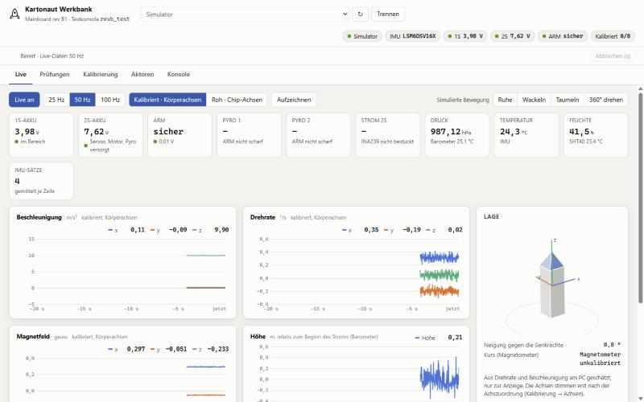

# Werkbank: Oberfläche für das Mainboard rev B1

Die Werkbank verbindet den PC über den USB-Anschluss des Teensy mit der Platine, zeigt die Messwerte
live, stößt die Prüfungen an und führt durch die Kalibrierung. Das Programm ist Python: es liest die
serielle Schnittstelle, wertet die Zeilen der Testkonsole aus und schickt Befehle und Kalibrierwerte
an den Teensy. Die Bedienung läuft im Browser auf dem eigenen Rechner (kein Netz nötig).



Stand 14.11.2026: erste Version. Gegen die simulierte Platine getestet (18 Tests, im Browser bedient),
die Firmware baut. **An der echten Platine ist noch nichts davon gelaufen.**

## Starten

```bash
pip install pyserial numpy
```

```bash
cd firmware && pio run -e revb_test -t upload
```

```bash
python firmware/tools/werkbank.py
```

Auf dem Teensy muss die Testkonsole `revb_test` laufen, und zwar der Stand mit den Befehlen `stream`
und `cal set` (ab 14.11.2026). Ohne Hardware:

```bash
python firmware/tools/werkbank.py --sim
```

| Schalter | Wirkung |
|---|---|
| `--port COM7` | diesen Port nehmen; ohne Angabe wird ein Teensy gesucht |
| `--sim` | simulierte Platine mit bekannten Sensorfehlern (`sim.py`) |
| `--http-port 8765` | Port der Oberfläche auf 127.0.0.1 |
| `--no-browser` | Browser nicht selbst öffnen |
| `--out <ordner>` | Ziel für Berichte und Aufzeichnungen (Standard `firmware/test_reports/`) |

Die Platine braucht den 1S-Zweig (siehe `Tischtest_revB1.md` §2); Servos, Motor und Pyro zusätzlich 2S.

## Die fünf Reiter

| Reiter | Inhalt |
|---|---|
| **Live** | Beschleunigung, Drehrate, Magnetfeld und Höhe als Verlauf über 20 s (25, 50 oder 100 Hz), Akkus, ARM, Pyro-Durchgang, Strom, Druck, Temperatur, Feuchte, Lage als 3D-Ansicht. Umschaltbar zwischen „kalibriert, Körperachsen“ und „roh, Chip-Achsen“. „Aufzeichnen“ schreibt die Rohdaten als CSV. |
| **Prüfungen** | Ein Knopf je Prüfung der Testkonsole, Ergebnistabelle (in Ordnung, Fehler, übersprungen, nicht bestückt), Bestückungsliste zum Umschalten, Bericht als Markdown und JSON wie `bench_test.py`. |
| **Kalibrierung** | Je Sensor ein Schritt mit Erklärung, Start und aktuellen Werten; unten Speichern, Laden, Standardwerte, Löschen. |
| **Aktoren** | Servos (Mitte, Grenzen, Durchlauf, µs, Trimmen), Rollmotor, Pyrokanäle. |
| **Konsole** | Alle Zeilen der Testkonsole und eine Befehlszeile. |

Rückfragen der Firmware (`WAIT`, `ASK`, `CONFIRM`) erscheinen als Dialog. Pyro zündet nur, wenn die
Firmware ARM und Durchgang sieht und das Wort `JA` von Hand eingetippt wurde; die Oberfläche tippt es
nie selbst.

## Kalibrierung: was es gibt und wofür

| Schritt | Verfahren | Wer rechnet | Nutzt die Flug-Firmware den Wert? |
|---|---|---|---|
| Gyro-Nullpunkt | Mittel in Ruhe, mit Rauschen und Temperatur | Teensy (`cal gyro`) | nein, sie misst vor jedem Start neu; hier Bauteilprüfung |
| Beschleunigung | geführt: 6 Lagen, Offset = (max + min)/2, Skalierung = 2 g/(max − min) | Teensy (`cal acc`) | ja |
| Beschleunigung, frei | beliebig viele ruhende Lagen, Offset und Skalierung so, dass der Betrag überall 1 g ist | PC, dann `cal set` | ja |
| Magnetometer | Ellipsoid-Fit: Hard-Iron (Mittelpunkt) und Soft-Iron (3×3) | Teensy (`cal mag`) oder PC mit Bild der Abdeckung | ja, am Boden für den Kurs, zusammen mit den Achsen |
| Achszuordnung | Spitze nach oben, +x nach oben, dann drehen | Teensy (`cal axes`) | ja |
| Barometer | Bodendruck und Rauschen | Teensy (`cal baro`) | nein, Bodendruck wird vor dem Start gemessen |
| Spannungsmessung | Teensy-Wert gegen Multimeter, Faktor je Kanal | Teensy (`cal adc`) | noch nicht |
| Strommessung | Offset ohne Last, Verstärkung gegen bekannte Last | Teensy (`cal ina`) | noch nicht |
| Servos | Mitte und Grenzen in µs | Teensy (`cal servo n`) | noch nicht (`Config.h`) |
| Gyro-Skala prüfen | Platine um 90°, 180° oder 360° drehen, integrierte Drehrate vergleichen | PC | nur Prüfung, nichts gespeichert |

Hintergrund der Verfahren:

- **Beschleunigungssensor**: das 6-Lagen-Verfahren (ST Design Tip DT0053) bestimmt Offset und
  Verstärkung je Achse aus den Lagen ±1 g. Die freie Variante braucht keine genau ausgerichteten
  Lagen: sie löst Σ (s·(a − b))² = g² für alle Lagen gleichzeitig. Querempfindlichkeit wird nicht
  bestimmt; der Kalibrierblock hat dafür kein Feld.
- **Magnetometer**: Hard-Iron verschiebt die Kugel der Messpunkte, Soft-Iron verformt sie zum
  Ellipsoid. Der Fit ist derselbe wie in `lib/calstore/EllipsoidFit.h`; die Annahmegrenzen (alle
  acht Oktanten, Residuum unter 10 %, Feld 0,15 bis 1,2 gauss) ebenfalls. Die Werte gelten nur für
  die Umgebung der Messung, also in der fertig montierten Avionik wiederholen.
- **Gyro-Skala**: der Kalibrierblock speichert keinen Skalenfaktor. Die Prüfung zeigt, ob einer
  nötig wäre.

## Aufbau

| Datei | Aufgabe |
|---|---|
| `__main__.py`, `../werkbank.py` | Start, Portwahl |
| `link.py` | Lesefaden an der seriellen Schnittstelle, Befehlswarteschlange, Rückfragen, Live-Daten, Aufnahme für die Fits; nutzt Parser und Bericht aus `../bench_test.py` |
| `calmath.py` | Kalibrierung anwenden, Ellipsoid-Fit, Lagen-Fit, Ruheerkennung, Skalenprüfung, Lage (nur numpy) |
| `sim.py` | simulierte Platine mit dem Zeilenprotokoll der Testkonsole |
| `server.py` | Webserver aus der Standardbibliothek, nur auf 127.0.0.1, mit Sitzungs-Token |
| `static/` | Seite, Stil, Skript (ohne fremde Bibliotheken) |
| `../test_bench_gui.py` | Tests ohne Hardware: `python -m pytest firmware/tools/test_bench_gui.py` |

Die Firmware-Seite steht in `examples/revb_test/`: `Stream.h` (Format der Live-Zeilen) und
`calSet()` in `Calib.cpp` (Namen und Grenzen von `cal set`).

Ablauf einer Verbindung: Befehle laufen einzeln. Solange keiner ansteht, läuft `stream`; vor jedem
Befehl beendet die Werkbank den Strom mit `q` und startet ihn danach neu. Die Live-Werte kommen roh
vom Teensy, die Kalibrierung rechnet der PC aus den Werten von `cal show`; so lassen sich roh und
kalibriert vergleichen und aus den Rohwerten neue Kalibrierwerte bestimmen.

## Grenzen dieser Version

- Nur die Testkonsole `revb_test`, nicht die Flug-Firmware (die spricht ein anderes Protokoll).
- Versuch E02 (`tvc ...`) läuft weiter über `capture_tvc.py`; in der Konsole der Werkbank gehen die
  Befehle, die CSV wird dort aber nicht gespeichert.
- `watchdog fire` startet den Teensy neu; die Werkbank meldet die getrennte Verbindung, danach neu
  verbinden.
- Die Lage in der 3D-Ansicht schätzt der PC aus Drehrate und Beschleunigung. Sie dient der
  Anschauung und ist nicht die Lage, die die Flug-Firmware rechnet.
