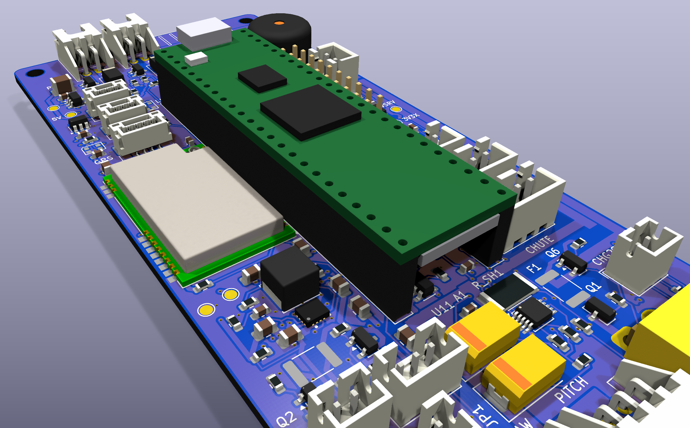
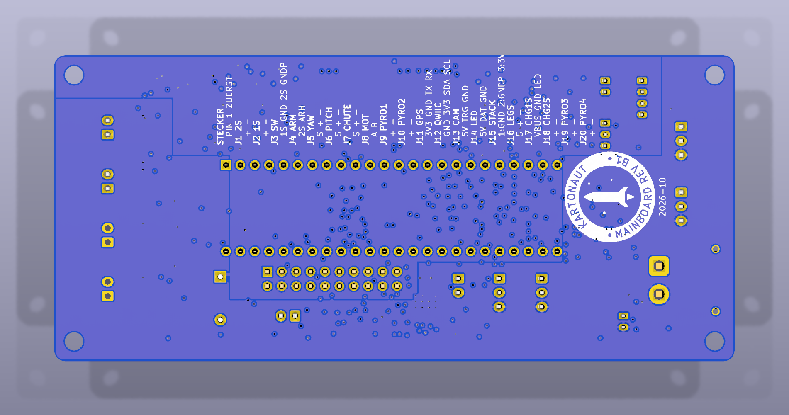

# Mainboard rev B1 – KiCad-Projekt

Stand 2026-10-22. Schaltplan und Platine werden hier **aus Code erzeugt**, nicht von Hand gezeichnet.
Die Quelle der Wahrheit ist `circuit.py`: Schaltplan, Platine und Prüfungen werden daraus abgeleitet.
Die Vorgabe ist die Spezifikation `../README.md`, Stand B1: rev B plus Review A1 bis A8
(`../review_kicad_2026-10-21.md`) und die Entscheidungen E1 bis E10 (`../Komponenten_2026-10-22.md`).
Dieses Dokument beschreibt, wie das Projekt entstanden ist, was fertig ist, was offen ist und wo bewusst
von der Spezifikation abgewichen wurde. Die Fertigerwahl steht in `../Fertiger_2026-10-21.md`.



## 1. Stand auf einen Blick

| Schritt | Stand |
|---|---|
| Schaltung als Daten (`circuit.py`) | 166 Bauteile (9 davon DNP), 113 Netze, 7 Schaltplanblätter |
| ERC | **0 Fehler, 0 Warnungen**, 4 begründete Ausschlüsse (§6) |
| Netzliste gegen Spezifikation §4 (`check_design.py`) | **OK**: 39 Teensy-Pins, 7 Chip-Selects, 7 Mux-Kanäle, 11 Schienen, Kelvin-Abgriff |
| Platzierung | **alle 166 Footprints**, keine Überschneidung |
| Strompfade | 2S-Pfad, Pyro-Ausgänge und VSYS_IN als F.Cu-Flächen (§5.4); kein 2S-Netz auf In2 |
| Routing | 2223 Bahnsegmente, 348 Vias, vier Lagen; `./make.sh pcb` braucht etwa 25 Minuten, danach `close_gaps.py` (§5.5) |
| DRC (JLC-Regeln) | **0 Fehler**, Schaltplan-Parität **0 Abweichungen** |
| Offene Verbindungen | **21** nach Freerouting und Skript-Routing; Rest von Hand in KiCad (§5.5) |
| Abbildungen | Renders oben, unten und schräg, Lagenbilder (`img/`) |
| Fertigungsdaten (Gerber, BOM, CPL) | offen, nach den offenen Verbindungen (§8) |

| Oben | Unten |
|---|---|
|  |  |

Die Lagen einzeln: `img/layers.pdf` (F.Cu, In1 GND, In2, B.Cu Versorgung, Bestückungsdruck) und
`img/layer_*.png`.

## 2. Werkzeuge

- **KiCad 10.0.6.** Die winget-Installation für alle Benutzer blieb an der Administrator-Abfrage
  hängen. Deshalb wurde der signierte Installer (KiCad Services Corp.) als Benutzerinstallation
  ausgeführt: `/S /CurrentUser` nach `%LOCALAPPDATA%\Programs\KiCad\10.0`. Die globalen
  Bibliothekstabellen (`sym-lib-table`, `fp-lib-table`) wurden aus dem Template nach
  `%APPDATA%\kicad\10.0\` kopiert; das macht die GUI sonst beim ersten Start.
- **easyeda2kicad** (pip) für die vier Teile, die nicht in der KiCad-Bibliothek sind: ICM-42688-P (C1850418),
  BMP390 (C5124834), TPS63070RNMR (C109322) und E22-400T22S (C2903765). Symbol, Footprint und
  3D-Modell kommen direkt aus der LCSC/EasyEDA-Datenbank, also genau die Footprints, mit denen JLC bestückt.
- **Freerouting 2.5.0** als JAR mit einer portablen **Temurin-25-JRE** (Zip, keine Installation), beides
  unter `%LOCALAPPDATA%\Programs\freerouting\`, Prüfsummen kontrolliert. Die native
  `freerouting-cli.exe` derselben Version stürzt mit einem GraalVM-Fehler ab; die JAR braucht Java 25.
- **CadQuery** für zwei 3D-Modelle, die fehlen: Teensy 4.1 (vereinfacht, auf 8,5-mm-Sockeln) und
  XT30PW-M (die KiCad-Bibliothek nennt das Modell, liefert es aber nicht).
- Datenblätter für die eigenen Entscheidungen: TPS63070 (SLVSC58B: Pinbelegung, Teiler-Tabelle 4,
  Kondensatoren) und ICM-42688-P (DS-000347: RESV-Pins, Abblockung).

## 3. Aufbau und Ablauf

```
circuit.py          Schaltung als Daten: Bauteile, Werte, Footprints, LCSC-Nummern, Netze, Blätter, Blöcke, Netzklassen
build_lib.py        lib/mainboard.*: Teensy-Symbol, INA239-Symbol, Sockel-Footprint, Kelvin-Shunt-Footprint
                    R_2512_Kelvin, 3D-Modelle Teensy und XT30; Pin-Typen der LCSC-Symbole
gen_schematic.py    Projektdatei (JLC-Regeln, Netzklassen, ERC-Ausschlüsse), Wurzelblatt und 7 Unterblätter
check_design.py     Tor 1: Netzliste aus dem Schaltplan gegen die Pin-Tabelle der Spezifikation
gen_pcb.py          Platine: Umriss, Footprints, Platzierung, Flächen, Sperrflächen, Plane-Vias, DSN-Export, SES-Übernahme, Nachbesserung,
                    Bestückungsdruck (`gen_pcb.py silk`: nur der Druck, auf der gerouteten Platine)
logo.py             Kartonaut-Abzeichen als Polygone, für den Bestückungsdruck und docs/brand/*.svg
render.py           Lagenbilder zuschneiden und zusammenfügen, Renders auf die Platine zuschneiden
make.sh             ganze Kette: ./make.sh [sch|pcb|drc|img]
snapshot.py         schnelles Bild einzelner Lagen beim Entwickeln
gaps.py             die offenen Verbindungen aus out/drc.json: was, wo, wie weit; `gaps.py png` mit Bild je Häufung
close_gaps.py       `dump`: Geometrie der Platine und die offenen Verbindungen nach out/geom.json; `apply`: Ergebnis des
                    Gitter-Routers in die Platine (KiCad-Python)
route_gaps.py       Gitter-Router (System-Python mit numpy/scipy): A* auf 0,05 mm, F.Cu/In2 mit Vias, Rip-up von
                    Signalbahnen; `debug n` mit Bild und Kennzahlen je Lücke, `region x0 y0 x1 y1` reißt einen Bereich auf
lib/                lcsc.* (easyeda2kicad), mainboard.* (eigene)
out/                Schaltplan-PDF, ERC- und DRC-Bericht (alles andere dort ist Zwischenstand)
img/                Renders und Lagenbilder
```

Neu erzeugen (Git Bash):

```bash
./make.sh
```

`make.sh` ruft `kicad-cli` aus der Bash auf und nicht aus Python. Aus der Microsoft-Store-Python gestartet,
findet `kicad-cli` die globalen Bibliothekstabellen nicht, denn der App-Container der Store-Python
verdeckt sie. Der ERC meldet dann 265 Bibliotheksfehler, und die Renders haben keine Modelle.

Warum Code statt GUI: Schaltung, Schaltplan und Platine können nicht auseinanderlaufen, jede Änderung ist
ein Diff in `circuit.py`, und ERC, Netzlistenprüfung und DRC laufen auf Knopfdruck. Die Dateien lassen sich
normal in KiCad öffnen. Sobald dort von Hand geroutet wird (§5.4), ist die Platinendatei die Quelle und
`./make.sh pcb` darf nicht mehr laufen. `./make.sh sch` und `./make.sh drc` bleiben nutzbar.

## 4. Schaltplan

Jedes Pin bekommt einen kurzen Draht und ein globales Netzlabel. So sind die Netznamen in Netzliste,
Platine, Netzklassen und Spezifikation dieselben (`VSERVO`, nicht `/Versorgung/VSERVO`). Jedes Blatt
ist in umrahmte Funktionsblöcke gegliedert. Die Blätter heißen Versorgung, Teensy, Sensorik, Funk,
Aktoren, Pyro und Signal. Die UUIDs werden aus Blatt und Referenz berechnet und sind deshalb bei jedem
Lauf gleich. PDF: `out/mainboard_schematic.pdf`.

## 5. Platine

### 5.1 Lagen

| Lage | Inhalt |
|---|---|
| F.Cu | alle Bauteile, Signale, GND-Füllung |
| In1.Cu | **durchgehende GND-Fläche** (Lagentyp *power*, wird nicht geroutet) |
| In2.Cu | Signale, GND-Füllung |
| B.Cu | **geteilte Versorgungsfläche**: GND_PWR unter allem, was am 2S hängt (TVC-Band mit XT30 und Servos, Mitte unter den VSERVO-Puffern, rechter Streifen mit den Aktoren, äußerer rechter Streifen neben J_STACK, Spitzen-Band unter Pyro, Arming und Summer); **5V_SYS** unter der 1S-Seite (linker Streifen, unter dem Teensy) |

Die Spezifikation sah die Versorgungsflächen auf Lage 3 vor. B.Cu ist gleichwertig und trägt ohnehin
keine Bauteile. In2 bleibt so als zweite Signallage frei; ohne sie war die Platine nicht zu entflechten.
Jedes SMD-Pad von GND, GND_PWR und 5V_SYS bekommt ein eigenes Via zu seiner Fläche. Das Via sitzt nur
dort, wo Pad und Via über dem eigenen Teil der Teilung liegen, außerhalb der Stromflächen (§5.4) und
außerhalb der 5-mm-Zone um die IMU; nur die IMU und ihre Kondensatoren dürfen ihre eigenen Masse-Vias im
Ring zwischen 2,6 und 5 mm setzen.

### 5.2 Netzklassen

| Klasse | Bahn | Netze |
|---|---|---|
| Strom | 1,0 mm (Router: 0,5 mm), nur F.Cu | VBAT2_RAW, VBAT2_REV, VBAT2_F, VBAT_PROT, VSERVO, VBAT_ARMED, PYRO1..4_NEG |
| Rückstrom | 0,8 mm | GND_PWR (wo es nicht auf der Fläche läuft) |
| Versorgung | 0,6 mm | 1S-Pfad mit VSYS_IN (A7), 5V_SYS, 3V3_RF, 3V3_EXP, TEENSY_VIN, MOT_A/B, VBUS_CHG |
| Wandler | 0,4 mm | U2_L1, U2_L2 |
| Default | 0,2 mm | Signale, 3V3, 3V3_SENS, GND (GND läuft über die Flächen) |

Alles, was in der Klasse Strom wirklich Strom führt, ist keine Bahn, sondern eine Kupferfläche (§5.4),
ebenso VSYS_IN am TPS63070. Was Freerouting an diese Netze noch anschließt, sind Messteiler,
Gate-Widerstände, Abblockkondensatoren und Testpunkte. `export_dsn` gibt der Klasse Strom deshalb für
den Router 0,5 mm statt 1,0 mm und `(use_layer F.Cu)` (A6); an 0603-Pads und durch die engen Kanäle
kam eine 1-mm-Bahn nicht.

JLC-Regeln im Projekt: 0,127 mm Abstand, Bahn mindestens 0,09 mm (Freerouting verjüngt an Pins auf
0,10 bis 0,12 mm), Via 0,45/0,2 mm, 0,2 mm zum Rand.

### 5.3 Platzierung

Stecker, ICs, die Kette des 2S-Pfads, Elkos und die Pyro-Spalten sind fest gesetzt (`ANCHORS`, `EDGE`,
`PYRO_COLS` in `gen_pcb.py`). Die übrigen Teile setzt eine gierige Suche je Funktionsblock in dessen Region
an das Pad, mit dem sie ein Netz teilen, mit 0,35 mm Abstand für Routingkanäle. Abblockkondensatoren
gehören über `OWNERS` fest zu ihrem IC. Findet ein Teil in seiner Region keinen Platz, sucht es auf der
ganzen Platine möglichst nah an seinem Partner und wird gemeldet (heute JP2, R26 und die drei kleinen
Kondensatoren des DRV8833, alle innerhalb weniger Millimeter). Die Flächen der Strompfade (§5.4) bleiben
für andere Teile gesperrt.

| Bereich | Inhalt |
|---|---|
| TVC-Kante | J_SERVO1 und 2 liegend, XT30 liegend rechts davon |
| links, TVC-Ende | J_SW, J_BAT1, J_CHG1 stehend; 1S-Kette Q2 → F2 → Q7; Lader MCP73831 unter dem Teensy |
| Mitte, TVC-Ende (SD-Weg, nur flach) | VSERVO-Puffer 2 × 330 µF, Shunt mit INA239 darunter |
| rechts, TVC-Ende | 2S-Kette XT30 → Q1 → F1 → Q6, Sternpunkt NT1 am XT30-Minus, J_CHG2 |
| rechter Streifen | J_SERVO3 und 4, J_MOT, DRV8833; J_STACK neben der rechten Teensy-Reihe, daneben LDO 3V3_EXP, BMP390, J_ARM; Summer |
| unter dem Teensy (≤ 3 mm) | CS-Decoder und Analogmux an ihren Pins, alle 33-k/100-n-Hälften der Messteiler, IMU, das zweite BMP390 (DNP), Hold-up 2 × 470 µF und D1 am VIN-Pin |
| linker Streifen | Buck-Boost mit Spule (≥ 25 mm von der IMU), Funkmodul, dann GPS, Kamera, LED-Stecker, Pegelwandler mit beiden WS2812B, LDO 3V3_RF |
| Spitzen-Kante | vier Pyro-Stecker liegend; darunter je Kanal eine Spalte mit TVS und FET, flach unter dem USB-Stecker; Qwiic rechts |

Gemessene Regeln:

- IMU genau auf der Rollachse unter dem Teensy, Chip-X quer, Chip-Y zur Spitze (Footprint gegen DS-000347
  geprüft). Im Radius 5 mm keine fremden Vias und keine In2-Bahnen, unter dem Chip gar keine Vias (B16).
- LoRa-Modul im linken Streifen, Antennenseite zur Spitze, 0,5 mm vom Rand (B17).
- Buck-Boost und Spule mehr als 25 mm von der IMU; L1 und L2 gehen ohne Kreuzung an ihre Pins.
- SD- und USB-Freiraum gilt nur für hohe THT-Teile. Karte und Stecker sitzen auf Teensy-Höhe, flache
  SMD-Teile dürfen darunter.

### 5.4 Strompfade als Flächen (Review A6 bis A8, B13)

Der 2S-Pfad wird nicht dem Autorouter überlassen. `CORRIDORS` in `gen_pcb.py` beschreibt ihn als
Wegpunkte zwischen Pads; der Generator macht daraus je Netz eine F.Cu-Fläche:

| Netz | Weg | Breite |
|---|---|---|
| VBAT2_RAW, VBAT2_REV, VBAT2_F | XT30-Plus → Q1 → F1 → Q6, kurze Stücke | 1,0 bis 1,2 mm |
| VBAT_PROT | Q6 → Shunt; Q6 → äußere Schiene am rechten Rand (u 24,9 bis 26,6) → J_ARM | 1,4 / 1,7 mm |
| VBAT_ARMED | J_ARM → äußere Schiene → Band hinter den Pins der vier Pyro-Stecker → je TVS | 1,6 bis 2,0 mm |
| VSERVO | Shunt → Bus quer unter den Teensy-Buchsen (v 28,1 bis 29,5) → Puffer → Band an beiden TVC-Servo-Steckern; Bus → innere Schiene (u 22,9 bis 24,6) → J_SERVO3/4 (über der Pinreihe, am Minus-Pin vorbei), DRV8833 VM | 0,6 bis 4,2 mm |
| PYRO1..4_NEG | FET-Drain senkrecht zu Pin 2 des Pyro-Steckers | 1,0 mm |
| VSYS_IN | C10 → beide Eingangspins des TPS63070; die Füllung wird erst am VQFN-Pin schmal (A7) | 0,6 bis 1,0 mm |

Zwei Eigenheiten von Freerouting waren dafür zu umgehen. Erstens liest es eine Fläche als ihren bloßen
Umriss, ohne die Aussparungen um fremde Pads; `carve_corridors` füllt die Flächen deshalb vor dem
Export und übernimmt die gefüllte Form als Umriss. Zweitens ist eine Kupferfläche auf einer Signallage für
fremde Netze kein Hindernis: Freerouting hat Signale quer durch die Flächen gelegt, und beim Füllen
zerfielen sie in Inseln. Jede Fläche bekommt deshalb für den Routinglauf eine deckungsgleiche Sperrfläche
für Bahnen und Vias; bei den breiten Netzen (VBAT_PROT, VBAT_ARMED, VSERVO) ist sie 0,6 mm kleiner, damit
die 1-mm-Stiche des eigenen Netzes am Rand andocken. `gen_pcb.py patch` löscht diese Sperrflächen am Ende.
Der Pyro-Rückstrom läuft über die GND_PWR-Fläche auf B.Cu direkt unter den Schienen.

### 5.5 Routing und was offen ist

Freerouting entflechtet den Großteil. Die Kette (`route` in `make.sh`) hat seit dem 22.10. abends diese Form:

1. `gen_pcb.py dsn` exportiert die platzierte Platine. **Alles, was schon auf der Platine liegt, ist für den
   Router fix** (im ersten Lauf die 124 Plane-Vias mit ihren Stummeln, in den Nachläufen die ganze
   Verdrahtung); In1 und B.Cu sind Power-Lagen, die Klasse Strom bleibt auf F.Cu. Das 5-mm-Via-Verbot um die
   IMU ist ein Polygon mit Löchern um die eigenen Masse-Vias der IMU; als volle Scheibe meldete Freerouting
   sie bei jedem Lauf als 22 „unfixable violations“ (jetzt 12, alle an den Sperrflächen des LoRa-Moduls).
2. Der Hauptlauf hält von selbst an, wenn sich der Score zehn Pässe lang nicht verbessert hat (28 bis 40
   Pässe, 13 bis 17 Minuten).
3. `gen_pcb.py ses` übernimmt die Session **durch Zusammenführen**, nicht durch Ersetzen: KiCads SES-Import
   löscht die vorhandene Verdrahtung, und Freerouting schreibt fixe Elemente nicht in die Session. Danach
   kommen die GND-Füllungen auf F.Cu und In2 dazu.
4. Zwei Nachläufe mit **je vier Pässen** routen nur das Offene und werden zusammengeführt. Mit 100 Pässen
   kreisten sie zehn Minuten lang zwischen denselben drei Zuständen; der erste Pass war immer der beste.
5. `gen_pcb.py patch` schließt Lücken mit dem Abstand der Platinenregel (0,2 mm; mit 0,13 mm entstanden
   DRC-Fehler): erst mit einem geraden Stummel auf einer Lage, dann über In2 mit zwei Vias (nicht für die
   Klasse Strom, nicht in der IMU-Zone, nicht durch fremde Stromflächen). Danach löscht es die Sperrflächen
   aus §5.4.

Ein ganzer Lauf dauert damit **etwa 25 Minuten** statt 40. Was Freerouting am Ende als „unrouted“ zählt
(80 bis 90), ist nicht das Maß: rund 55 davon sind die Pads, die schon über Stummel und Via an ihrer Fläche
hängen. Freerouting kennt die Flächen auf den Power-Lagen nicht als Verbindung, legt für diese Pads in
seiner Fanout-Stufe eigene Vias und zählt sie dann als offen. Zwei Auswege wurden am 22.10. ausprobiert und
verworfen: In1 und B.Cu als Signallagen unter einer Bahnensperre (668 Abstandsverletzungen, jedes fremde
Via gegen die GND-Fläche) und die schon angebundenen Pads aus der Netzliste nehmen (146 Verletzungen, fixe
Stummel gegen netzlose Pads). **Das Maß ist der KiCad-DRC.**

Drei Läufe am 22.10. abends endeten bei 25, 27 und 28 offenen Verbindungen, acht Läufe davor zwischen 26
und 35; die Liste ist von Lauf zu Lauf fast dieselbe. Die Platine ist gegenüber rev B um 32 Teile und vier
Stromflächen dichter.

**Skript-Routing der Reste (23.10. nachts):** `close_gaps.py dump` schreibt die Geometrie der Platine und die
offenen Verbindungen des DRC nach `out/geom.json`; `route_gaps.py` (System-Python mit numpy/scipy) rastert
alles Kupfer mit 0,05 mm und sucht je Lücke mit A* einen Weg auf F.Cu und In2 mit Vias (Klasse Strom nur
F.Cu, Versorgungsflächen-Netze auch B.Cu), Abstand nach Netzklasse, Sperrflächen und 5-mm-IMU-Zone
beachtet; ein Endpunkt ist das ganze zusammenhängende Kupferstück (Pad, Stummel, Via). Wo ein Pin
eingekesselt ist, reißt es Signalbahnen auf, routet und legt die aufgerissenen Netze neu; klappt das nicht,
wird alles zurückgesetzt. `close_gaps.py apply` übernimmt das Ergebnis, dann `./make.sh drc`. So gingen
sechs der 27 zu, mit 0 DRC-Fehlern. Die übrigen 21 liegen in drei Häufungen, in denen das Aufreißen nicht
konvergiert: um den DRV8833 mit der VSERVO-Schiene, um J_STACK mit CS-Decoder und Analogmux, und um den
Shunt mit der 2S-Kette. Ein Versuch, den ganzen Bereich x 120..154 / y 85..133 aufzureißen und neu zu
verlegen (`route_gaps.py region`), schloss zwar alle Lücken dort, ließ aber 24 Signalnetze offen: dafür
braucht es einen echten Autorouter mit Schieben, also KiCads interaktiven Router.

**Die eingecheckte Platine hat 21 offene Verbindungen, 0 DRC-Fehler und keine Abweichung vom Schaltplan.**
7 davon sind Geometrie der Flächen: Strompfade, die ihr Pad nicht erreichen oder in Inseln
zerfallen (`CORRIDORS` und `add_zones` in `gen_pcb.py`, oder in KiCad eine Bahn zwischen die Inseln).
Die übrigen 14 sind in KiCad von Hand zu ziehen (interaktiver Router mit
Schieben; danach `./make.sh drc`). Koordinaten (u | v) in mm wie in `gen_pcb.py`, KiCad x = 127 + u,
y = 170 − v:

| Art | Netz | Was | Wo (u \| v) |
|---|---|---|---|
| Fläche | GND | Pad 7 von U6 ↔ Zone "GND F.Cu" | 6.5 \| 21.3 |
| Fläche | GND | Zone "GND F.Cu" ↔ Zone "GND F.Cu" | -26.7 \| 0.3 |
| Fläche | VBAT2_F | Zone "VBAT2_F" ↔ Pad 1 von R4 | 5.6 \| 17.0 |
| Fläche | VBAT2_RAW | Pad 1 von J18 ↔ Zone "VBAT2_RAW" | 19.0 \| 19.6 |
| Fläche | VBAT_PROT | Zone "VBAT_PROT" ↔ Zone "VBAT_PROT" | 26.5 \| 78.4 |
| Fläche | VSERVO | Pad 1 von C36 ↔ Zone "VSERVO" | 16.6 \| 62.2 |
| Fläche | VSERVO | Zone "VSERVO" ↔ Pad 6 von J15 | 13.7 \| 77.3 |
| Versorgung | 5V_SYS | Pad 4 von J15 ↔ Bahn | 13.7 \| 79.9 |
| Versorgung | GND_PWR | Bahn ↔ Pad 2 von C6 | -0.7 \| 22.3 |
| Versorgung | GND_PWR | Via - B.Cu ↔ Pad 2 von C38 | 12.3 \| 53.5 |
| Versorgung | VSERVO | Bahn ↔ Bahn | 19.0 \| 47.9 |
| Versorgung | VSERVO | Pad 12 von U7 ↔ Bahn | 19.4 \| 54.2 |
| Versorgung | VSERVO | Pad 6 von J15 ↔ Pad 5 von J15 | 13.7 \| 77.3 |
| Signal | CS_EXT0 | Pad 11 von U12 ↔ Pad 10 von J15 | -2.1 \| 43.4 |
| Signal | CS_EXT1 | Pad 10 von U12 ↔ Pad 11 von J15 | -1.5 \| 43.4 |
| Signal | LORA_M1 | Pad 21 von U10 ↔ Pad 24 von A1 | -25.6 \| 56.5 |
| Signal | MOT_A | Bahn ↔ Pad 2 von U7 | 13.6 \| 52.9 |
| Signal | MOT_B | Pad 5 von U7 ↔ Pad 2 von J8 | 13.6 \| 54.2 |
| Signal | PYRO3_NEG | Pad 3 von Q8 ↔ Bahn | 3.3 \| 105.3 |
| Signal | SEL2 | Pad 9 von U13 ↔ Bahn | 5.4 \| 43.4 |
| Signal | VBAT1_SENSE | Pad 1 von C7 ↔ Bahn | -4.8 \| 45.6 |

Die aktuelle Liste mit Positionen schreibt `kicad-cli pcb drc` nach `out/drc.rpt` (Abschnitt „unconnected“).
Freerouting ist zwischen Läufen nicht reproduzierbar: Ein neuer `./make.sh pcb` überschreibt die Platine und
hinterlässt eine etwas andere Restliste. Sobald von Hand geroutet wird, ist die Platinendatei die Quelle;
dann nur noch `./make.sh sch`, `./make.sh drc` und `gen_pcb.py silk`.

Gemessen mit `../review_check_layout.py`: kein 2S-Netz auf In2 (A6); im Umkreis von 5 mm um die IMU nur
deren eigene Masse-Vias, keine In2-Bahnen (B16); die Sense-Netze berühren nur die Sense-Pads des Shunts (A5).

### 5.6 Bestückungsdruck

`add_silk` in `gen_pcb.py` setzt den ganzen Druck; `gen_pcb.py silk` macht nur diesen Schritt auf der
gerouteten Platine (Bauteile, Bahnen und Flächen bleiben). Regeln nach JLC: 1,0 mm Schrift, 0,15 mm
Strich, nur 0° und 90°. Jeder Text sucht sich einen Platz rund um sein Bauteil, der frei ist von
offenen Pads, Bauteilumrissen, fremden Courtyards, dem Rand und schon gesetztem Text. Findet er keinen,
bleibt die Referenz nur auf F.Fab; das Skript listet sie. Auf der dichteren B1-Platine sind das 27
Referenzen (unter anderem J2, J8, J10, J13, J15, J17, U2, U3, U5, U6, U8, U12 bis U15, die Pyro-FETs und drei
Testpunkte) und das kleine Abzeichen der Vorderseite. Die Steckernamen (`LABELS`) stehen fast alle.

- **Vorderseite:** Stecker mit Kurznamen (`LABELS`: ARM, PYRO1, YAW …) statt J-Nummer, Referenzen der
  ICs, Transistoren, LEDs und Jumper, Testpunkte mit Netznamen (`TP_LABELS`), IMU-Achsen und
  `JLCJLCJLCJLC` unter dem Teensy, ein kleines Abzeichen (6 mm) an der ersten freien Stelle.
- **Rückseite:** Abzeichen 20 mm mit „KARTONAUT“ und „MAINBOARD REV B1“, Datum, Steckerbelegung
  (`PINOUT`, Pin 1 zuerst, Wortzahl gegen `circuit.py` geprüft) in ein oder zwei Blöcken.
- **Lötstopp blau:** `MASK_COLOR`, als Stackup JLC04161H-7628 ins Board geschrieben (`set_stackup`);
  die Renders nutzen die Stackup-Farben.

Der DRC meldet 17 Druckwarnungen, alle aus Footprint-Grafik (Teensy-Umriss über den Randpads des
LoRa-Moduls, Umriss-Kreuzungen); JLC schneidet den Druck über Pads weg.

## 6. Entscheidungen, die die Spezifikation offen ließ oder die von ihr abweichen

| Punkt | Entscheidung | Grund |
|---|---|---|
| Referenzen | Standard (J1 bis J20, U2 bis U15, Q1 bis Q9, A1 = Teensy); der Name aus der Spezifikation steht im Feld `Funktion`. Entfallene Teile (U1, U9, L1) lassen ihre Nummer frei | KiCad-Annotation braucht Präfix plus Zahl; Zuordnung in §7 |
| Stecker an der TVC-Stirnseite | XT30 und die zwei TVC-Servos liegend; alle anderen stehend | nutzbar sind 41 mm Kante |
| Stecker an der Spitze | vier Pyro-Stecker liegend an der Kante; ARM, GPS, Kamera, LED und Qwiic stehend | die vier Pyro-Stecker füllen die 41 mm |
| Sternpunkt | eigenes Netz **GND_PWR**, eine Netzbrücke NT1 (0,5-mm-Pads) am 2S-Minus, als Fläche auf B.Cu | macht §3/§8 im Layout prüfbar |
| Versorgungsflächen | auf B.Cu statt In2 (§5.1) | In2 wird als Signallage gebraucht |
| 2S-Pfad | Kupferflächen statt 2-mm-Bahnen (§5.4) | Review B13; 2 mm passen nicht an 2,0/2,5-mm-Steckerpins |
| Lastschalter (E1) | AO3401A wie der Verpolschutz, Gate 100 k nach Source und 1 k zum Stecker | Basic-Teil; im 1S-Pfad bei −3 V Gate knapp (Review B5), am Bestelltag einen bei −2,5 V spezifizierten Typ prüfen |
| Ladeanschlüsse (E2) | Lader-IC MCP73831 auf der Platine; USB-C, CC-Widerstände und Lade-LED am Schalterbrett (J_CHG1: VBUS, GND, LED-Kathode). 2S-Ladestecker J_CHG2 als JST-PH 2 (≤ 1 A) direkt am Akku-Plus | das CAD legt Buchsen und LED auf das Schalterbrett an Luke B (`cad/README.md`) |
| Teensy-Pinbelegung (E10) | 74HC138 und 74HC4051 teilen die Adresse SEL0..2 (Pins 38, 25, 30); CS_EN an Pin 31; Mux-Ausgang an Pin 24; frei bleiben 16, 40, 41 | Komponenten §9; alle Flugsensoren direkt auf dem Decoder |
| Messteiler | 100 k sitzt am gemessenen Knoten, 33 k und 100 nF am Mux-Eingang unter dem Teensy | gleicher Teiler, Filter direkt am ADC-Pfad; an der Spitze war kein Platz |
| J_STACK Pin 2 | GND_PWR statt zweitem GND | Rückleiter für VSERVO an Pin 5/6; auf der Zusatzplatine nicht mit GND verbinden |
| J_STACK Pin 19 (ARM) | ARM_SENSE (0 bis 2,1 V) über 10 k | Logikpegel ohne Zusatzteil; die Zusatzplatine vergleicht |
| INA239 VBUS | am Kelvin-Abgriff ISENS_N (8 µA) statt an VSERVO | VSERVO erbt 0,2 mm Netzklassenabstand, der zwischen die 0,5-mm-Pins nicht passt |
| TVS | SMAJ12CA (SMA, 400 W) statt SMBJ12CA | vier Kanäle unter dem USB-Stecker; Review C3 nennt SMAJ als Alternative |
| DRV8833 nSLEEP | direkt an Pin 11, ohne externen Widerstand | interner Pull-down hält den Motor beim Booten aus |
| TPS63070 | FB 680 k / 130 k (4,98 V); EN-Teiler 330 k / 115 k: an ab 3,1 V, aus unter 2,7 V (A2); FB2 offen (B2); PS/SYNC hoch | |
| ICM-42688-P | RESV und FSYNC an GND, VDD 100 n + 2,2 µ, VDDIO 10 n, an 3V3_SENS; CS aus dem Decoder | DS-000347 Tab. 9/10 |
| Servo-Signale | 220 Ω in Reihe | Schutz der Teensy-Pins |
| E22 | ANT-Pad offen, Antenne über die IPEX-Buchse; NRST mit 10 k nach 3V3_RF an Pin 6 | B9 |
| LCSC-Nummern | nur bei den Teilen aus `../ORDER.md` §3.3 und dem Lader | Passive beim Bestellen mit dem JLC-Plugin zuordnen |
| ERC-Ausschlüsse | DRV8833: Brückenausgänge parallel; AISEN/BISEN direkt an GND_PWR | gewollt |

## 7. Referenzen ↔ Namen der Spezifikation

| Ref | Spezifikation | Ref | Spezifikation |
|---|---|---|---|
| A1 | U_TEENSY | J11 | J_GPS |
| J1 | J_BAT2 (XT30) | J12 | J_QWIIC |
| J2 | J_BAT1 | J13 | J_CAM |
| J3 | J_SW | J14 | J_LED |
| J4 | J_ARM | J15 | J_STACK |
| J5, J6, J7, J16 | J_SERVO1, 2, 3, 4 | J17, J18 | J_CHG1, J_CHG2 |
| J8 | J_MOT | J9, J10, J19, J20 | J_PYRO1, 2, 3, 4 |
| R_SH1 | R_SHUNT | F1, F2 | F_BAT2, F_BAT1 |
| Q6, Q7 | Q_SW2, Q_SW1 (Lastschalter) | Q3, Q4, Q8, Q9 | Q_P1 bis Q_P4 |
| Q5 | Q_BZ | D2, D3, D5, D6 | D_TVS Pyro 1 bis 4 |
| U12, U13 | CS-Decoder, Analogmux | U11, U14 | Lader, LDO 3V3_EXP |
| U5, U15 | Barometer, zweites (DNP) | NT1 | Sternpunkt GND_PWR/GND |
## 8. Nächste Schritte

1. Die 21 offenen Verbindungen aus §5.5 in KiCad ziehen (interaktiver Router mit Schieben, die drei
   Häufungen DRV8833, J_STACK und Shunt), die Flächen-Punkte entweder dort mit einer Bahn oder im
   Generator (`CORRIDORS`, `add_zones`), dann `./make.sh drc` (Ziel: 0 Fehler, 0 offene Verbindungen) und
   `gen_pcb.py silk` für den Druck. Ab hier ist die Platinendatei die Quelle; `./make.sh pcb` nicht mehr
   laufen lassen.
2. `../review_check_layout.py` erneut laufen lassen: keine 2S-Bahn auf In2, nichts Fremdes in der
   IMU-Zone.
3. Review mit dem Kollegen anhand von Schaltplan-PDF, `img/layers.pdf` und Design Guide (Tor 1 und 2 in
   `../ORDER.md`). Besonders: Breite und Lage der Strompfade, Masseführung um den Sternpunkt, Abstand
   LoRa ↔ IMU, der Anlauf des TPS63070 mit 940 µF hinter D1.
4. 1:1-Papierausdruck mit Teensy und Steckern in den Kuppler halten; Kabelwege zum Schalterbrett an Luke B
   (J_SW, J_CHG1, J_CHG2) und zum Schlüsselschalter (J_ARM) prüfen.
5. Fertigungsdaten über `kicad-cli`: Gerber, Bohrdaten, BOM und CPL im JLC-Format; DNP-Teile (Pyro 3/4,
   zweites BMP390) sind markiert. LCSC-Nummern der Passiven, des SN74LV1T34, des 74HC138/4051, der Polymer-
   Elkos und der Polyfuses ergänzen. INA239 bei DigiKey bestellen. Fertiger nach `../Fertiger_2026-10-21.md`.
6. Datenblatt `../datasheet/MS-MB-B.tex` auf B1 umschreiben (es beschreibt noch rev B; die Stückliste dort
   entsteht aus `circuit.py` und zeigt beim nächsten Bau schon B1).
